# Bell24h-OS — Volume 2: Enterprise System Architecture

> **Classification:** Internal — Master Reference  
> **Version:** 1.0  
> **Date:** 2026-07-14  
> **Authority:** Supersedes all prior architecture discussions.  
> **Prerequisite:** Volume 0 (Enterprise Constitution) must be read first.

---

## Table of Contents

1. [Executive Architecture Overview](#1-executive-architecture-overview)
2. [System Philosophy](#2-system-philosophy)
3. [Enterprise Design Principles](#3-enterprise-design-principles)
4. [Complete System Landscape](#4-complete-system-landscape)
5. [High-Level Architecture Diagram](#5-high-level-architecture-diagram)
6. [Module Dependency Graph](#6-module-dependency-graph)
7. [Data Flow Architecture](#7-data-flow-architecture)
8. [Service Layer Architecture](#8-service-layer-architecture)
9. [API Gateway Architecture](#9-api-gateway-architecture)
10. [Authentication Flow](#10-authentication-flow)
11. [Organization Isolation](#11-organization-isolation)
12. [Row Level Security](#12-row-level-security)
13. [AI Provider Architecture](#13-ai-provider-architecture)
14. [Prompt Pipeline](#14-prompt-pipeline)
15. [Content Generation Pipeline](#15-content-generation-pipeline)
16. [Image Pipeline](#16-image-pipeline)
17. [Video Pipeline](#17-video-pipeline)
18. [Voice Pipeline](#18-voice-pipeline)
19. [Avatar Pipeline](#19-avatar-pipeline)
20. [Publishing Pipeline](#20-publishing-pipeline)
21. [Automation Pipeline](#21-automation-pipeline)
22. [Learning Pipeline](#22-learning-pipeline)
23. [Campaign Pipeline](#23-campaign-pipeline)
24. [Performance Pipeline](#24-performance-pipeline)
25. [Industry Intelligence Architecture](#25-industry-intelligence-architecture)
26. [SEO Intelligence Architecture](#26-seo-intelligence-architecture)
27. [Enterprise Search Architecture](#27-enterprise-search-architecture)
28. [Global Job Orchestrator](#28-global-job-orchestrator)
29. [Event Bus Architecture](#29-event-bus-architecture)
30. [Queue Processing](#30-queue-processing)
31. [Worker Architecture](#31-worker-architecture)
32. [Scheduler](#32-scheduler)
33. [Storage Architecture](#33-storage-architecture)
34. [Database Layer](#34-database-layer)
35. [Caching Layer](#35-caching-layer)
36. [AI Agent Communication](#36-ai-agent-communication)
37. [Logging Architecture](#37-logging-architecture)
38. [Monitoring Architecture](#38-monitoring-architecture)
39. [Error Recovery](#39-error-recovery)
40. [Disaster Recovery](#40-disaster-recovery)
41. [Scalability Strategy](#41-scalability-strategy)
42. [Multi-Tenant Strategy](#42-multi-tenant-strategy)
43. [Security Architecture](#43-security-architecture)
44. [Deployment Architecture](#44-deployment-architecture)
45. [Development Workflow](#45-development-workflow)
46. [Production Workflow](#46-production-workflow)
47. [CI/CD Pipeline](#47-cicd-pipeline)
48. [Runtime Certification](#48-runtime-certification)
49. [Future Expansion Strategy](#49-future-expansion-strategy)
50. [Architecture Decision Records (ADR)](#50-architecture-decision-records-adr)

---

## 1. Executive Architecture Overview

### 1.1 What Bell24h-OS Is

Bell24h-OS is a **monolithic-modular** enterprise AI operating system. It is not a microservices mesh. It is a single, coherent application with clear internal module boundaries, enforced through service layers and database isolation.

**Key architectural decisions:**
- **Single codebase** — One React frontend, one Hono/Express backend, one PostgreSQL database
- **Module boundaries via service layers** — Not separate deployable units
- **Multi-tenant via RLS** — Organization isolation at the database level
- **AI-first** — Every module can invoke AI providers through a centralized gateway
- **Job-driven** — All async work flows through a single Global Job Orchestrator
- **Event-driven** — Modules communicate via an internal event bus

### 1.2 Why This Architecture

| Decision | Rationale |
|---|---|
| Monolithic-modular | Faster development, simpler deployment, easier debugging for a startup-phase product |
| Single database with RLS | True multi-tenancy without operational overhead of per-tenant databases |
| Service layers | Clean module boundaries without deployment complexity |
| Global Job Orchestrator | Single point of control for all async work, cost tracking, rate limiting |
| AI Provider Gateway | Centralized AI access, failover, cost management, usage tracking |

### 1.3 Scale Targets

| Metric | Target | Architecture Support |
|---|---|---|
| Organizations | 10,000+ | RLS + connection pooling |
| Concurrent users | 1,000+ | Stateless API + CDN |
| Daily assets generated | 2,000+ per org | Job Orchestrator + worker pool |
| API requests/second | 10,000+ | Caching + CDN + connection pooling |
| Data volume | 10TB+ | Partitioning + archival strategy |
| AI calls/day | 100,000+ | Provider gateway + queuing |

---

## 2. System Philosophy

### 2.1 Core Beliefs

1. **Simplicity over cleverness** — The simplest working solution is always preferred
2. **Boring technology** — Use proven tools, not bleeding-edge frameworks
3. **Convention over configuration** — Every module follows the same patterns
4. **Fail loudly** — Errors propagate up, never silently swallowed
5. **Data integrity first** — RLS + foreign keys + constraints, always
6. **AI as infrastructure** — AI providers are utilities, not magic
7. **Audit everything** — Every mutation is logged, every decision is traceable

### 2.2 What We Are NOT

| Anti-Pattern | Our Approach |
|---|---|
| Microservices for everything | Monolith with module boundaries |
| Serverless everything | Persistent workers for jobs, serverless for API |
| Polyglot persistence | Single PostgreSQL with schema organization |
| Event sourcing for all state | Traditional CRUD + audit logs |
| Kubernetes from day one | Start simple, scale when needed |
| GraphQL for everything | REST API with well-defined contracts |

---

## 3. Enterprise Design Principles

### Principle 1 — Module Isolation

Every module is a self-contained unit of functionality with:
- Its own database tables (namespaced)
- Its own service layer
- Its own API endpoints
- Its own UI components
- Its own tests

Modules communicate ONLY through:
1. Service layer calls (synchronous)
2. Event bus (asynchronous)
3. Job Orchestrator (deferred work)

### Principle 2 — Single Source of Truth

Every piece of data has ONE canonical location:
- User identity → `users` table
- Organization config → `organizations` table
- AI prompts → `prompts` table
- Campaign data → `campaigns` table
- etc.

No module maintains its own copy of another module's data.

### Principle 3 — Defense in Depth

Security is layered:

```
Layer 1: CDN / Edge (DDoS protection, rate limiting)
Layer 2: API Gateway (JWT validation, org scoping)
Layer 3: Service Layer (business rules, authorization)
Layer 4: Database (RLS policies, constraints)
Layer 5: Audit (logging every access)
```

### Principle 4 — Graceful Degradation

When a module or provider fails:
1. The failure is logged
2. The user sees a meaningful error
3. Dependent features degrade gracefully
4. The system recovers automatically when possible
5. Alerts fire for human intervention

### Principle 5 — Observable by Default

Every significant action produces:
- A log entry
- A metric data point
- An audit record (for data mutations)
- A trace (for cross-service calls)

---

## 4. Complete System Landscape

### 4.1 Module Inventory

Bell24h-OS consists of 19 core modules organized into 6 layers:

```
┌─────────────────────────────────────────────────────────────────┐
│                    APPLICATION LAYER                             │
│  Dashboard │ CRM │ Studios │ Intelligence │ Analytics │ Settings │
└───────────────────────────┬─────────────────────────────────────┘
                            │
┌───────────────────────────▼─────────────────────────────────────┐
│                     API LAYER                                    │
│  Gateway │ Auth │ Rate Limiting │ Org Scoping │ Validation       │
└──────┬────────────┬────────────┬────────────┬───────────────────┘
       │            │            │            │
┌──────▼────┐ ┌─────▼─────┐ ┌───▼───┐ ┌─────▼─────┐
│ INTEL     │ │ CREATIVE  │ │ DISTR │ │ ENTERPRISE│
│ Layer     │ │ Layer     │ │ Layer │ │ Layer     │
│           │ │           │ │       │ │           │
│ Industry  │ │ Image     │ │ Pub   │ │ Analytics │
│ SEO       │ │ Video     │ │ Auto  │ │ Security  │
│ Campaign  │ │ Voice     │ │       │ │ Audit     │
│ Perf.     │ │ Avatar    │ │       │ │ Compliance│
│ Learning  │ │ Composer  │ │       │ │           │
└──────┬────┘ └─────┬─────┘ └───┬───┘ └─────┬─────┘
       │            │           │            │
┌──────▼────────────▼───────────▼────────────▼───────────────────┐
│                    SERVICE LAYER                                 │
│  Each module exposes a service interface. No direct DB access.  │
└──────┬────────────────────────────────────────────┬────────────┘
       │                                            │
┌──────▼──────────────┐  ┌──────────────────────────▼────────────┐
│   DATABASE LAYER    │  │         JOB ORCHESTRATOR               │
│   PostgreSQL + RLS  │  │  Queue │ Workers │ Scheduler │ Retry   │
│   Prisma ORM        │  └──────────────┬─────────────────────────┘
└─────────────────────┘                 │
                              ┌─────────▼─────────┐
                              │   AI PROVIDERS     │
                              │  OpenAI │ Anthropic │
                              │  Google │ ElevenLabs│
                              │  Stability │ Runway │
                              └───────────────────┘
```

### 4.2 Module Count by Layer

| Layer | Modules | Purpose |
|---|---|---|
| Application | 6 surfaces | User-facing UI |
| API | 1 gateway + middleware | Request handling |
| Intelligence | 5 modules | Business intelligence |
| Creative | 6 modules | Content creation |
| Distribution | 2 modules | Publishing + automation |
| Enterprise | 4 modules | Analytics, security, audit |
| Foundation | 3 systems | Database, jobs, AI providers |
| **Total** | **27 distinct systems** | |

---

## 5. High-Level Architecture Diagram

```mermaid
graph TB
    subgraph CLIENT["🖥️ Client Layer"]
        WEB["React SPA<br/>TypeScript + Tailwind"]
        MOBILE["Mobile Web<br/>(Future)"]
    end

    subgraph EDGE["🌐 Edge Layer"]
        CDN["Vercel CDN<br/>Static Assets"]
        EDGE Functions["Edge Functions<br/>Auth, Redirects"]
    end

    subgraph API["⚡ API Layer"]
        GW["API Gateway<br/>JWT + Org Scope"]
        AUTH["Auth Service<br/>Supabase Auth"]
        RATE["Rate Limiter<br/>Per-Org Limits"]
    end

    subgraph SERVICES["🔧 Service Layer"]
        direction TB
        subgraph INTEL["Intelligence"]
            II["Industry Intel"]
            SEO["SEO Intel"]
            CI["Campaign Intel"]
            PI["Performance Intel"]
            LE["Learning Engine"]
        end
        subgraph CREATIVE["Creative"]
            IS["Image Studio"]
            VS["Video Studio"]
            VOS["Voice Studio"]
            AS["Avatar Studio"]
            MC["Media Composer"]
            PS["Prompt Studio"]
        end
        subgraph DISTRIBUTE["Distribution"]
            PC["Publishing Center"]
            AE["Automation Engine"]
        end
        subgraph ENTERPRISE["Enterprise"]
            ANALYTICS["Analytics"]
            SEC["Security"]
            AUDIT["Audit Log"]
        end
    end

    subgraph DATA["💾 Data Layer"]
        PG[("PostgreSQL<br/>+ Supabase RLS")]
        CACHE["Redis Cache<br/>(Future)"]
        STORE["Supabase Storage<br/>Files & Media"]
    end

    subgraph JOBS["⚙️ Job Orchestrator"]
        QUEUE["Job Queue<br/>Priority + Retry"]
        WORKER1["Worker Pool<br/>Image Gen"]
        WORKER2["Worker Pool<br/>Video Gen"]
        WORKER3["Worker Pool<br/>Publishing"]
        SCHED["Scheduler<br/>Cron + Delayed"]
    end

    subgraph AI["🤖 AI Providers"]
        OAI["OpenAI<br/>GPT-4o, DALL-E"]
        ANT["Anthropic<br/>Claude"]
        GOOGLE["Google<br/>Gemini, Imagen"]
        ELEVEN["ElevenLabs<br/>Voice"]
        STABILITY["Stability AI<br/>SDXL"]
        RUNWAY["RunwayML<br/>Gen-3"]
    end

    WEB --> CDN
    MOBILE --> CDN
    CDN --> EDGE
    EDGE --> GW
    GW --> AUTH
    GW --> RATE
    RATE --> SERVICES
    SERVICES --> DATA
    SERVICES --> JOBS
    JOBS --> AI
    SERVICES --> AI
```

---

## 6. Module Dependency Graph

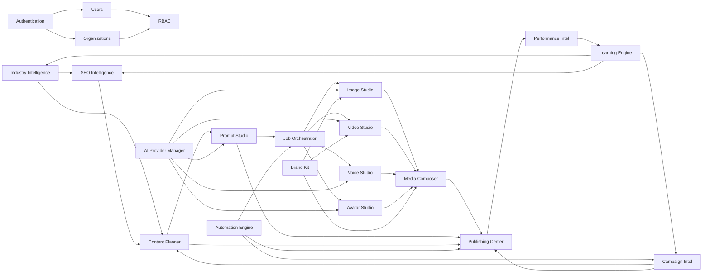

### 6.1 Dependency Rules

1. **No circular dependencies** — If A depends on B, B cannot depend on A
2. **Foundation first** — Auth → Users → Orgs → RBAC must be complete before any feature module
3. **Intelligence before Creative** — Industry and SEO intelligence must exist before content generation
4. **Creative before Publishing** — Content must be created before it can be published
5. **Publishing before Analytics** — Content must be published before performance can be measured

---

## 7. Data Flow Architecture

### 7.1 Request Flow (Synchronous)

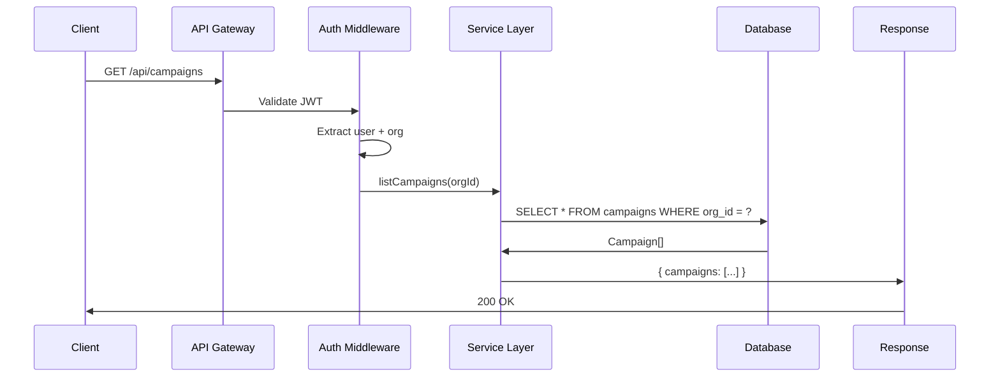

### 7.2 Job Flow (Asynchronous)

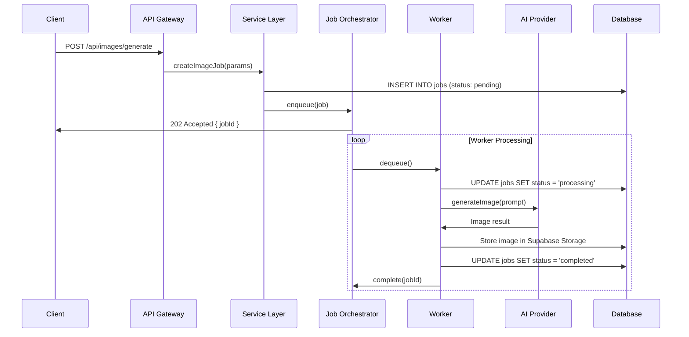

### 7.3 Event Flow (Cross-Module)

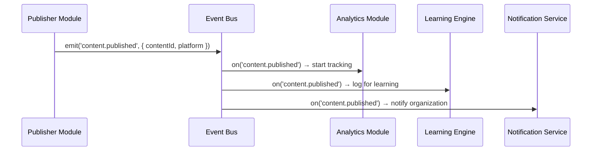

---

## 8. Service Layer Architecture

### 8.1 Service Layer Pattern

Every module follows this exact structure:

```
src/
  modules/
    [module-name]/
      ├── service.ts          # Service layer (business logic)
      ├── repository.ts       # Data access (Prisma queries)
      ├── types.ts            # TypeScript types
      ├── validation.ts       # Zod schemas
      ├── events.ts           # Event emitters/handlers
      ├── errors.ts           # Custom error classes
      └── index.ts            # Public API exports
```

### 8.2 Service Interface

Every service must implement:

```typescript
interface ModuleService {
  // CRUD operations
  list(organizationId: string, filters?: FilterParams): Promise<PaginatedResult>
  getById(organizationId: string, id: string): Promise<Entity | null>
  create(organizationId: string, data: CreateInput): Promise<Entity>
  update(organizationId: string, id: string, data: UpdateInput): Promise<Entity>
  delete(organizationId: string, id: string): Promise<void>

  // Business operations (module-specific)
  // ...

  // Event handlers
  onEvent?(event: DomainEvent): Promise<void>
}
```

### 8.3 Service Rules

1. **Services never import from other modules' repositories** — Use the other module's service
2. **Services never call AI providers directly** — Use the AI Provider Gateway
3. **Services never do async work directly** — Submit to Job Orchestrator
4. **Services validate all input** — Zod schemas before any database operation
5. **Services emit events** — For cross-module communication
6. **Services are idempotent** — Same input produces same output, no side effects on retry

---

## 9. API Gateway Architecture

### 9.1 Gateway Responsibilities

```
Request → [CORS] → [Body Parse] → [JWT Validate] → [Org Extract] → [Rate Limit] → [Route] → [Response]
```

### 9.2 Middleware Stack

| Order | Middleware | Purpose |
|---|---|---|
| 1 | CORS | Cross-origin request handling |
| 2 | Body Parser | JSON/form data parsing |
| 3 | Request ID | Unique request tracking |
| 4 | Logger | Request/response logging |
| 5 | JWT Validate | Token verification |
| 6 | Org Extract | Organization context injection |
| 7 | Rate Limiter | Per-org request throttling |
| 8 | Validator | Input schema validation |
| 9 | Route Handler | Business logic |
| 10 | Error Handler | Error normalization |

### 9.3 API Response Format

Every API response follows this contract:

```typescript
// Success
{
  "ok": true,
  "data": { ... },           // Single object or paginated list
  "meta": {                   // Optional metadata
    "page": 1,
    "pageSize": 20,
    "total": 150,
    "totalPages": 8
  }
}

// Error
{
  "ok": false,
  "error": {
    "code": "VALIDATION_ERROR",
    "message": "Email is required",
    "details": {
      "field": "email",
      "constraint": "required"
    }
  }
}
```

### 9.4 API Versioning

- Current version: `v1`
- All endpoints: `/api/v1/...`
- Breaking changes require a new version
- Old versions supported for 6 months after deprecation

### 9.5 Rate Limits

| Tier | Requests/min | Burst |
|---|---|---|
| Free | 60 | 10 |
| Starter | 300 | 50 |
| Professional | 1,000 | 200 |
| Enterprise | 10,000 | 2,000 |

---

## 10. Authentication Flow

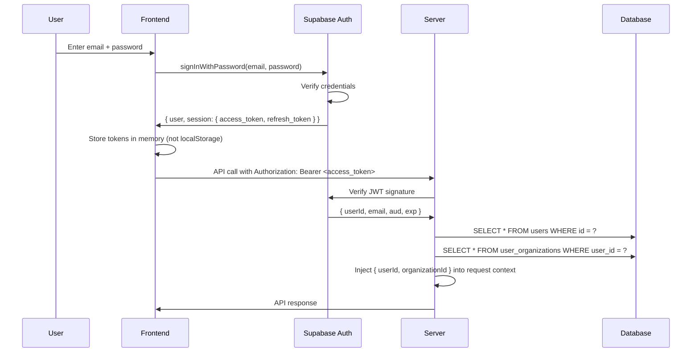

### 10.1 Token Management

| Token | Storage | Lifetime | Refresh |
|---|---|---|---|
| Access Token | Memory (JS variable) | 1 hour | Auto-refresh |
| Refresh Token | HttpOnly Cookie | 30 days | Auto-rotate |
| Session | Server-side | Until revoked | N/A |

### 10.2 Auth Providers

| Provider | Status | Use Case |
|---|---|---|
| Email/Password | ✅ Active | Primary auth |
| Google OAuth | 📋 Planned | Social login |
| Microsoft OAuth | 📋 Planned | Enterprise SSO |
| SAML | 📋 Planned | Enterprise SSO |

---

## 11. Organization Isolation

### 11.1 Multi-Tenancy Model

```
Organization (Tenant)
  ├── Users (via user_organizations)
  ├── Teams (via teams)
  ├── Roles (via roles)
  ├── Data (via org_id on all tables)
  └── Storage (via org_id prefix)
```

### 11.2 Organization Context Flow

1. **Authentication** → User identified via JWT
2. **Org Resolution** → User's organization(s) looked up
3. **Org Selection** → Active organization set (user can belong to multiple)
4. **Request Scoping** → `organizationId` injected into all queries
5. **RLS Enforcement** → Database-level isolation

### 11.3 Cross-Organization Data

Some data is intentionally shared:

| Data | Scope | Purpose |
|---|---|---|
| Industry Intelligence | Global | Shared knowledge base |
| Category Taxonomy | Global | Standardized categories |
| AI Provider Config | Global | System-wide providers |
| System Settings | Global | Platform configuration |
| Audit Logs | Global | Compliance trail |

---

## 12. Row Level Security

### 12.1 RLS Strategy

Every table with `organization_id` has an RLS policy:

```sql
-- Enable RLS
ALTER TABLE campaigns ENABLE ROW LEVEL SECURITY;

-- Organization isolation policy
CREATE POLICY org_isolation ON campaigns
  FOR ALL
  USING (organization_id = current_setting('app.current_organization_id')::text)
  WITH CHECK (organization_id = current_setting('app.current_organization_id')::text);

-- Admin bypass (service role)
CREATE POLICY admin_access ON campaigns
  FOR ALL
  USING (current_setting('app.is_admin', true)::boolean = true);
```

### 12.2 RLS Testing

Every RLS policy must have a test proving:

1. User in Org A CAN see Org A's data
2. User in Org A CANNOT see Org B's data
3. User in Org A CANNOT modify Org B's data
4. Service role CAN bypass RLS (for admin operations)
5. Unauthenticated users CANNOT access any data

---

## 13. AI Provider Architecture

### 13.1 Provider Gateway

All AI calls go through the AI Provider Gateway:

```
Module Service → AI Provider Gateway → Provider Router → Specific Provider
```

### 13.2 Provider Registry

| Provider | Models | Cost Tracking | Failover |
|---|---|---|---|
| OpenAI | GPT-4o, GPT-4o-mini, DALL-E 3, Whisper | ✅ Per-token | ✅ → Anthropic |
| Anthropic | Claude 3.5 Sonnet, Claude 3 Haiku | ✅ Per-token | ✅ → OpenAI |
| Google | Gemini 1.5 Pro, Gemini 1.5 Flash | ✅ Per-token | ✅ → Anthropic |
| ElevenLabs | Turbo v2, Multilingual v2 | ✅ Per-character | ✅ → OpenAI TTS |
| Stability AI | SDXL, Stable Video Diffusion | ✅ Per-image | ✅ → DALL-E 3 |
| RunwayML | Gen-3 Alpha, Gen-3 Alpha Turbo | ✅ Per-second | ✅ → Stability |
| Replicate | FLUX, various open-source | ✅ Per-second | ✅ → OpenAI |

### 13.3 Provider Selection Logic

```typescript
function selectProvider(task: AITask): Provider {
  // 1. Check org's provider preferences
  const orgPrefs = await getOrgProviderPrefs(task.organizationId)
  if (orgPrefs.preferred[task.type]) return orgPrefs.preferred[task.type]

  // 2. Check cost optimization
  if (task.priority === 'low') return getCheapestProvider(task.type)
  
  // 3. Check availability
  if (!primaryProvider.isAvailable()) return failoverProvider(task.type)
  
  // 4. Default
  return defaultProvider[task.type]
}
```

### 13.4 Cost Tracking

Every AI call is tracked:

```typescript
interface AICostRecord {
  id: string
  organizationId: string
  provider: string
  model: string
  taskType: string        // 'text' | 'image' | 'video' | 'voice'
  inputTokens: number
  outputTokens: number
  costUsd: number
  latencyMs: number
  createdAt: Date
}
```

---

## 14. Prompt Pipeline

```mermaid
graph LR
    A["Content Request"] --> B["Prompt Studio"]
    B --> C["Template Selection"]
    C --> D["Variable Injection"]
    D --> E["Industry Context"]
    E --> F["SEO Context"]
    F --> G["Brand Context"]
    G --> H["Final Prompt"]
    H --> I["AI Provider"]
    I --> J["Response"]
    J --> K["Quality Check"]
    K --> L["Storage"]
```

### 14.1 Prompt Composition

Every prompt is composed from:

1. **Base Template** — Stored in Prompt Studio
2. **Industry Context** — From Industry Intelligence
3. **SEO Keywords** — From SEO Intelligence
4. **Brand Guidelines** — From Brand Kit
5. **Platform Rules** — Platform-specific formatting
6. **User Overrides** — Custom instructions

---

## 15. Content Generation Pipeline

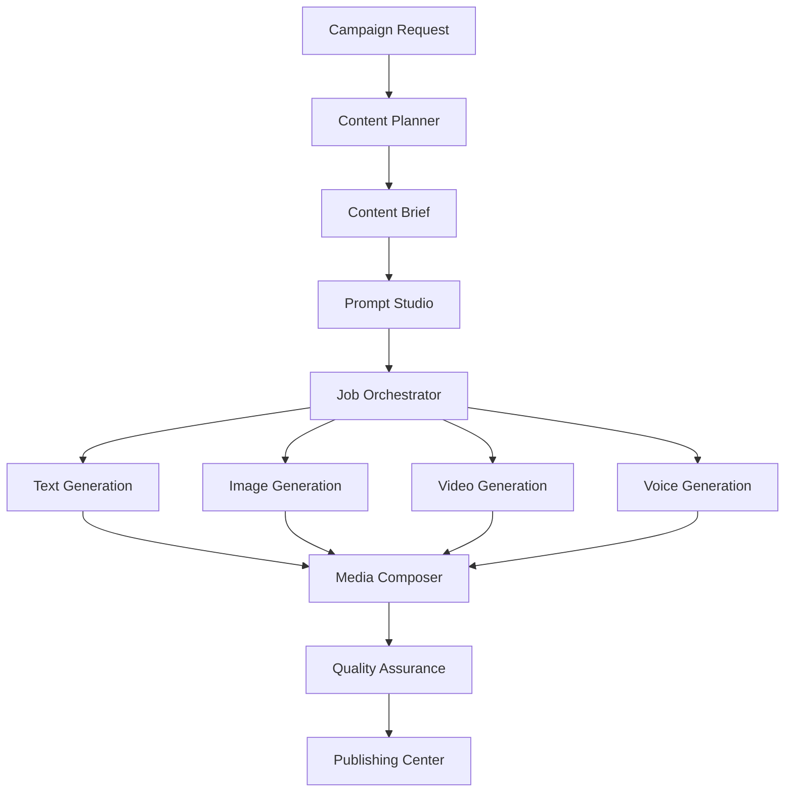

### 15.1 Content Types

| Type | AI Provider | Output | Platforms |
|---|---|---|---|
| LinkedIn Post | GPT-4o | Text + Image | LinkedIn |
| X Thread | GPT-4o | Thread + Media | X/Twitter |
| Blog Post | Claude 3.5 | Long-form HTML | WordPress, Medium |
| YouTube Script | GPT-4o | Script + Storyboard | YouTube |
| Email Campaign | GPT-4o | HTML Email | Email |
| WhatsApp Message | GPT-4o | Text + Image | WhatsApp |
| Product Page | Claude 3.5 | HTML | VyaparSethu |

---

## 16. Image Pipeline

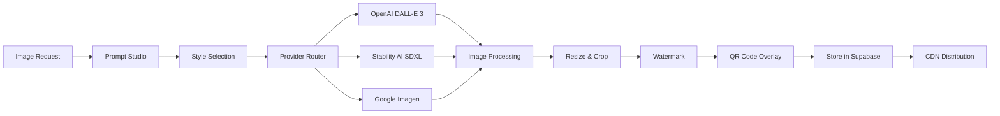

### 16.1 Image Specifications

| Platform | Aspect Ratio | Resolution | Format |
|---|---|---|---|
| LinkedIn | 1200×627 | High | WebP/JPG |
| Instagram Post | 1080×1080 | High | JPG |
| Instagram Story | 1080×1920 | High | JPG |
| Facebook | 1200×630 | High | JPG |
| X/Twitter | 1600×900 | High | JPG/PNG |
| YouTube Thumbnail | 1280×720 | High | JPG |
| Email Header | 600×200 | Medium | JPG |

---

## 17. Video Pipeline

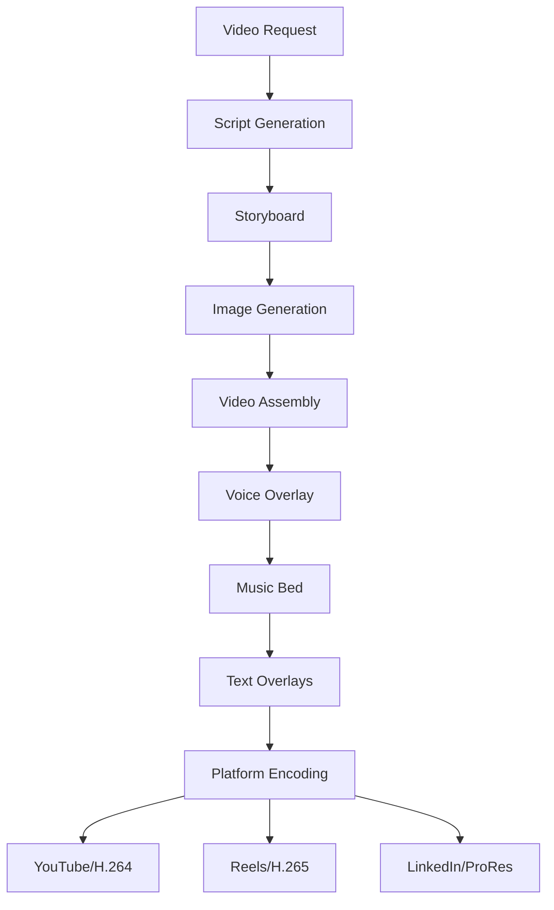

### 17.1 Video Specifications

| Platform | Duration | Aspect Ratio | Resolution | Max Size |
|---|---|---|---|---|
| YouTube Shorts | 15–60s | 9:16 | 1080×1920 | 256MB |
| Instagram Reels | 15–90s | 9:16 | 1080×1920 | 256MB |
| LinkedIn Video | 30–120s | 16:9 | 1920×1080 | 256MB |
| Facebook Video | 30–180s | 16:9 | 1920×1080 | 256MB |
| X/Twitter Video | 15–140s | 16:9 | 1920×1080 | 512MB |

---

## 18. Voice Pipeline

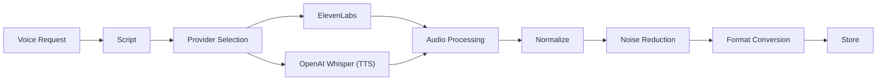

### 18.1 Voice Specifications

| Output | Provider | Quality | Format |
|---|---|---|---|
| Video Voiceover | ElevenLabs Turbo | 44.1kHz | WAV/MP3 |
| Podcast Intro | ElevenLabs Multilingual | 44.1kHz | WAV |
| Ad Voiceover | ElevenLabs Turbo | 44.1kHz | MP3 |
| Phone System | OpenAI TTS | 22kHz | WAV |

---

## 19. Avatar Pipeline

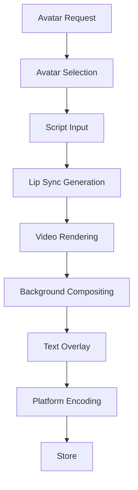

### 19.1 Avatar Types

| Type | Use Case | Quality | Duration |
|---|---|---|---|
| Static Avatar | Profile image | High | N/A |
| Animated Avatar | Social media | Medium | 15–60s |
| Speaking Avatar | Video content | High | 30–300s |
| Live Avatar | Webinar (planned) | High | Unlimited |

---

## 20. Publishing Pipeline

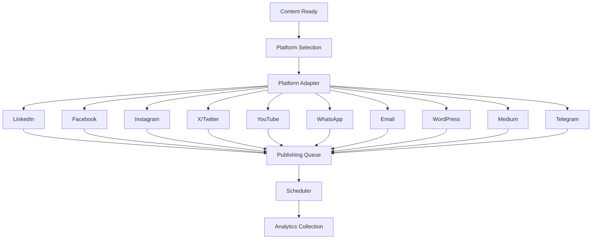

### 20.1 Platform Adapters

| Platform | API | Auth | Status |
|---|---|---|---|
| LinkedIn | LinkedIn Marketing API | OAuth 2.0 | ✅ Ready |
| Facebook | Meta Graph API | OAuth 2.0 | ✅ Ready |
| Instagram | Meta Graph API | OAuth 2.0 | ✅ Ready |
| X/Twitter | Twitter API v2 | OAuth 2.0 | ✅ Ready |
| YouTube | YouTube Data API v3 | OAuth 2.0 | ✅ Ready |
| WhatsApp | WhatsApp Business API | API Key | ✅ Ready |
| Email | SMTP / SendGrid | API Key | ✅ Ready |
| WordPress | WordPress REST API | Application Password | ✅ Ready |
| Medium | Medium API | API Key | ✅ Ready |
| Telegram | Telegram Bot API | Bot Token | ✅ Ready |

---

## 21. Automation Pipeline

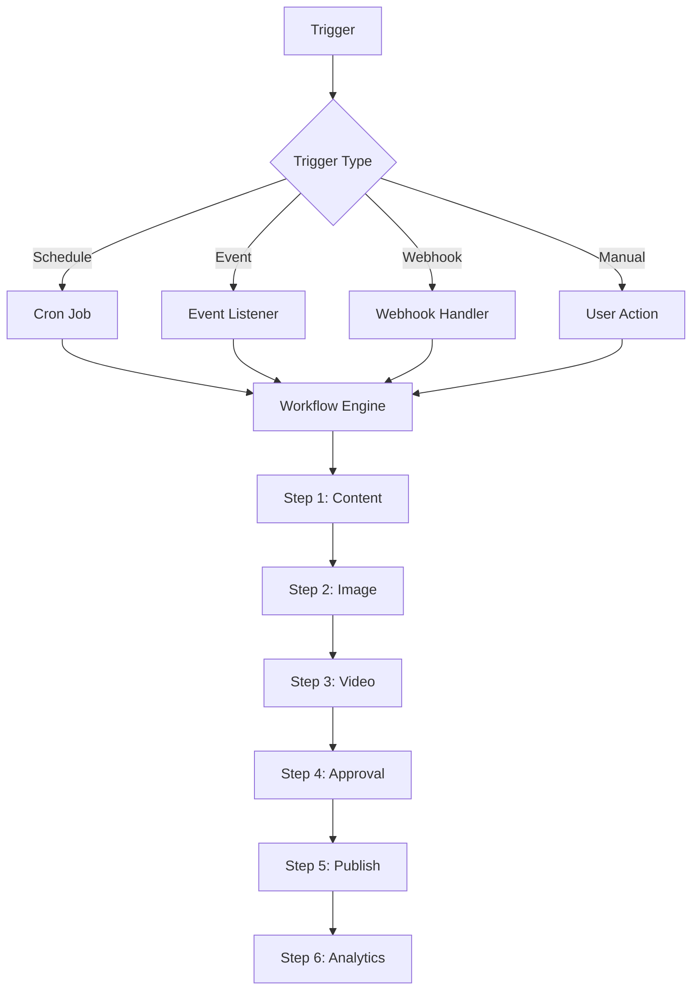

### 21.1 Automation Types

| Type | Trigger | Example |
|---|---|---|
| Scheduled | Cron expression | "Publish daily at 9 AM" |
| Event-driven | Module event | "When campaign created, generate content" |
| Webhook | External HTTP | "When form submitted, create lead" |
| Conditional | Data threshold | "When CTR drops below 2%, regenerate" |

---

## 22. Learning Pipeline

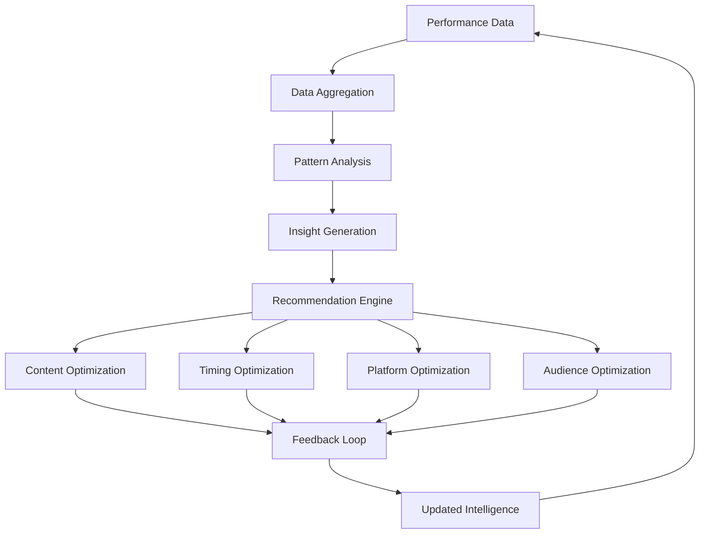

### 22.1 Learning Signals

| Signal | Source | Weight |
|---|---|---|
| Click-through rate | Platform analytics | High |
| Engagement rate | Platform analytics | High |
| Conversion rate | Business analytics | Critical |
| Watch time | Video platforms | Medium |
| Shares | Social platforms | High |
| Comments | Social platforms | Medium |
| Saves/Bookmarks | Social platforms | High |
| Time on page | Website analytics | Medium |

---

## 23. Campaign Pipeline

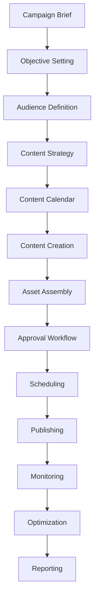

### 23.1 Campaign Lifecycle States

```
draft → planning → content_creation → review → approved → scheduled → publishing → live → completed → archived
```

---

## 24. Performance Pipeline

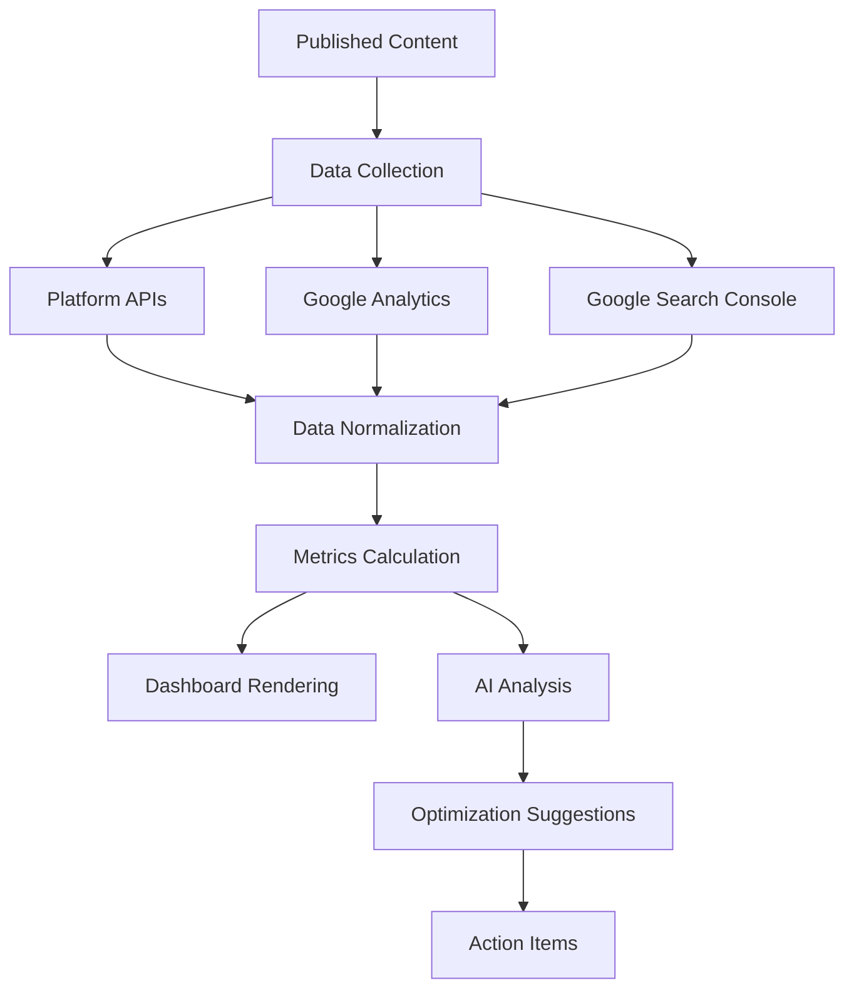

### 24.1 Metrics Tracked

| Category | Metrics |
|---|---|
| Reach | Impressions, Reach, Frequency |
| Engagement | Likes, Comments, Shares, Saves |
| Traffic | Clicks, CTR, Bounce Rate, Time on Page |
| Conversion | Leads, Sales, Sign-ups, Downloads |
| Revenue | Revenue, ROI, CPA, ROAS |
| Video | Views, Watch Time, Retention, Completion Rate |

---

## 25. Industry Intelligence Architecture

### 25.1 Data Model

```
Industry Intelligence
  ├── Industry (50+)
  │   ├── Category (450+)
  │   │   ├── Subcategory (4,500+)
  │   │   │   ├── Product Family (45,000+)
  │   │   │   │   ├── Product (450,000+)
  │   │   │   │   ├── Buyer Persona
  │   │   │   │   ├── Supplier Persona
  │   │   │   │   └── Keyword Cluster
  │   │   │   └── Applications
  │   │   └── Pain Points
  │   ├── Marketing Styles
  │   ├── Image Styles
  │   └── Video Styles
  ├── Geography
  │   ├── Country
  │   ├── State/Region
  │   └── City
  └── Language
      └── Localization Rules
```

### 25.2 Industry Coverage

| Industry | Categories | Products | Priority |
|---|---|---|---|
| Manufacturing | 85 | 12,000+ | Critical |
| Textiles | 45 | 8,000+ | Critical |
| Chemicals | 60 | 15,000+ | High |
| Electronics | 50 | 10,000+ | High |
| Pharmaceuticals | 40 | 6,000+ | High |
| Auto Components | 35 | 5,000+ | High |
| Agriculture | 55 | 9,000+ | Medium |
| Construction | 40 | 7,000+ | Medium |

---

## 26. SEO Intelligence Architecture

### 26.1 SEO Data Flow

```
Keyword Research → Clustering → Intent Classification → Content Mapping → Monitoring
```

### 26.2 Keyword Intelligence

| Data Point | Source | Update Frequency |
|---|---|---|
| Search Volume | Google Ads API | Monthly |
| Keyword Difficulty | Ahrefs/SEMrush | Monthly |
| SERP Features | Google Search API | Weekly |
| Competitor Rankings | Ahrefs/SEMrush | Weekly |
| Content Gaps | Internal analysis | Monthly |
| Trend Data | Google Trends | Daily |

### 26.3 Topical Authority Model

Each industry has a topical authority tree:

```
Industry Topic (pillar)
  ├── Subtopic 1 (cluster)
  │   ├── Long-tail keyword 1
  │   ├── Long-tail keyword 2
  │   └── Long-tail keyword 3
  ├── Subtopic 2 (cluster)
  └── Subtopic 3 (cluster)
```

---

## 27. Enterprise Search Architecture

### 27.1 Search Scope

| Data | Search Method | Index |
|---|---|---|
| Products | Full-text + FTS5 | PostgreSQL |
| Content | Full-text | PostgreSQL |
| Campaigns | Metadata search | PostgreSQL |
| Assets | Filename + tags | PostgreSQL |
| Analytics | Date + metric filters | PostgreSQL |

### 27.2 Search Architecture

```
User Query → Query Parser → Multi-Index Search → Ranking → Results
```

---

## 28. Global Job Orchestrator

### 28.1 Job Types

| Job Type | Priority | Timeout | Retries | Worker |
|---|---|---|---|---|
| Image Generation | Normal | 5 min | 3 | Image Worker |
| Video Generation | Normal | 30 min | 3 | Video Worker |
| Voice Generation | Normal | 5 min | 3 | Voice Worker |
| Content Publishing | High | 10 min | 5 | Publishing Worker |
| Analytics Fetch | Low | 15 min | 3 | Analytics Worker |
| Email Send | High | 2 min | 5 | Email Worker |
| Report Generation | Low | 30 min | 2 | Report Worker |

### 28.2 Job States

```
pending → queued → processing → completed
                      ↓
                   failed → retrying → processing
                      ↓
                   dead_letter
```

### 28.3 Job Priority Levels

| Level | Value | Use Case |
|---|---|---|
| Critical | 0 | Auth, security |
| High | 1 | Publishing, email |
| Normal | 2 | Content generation |
| Low | 3 | Analytics, reports |
| Background | 4 | Maintenance, cleanup |

---

## 29. Event Bus Architecture

### 29.1 Event Types

| Event | Emitter | Consumers |
|---|---|---|
| `user.created` | Auth Service | Analytics, Notification |
| `org.created` | Org Service | Analytics |
| `campaign.created` | Campaign Service | Content Planner |
| `content.generated` | Creative Service | QA, Publishing |
| `content.published` | Publishing Service | Analytics, Learning |
| `analytics.updated` | Analytics Service | Learning, Dashboard |
| `job.completed` | Job Orchestrator | Emitting Module |
| `job.failed` | Job Orchestrator | Error Handler, Alert |

### 29.2 Event Contract

```typescript
interface DomainEvent {
  id: string
  type: string
  aggregateId: string
  organizationId: string
  payload: Record<string, unknown>
  metadata: {
    userId?: string
    jobId?: string
    source: string
  }
  timestamp: Date
  version: number
}
```

---

## 30. Queue Processing

### 30.1 Queue Architecture

```
┌─────────────┐     ┌──────────────┐     ┌─────────────┐
│  Producers   │────▶│   Redis Queue │────▶│  Consumers   │
│  (Services)  │     │  (BullMQ)    │     │  (Workers)   │
└─────────────┘     └──────────────┘     └─────────────┘
```

### 30.2 Queue Names

| Queue | Purpose | Concurrency |
|---|---|---|
| `critical` | Auth, security | 10 |
| `high` | Publishing, email | 5 |
| `normal` | Content generation | 3 |
| `low` | Analytics, reports | 2 |
| `ai-tasks` | AI provider calls | 5 |

---

## 31. Worker Architecture

### 31.1 Worker Types

| Worker | Responsibility | Instances |
|---|---|---|
| Image Worker | Generate images via AI | 3 |
| Video Worker | Generate videos via AI | 2 |
| Voice Worker | Generate voiceovers | 2 |
| Publishing Worker | Post to platforms | 3 |
| Analytics Worker | Fetch platform data | 2 |
| Email Worker | Send emails | 2 |
| Report Worker | Generate reports | 1 |
| Maintenance Worker | Cleanup, optimization | 1 |

### 31.2 Worker Lifecycle

```
Start → Poll Queue → Acquire Job → Process → Store Result → Complete Job → Poll Queue
```

---

## 32. Scheduler

### 32.1 Scheduled Tasks

| Task | Schedule | Purpose |
|---|---|---|
| Analytics Collection | Every 4 hours | Fetch platform metrics |
| Report Generation | Daily at 6 AM | Generate daily reports |
| Queue Cleanup | Daily at 2 AM | Remove completed jobs |
| Cache Refresh | Every 30 minutes | Refresh cached data |
| Health Check | Every 5 minutes | System health monitoring |
| Cost Report | Weekly (Sunday) | AI cost aggregation |

---

## 33. Storage Architecture

### 33.1 Storage Buckets

| Bucket | Purpose | Access |
|---|---|---|
| `images` | Generated images | Public read, org-scoped write |
| `videos` | Generated videos | Public read, org-scoped write |
| `audio` | Voice/audio files | Public read, org-scoped write |
| `documents` | PDFs, brochures | Auth read, org-scoped write |
| `avatars` | Avatar models | Public read, org-scoped write |
| `thumbnails` | Generated thumbnails | Public read, org-scoped write |
| `exports` | Exported reports | Auth read, org-scoped write |
| `temp` | Temporary uploads | Auto-delete after 24h |

### 33.2 File Naming Convention

```
/{organization_id}/{module}/{year}/{month}/{day}/{uuid}.{ext}
```

Example:
```
/org_abc123/images/2026/07/14/a1b2c3d4.webp
```

---

## 34. Database Layer

### 34.1 Schema Organization

```sql
-- Core schemas
CREATE SCHEMA auth;          -- Authentication tables
CREATE SCHEMA core;          -- Organizations, Users, Teams
CREATE SCHEMA intelligence;  -- Industry, SEO, Campaign intel
CREATE SCHEMA creative;      -- Images, Videos, Voice, Avatars
CREATE SCHEMA publishing;    -- Publishing, Scheduling
CREATE SCHEMA analytics;     -- Performance, Metrics
CREATE SCHEMA automation;    -- Workflows, Rules
CREATE SCHEMA ai;            -- Prompts, Provider config
CREATE SCHEMA audit;         -- Audit logs, Changes
CREATE SCHEMA system;        -- Settings, Config
```

### 34.2 Connection Pooling

| Setting | Value | Purpose |
|---|---|---|
| Pool Size | 20 connections | Standard load |
| Max Overflow | 10 connections | Peak load |
| Connection Timeout | 30 seconds | Fail fast |
| Idle Timeout | 5 minutes | Release resources |

---

## 35. Caching Layer

### 35.1 Cache Strategy

| Data | Cache TTL | Invalidation |
|---|---|---|
| User profile | 5 minutes | On update |
| Organization config | 10 minutes | On update |
| Industry data | 24 hours | On data refresh |
| SEO keywords | 6 hours | On data refresh |
| Dashboard stats | 1 hour | On analytics update |
| API responses | 5 minutes | On data mutation |

### 35.2 Cache Keys

```
user:{userId}:profile
org:{orgId}:config
org:{orgId}:stats
industry:{industryId}:data
seo:keywords:{clusterId}
campaign:{campaignId}:metrics
```

---

## 36. AI Agent Communication

### 36.1 Agent Communication Protocol

```typescript
interface AgentMessage {
  id: string
  from: string              // Agent ID
  to: string                // Agent ID or 'broadcast'
  type: 'request' | 'response' | 'notification' | 'escalation'
  payload: {
    action: string
    data: unknown
    context: {
      organizationId: string
      campaignId?: string
      jobId?: string
    }
  }
  priority: 'low' | 'normal' | 'high' | 'critical'
  timestamp: Date
}
```

### 36.2 Agent Tiers

| Tier | Agents | Communication |
|---|---|---|
| Executive | CEO, CTO, CMO | Direct to all |
| Intelligence | Industry, SEO, Campaign, Procurement | Via service layer |
| Creative | Prompt, Content, Image, Video, Voice, Avatar | Via job orchestrator |
| Operations | Publishing, Analytics, Learning, Workflow, QA, Compliance | Via event bus |

---

## 37. Logging Architecture

### 37.1 Log Levels

| Level | Use Case | Retention |
|---|---|---|
| ERROR | System errors, exceptions | 90 days |
| WARN | Degraded performance, retries | 30 days |
| INFO | Request/response, job lifecycle | 7 days |
| DEBUG | Detailed tracing (dev only) | 1 day |

### 37.2 Log Format

```json
{
  "timestamp": "2026-07-14T12:00:00.000Z",
  "level": "INFO",
  "service": "campaign-service",
  "message": "Campaign created",
  "context": {
    "organizationId": "org_abc123",
    "userId": "user_xyz",
    "campaignId": "camp_123",
    "requestId": "req_456"
  },
  "duration": 150
}
```

---

## 38. Monitoring Architecture

### 38.1 Key Metrics

| Category | Metrics | Alert Threshold |
|---|---|---|
| API | Response time, error rate, throughput | p95 > 500ms, error > 1% |
| Database | Connection pool, query time, locks | pool > 80%, query > 1s |
| Jobs | Queue depth, processing time, failure rate | depth > 100, failure > 5% |
| AI Providers | Latency, error rate, cost/hour | latency > 10s, error > 10% |
| Storage | Usage, bandwidth, errors | usage > 80% |

### 38.2 Alert Channels

| Severity | Channel | Response Time |
|---|---|---|
| Critical | Slack + PagerDuty | Immediate |
| High | Slack | < 1 hour |
| Medium | Email | < 4 hours |
| Low | Dashboard | < 24 hours |

---

## 39. Error Recovery

### 39.1 Error Classification

| Type | Example | Recovery |
|---|---|---|
| Transient | Network timeout | Auto-retry (3x) |
| Rate limit | Provider 429 | Exponential backoff |
| Auth failure | Invalid token | Re-authenticate |
| Data conflict | Duplicate key | Conflict resolution |
| Provider down | 503 from AI provider | Failover to alternative |
| Logic error | Business rule violation | Alert + manual fix |

### 39.2 Circuit Breaker

```typescript
interface CircuitBreaker {
  failureThreshold: 5     // Open after 5 failures
  resetTimeout: 30000     // Try again after 30s
  halfOpenMax: 3          // Max 3 test requests
}
```

---

## 40. Disaster Recovery

### 40.1 Backup Strategy

| Data | Backup Frequency | Retention | Method |
|---|---|---|---|
| Database | Daily | 30 days | pg_dump + S3 |
| Database WAL | Continuous | 7 days | WAL archiving |
| Storage files | Daily | 30 days | Supabase backup |
| Config | On change | 90 days | Git |
| Audit logs | Daily | 365 days | S3 |

### 40.2 Recovery Targets

| Metric | Target |
|---|---|
| RPO (Recovery Point Objective) | 1 hour |
| RTO (Recovery Time Objective) | 4 hours |
| Backup verification | Weekly automated test |

---

## 41. Scalability Strategy

### 41.1 Horizontal Scaling

| Component | Scaling Method | Trigger |
|---|---|---|
| API servers | Auto-scale (Vercel) | CPU > 70% |
| Workers | Auto-scale (Railway) | Queue depth > 50 |
| Database | Read replicas | Read latency > 200ms |
| Storage | CDN cache | Bandwidth > threshold |

### 41.2 Vertical Scaling

| Component | Current | Scale To |
|---|---|---|
| Database | 1 vCPU, 1GB | 4 vCPU, 16GB |
| Workers | 1 vCPU, 512MB | 2 vCPU, 4GB |

### 41.3 Database Partitioning

| Table | Partition Key | Strategy |
|---|---|---|
| `analytics_events` | `created_at` | Monthly |
| `audit_logs` | `created_at` | Monthly |
| `job_history` | `created_at` | Weekly |
| `cost_records` | `created_at` | Monthly |

---

## 42. Multi-Tenant Strategy

### 42.1 Tenant Isolation Levels

| Level | Method | Use Case |
|---|---|---|
| Database | RLS policies | All business data |
| Storage | Path prefix (`org_id/`) | File storage |
| Cache | Key prefix (`org:`) | Cached data |
| Queue | Job metadata | Async jobs |

### 42.2 Tenant Context Propagation

```
JWT → API Gateway → Middleware → Service → Repository → Database (via RLS)
                                    ↓
                              Event Bus (org-scoped)
                                    ↓
                              Job Orchestrator (org-scoped)
```

---

## 43. Security Architecture

### 43.1 Security Layers

```
┌─────────────────────────────────────────┐
│ Layer 1: Edge Security                   │
│ DDoS protection, WAF, Rate limiting     │
├─────────────────────────────────────────┤
│ Layer 2: Transport Security             │
│ TLS 1.3, HSTS, Certificate pinning     │
├─────────────────────────────────────────┤
│ Layer 3: Authentication                 │
│ JWT, OAuth 2.0, MFA (planned)           │
├─────────────────────────────────────────┤
│ Layer 4: Authorization                  │
│ RBAC, Organization isolation, RLS       │
├─────────────────────────────────────────┤
│ Layer 5: Data Security                  │
│ Encryption at rest, Field encryption    │
├─────────────────────────────────────────┤
│ Layer 6: Audit                          │
│ Every mutation logged, Tamper-proof logs │
└─────────────────────────────────────────┘
```

### 43.2 API Security

| Control | Implementation |
|---|---|
| CORS | Whitelist origins |
| CSRF | SameSite cookies + CSRF tokens |
| XSS | React auto-escaping + CSP headers |
| SQL Injection | Prisma parameterized queries |
| Rate Limiting | Per-org, per-endpoint |
| Input Validation | Zod schemas |
| Output Sanitization | Response filtering |

---

## 44. Deployment Architecture

### 44.1 Environments

| Environment | Purpose | URL |
|---|---|---|
| Development | Local development | `localhost:3000` |
| Preview | PR preview | `*.shogo.ai` |
| Staging | Pre-production | `staging.vyaparsethu.com` |
| Production | Live | `vyaparsethu.com` |

### 44.2 Deployment Pipeline

```
Code Push → GitHub → CI (Build + Test) → Preview Deploy → Merge → Staging → Production
```

### 44.3 Infrastructure

| Service | Provider | Purpose |
|---|---|---|
| Frontend | Vercel | SPA hosting |
| Backend | Vercel / Railway | API hosting |
| Database | Supabase / Neon | PostgreSQL |
| Storage | Supabase | File storage |
| Cache | Upstash (planned) | Redis cache |
| Queue | BullMQ (in-process) | Job queue |
| CDN | Vercel Edge | Static assets |
| DNS | Cloudflare | DNS management |
| Monitoring | Vercel Analytics | Performance |

---

## 45. Development Workflow

### 45.1 Branch Strategy

```
main (production)
  ├── develop (integration)
  │   ├── feature/module-name
  │   ├── fix/issue-description
  │   └── refactor/module-name
  └── release/v1.x.x
```

### 45.2 Development Process

1. Create feature branch from `develop`
2. Implement module following Volume 0 rules
3. Write tests
4. Run quality gates (Build, Lint, Type Check)
5. Create PR
6. Code review
7. Merge to `develop`
8. Preview deploy
9. Manual verification
10. Merge to `main` → Production deploy

### 45.3 Module Development Checklist

```
□ Schema designed and validated
□ Service layer implemented
□ API endpoints implemented
□ RLS policies created
□ Frontend components built
□ Tests written
□ Documentation updated
□ Quality gates passed
□ PR created and reviewed
```

---

## 46. Production Workflow

### 46.1 Deployment Checklist

```
□ All tests passing
□ Build successful
□ Type check clean
□ Database migrations applied
□ RLS policies verified
□ Monitoring configured
□ Alerts configured
□ Rollback plan documented
□ Changelog updated
```

### 46.2 Post-Deployment Verification

1. Health check endpoint returns 200
2. Critical user flows work
3. No increase in error rate
4. No increase in response time
5. Database connections stable

---

## 47. CI/CD Pipeline

### 47.1 Pipeline Stages

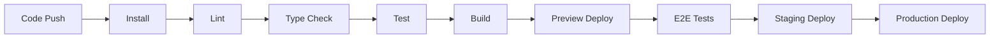

### 47.2 Pipeline Gates

| Stage | Tool | Pass Criteria |
|---|---|---|
| Install | bun | Zero errors |
| Lint | ESLint | Zero warnings |
| Type Check | tsc --noEmit | Zero errors |
| Test | Vitest | All pass |
| Build | Vite | Zero errors |
| Preview | Vercel | Deployed |
| E2E | Playwright | All pass |
| Staging | Vercel | Deployed + verified |
| Production | Vercel | Deployed + verified |

---

## 48. Runtime Certification

### 48.1 Certification Checklist

Before any module is certified as production-ready:

```
□ Build passes (bun run build)
□ Type check passes (tsc --noEmit)
□ All unit tests pass
□ All integration tests pass
□ All E2E tests pass
□ RLS policies verified (automated test)
□ API endpoints return correct shapes
□ Error handling produces meaningful messages
□ Loading states work correctly
□ Empty states work correctly
□ Mobile responsive (at least functional)
□ No console.log statements
□ No TODO comments
□ No placeholder data
□ Documentation updated
□ Changelog updated
```

---

## 49. Future Expansion Strategy

### 49.1 Phase 5+ Capabilities

| Capability | Architecture Impact | Priority |
|---|---|---|
| Mobile App (React Native) | Shared API, new UI layer | Medium |
| Real-time Collaboration | WebSocket layer | Medium |
| AI Marketing Brain | New orchestration layer | High |
| Enterprise Knowledge Graph | Graph database (Neo4j) | Medium |
| B2B Marketplace | New module + escrow | High |
| Export Intelligence | New module + trade APIs | Medium |
| Manufacturing Intelligence | New module + IoT data | Low |

### 49.2 Scaling Triggers

| Trigger | Action |
|---|---|
| 1,000 concurrent users | Add read replica |
| 10,000 orgs | Evaluate partitioning |
| 100TB data | Evaluate data warehouse |
| 1M daily jobs | Evaluate distributed workers |
| Global users | Evaluate multi-region |

---

## 50. Architecture Decision Records (ADR)

### ADR-001: Monolithic-Modular over Microservices

- **Status:** Accepted
- **Context:** Startup phase, small team, rapid iteration needed
- **Decision:** Single codebase with module boundaries via service layers
- **Consequences:** Simpler deployment, easier debugging, but modules must be disciplined about boundaries

### ADR-002: PostgreSQL over MongoDB

- **Status:** Accepted
- **Context:** Complex relational data, multi-tenancy, RLS needed
- **Decision:** PostgreSQL with Supabase
- **Consequences:** Strong data integrity, RLS, but requires schema migrations

### ADR-003: Supabase over Custom Auth

- **Status:** Accepted
- **Context:** Need production-ready auth quickly
- **Decision:** Supabase Auth with JWT
- **Consequences:** Fast implementation, but vendor dependency

### ADR-004: Global Job Orchestrator over Per-Module Queues

- **Status:** Accepted
- **Context:** Multiple modules need async work, cost tracking needed
- **Decision:** Single BullMQ-based orchestrator
- **Consequences:** Centralized control, but single point of failure

### ADR-005: REST over GraphQL

- **Status:** Accepted
- **Context:** Simple CRUD operations, team familiarity
- **Decision:** REST API with well-defined contracts
- **Consequences:** Simpler implementation, but more endpoints to maintain

### ADR-006: Vercel over AWS

- **Status:** Accepted
- **Context:** Startup phase, need fast deployment
- **Decision:** Vercel for frontend + serverless, Supabase for DB
- **Consequences:** Fast deployment, limited customization, potential vendor lock-in

### ADR-007: shadcn/ui over Custom Component Library

- **Status:** Accepted
- **Context:** Need production-ready UI quickly
- **Decision:** shadcn/ui with Tailwind CSS
- **Consequences:** Fast UI development, but components are copied (not a dependency)

---

## Appendix A — Architecture Metrics

| Metric | Value |
|---|---|
| Total modules | 19 core + 6 support |
| Total database tables (planned) | 100+ |
| Total API endpoints (planned) | 200+ |
| Total AI agents | 25 |
| Total integration points | 10 platforms |
| Total quality gates | 11 |
| Total ADRs | 7 |
| Architecture document size | ~5,000+ lines |

---

## Appendix B — Glossary

| Term | Definition |
|---|---|
| **Module** | A self-contained unit of functionality |
| **Service Layer** | The business logic interface for a module |
| **Repository** | The data access layer for a module |
| **Job** | An asynchronous task managed by the orchestrator |
| **Worker** | A process that executes jobs |
| **Event** | A notification that something happened |
| **RLS** | Row Level Security — database-level tenant isolation |
| **RLS Policy** | A rule that controls which rows a user can access |
| **ADR** | Architecture Decision Record — documents a significant choice |
| **Quality Gate** | A verification step that must pass |
| **Frozen Module** | A completed module that cannot be restructured |

---

*This document is the definitive technical architecture for Bell24h-OS. All subsequent volumes reference this architecture. Changes to this document require an ADR.*
