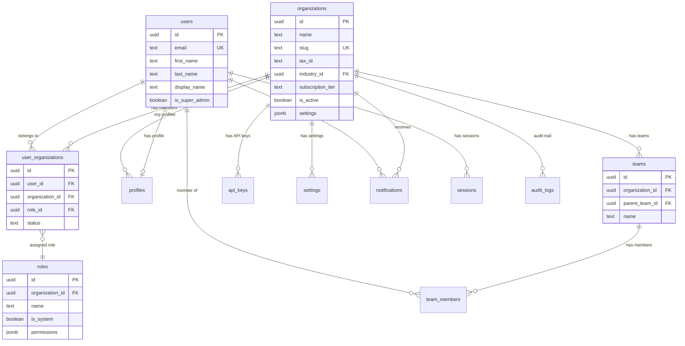
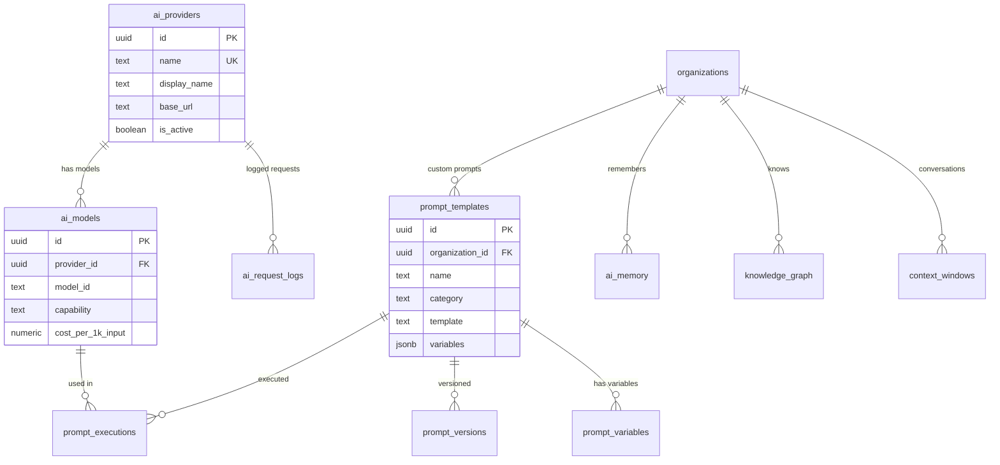
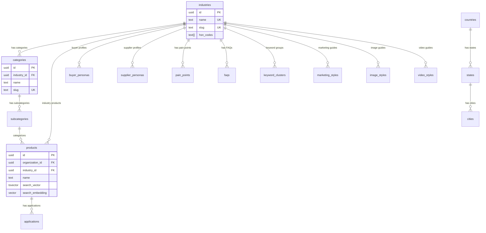
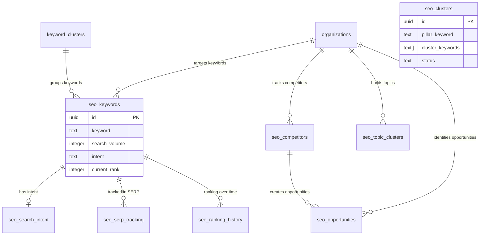
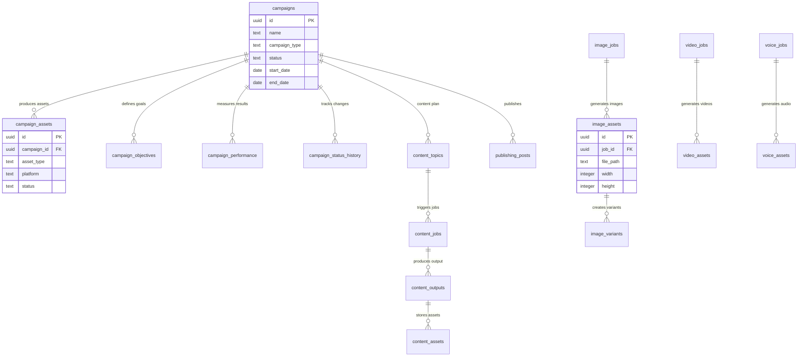
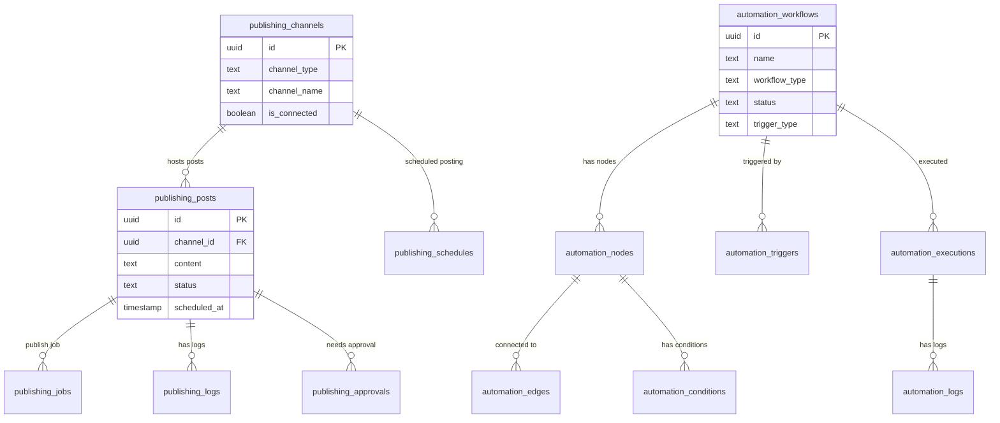
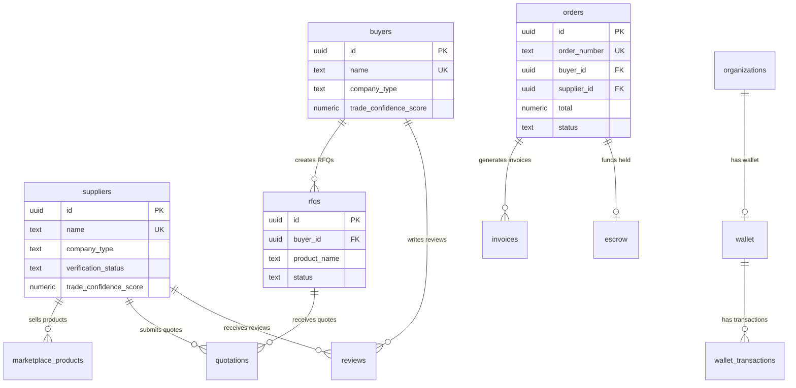
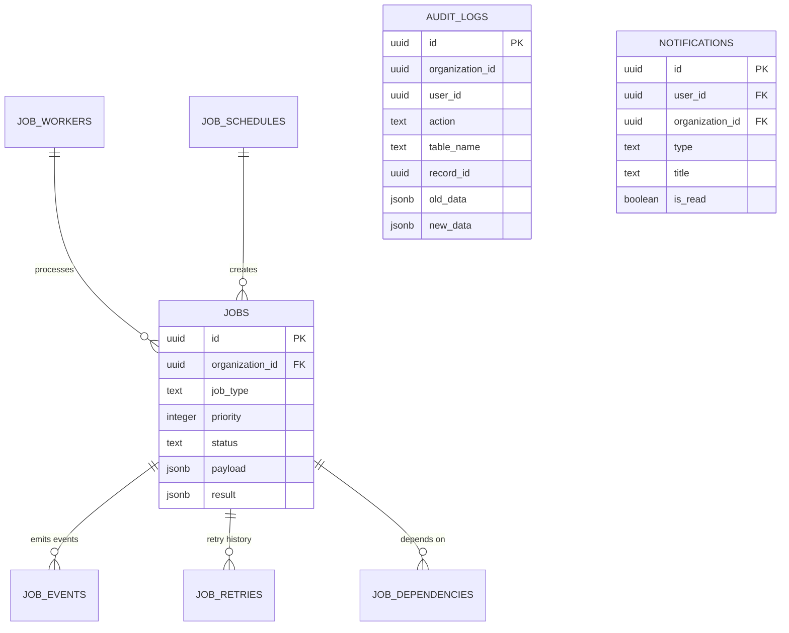

# Bell24h-OS — Volume 3: Enterprise Database Architecture

> **Classification:** Internal — Master Reference  
> **Version:** 1.0  
> **Date:** 2026-07-14  
> **Authority:** This is the canonical database blueprint. Every migration must conform to this document.  
> **Prerequisite:** Volume 0 (Constitution), Volume 2 (System Architecture) must be read first.

---

## Table of Contents

- [Part I: Database Design Principles](#part-i-database-design-principles)
  - [1. Multi-Tenancy](#1-multi-tenancy)
  - [2. Organization Isolation](#2-organization-isolation)
  - [3. Row Level Security](#3-row-level-security)
  - [4. Soft Delete](#4-soft-delete)
  - [5. Audit Logging](#5-audit-logging)
  - [6. Versioning & Immutable History](#6-versioning--immutable-history)
  - [7. Normalization Strategy](#7-normalization-strategy)
  - [8. Performance Principles](#8-performance-principles)
  - [9. Horizontal Scaling](#9-horizontal-scaling)
  - [10. Partitioning Strategy](#10-partitioning-strategy)
  - [11. Vector Search](#11-vector-search)
  - [12. Caching Strategy](#12-caching-strategy)
- [Part II: SQL Standards](#part-ii-sql-standards)
  - [13. Naming Conventions](#13-naming-conventions)
  - [14. Index Standards](#14-index-standards)
  - [15. UUID Strategy](#15-uuid-strategy)
  - [16. Timestamp Standards](#16-timestamp-standards)
  - [17. Audit Fields](#17-audit-fields)
  - [18. Soft Delete Standards](#18-soft-delete-standards)
  - [19. Versioning Standards](#19-versioning-standards)
  - [20. Trigger Standards](#20-trigger-standards)
- [Part III: Identity Platform](#part-iii-identity-platform)
  - [21. Identity Platform Tables](#21-identity-platform-tables)
- [Part IV: AI Platform](#part-iv-ai-platform)
  - [22. AI Platform Tables](#22-ai-platform-tables)
- [Part V: Industry Intelligence](#part-v-industry-intelligence)
  - [23. Industry Intelligence Tables](#23-industry-intelligence-tables)
- [Part VI: SEO Intelligence](#part-vi-seo-intelligence)
  - [24. SEO Intelligence Tables](#24-seo-intelligence-tables)
- [Part VII: Campaign Intelligence](#part-vii-campaign-intelligence)
  - [25. Campaign Intelligence Tables](#25-campaign-intelligence-tables)
- [Part VIII: Content Planner](#part-viii-content-planner)
  - [26. Content Planner Tables](#26-content-planner-tables)
- [Part IX: Creative Platform](#part-ix-creative-platform)
  - [27. Creative Platform Tables](#27-creative-platform-tables)
- [Part X: Publishing Platform](#part-x-publishing-platform)
  - [28. Publishing Platform Tables](#28-publishing-platform-tables)
- [Part XI: Automation Platform](#part-xi-automation-platform)
  - [29. Automation Platform Tables](#29-automation-platform-tables)
- [Part XII: Performance Intelligence](#part-xii-performance-intelligence)
  - [30. Performance Intelligence Tables](#30-performance-intelligence-tables)
- [Part XIII: Marketplace Platform](#part-xiii-marketplace-platform)
  - [31. Marketplace Platform Tables](#31-marketplace-platform-tables)
- [Part XIV: Global Job Orchestrator](#part-xiv-global-job-orchestrator)
  - [32. Job Orchestrator Tables](#32-job-orchestrator-tables)
- [Part XV: Storage Architecture](#part-xv-storage-architecture)
  - [33. Storage Buckets](#33-storage-buckets)
- [Part XVI: ER Diagrams](#part-xvi-er-diagrams)
  - [34. Entity Relationship Diagrams](#34-entity-relationship-diagrams)
- [Part XVII: Performance Optimization](#part-xvii-performance-optimization)
  - [35. Partitioning](#35-partitioning)
  - [36. Read Replicas](#36-read-replicas)
  - [37. Connection Pooling](#37-connection-pooling)
  - [38. Materialized Views](#38-materialized-views)
  - [39. Query Optimization](#39-query-optimization)
  - [40. Archiving Strategy](#40-archiving-strategy)
- [Part XVIII: Migration Strategy](#part-xviii-migration-strategy)
  - [41. Migration Standards](#41-migration-standards)
  - [42. Rollback Strategy](#42-rollback-strategy)
- [Part XIX: Growth Estimates](#part-xix-growth-estimates)
  - [43. Table Growth Projections](#43-table-growth-projections)
- [Part XX: Future Expansion](#part-xx-future-expansion)
  - [44. Future Schema Extensions](#44-future-schema-extensions)

---

# Part I: Database Design Principles

---

## 1. Multi-Tenancy

### 1.1 Tenancy Model

Bell24h-OS uses a **shared database, shared schema** multi-tenancy model. All organizations share the same PostgreSQL database and the same tables. Isolation is enforced at the application level (middleware) and the database level (Row Level Security).

**Why shared schema:**
- Lower operational cost (one database to maintain)
- Simpler migrations (one schema to update)
- Easier analytics and reporting (cross-org queries for system admin)
- PostgreSQL RLS provides hardware-level isolation

### 1.2 Tenant Context Injection

Every request follows this flow:

```
1. JWT Token → Extract user_id
2. user_id → Query user_organizations → Get organization_id
3. SET LOCAL app.current_organization_id = '{org_id}';
4. All subsequent queries in this transaction are scoped by RLS
```

### 1.3 Tenant-Aware Columns

Every business data table includes:

```sql
organization_id  UUID NOT NULL REFERENCES organizations(id)
created_by       UUID NOT NULL REFERENCES users(id)
updated_by       UUID REFERENCES users(id)
```

### 1.4 System-Scoped Tables (Exempt from Org Isolation)

| Table | Scope | Reason |
|---|---|---|
| `organizations` | Global | The orgs themselves |
| `users` | Global | User identity |
| `user_organizations` | Global | Membership mapping |
| `industry_intelligence` | Global | Shared knowledge base |
| `categories` | Global | Standardized taxonomy |
| `subcategories` | Global | Standardized taxonomy |
| `countries` | Global | Reference data |
| `states` | Global | Reference data |
| `cities` | Global | Reference data |
| `languages` | Global | Reference data |
| `ai_providers` | Global | System-wide providers |
| `ai_models` | Global | System-wide models |
| `system_settings` | Global | Platform configuration |
| `audit_logs` | Global | Compliance trail |

---

## 2. Organization Isolation

### 2.1 Isolation Boundaries

| Layer | Method | Enforcement |
|---|---|---|
| Application | Middleware | Injects `organization_id` into context |
| Service | Code | Scopes all queries by `organization_id` |
| Database | RLS | Hardware-enforced row filtering |
| Storage | Path prefix | Files stored under `/{org_id}/` |
| Cache | Key prefix | Cache keys include `org:{id}:` |
| Queue | Job metadata | Jobs carry `organization_id` |

### 2.2 Cross-Organization Queries

Cross-org queries are ONLY allowed for:
1. System administrators (service role with `app.is_admin = true`)
2. Analytics aggregation (anonymized, org IDs stripped)
3. Industry intelligence (global knowledge base)
4. Audit log review (compliance officers)

### 2.3 Organization Switching

Users can belong to multiple organizations. When switching:

```sql
-- 1. Verify membership
SELECT role FROM user_organizations
WHERE user_id = $1 AND organization_id = $2 AND status = 'active';

-- 2. Set context
SET LOCAL app.current_organization_id = $2;

-- 3. All subsequent queries are automatically scoped
```

---

## 3. Row Level Security

### 3.1 RLS Policy Template

Every organization-scoped table follows this exact pattern:

```sql
-- Step 1: Enable RLS
ALTER TABLE {table_name} ENABLE ROW LEVEL SECURITY;

-- Step 2: Organization isolation policy
CREATE POLICY org_isolation_{table_name} ON {table_name}
  FOR ALL
  USING (organization_id = current_setting('app.current_organization_id')::uuid)
  WITH CHECK (organization_id = current_setting('app.current_organization_id')::uuid);

-- Step 3: Admin bypass policy
CREATE POLICY admin_bypass_{table_name} ON {table_name}
  FOR ALL
  USING (current_setting('app.is_admin', true)::boolean = true);

-- Step 4: Service role bypass (for system operations)
CREATE POLICY service_bypass_{table_name} ON {table_name}
  FOR ALL
  USING (current_setting('app.role', true)::text = 'service_role');
```

### 3.2 RLS Testing Requirements

Every RLS policy must pass these tests:

```sql
-- Test 1: User in Org A CAN read Org A data
SET LOCAL app.current_organization_id = 'org-a-id';
SELECT COUNT(*) FROM {table};  -- Should return rows

-- Test 2: User in Org A CANNOT read Org B data
SET LOCAL app.current_organization_id = 'org-a-id';
SELECT * FROM {table} WHERE organization_id = 'org-b-id';  -- Should return 0 rows

-- Test 3: User in Org A CANNOT insert into Org B
SET LOCAL app.current_organization_id = 'org-a-id';
INSERT INTO {table} (organization_id, ...) VALUES ('org-b-id', ...);  -- Should fail

-- Test 4: Admin CAN read all data
SET LOCAL app.is_admin = 'true';
SELECT COUNT(*) FROM {table};  -- Should return all rows
```

### 3.3 RLS Policy Summary

| Table Category | Policy Type | Bypass |
|---|---|---|
| Business data | `org_isolation` | Admin + Service |
| User data | `user_ownership` | Admin + Self |
| Global data | No RLS | Public read, admin write |
| Audit data | `org_isolation` | Admin only |
| System data | No RLS | Service role only |

---

## 4. Soft Delete

### 4.1 Soft Delete Pattern

Every business data table includes:

```sql
deleted_at  TIMESTAMPTZ       -- NULL = active, non-NULL = deleted
deleted_by  UUID REFERENCES users(id)  -- Who deleted
```

### 4.2 Soft Delete Rules

1. **Never physically delete business data** — Set `deleted_at` instead
2. **Restore is always possible** — Set `deleted_at = NULL`
3. **RLS includes soft delete filter** — Deleted rows are hidden from normal queries
4. **Admin can see deleted rows** — Via service role or special flag
5. **Archival is separate** — After retention period, move to archive schema

### 4.3 Soft Delete RLS Addition

```sql
CREATE POLICY soft_delete_{table_name} ON {table_name}
  FOR SELECT
  USING (
    deleted_at IS NULL
    OR organization_id = current_setting('app.current_organization_id')::uuid
  );
```

### 4.4 Soft Delete View

```sql
CREATE VIEW {table_name}_active AS
SELECT * FROM {table_name}
WHERE deleted_at IS NULL;

CREATE VIEW {table_name}_deleted AS
SELECT * FROM {table_name}
WHERE deleted_at IS NOT NULL;
```

---

## 5. Audit Logging

### 5.1 Audit Log Schema

Every data mutation is recorded in the `audit_logs` table:

```sql
CREATE TABLE audit_logs (
  id              UUID PRIMARY KEY DEFAULT gen_random_uuid(),
  organization_id UUID NOT NULL,          -- NULL for system-wide events
  user_id         UUID,                   -- Who performed the action
  action          TEXT NOT NULL,           -- 'create', 'update', 'delete', 'restore'
  table_name      TEXT NOT NULL,           -- Which table was affected
  record_id       UUID NOT NULL,           -- Which record was affected
  old_data        JSONB,                  -- Previous state (for updates)
  new_data        JSONB,                  -- New state (for creates/updates)
  metadata        JSONB DEFAULT '{}',     -- Additional context
  ip_address      INET,                   -- Client IP
  user_agent      TEXT,                   -- Client user agent
  created_at      TIMESTAMPTZ DEFAULT NOW()
);
```

### 5.2 Audit Trigger Template

```sql
CREATE OR REPLACE FUNCTION audit_trigger_func()
RETURNS TRIGGER AS $$
BEGIN
  IF TG_OP = 'INSERT' THEN
    INSERT INTO audit_logs (
      organization_id, user_id, action, table_name, record_id, new_data, ip_address
    ) VALUES (
      NEW.organization_id,
      current_setting('app.current_user_id', true)::uuid,
      'create',
      TG_TABLE_NAME,
      NEW.id,
      to_jsonb(NEW),
      current_setting('app.client_ip', true)::inet
    );
    RETURN NEW;

  ELSIF TG_OP = 'UPDATE' THEN
    INSERT INTO audit_logs (
      organization_id, user_id, action, table_name, record_id, old_data, new_data, ip_address
    ) VALUES (
      NEW.organization_id,
      current_setting('app.current_user_id', true)::uuid,
      'update',
      TG_TABLE_NAME,
      NEW.id,
      to_jsonb(OLD),
      to_jsonb(NEW),
      current_setting('app.client_ip', true)::inet
    );
    RETURN NEW;

  ELSIF TG_OP = 'DELETE' THEN
    INSERT INTO audit_logs (
      organization_id, user_id, action, table_name, record_id, old_data, ip_address
    ) VALUES (
      OLD.organization_id,
      current_setting('app.current_user_id', true)::uuid,
      'delete',
      TG_TABLE_NAME,
      OLD.id,
      to_jsonb(OLD),
      current_setting('app.client_ip', true)::inet
    );
    RETURN OLD;
  END IF;
END;
$$ LANGUAGE plpgsql SECURITY DEFINER;
```

### 5.3 Audit Log Retention

| Data | Retention | Action After Retention |
|---|---|---|
| Business data mutations | 2 years | Archive to cold storage |
| Auth events | 5 years | Archive to cold storage |
| System events | 1 year | Delete |
| Security events | 7 years | Archive to cold storage |

---

## 6. Versioning & Immutable History

### 6.1 Versioned Tables

Tables that require version history include:

```sql
version     INTEGER NOT NULL DEFAULT 1
updated_at  TIMESTAMPTZ NOT NULL DEFAULT NOW()
```

### 6.2 Version History Table Pattern

For critical data (prompts, campaigns, content), a separate history table stores every version:

```sql
CREATE TABLE {table_name}_history (
  id              UUID PRIMARY KEY DEFAULT gen_random_uuid(),
  record_id       UUID NOT NULL,           -- FK to main table
  version         INTEGER NOT NULL,
  data            JSONB NOT NULL,           -- Full snapshot at this version
  changed_by      UUID REFERENCES users(id),
  change_reason   TEXT,
  created_at      TIMESTAMPTZ DEFAULT NOW()
);

CREATE INDEX idx_{table_name}_history_record ON {table_name}_history(record_id);
CREATE INDEX idx_{table_name}_history_version ON {table_name}_history(record_id, version DESC);
```

### 6.3 Immutable History Rules

1. History records are **never** updated or deleted
2. History records have **no** RLS (append-only, read by admin)
3. Each version is a **complete snapshot** (not a diff)
4. Maximum versions retained: **100 per record** (configurable)

---

## 7. Normalization Strategy

### 7.1 Normalization Level

Bell24h-OS uses **Third Normal Form (3NF)** as the baseline:

- **1NF:** All columns contain atomic values, no repeating groups
- **2NF:** All non-key columns depend on the entire primary key
- **3NF:** No transitive dependencies

### 7.2 Strategic Denormalization

Denormalization is allowed for:

| Pattern | Example | Reason |
|---|---|---|
| Read-heavy aggregations | `campaigns.total_impressions` | Avoid expensive JOINs |
| Display fields | `users.display_name` | Avoid JOINs for UI |
| Cached computations | `analytics.click_through_rate` | Avoid real-time calculation |
| Search optimization | `products.search_vector` | Full-text search performance |

### 7.3 JSONB Usage

JSONB is used for:

| Use Case | Table | Column |
|---|---|---|
| Flexible metadata | Most tables | `metadata JSONB DEFAULT '{}'` |
| AI prompt variables | `prompt_templates` | `variables JSONB` |
| Platform-specific data | `publishing_posts` | `platform_data JSONB` |
| Configuration | `organizations` | `settings JSONB` |
| Analytics snapshots | `analytics_events` | `properties JSONB` |

**Rule:** JSONB columns must never be the primary query filter. Use structured columns for filtering and sorting.

---

## 8. Performance Principles

### 8.1 Query Performance Targets

| Operation | Target | Method |
|---|---|---|
| Single row lookup | < 5ms | Primary key index |
| Filtered list (20 rows) | < 50ms | Composite index |
| Aggregation | < 200ms | Materialized view |
| Full-text search | < 100ms | GIN index |
| Dashboard query | < 500ms | Materialized view + cache |

### 8.2 Index Strategy

1. **Every foreign key** gets an index
2. **Every frequently filtered column** gets an index
3. **Composite indexes** for multi-column WHERE clauses
4. **Partial indexes** for filtered queries (e.g., only active records)
5. **GIN indexes** for JSONB and full-text search
6. **BRIN indexes** for time-series data (append-only tables)

### 8.3 Connection Pooling

| Setting | Value |
|---|---|
| Min connections | 5 |
| Max connections | 20 |
| Idle timeout | 300 seconds |
| Connection timeout | 30 seconds |
| Statement timeout | 30 seconds |

---

## 9. Horizontal Scaling

### 9.1 Scaling Strategy

| Component | Scaling Method | Trigger |
|---|---|---|
| Database | Read replicas | Read latency > 200ms |
| Database | Vertical scaling | Connection pool > 80% |
| Storage | CDN | Bandwidth > threshold |
| Cache | Cluster mode | Memory > 80% |
| Queue | Consumer scaling | Queue depth > 100 |

### 9.2 Read Replica Routing

```sql
-- Write operations → Primary
INSERT, UPDATE, DELETE, DDL → Primary

-- Read operations → Replica (when available)
SELECT → Replica (with fallback to Primary)
```

---

## 10. Partitioning Strategy

### 10.1 Tables Requiring Partitioning

| Table | Partition Key | Strategy | Retention |
|---|---|---|---|
| `analytics_events` | `created_at` | Monthly | 24 months |
| `audit_logs` | `created_at` | Monthly | 24 months |
| `job_history` | `completed_at` | Weekly | 3 months |
| `ai_request_logs` | `created_at` | Monthly | 12 months |
| `publishing_logs` | `created_at` | Monthly | 12 months |
| `cost_records` | `created_at` | Monthly | 24 months |

### 10.2 Partition Template

```sql
CREATE TABLE {table_name} (
  -- columns...
) PARTITION BY RANGE (created_at);

-- Create partitions
CREATE TABLE {table_name}_2026_01 PARTITION OF {table_name}
  FOR VALUES FROM ('2026-01-01') TO ('2026-02-01');

CREATE TABLE {table_name}_2026_02 PARTITION OF {table_name}
  FOR VALUES FROM ('2026-02-01') TO ('2026-03-01');

-- ... automated via pg_partman or cron
```

---

## 11. Vector Search

### 11.1 pgvector Extension

```sql
CREATE EXTENSION IF NOT EXISTS vector;
```

### 11.2 Vector Columns

| Table | Column | Dimensions | Purpose |
|---|---|---|---|
| `ai_memory` | `embedding` | 1536 | OpenAI text-embedding-3-small |
| `products` | `search_embedding` | 1536 | Product semantic search |
| `content` | `content_embedding` | 1536 | Content similarity |
| `keywords` | `keyword_embedding` | 1536 | Keyword clustering |

### 11.3 Vector Index

```sql
CREATE INDEX idx_{table}_embedding ON {table}
  USING ivfflat (embedding vector_cosine_ops)
  WITH (lists = 100);
```

---

## 12. Caching Strategy

### 12.1 Cache Invalidation Triggers

| Event | Cache Invalidated | Method |
|---|---|---|
| Record updated | `org:{id}:module:{id}` | On mutation |
| Record deleted | `org:{id}:module:*` | Pattern delete |
| Settings changed | `org:{id}:settings` | On mutation |
| Analytics updated | `org:{id}:stats:*` | TTL-based |

### 12.2 Cache TTL Standards

| Data Type | TTL | Refresh |
|---|---|---|
| User profile | 5 min | On mutation |
| Organization config | 10 min | On mutation |
| Dashboard stats | 1 hour | Background refresh |
| Industry data | 24 hours | Daily batch |
| Static reference | 7 days | On deploy |

---

# Part II: SQL Standards

---

## 13. Naming Conventions

### 13.1 Table Names

| Rule | Example | Anti-Example |
|---|---|---|
| Plural nouns | `campaigns` | `campaign` |
| Snake_case | `user_organizations` | `UserOrganizations` |
| Module prefix optional | `image_jobs` | `ij` |
| Junction tables: `{a}_{b}` | `campaign_channels` | `campaign_channel_map` |
| History tables: `{table}_history` | `prompts_history` | `prompt_versions` |

### 13.2 Column Names

| Rule | Example | Anti-Example |
|---|---|---|
| Snake_case | `organization_id` | `organizationId` |
| Foreign keys: `{table}_id` | `campaign_id` | `campaignId` |
| Boolean: `is_` or `has_` | `is_active`, `has_approval` | `active`, `approval` |
| Timestamps: `{verb}_at` | `created_at`, `published_at` | `createdDate` |
| Count: `{thing}_count` | `impression_count` | `impressions` (for counters) |

### 13.3 Index Names

| Rule | Example |
|---|---|
| `idx_{table}_{columns}` | `idx_campaigns_organization_id` |
| Unique: `uniq_{table}_{columns}` | `uniq_users_email` |
| Partial: `idx_{table}_{col}_{condition}` | `idx_campaigns_active` |
| GIN: `gin_{table}_{column}` | `gin_products_search_vector` |

### 13.4 Constraint Names

| Rule | Example |
|---|---|
| Primary key: `{table}_pkey` | `campaigns_pkey` (automatic) |
| Foreign key: `fk_{table}_{ref}` | `fk_campaigns_organization` |
| Check: `chk_{table}_{rule}` | `chk_campaigns_status` |
| Unique: `uniq_{table}_{cols}` | `uniq_users_email` |

### 13.5 RLS Policy Names

| Rule | Example |
|---|---|
| Isolation: `org_isolation_{table}` | `org_isolation_campaigns` |
| Admin: `admin_bypass_{table}` | `admin_bypass_campaigns` |
| Soft delete: `soft_delete_{table}` | `soft_delete_campaigns` |

---

## 14. Index Standards

### 14.1 Mandatory Indexes

Every table must have:
1. Primary key index (UUID)
2. Index on `organization_id` (for RLS performance)
3. Index on `created_at` (for sorting)
4. Index on `deleted_at` (for soft delete filtering)

### 14.2 Foreign Key Indexes

Every foreign key column MUST have an index:

```sql
CREATE INDEX idx_{table}_{ref_column} ON {table}({ref_column});
```

### 14.3 Composite Indexes

For multi-column WHERE clauses:

```sql
-- Example: Filter campaigns by org and status
CREATE INDEX idx_campaigns_org_status ON campaigns(organization_id, status);

-- Example: Filter by org, status, and date
CREATE INDEX idx_campaigns_org_status_date ON campaigns(organization_id, status, created_at DESC);
```

### 14.4 Partial Indexes

For filtered queries on large tables:

```sql
-- Only index active campaigns
CREATE INDEX idx_campaigns_active ON campaigns(organization_id, created_at DESC)
  WHERE deleted_at IS NULL AND status = 'active';

-- Only index pending jobs
CREATE INDEX idx_jobs_pending ON jobs(priority, created_at)
  WHERE status = 'pending';
```

### 14.5 GIN Indexes

For JSONB and full-text search:

```sql
-- JSONB search
CREATE INDEX gin_products_metadata ON products USING GIN(metadata);

-- Full-text search
CREATE INDEX gin_products_search ON products USING GIN(search_vector);
```

### 14.6 BRIN Indexes

For append-only time-series tables:

```sql
CREATE INDEX brin_audit_logs_created ON audit_logs USING BRIN(created_at);
```

---

## 15. UUID Strategy

### 15.1 UUID Generation

All primary keys use PostgreSQL's built-in UUID generator:

```sql
id UUID PRIMARY KEY DEFAULT gen_random_uuid()
```

### 15.2 UUID Version

- **UUIDv4** (random) — For all primary keys
- **No sequential IDs** — No auto-increment for business tables
- **No exposed sequential data** — UUIDs don't leak record counts

### 15.3 UUID Columns

| Column | Type | Default |
|---|---|---|
| Primary key | `UUID` | `gen_random_uuid()` |
| Foreign key | `UUID` | None (required) |
| Reference ID | `UUID` | None (required) |

---

## 16. Timestamp Standards

### 16.1 Required Timestamps

Every table includes:

```sql
created_at TIMESTAMPTZ NOT NULL DEFAULT NOW()
updated_at TIMESTAMPTZ NOT NULL DEFAULT NOW()
```

### 16.2 Timestamp Trigger

```sql
CREATE OR REPLACE FUNCTION update_updated_at()
RETURNS TRIGGER AS $$
BEGIN
  NEW.updated_at = NOW();
  RETURN NEW;
END;
$$ LANGUAGE plpgsql;

-- Apply to every table with updated_at
CREATE TRIGGER trigger_{table}_updated_at
  BEFORE UPDATE ON {table}
  FOR EACH ROW
  EXECUTE FUNCTION update_updated_at();
```

### 16.3 Timezone Standard

- All timestamps stored in **UTC**
- Converted to local timezone at the application layer
- Never store timestamps without timezone

---

## 17. Audit Fields

### 17.1 Standard Audit Columns

```sql
-- Organization context
organization_id  UUID NOT NULL REFERENCES organizations(id)

-- User context
created_by       UUID NOT NULL REFERENCES users(id)
updated_by       UUID REFERENCES users(id)
deleted_by       UUID REFERENCES users(id)

-- Timestamps
created_at       TIMESTAMPTZ NOT NULL DEFAULT NOW()
updated_at       TIMESTAMPTZ NOT NULL DEFAULT NOW()
deleted_at       TIMESTAMPTZ

-- Versioning
version          INTEGER NOT NULL DEFAULT 1
```

### 17.2 Audit Field Rules

1. `created_by` is set at INSERT time, never changes
2. `updated_by` is set at every UPDATE
3. `deleted_by` is set only on soft delete
4. `version` increments on every UPDATE
5. `created_at` is set at INSERT time, never changes
6. `updated_at` is auto-updated by trigger

---

## 18. Soft Delete Standards

### 18.1 Soft Delete Implementation

```sql
-- Soft delete a record
UPDATE {table} SET
  deleted_at = NOW(),
  deleted_by = current_setting('app.current_user_id')::uuid
WHERE id = $1 AND organization_id = current_setting('app.current_organization_id')::uuid;

-- Restore a deleted record
UPDATE {table} SET
  deleted_at = NULL,
  deleted_by = NULL
WHERE id = $1 AND organization_id = current_setting('app.current_organization_id')::uuid;
```

### 18.2 Soft Delete Queries

```sql
-- Active records (default view)
SELECT * FROM {table} WHERE deleted_at IS NULL;

-- Deleted records (admin view)
SELECT * FROM {table} WHERE deleted_at IS NOT NULL;

-- All records (admin only)
SELECT * FROM {table};
```

---

## 19. Versioning Standards

### 19.1 Optimistic Locking

```sql
-- Update with version check
UPDATE {table}
SET {columns}, version = version + 1, updated_at = NOW()
WHERE id = $1 AND version = $expected_version;

-- If 0 rows affected, version conflict (someone else updated)
```

### 19.2 Version History

```sql
-- Create history record on update
INSERT INTO {table}_history (record_id, version, data, changed_by, change_reason)
SELECT id, version, to_jsonb({table}.*), $user_id, $reason
FROM {table} WHERE id = $record_id;
```

---

## 20. Trigger Standards

### 20.1 Standard Triggers Per Table

Every business data table gets these triggers:

```sql
-- 1. Updated_at trigger
CREATE TRIGGER trg_{table}_updated_at
  BEFORE UPDATE ON {table}
  FOR EACH ROW EXECUTE FUNCTION update_updated_at();

-- 2. Audit trigger
CREATE TRIGGER trg_{table}_audit
  AFTER INSERT OR UPDATE OR DELETE ON {table}
  FOR EACH ROW EXECUTE FUNCTION audit_trigger_func();

-- 3. Version history trigger (for versioned tables)
CREATE TRIGGER trg_{table}_version
  BEFORE UPDATE ON {table}
  FOR EACH ROW EXECUTE FUNCTION version_trigger_func();
```

### 20.2 Trigger Naming Convention

```
trg_{table}_{purpose}
```

Examples:
- `trg_campaigns_updated_at`
- `trg_campaigns_audit`
- `trg_campaigns_version`
- `trg_campaigns_slug_generate`

---

# Part III: Identity Platform

---

## 21. Identity Platform Tables

### 21.1 organizations

The top-level tenant entity. Every piece of business data belongs to an organization.

```sql
CREATE TABLE organizations (
  id                UUID PRIMARY KEY DEFAULT gen_random_uuid(),
  name              TEXT NOT NULL,
  slug              TEXT NOT NULL UNIQUE,
  legal_name        TEXT,
  tax_id            TEXT,                    -- GSTIN / PAN / CIN
  tax_id_type       TEXT,                    -- 'gstin', 'pan', 'cin', 'vat'
  industry_id       UUID,                    -- FK to industries (global)
  logo_url          TEXT,
  cover_url         TEXT,
  website           TEXT,
  email             TEXT,
  phone             TEXT,
  address_line1     TEXT,
  address_line2     TEXT,
  city              TEXT,
  state             TEXT,
  country_id        UUID,                    -- FK to countries
  postal_code       TEXT,
  timezone          TEXT NOT NULL DEFAULT 'Asia/Kolkata',
  currency          TEXT NOT NULL DEFAULT 'INR',
  language_id       UUID,                    -- FK to languages
  settings          JSONB NOT NULL DEFAULT '{}',
  subscription_tier TEXT NOT NULL DEFAULT 'free',  -- 'free', 'starter', 'professional', 'enterprise'
  subscription_expires_at TIMESTAMPTZ,
  is_active         BOOLEAN NOT NULL DEFAULT true,
  is_verified       BOOLEAN NOT NULL DEFAULT false,
  verified_at       TIMESTAMPTZ,
  metadata          JSONB NOT NULL DEFAULT '{}',
  created_at        TIMESTAMPTZ NOT NULL DEFAULT NOW(),
  updated_at        TIMESTAMPTZ NOT NULL DEFAULT NOW(),
  deleted_at        TIMESTAMPTZ,
  deleted_by        UUID REFERENCES users(id)
);

-- Indexes
CREATE UNIQUE INDEX uniq_organizations_slug ON organizations(slug) WHERE deleted_at IS NULL;
CREATE INDEX idx_organizations_industry ON organizations(industry_id);
CREATE INDEX idx_organizations_country ON organizations(country_id);
CREATE INDEX idx_organizations_subscription ON organizations(subscription_tier);
CREATE INDEX idx_organizations_active ON organizations(is_active) WHERE deleted_at IS NULL;

-- RLS
ALTER TABLE organizations ENABLE ROW LEVEL SECURITY;
CREATE POLICY org_isolation_organizations ON organizations
  FOR ALL USING (id = current_setting('app.current_organization_id')::uuid);
CREATE POLICY admin_bypass_organizations ON organizations
  FOR ALL USING (current_setting('app.is_admin', true)::boolean = true);
CREATE POLICY service_bypass_organizations ON organizations
  FOR ALL USING (current_setting('app.role', true)::text = 'service_role');
```

**Estimated Growth:** 10,000+ organizations over 3 years

---

### 21.2 users

User identity. Global — not scoped to any single organization.

```sql
CREATE TABLE users (
  id                UUID PRIMARY KEY DEFAULT gen_random_uuid(),
  email             TEXT NOT NULL UNIQUE,
  email_verified    BOOLEAN NOT NULL DEFAULT false,
  email_verified_at TIMESTAMPTZ,
  password_hash     TEXT,                    -- NULL for OAuth-only users
  phone             TEXT,
  phone_verified    BOOLEAN NOT NULL DEFAULT false,
  first_name        TEXT NOT NULL,
  last_name         TEXT,
  display_name      TEXT GENERATED ALWAYS AS (
    COALESCE(first_name || ' ' || NULLIF(last_name, ''), first_name)
  ) STORED,
  avatar_url        TEXT,
  bio               TEXT,
  timezone          TEXT NOT NULL DEFAULT 'Asia/Kolkata',
  language_id       UUID,                    -- FK to languages
  is_active         BOOLEAN NOT NULL DEFAULT true,
  is_super_admin    BOOLEAN NOT NULL DEFAULT false,
  last_login_at     TIMESTAMPTZ,
  login_count       INTEGER NOT NULL DEFAULT 0,
  metadata          JSONB NOT NULL DEFAULT '{}',
  created_at        TIMESTAMPTZ NOT NULL DEFAULT NOW(),
  updated_at        TIMESTAMPTZ NOT NULL DEFAULT NOW(),
  deleted_at        TIMESTAMPTZ,
  deleted_by        UUID REFERENCES users(id)
);

-- Indexes
CREATE INDEX idx_users_email ON users(email);
CREATE INDEX idx_users_phone ON users(phone) WHERE phone IS NOT NULL;
CREATE INDEX idx_users_name ON users(last_name, first_name);
CREATE INDEX idx_users_active ON users(is_active) WHERE deleted_at IS NULL;

-- Note: No RLS on users (global table)
-- Access controlled at application layer
```

**Estimated Growth:** 100,000+ users over 3 years

---

### 21.3 user_organizations

Junction table linking users to organizations with role assignment.

```sql
CREATE TABLE user_organizations (
  id                UUID PRIMARY KEY DEFAULT gen_random_uuid(),
  user_id           UUID NOT NULL REFERENCES users(id) ON DELETE CASCADE,
  organization_id   UUID NOT NULL REFERENCES organizations(id) ON DELETE CASCADE,
  role_id           UUID NOT NULL REFERENCES roles(id),
  status            TEXT NOT NULL DEFAULT 'active',  -- 'active', 'invited', 'suspended', 'left'
  invited_by        UUID REFERENCES users(id),
  invited_at        TIMESTAMPTZ,
  joined_at         TIMESTAMPTZ DEFAULT NOW(),
  last_active_at    TIMESTAMPTZ,
  settings          JSONB NOT NULL DEFAULT '{}',
  created_at        TIMESTAMPTZ NOT NULL DEFAULT NOW(),
  updated_at        TIMESTAMPTZ NOT NULL DEFAULT NOW(),

  CONSTRAINT uniq_user_org UNIQUE(user_id, organization_id)
);

-- Indexes
CREATE INDEX idx_user_organizations_user ON user_organizations(user_id);
CREATE INDEX idx_user_organizations_org ON user_organizations(organization_id);
CREATE INDEX idx_user_organizations_role ON user_organizations(role_id);
CREATE INDEX idx_user_organizations_status ON user_organizations(organization_id, status);

-- RLS
ALTER TABLE user_organizations ENABLE ROW LEVEL SECURITY;
CREATE POLICY org_isolation_user_organizations ON user_organizations
  FOR ALL USING (organization_id = current_setting('app.current_organization_id')::uuid);
```

**Estimated Growth:** 50,000+ memberships over 3 years

---

### 21.4 profiles

Extended user profile data, organization-specific.

```sql
CREATE TABLE profiles (
  id                UUID PRIMARY KEY DEFAULT gen_random_uuid(),
  user_id           UUID NOT NULL REFERENCES users(id) ON DELETE CASCADE,
  organization_id   UUID NOT NULL REFERENCES organizations(id) ON DELETE CASCADE,
  job_title         TEXT,
  department        TEXT,
  phone_extension   TEXT,
  linkedin_url      TEXT,
  twitter_url       TEXT,
  bio               TEXT,
  avatar_url        TEXT,
  preferences       JSONB NOT NULL DEFAULT '{}',
  notification_prefs JSONB NOT NULL DEFAULT '{}',
  created_at        TIMESTAMPTZ NOT NULL DEFAULT NOW(),
  updated_at        TIMESTAMPTZ NOT NULL DEFAULT NOW(),

  CONSTRAINT uniq_profile_user_org UNIQUE(user_id, organization_id)
);

-- Indexes
CREATE INDEX idx_profiles_user ON profiles(user_id);
CREATE INDEX idx_profiles_org ON profiles(organization_id);

-- RLS
ALTER TABLE profiles ENABLE ROW LEVEL SECURITY;
CREATE POLICY org_isolation_profiles ON profiles
  FOR ALL USING (organization_id = current_setting('app.current_organization_id')::uuid);
```

---

### 21.5 teams

Organizational team structure.

```sql
CREATE TABLE teams (
  id                UUID PRIMARY KEY DEFAULT gen_random_uuid(),
  organization_id   UUID NOT NULL REFERENCES organizations(id) ON DELETE CASCADE,
  parent_team_id    UUID REFERENCES teams(id),
  name              TEXT NOT NULL,
  description       TEXT,
  lead_user_id      UUID REFERENCES users(id),
  is_active         BOOLEAN NOT NULL DEFAULT true,
  settings          JSONB NOT NULL DEFAULT '{}',
  created_by        UUID NOT NULL REFERENCES users(id),
  created_at        TIMESTAMPTZ NOT NULL DEFAULT NOW(),
  updated_at        TIMESTAMPTZ NOT NULL DEFAULT NOW(),
  deleted_at        TIMESTAMPTZ,
  deleted_by        UUID REFERENCES users(id)
);

-- Indexes
CREATE INDEX idx_teams_org ON teams(organization_id);
CREATE INDEX idx_teams_parent ON teams(parent_team_id);
CREATE INDEX idx_teams_lead ON teams(lead_user_id);

-- RLS
ALTER TABLE teams ENABLE ROW LEVEL SECURITY;
CREATE POLICY org_isolation_teams ON teams
  FOR ALL USING (organization_id = current_setting('app.current_organization_id')::uuid);
```

---

### 21.6 team_members

```sql
CREATE TABLE team_members (
  id                UUID PRIMARY KEY DEFAULT gen_random_uuid(),
  team_id           UUID NOT NULL REFERENCES teams(id) ON DELETE CASCADE,
  user_id           UUID NOT NULL REFERENCES users(id) ON DELETE CASCADE,
  organization_id   UUID NOT NULL REFERENCES organizations(id) ON DELETE CASCADE,
  role              TEXT NOT NULL DEFAULT 'member',  -- 'lead', 'member', 'viewer'
  joined_at         TIMESTAMPTZ DEFAULT NOW(),
  created_at        TIMESTAMPTZ NOT NULL DEFAULT NOW(),
  updated_at        TIMESTAMPTZ NOT NULL DEFAULT NOW(),

  CONSTRAINT uniq_team_member UNIQUE(team_id, user_id)
);

-- Indexes
CREATE INDEX idx_team_members_team ON team_members(team_id);
CREATE INDEX idx_team_members_user ON team_members(user_id);
CREATE INDEX idx_team_members_org ON team_members(organization_id);

-- RLS
ALTER TABLE team_members ENABLE ROW LEVEL SECURITY;
CREATE POLICY org_isolation_team_members ON team_members
  FOR ALL USING (organization_id = current_setting('app.current_organization_id')::uuid);
```

---

### 21.7 roles

Role definitions. Organization-specific roles extend a set of built-in system roles.

```sql
CREATE TABLE roles (
  id                UUID PRIMARY KEY DEFAULT gen_random_uuid(),
  organization_id   UUID REFERENCES organizations(id) ON DELETE CASCADE,  -- NULL = system role
  name              TEXT NOT NULL,
  description       TEXT,
  is_system         BOOLEAN NOT NULL DEFAULT false,  -- System roles cannot be deleted
  is_default        BOOLEAN NOT NULL DEFAULT false,  -- Default role for new members
  permissions       JSONB NOT NULL DEFAULT '[]',     -- Array of permission strings
  priority          INTEGER NOT NULL DEFAULT 0,      -- Higher = more authority
  created_at        TIMESTAMPTZ NOT NULL DEFAULT NOW(),
  updated_at        TIMESTAMPTZ NOT NULL DEFAULT NOW(),
  deleted_at        TIMESTAMPTZ,
  deleted_by        UUID REFERENCES users(id),

  CONSTRAINT uniq_role_name_org UNIQUE(name, organization_id)
);

-- Indexes
CREATE INDEX idx_roles_org ON roles(organization_id);
CREATE INDEX idx_roles_system ON roles(is_system) WHERE is_system = true;

-- Predefined system roles (seeded):
-- 'super_admin' — Full system access
-- 'org_owner' — Full organization access
-- 'org_admin' — Administrative access
-- 'marketing_manager' — Marketing module access
-- 'content_editor' — Content creation and editing
-- 'viewer' — Read-only access
```

---

### 21.8 permissions

```sql
CREATE TABLE permissions (
  id                UUID PRIMARY KEY DEFAULT gen_random_uuid(),
  module            TEXT NOT NULL,           -- 'campaigns', 'images', 'publishing', etc.
  action            TEXT NOT NULL,           -- 'create', 'read', 'update', 'delete', 'publish'
  description       TEXT,
  is_dangerous      BOOLEAN NOT NULL DEFAULT false,  -- Requires explicit grant
  created_at        TIMESTAMPTZ NOT NULL DEFAULT NOW(),

  CONSTRAINT uniq_permission UNIQUE(module, action)
);

-- Predefined permissions (seeded):
-- ('campaigns', 'create', 'Create campaigns', false)
-- ('campaigns', 'read', 'View campaigns', false)
-- ('campaigns', 'update', 'Edit campaigns', false)
-- ('campaigns', 'delete', 'Delete campaigns', true)
-- ('campaigns', 'publish', 'Publish campaigns', true)
-- ('images', 'create', 'Generate images', false)
-- ('images', 'delete', 'Delete images', true)
-- ('publishing', 'publish', 'Publish content', true)
-- ('billing', 'manage', 'Manage billing', true)
-- ('settings', 'manage', 'Manage settings', true)
-- ... etc.
```

---

### 21.9 sessions

Active user sessions.

```sql
CREATE TABLE sessions (
  id                UUID PRIMARY KEY DEFAULT gen_random_uuid(),
  user_id           UUID NOT NULL REFERENCES users(id) ON DELETE CASCADE,
  token_hash        TEXT NOT NULL UNIQUE,
  refresh_token_hash TEXT,
  ip_address        INET,
  user_agent        TEXT,
  device_type       TEXT,                    -- 'desktop', 'mobile', 'tablet'
  device_name       TEXT,
  expires_at        TIMESTAMPTZ NOT NULL,
  refresh_expires_at TIMESTAMPTZ,
  is_revoked        BOOLEAN NOT NULL DEFAULT false,
  last_activity_at  TIMESTAMPTZ DEFAULT NOW(),
  created_at        TIMESTAMPTZ NOT NULL DEFAULT NOW()
);

-- Indexes
CREATE INDEX idx_sessions_user ON sessions(user_id);
CREATE INDEX idx_sessions_token ON sessions(token_hash);
CREATE INDEX idx_sessions_expires ON sessions(expires_at) WHERE is_revoked = false;
```

---

### 21.10 audit_logs

System-wide audit trail. Global table with org scoping for compliance.

```sql
CREATE TABLE audit_logs (
  id                UUID PRIMARY KEY DEFAULT gen_random_uuid(),
  organization_id   UUID,                    -- NULL for system-wide events
  user_id           UUID,
  session_id        UUID,
  action            TEXT NOT NULL,           -- 'create', 'update', 'delete', 'login', 'logout', etc.
  table_name        TEXT,
  record_id         UUID,
  old_data          JSONB,
  new_data          JSONB,
  metadata          JSONB NOT NULL DEFAULT '{}',
  ip_address        INET,
  user_agent        TEXT,
  severity          TEXT NOT NULL DEFAULT 'info',  -- 'info', 'warning', 'error', 'critical'
  created_at        TIMESTAMPTZ NOT NULL DEFAULT NOW()
) PARTITION BY RANGE (created_at);

-- Partitions (monthly)
CREATE TABLE audit_logs_2026_01 PARTITION OF audit_logs
  FOR VALUES FROM ('2026-01-01') TO ('2026-02-01');
-- ... etc.

-- Indexes
CREATE INDEX idx_audit_logs_org ON audit_logs(organization_id);
CREATE INDEX idx_audit_logs_user ON audit_logs(user_id);
CREATE INDEX idx_audit_logs_action ON audit_logs(action);
CREATE INDEX idx_audit_logs_table ON audit_logs(table_name);
CREATE INDEX idx_audit_logs_record ON audit_logs(table_name, record_id);
CREATE INDEX idx_audit_logs_created ON audit_logs USING BRIN(created_at);
CREATE INDEX idx_audit_logs_severity ON audit_logs(severity) WHERE severity IN ('warning', 'error', 'critical');

-- RLS (admin only)
ALTER TABLE audit_logs ENABLE ROW LEVEL SECURITY;
CREATE POLICY admin_bypass_audit_logs ON audit_logs
  FOR ALL USING (current_setting('app.is_admin', true)::boolean = true);
CREATE POLICY service_bypass_audit_logs ON audit_logs
  FOR ALL USING (current_setting('app.role', true)::text = 'service_role');
```

**Estimated Growth:** 10M+ rows/year (partitioned monthly)

---

### 21.11 notifications

User notifications.

```sql
CREATE TABLE notifications (
  id                UUID PRIMARY KEY DEFAULT gen_random_uuid(),
  user_id           UUID NOT NULL REFERENCES users(id) ON DELETE CASCADE,
  organization_id   UUID REFERENCES organizations(id) ON DELETE CASCADE,
  type              TEXT NOT NULL,           -- 'info', 'success', 'warning', 'error', 'task', 'mention'
  title             TEXT NOT NULL,
  message           TEXT NOT NULL,
  action_url        TEXT,                    -- Deep link to relevant page
  action_label      TEXT,                    -- Button text
  entity_type       TEXT,                    -- 'campaign', 'job', 'comment', etc.
  entity_id         UUID,                    -- Reference to the entity
  is_read           BOOLEAN NOT NULL DEFAULT false,
  read_at           TIMESTAMPTZ,
  is_emailed        BOOLEAN NOT NULL DEFAULT false,
  metadata          JSONB NOT NULL DEFAULT '{}',
  created_at        TIMESTAMPTZ NOT NULL DEFAULT NOW()
);

-- Indexes
CREATE INDEX idx_notifications_user ON notifications(user_id, created_at DESC);
CREATE INDEX idx_notifications_unread ON notifications(user_id) WHERE is_read = false;
CREATE INDEX idx_notifications_org ON notifications(organization_id);
CREATE INDEX idx_notifications_entity ON notifications(entity_type, entity_id);

-- RLS
ALTER TABLE notifications ENABLE ROW LEVEL SECURITY;
CREATE POLICY org_isolation_notifications ON notifications
  FOR ALL USING (organization_id = current_setting('app.current_organization_id')::uuid);
```

---

### 21.12 api_keys

Organization API keys for external integrations.

```sql
CREATE TABLE api_keys (
  id                UUID PRIMARY KEY DEFAULT gen_random_uuid(),
  organization_id   UUID NOT NULL REFERENCES organizations(id) ON DELETE CASCADE,
  name              TEXT NOT NULL,
  key_hash          TEXT NOT NULL UNIQUE,
  key_prefix        TEXT NOT NULL,           -- First 8 chars for identification: 'b24h_abc1'
  scopes            JSONB NOT NULL DEFAULT '["read"]',  -- Array of allowed scopes
  rate_limit        INTEGER NOT NULL DEFAULT 1000,      -- Requests per hour
  expires_at        TIMESTAMPTZ,
  last_used_at      TIMESTAMPTZ,
  usage_count       BIGINT NOT NULL DEFAULT 0,
  is_active         BOOLEAN NOT NULL DEFAULT true,
  created_by        UUID NOT NULL REFERENCES users(id),
  created_at        TIMESTAMPTZ NOT NULL DEFAULT NOW(),
  updated_at        TIMESTAMPTZ NOT NULL DEFAULT NOW(),
  revoked_at        TIMESTAMPTZ,
  revoked_by        UUID REFERENCES users(id)
);

-- Indexes
CREATE INDEX idx_api_keys_org ON api_keys(organization_id);
CREATE INDEX idx_api_keys_hash ON api_keys(key_hash);
CREATE INDEX idx_api_keys_active ON api_keys(organization_id) WHERE is_active = true;

-- RLS
ALTER TABLE api_keys ENABLE ROW LEVEL SECURITY;
CREATE POLICY org_isolation_api_keys ON api_keys
  FOR ALL USING (organization_id = current_setting('app.current_organization_id')::uuid);
```

---

### 21.13 settings

Organization-level settings.

```sql
CREATE TABLE settings (
  id                UUID PRIMARY KEY DEFAULT gen_random_uuid(),
  organization_id   UUID NOT NULL REFERENCES organizations(id) ON DELETE CASCADE,
  category          TEXT NOT NULL,           -- 'general', 'branding', 'notifications', 'billing', 'security'
  key               TEXT NOT NULL,
  value             JSONB NOT NULL,
  value_type        TEXT NOT NULL DEFAULT 'json',  -- 'json', 'string', 'number', 'boolean'
  description       TEXT,
  is_sensitive      BOOLEAN NOT NULL DEFAULT false,  -- Encrypted at rest
  created_at        TIMESTAMPTZ NOT NULL DEFAULT NOW(),
  updated_at        TIMESTAMPTZ NOT NULL DEFAULT NOW(),

  CONSTRAINT uniq_setting_org_key UNIQUE(organization_id, category, key)
);

-- Indexes
CREATE INDEX idx_settings_org ON settings(organization_id);
CREATE INDEX idx_settings_category ON settings(organization_id, category);

-- RLS
ALTER TABLE settings ENABLE ROW LEVEL SECURITY;
CREATE POLICY org_isolation_settings ON settings
  FOR ALL USING (organization_id = current_setting('app.current_organization_id')::uuid);
```

**Predefined settings:**

| Category | Key | Default | Description |
|---|---|---|---|
| general | `company_name` | org name | Display name |
| general | `timezone` | `Asia/Kolkata` | Org timezone |
| general | `currency` | `INR` | Default currency |
| branding | `primary_color` | `#1a56db` | Brand primary |
| branding | `logo_url` | NULL | Org logo |
| notifications | `email_enabled` | `true` | Email notifications |
| notifications | `slack_webhook` | NULL | Slack integration |
| security | `mfa_required` | `false` | Require MFA |
| security | `session_timeout` | `3600` | Session timeout (seconds) |
| billing | `plan` | `free` | Current plan |
| billing | `auto_renew` | `true` | Auto-renew subscription |

---

# Part IV: AI Platform

---

## 22. AI Platform Tables

### 22.1 ai_providers

Global registry of AI providers. Not org-scoped — shared system resource.

```sql
CREATE TABLE ai_providers (
  id                UUID PRIMARY KEY DEFAULT gen_random_uuid(),
  name              TEXT NOT NULL UNIQUE,     -- 'openai', 'anthropic', 'google', etc.
  display_name      TEXT NOT NULL,
  base_url          TEXT NOT NULL,
  auth_type         TEXT NOT NULL,            -- 'api_key', 'oauth', 'bearer'
  auth_header       TEXT NOT NULL DEFAULT 'Authorization',
  is_active         BOOLEAN NOT NULL DEFAULT true,
  rate_limit_rpm    INTEGER,                  -- Requests per minute
  rate_limit_tpd    BIGINT,                   -- Tokens per day
  cost_per_1k_input NUMERIC(10,6),            -- USD per 1K input tokens
  cost_per_1k_output NUMERIC(10,6),           -- USD per 1K output tokens
  metadata          JSONB NOT NULL DEFAULT '{}',
  created_at        TIMESTAMPTZ NOT NULL DEFAULT NOW(),
  updated_at        TIMESTAMPTZ NOT NULL DEFAULT NOW()
);

-- No RLS (global table)
```

**Seed Data:**

| name | display_name | base_url |
|---|---|---|
| openai | OpenAI | https://api.openai.com/v1 |
| anthropic | Anthropic | https://api.anthropic.com |
| google | Google AI | https://generativelanguage.googleapis.com |
| elevenlabs | ElevenLabs | https://api.elevenlabs.io/v1 |
| stability | Stability AI | https://api.stability.ai/v1 |
| runwayml | RunwayML | https://api.runwayml.com/v1 |
| replicate | Replicate | https://api.replicate.com/v1 |
| midjourney | Midjourney | https://api.midjourney.com/v1 |

---

### 22.2 ai_models

Available AI models per provider.

```sql
CREATE TABLE ai_models (
  id                UUID PRIMARY KEY DEFAULT gen_random_uuid(),
  provider_id       UUID NOT NULL REFERENCES ai_providers(id),
  model_id          TEXT NOT NULL,            -- 'gpt-4o', 'claude-3-5-sonnet', etc.
  display_name      TEXT NOT NULL,
  capability        TEXT NOT NULL,            -- 'text', 'image', 'video', 'voice', 'embedding', 'multimodal'
  max_input_tokens  INTEGER,
  max_output_tokens INTEGER,
  supports_streaming BOOLEAN NOT NULL DEFAULT false,
  supports_tools    BOOLEAN NOT NULL DEFAULT false,
  supports_vision   BOOLEAN NOT NULL DEFAULT false,
  cost_per_1k_input NUMERIC(10,6),
  cost_per_1k_output NUMERIC(10,6),
  cost_per_image    NUMERIC(10,4),            -- For image generation models
  cost_per_second   NUMERIC(10,4),            -- For video/voice models
  is_active         BOOLEAN NOT NULL DEFAULT true,
  metadata          JSONB NOT NULL DEFAULT '{}',
  created_at        TIMESTAMPTZ NOT NULL DEFAULT NOW(),
  updated_at        TIMESTAMPTZ NOT NULL DEFAULT NOW(),

  CONSTRAINT uniq_ai_model UNIQUE(provider_id, model_id)
);

-- Indexes
CREATE INDEX idx_ai_models_provider ON ai_models(provider_id);
CREATE INDEX idx_ai_models_capability ON ai_models(capability);
CREATE INDEX idx_ai_models_active ON ai_models(is_active) WHERE is_active = true;
```

**Seed Data:**

| provider | model_id | capability | display_name |
|---|---|---|---|
| openai | gpt-4o | text | GPT-4o |
| openai | gpt-4o-mini | text | GPT-4o Mini |
| openai | dall-e-3 | image | DALL-E 3 |
| openai | whisper-1 | voice | Whisper |
| openai | tts-1 | voice | Text-to-Speech |
| openai | text-embedding-3-small | embedding | Embedding Small |
| anthropic | claude-3-5-sonnet-20241022 | text | Claude 3.5 Sonnet |
| anthropic | claude-3-haiku-20240307 | text | Claude 3 Haiku |
| google | gemini-1.5-pro | multimodal | Gemini 1.5 Pro |
| google | gemini-1.5-flash | text | Gemini 1.5 Flash |
| elevenlabs | eleven_turbo_v2 | voice | Turbo v2 |
| elevenlabs | eleven_multilingual_v2 | voice | Multilingual v2 |
| stability | sdxl-1024-v1-0 | image | SDXL |
| stability | stable-video-diffusion | video | Stable Video |
| runwayml | gen3-alpha | video | Gen-3 Alpha |

---

### 22.3 prompt_templates

Reusable prompt templates managed via Prompt Studio.

```sql
CREATE TABLE prompt_templates (
  id                UUID PRIMARY KEY DEFAULT gen_random_uuid(),
  organization_id   UUID REFERENCES organizations(id) ON DELETE CASCADE,  -- NULL = system template
  name              TEXT NOT NULL,
  slug              TEXT NOT NULL,
  category          TEXT NOT NULL,            -- 'content', 'image', 'video', 'voice', 'seo', 'campaign', 'custom'
  description       TEXT,
  template          TEXT NOT NULL,            -- The prompt text with {{variables}}
  variables         JSONB NOT NULL DEFAULT '[]',  -- Variable definitions
  system_prompt     TEXT,
  model_preference  TEXT,                     -- Preferred model
  temperature       NUMERIC(3,2) DEFAULT 0.7,
  max_tokens        INTEGER DEFAULT 4096,
  is_system         BOOLEAN NOT NULL DEFAULT false,  -- System templates cannot be deleted
  is_active         BOOLEAN NOT NULL DEFAULT true,
  version           INTEGER NOT NULL DEFAULT 1,
  tags              TEXT[] DEFAULT '{}',
  usage_count       BIGINT NOT NULL DEFAULT 0,
  avg_quality_score NUMERIC(3,2),             -- Average quality score from feedback
  metadata          JSONB NOT NULL DEFAULT '{}',
  created_by        UUID REFERENCES users(id),
  created_at        TIMESTAMPTZ NOT NULL DEFAULT NOW(),
  updated_at        TIMESTAMPTZ NOT NULL DEFAULT NOW(),
  deleted_at        TIMESTAMPTZ,
  deleted_by        UUID REFERENCES users(id),

  CONSTRAINT uniq_prompt_slug_org UNIQUE(slug, organization_id)
);

-- Indexes
CREATE INDEX idx_prompt_templates_org ON prompt_templates(organization_id);
CREATE INDEX idx_prompt_templates_category ON prompt_templates(category);
CREATE INDEX idx_prompt_templates_system ON prompt_templates(is_system) WHERE is_system = true;
CREATE INDEX idx_prompt_templates_tags ON prompt_templates USING GIN(tags);

-- RLS
ALTER TABLE prompt_templates ENABLE ROW LEVEL SECURITY;
CREATE POLICY org_isolation_prompt_templates ON prompt_templates
  FOR ALL USING (
    organization_id = current_setting('app.current_organization_id')::uuid
    OR organization_id IS NULL  -- System templates visible to all
  );
```

---

### 22.4 prompt_versions

Version history for prompt templates.

```sql
CREATE TABLE prompt_versions (
  id                UUID PRIMARY KEY DEFAULT gen_random_uuid(),
  template_id       UUID NOT NULL REFERENCES prompt_templates(id) ON DELETE CASCADE,
  version           INTEGER NOT NULL,
  template_text     TEXT NOT NULL,
  variables         JSONB NOT NULL DEFAULT '[]',
  system_prompt     TEXT,
  change_summary    TEXT,
  changed_by        UUID REFERENCES users(id),
  created_at        TIMESTAMPTZ NOT NULL DEFAULT NOW(),

  CONSTRAINT uniq_prompt_version UNIQUE(template_id, version)
);

-- Indexes
CREATE INDEX idx_prompt_versions_template ON prompt_versions(template_id, version DESC);
```

---

### 22.5 prompt_variables

Defined variables for prompt templates.

```sql
CREATE TABLE prompt_variables (
  id                UUID PRIMARY KEY DEFAULT gen_random_uuid(),
  template_id       UUID NOT NULL REFERENCES prompt_templates(id) ON DELETE CASCADE,
  name              TEXT NOT NULL,            -- Variable name: 'product_name'
  label             TEXT NOT NULL,            -- Display label: 'Product Name'
  type              TEXT NOT NULL DEFAULT 'text',  -- 'text', 'number', 'select', 'textarea', 'image_url'
  default_value     TEXT,
  options           JSONB,                    -- For 'select' type: ['option1', 'option2']
  is_required       BOOLEAN NOT NULL DEFAULT true,
  placeholder       TEXT,
  validation        JSONB,                    -- Validation rules
  sort_order        INTEGER NOT NULL DEFAULT 0,
  created_at        TIMESTAMPTZ NOT NULL DEFAULT NOW(),

  CONSTRAINT uniq_prompt_var UNIQUE(template_id, name)
);

-- Indexes
CREATE INDEX idx_prompt_variables_template ON prompt_variables(template_id, sort_order);
```

---

### 22.6 prompt_executions

Every time a prompt is executed.

```sql
CREATE TABLE prompt_executions (
  id                UUID PRIMARY KEY DEFAULT gen_random_uuid(),
  organization_id   UUID REFERENCES organizations(id),
  template_id       UUID REFERENCES prompt_templates(id),
  job_id            UUID,                     -- FK to jobs table
  model_id          UUID REFERENCES ai_models(id),
  provider_id       UUID REFERENCES ai_providers(id),
  input_text        TEXT NOT NULL,
  output_text       TEXT,
  system_prompt     TEXT,
  variables_used    JSONB NOT NULL DEFAULT '{}',
  input_tokens      INTEGER,
  output_tokens     INTEGER,
  total_tokens      INTEGER,
  cost_usd          NUMERIC(10,6),
  latency_ms        INTEGER,
  status            TEXT NOT NULL DEFAULT 'pending',  -- 'pending', 'processing', 'completed', 'failed'
  error_message     TEXT,
  quality_score     NUMERIC(3,2),             -- 0-10 quality rating
  metadata          JSONB NOT NULL DEFAULT '{}',
  created_at        TIMESTAMPTZ NOT NULL DEFAULT NOW()
) PARTITION BY RANGE (created_at);

-- Indexes
CREATE INDEX idx_prompt_executions_org ON prompt_executions(organization_id);
CREATE INDEX idx_prompt_executions_template ON prompt_executions(template_id);
CREATE INDEX idx_prompt_executions_job ON prompt_executions(job_id);
CREATE INDEX idx_prompt_executions_status ON prompt_executions(status);
CREATE INDEX idx_prompt_executions_created ON prompt_executions USING BRIN(created_at);

-- RLS
ALTER TABLE prompt_executions ENABLE ROW LEVEL SECURITY;
CREATE POLICY org_isolation_prompt_executions ON prompt_executions
  FOR ALL USING (organization_id = current_setting('app.current_organization_id')::uuid);
```

**Estimated Growth:** 500K+ rows/year

---

### 22.7 ai_request_logs

Detailed logging for every AI API call.

```sql
CREATE TABLE ai_request_logs (
  id                UUID PRIMARY KEY DEFAULT gen_random_uuid(),
  organization_id   UUID REFERENCES organizations(id),
  provider_id       UUID NOT NULL REFERENCES ai_providers(id),
  model_id          UUID REFERENCES ai_models(id),
  request_type      TEXT NOT NULL,            -- 'chat', 'completion', 'image', 'video', 'voice', 'embedding'
  endpoint          TEXT NOT NULL,
  request_headers   JSONB,
  request_body      JSONB,
  response_status   INTEGER,
  response_body     JSONB,
  response_headers  JSONB,
  input_tokens      INTEGER,
  output_tokens     INTEGER,
  total_tokens      INTEGER,
  cost_usd          NUMERIC(10,6),
  latency_ms        INTEGER,
  ttfb_ms           INTEGER,                  -- Time to first byte
  is_cached         BOOLEAN NOT NULL DEFAULT false,
  error_code        TEXT,
  error_message     TEXT,
  retry_count       INTEGER NOT NULL DEFAULT 0,
  metadata          JSONB NOT NULL DEFAULT '{}',
  created_at        TIMESTAMPTZ NOT NULL DEFAULT NOW()
) PARTITION BY RANGE (created_at);

-- Indexes
CREATE INDEX idx_ai_request_logs_org ON ai_request_logs(organization_id);
CREATE INDEX idx_ai_request_logs_provider ON ai_request_logs(provider_id);
CREATE INDEX idx_ai_request_logs_type ON ai_request_logs(request_type);
CREATE INDEX idx_ai_request_logs_status ON ai_request_logs(response_status);
CREATE INDEX idx_ai_request_logs_created ON ai_request_logs USING BRIN(created_at);
CREATE INDEX idx_ai_request_logs_errors ON ai_request_logs(error_code) WHERE error_code IS NOT NULL;
```

---

### 22.8 ai_memory

Long-term AI memory for organizations and users.

```sql
CREATE TABLE ai_memory (
  id                UUID PRIMARY KEY DEFAULT gen_random_uuid(),
  organization_id   UUID REFERENCES organizations(id) ON DELETE CASCADE,
  user_id           UUID REFERENCES users(id) ON DELETE CASCADE,
  namespace         TEXT NOT NULL DEFAULT 'general',  -- 'general', 'brand', 'audience', 'campaign', 'competitor'
  content           TEXT NOT NULL,
  embedding         vector(1536),             -- OpenAI text-embedding-3-small
  source_type       TEXT,                     -- 'user_input', 'campaign_result', 'analytics', 'manual'
  source_id         UUID,                     -- Reference to source entity
  importance        NUMERIC(3,2) DEFAULT 0.5, -- 0-1 importance score
  access_count      INTEGER NOT NULL DEFAULT 0,
  last_accessed_at  TIMESTAMPTZ,
  expires_at        TIMESTAMPTZ,
  tags              TEXT[] DEFAULT '{}',
  metadata          JSONB NOT NULL DEFAULT '{}',
  created_at        TIMESTAMPTZ NOT NULL DEFAULT NOW(),
  updated_at        TIMESTAMPTZ NOT NULL DEFAULT NOW(),
  deleted_at        TIMESTAMPTZ
);

-- Indexes
CREATE INDEX idx_ai_memory_org ON ai_memory(organization_id);
CREATE INDEX idx_ai_memory_user ON ai_memory(user_id);
CREATE INDEX idx_ai_memory_namespace ON ai_memory(organization_id, namespace);
CREATE INDEX idx_ai_memory_embedding ON ai_memory USING ivfflat (embedding vector_cosine_ops) WITH (lists = 100);
CREATE INDEX idx_ai_memory_tags ON ai_memory USING GIN(tags);

-- RLS
ALTER TABLE ai_memory ENABLE ROW LEVEL SECURITY;
CREATE POLICY org_isolation_ai_memory ON ai_memory
  FOR ALL USING (organization_id = current_setting('app.current_organization_id')::uuid);
```

---

### 22.9 knowledge_graph

Entity-relationship knowledge base.

```sql
CREATE TABLE knowledge_graph (
  id                UUID PRIMARY KEY DEFAULT gen_random_uuid(),
  organization_id   UUID REFERENCES organizations(id) ON DELETE CASCADE,
  entity_type       TEXT NOT NULL,            -- 'product', 'company', 'person', 'concept', 'trend'
  entity_name       TEXT NOT NULL,
  entity_id         UUID,                     -- Reference to the actual entity
  properties        JSONB NOT NULL DEFAULT '{}',
  embedding         vector(1536),
  source            TEXT,                     -- Where this knowledge came from
  confidence        NUMERIC(3,2) DEFAULT 1.0, -- 0-1 confidence score
  is_verified       BOOLEAN NOT NULL DEFAULT false,
  created_at        TIMESTAMPTZ NOT NULL DEFAULT NOW(),
  updated_at        TIMESTAMPTZ NOT NULL DEFAULT NOW()
);

-- Edges
CREATE TABLE knowledge_edges (
  id                UUID PRIMARY KEY DEFAULT gen_random_uuid(),
  organization_id   UUID REFERENCES organizations(id) ON DELETE CASCADE,
  source_entity_id  UUID NOT NULL REFERENCES knowledge_graph(id) ON DELETE CASCADE,
  target_entity_id  UUID NOT NULL REFERENCES knowledge_graph(id) ON DELETE CASCADE,
  relationship      TEXT NOT NULL,            -- 'competitor_of', 'supplies_to', 'part_of', 'related_to'
  weight            NUMERIC(3,2) DEFAULT 1.0,
  properties        JSONB NOT NULL DEFAULT '{}',
  created_at        TIMESTAMPTZ NOT NULL DEFAULT NOW(),

  CONSTRAINT uniq_knowledge_edge UNIQUE(source_entity_id, target_entity_id, relationship)
);

-- Indexes
CREATE INDEX idx_knowledge_graph_org ON knowledge_graph(organization_id);
CREATE INDEX idx_knowledge_graph_type ON knowledge_graph(entity_type);
CREATE INDEX idx_knowledge_graph_embedding ON knowledge_graph USING ivfflat (embedding vector_cosine_ops) WITH (lists = 100);
CREATE INDEX idx_knowledge_edges_source ON knowledge_edges(source_entity_id);
CREATE INDEX idx_knowledge_edges_target ON knowledge_edges(target_entity_id);
```

---

### 22.10 embeddings

Vector embeddings for semantic search.

```sql
CREATE TABLE embeddings (
  id                UUID PRIMARY KEY DEFAULT gen_random_uuid(),
  organization_id   UUID REFERENCES organizations(id) ON DELETE CASCADE,
  entity_type       TEXT NOT NULL,            -- 'product', 'content', 'keyword', 'campaign', 'asset'
  entity_id         UUID NOT NULL,
  model_id          UUID REFERENCES ai_models(id),
  content           TEXT NOT NULL,            -- The text that was embedded
  embedding         vector(1536) NOT NULL,
  dimensions        INTEGER NOT NULL DEFAULT 1536,
  metadata          JSONB NOT NULL DEFAULT '{}',
  created_at        TIMESTAMPTZ NOT NULL DEFAULT NOW(),

  CONSTRAINT uniq_embedding_entity UNIQUE(entity_type, entity_id, model_id)
);

-- Indexes
CREATE INDEX idx_embeddings_org ON embeddings(organization_id);
CREATE INDEX idx_embeddings_entity ON embeddings(entity_type, entity_id);
CREATE INDEX idx_embeddings_vector ON embeddings USING ivfflat (embedding vector_cosine_ops) WITH (lists = 100);

-- RLS
ALTER TABLE embeddings ENABLE ROW LEVEL SECURITY;
CREATE POLICY org_isolation_embeddings ON embeddings
  FOR ALL USING (organization_id = current_setting('app.current_organization_id')::uuid);
```

---

### 22.11 vector_indexes

Registered vector indexes for management.

```sql
CREATE TABLE vector_indexes (
  id                UUID PRIMARY KEY DEFAULT gen_random_uuid(),
  name              TEXT NOT NULL UNIQUE,
  table_name        TEXT NOT NULL,
  column_name       TEXT NOT NULL,
  index_type        TEXT NOT NULL DEFAULT 'ivfflat',  -- 'ivfflat', 'hnsw'
  dimensions        INTEGER NOT NULL,
  lists             INTEGER,                  -- For ivfflat
  ef_construction   INTEGER,                  -- For hnsw
  metric            TEXT NOT NULL DEFAULT 'cosine',  -- 'cosine', 'l2', 'inner_product'
  is_active         BOOLEAN NOT NULL DEFAULT true,
  row_count         BIGINT NOT NULL DEFAULT 0,
  size_bytes        BIGINT NOT NULL DEFAULT 0,
  created_at        TIMESTAMPTZ NOT NULL DEFAULT NOW(),
  updated_at        TIMESTAMPTZ NOT NULL DEFAULT NOW()
);
```

---

### 22.12 context_windows

AI conversation context management.

```sql
CREATE TABLE context_windows (
  id                UUID PRIMARY KEY DEFAULT gen_random_uuid(),
  organization_id   UUID REFERENCES organizations(id) ON DELETE CASCADE,
  user_id           UUID REFERENCES users(id) ON DELETE CASCADE,
  session_id        UUID,                     -- Conversation session
  agent_id          TEXT,                     -- Which AI agent
  messages          JSONB NOT NULL DEFAULT '[]',  -- Array of {role, content, tokens}
  total_tokens      INTEGER NOT NULL DEFAULT 0,
  max_tokens        INTEGER NOT NULL DEFAULT 128000,
  model_id          UUID REFERENCES ai_models(id),
  metadata          JSONB NOT NULL DEFAULT '{}',
  created_at        TIMESTAMPTZ NOT NULL DEFAULT NOW(),
  updated_at        TIMESTAMPTZ NOT NULL DEFAULT NOW(),
  expires_at        TIMESTAMPTZ              -- Auto-cleanup
);

-- Indexes
CREATE INDEX idx_context_windows_org ON context_windows(organization_id);
CREATE INDEX idx_context_windows_user ON context_windows(user_id);
CREATE INDEX idx_context_windows_session ON context_windows(session_id);
CREATE INDEX idx_context_windows_expires ON context_windows(expires_at) WHERE expires_at IS NOT NULL;

-- RLS
ALTER TABLE context_windows ENABLE ROW LEVEL SECURITY;
CREATE POLICY org_isolation_context_windows ON context_windows
  FOR ALL USING (organization_id = current_setting('app.current_organization_id')::uuid);
```

---

# Part V: Industry Intelligence

---

## 23. Industry Intelligence Tables

### 23.1 industries

Global industry registry. Not org-scoped — shared knowledge base.

```sql
CREATE TABLE industries (
  id                UUID PRIMARY KEY DEFAULT gen_random_uuid(),
  name              TEXT NOT NULL UNIQUE,
  slug              TEXT NOT NULL UNIQUE,
  description       TEXT,
  icon              TEXT,                     -- Icon identifier
  color             TEXT,                     -- Brand color for UI
  parent_id         UUID REFERENCES industries(id),
  hsn_codes         TEXT[],                   -- HSN code mappings
  gst_rates         JSONB,                    -- GST rate information
  unspsc_codes      TEXT[],                   -- UNSPSC code mappings
  keyword_seeds     TEXT[],                   -- Starting keywords for this industry
  avg_buying_cycle  TEXT,                     -- '30_days', '90_days', '6_months', '1_year'
  avg_order_value   NUMERIC(12,2),            -- Average order value in INR
  is_active         BOOLEAN NOT NULL DEFAULT true,
  metadata          JSONB NOT NULL DEFAULT '{}',
  created_at        TIMESTAMPTZ NOT NULL DEFAULT NOW(),
  updated_at        TIMESTAMPTZ NOT NULL DEFAULT NOW()
);

-- Indexes
CREATE INDEX idx_industries_slug ON industries(slug);
CREATE INDEX idx_industries_parent ON industries(parent_id);
CREATE INDEX idx_industries_active ON industries(is_active) WHERE is_active = true;
```

**Target: 50+ industries**

---

### 23.2 categories

Industry categories.

```sql
CREATE TABLE categories (
  id                UUID PRIMARY KEY DEFAULT gen_random_uuid(),
  industry_id       UUID NOT NULL REFERENCES industries(id),
  name              TEXT NOT NULL,
  slug              TEXT NOT NULL,
  description       TEXT,
  icon              TEXT,
  parent_id         UUID REFERENCES categories(id),
  product_count     INTEGER NOT NULL DEFAULT 0,
  buyer_count       INTEGER NOT NULL DEFAULT 0,
  supplier_count    INTEGER NOT NULL DEFAULT 0,
  keyword_count     INTEGER NOT NULL DEFAULT 0,
  is_active         BOOLEAN NOT NULL DEFAULT true,
  metadata          JSONB NOT NULL DEFAULT '{}',
  created_at        TIMESTAMPTZ NOT NULL DEFAULT NOW(),
  updated_at        TIMESTAMPTZ NOT NULL DEFAULT NOW(),

  CONSTRAINT uniq_category_slug UNIQUE(slug)
);

-- Indexes
CREATE INDEX idx_categories_industry ON categories(industry_id);
CREATE INDEX idx_categories_parent ON categories(parent_id);
CREATE INDEX idx_categories_slug ON categories(slug);
```

**Target: 450+ categories**

---

### 23.3 subcategories

```sql
CREATE TABLE subcategories (
  id                UUID PRIMARY KEY DEFAULT gen_random_uuid(),
  category_id       UUID NOT NULL REFERENCES categories(id),
  industry_id       UUID NOT NULL REFERENCES industries(id),
  name              TEXT NOT NULL,
  slug              TEXT NOT NULL,
  description       TEXT,
  product_count     INTEGER NOT NULL DEFAULT 0,
  is_active         BOOLEAN NOT NULL DEFAULT true,
  metadata          JSONB NOT NULL DEFAULT '{}',
  created_at        TIMESTAMPTZ NOT NULL DEFAULT NOW(),
  updated_at        TIMESTAMPTZ NOT NULL DEFAULT NOW(),

  CONSTRAINT uniq_subcategory_slug UNIQUE(slug)
);

-- Indexes
CREATE INDEX idx_subcategories_category ON subcategories(category_id);
CREATE INDEX idx_subcategories_industry ON subcategories(industry_id);
CREATE INDEX idx_subcategories_slug ON subcategories(slug);
```

**Target: 4,500+ subcategories**

---

### 23.4 products

Product catalog. Org-scoped for company products, global for industry product taxonomy.

```sql
CREATE TABLE products (
  id                UUID PRIMARY KEY DEFAULT gen_random_uuid(),
  organization_id   UUID REFERENCES organizations(id) ON DELETE CASCADE,  -- NULL = taxonomy entry
  subcategory_id    UUID REFERENCES subcategories(id),
  category_id       UUID REFERENCES categories(id),
  industry_id       UUID NOT NULL REFERENCES industries(id),
  name              TEXT NOT NULL,
  slug              TEXT NOT NULL,
  description       TEXT,
  short_description TEXT,
  hsn_code          TEXT,
  gst_rate          NUMERIC(5,2),
  sku               TEXT,
  unit              TEXT,                     -- 'kg', 'piece', 'meter', 'liter', etc.
  min_order_qty     INTEGER,
  max_order_qty     INTEGER,
  price_min         NUMERIC(12,2),
  price_max         NUMERIC(12,2),
  currency          TEXT NOT NULL DEFAULT 'INR',
  specifications    JSONB NOT NULL DEFAULT '{}',
  features          TEXT[],
  applications      TEXT[],
  certifications    TEXT[],
  images            TEXT[],                   -- Array of image URLs
  search_vector     tsvector,                 -- Full-text search
  search_embedding  vector(1536),             -- Semantic search
  is_active         BOOLEAN NOT NULL DEFAULT true,
  is_featured       BOOLEAN NOT NULL DEFAULT false,
  view_count        BIGINT NOT NULL DEFAULT 0,
  inquiry_count     INTEGER NOT NULL DEFAULT 0,
  tags              TEXT[] DEFAULT '{}',
  metadata          JSONB NOT NULL DEFAULT '{}',
  created_by        UUID REFERENCES users(id),
  created_at        TIMESTAMPTZ NOT NULL DEFAULT NOW(),
  updated_at        TIMESTAMPTZ NOT NULL DEFAULT NOW(),
  deleted_at        TIMESTAMPTZ,
  deleted_by        UUID REFERENCES users(id),

  CONSTRAINT uniq_product_slug UNIQUE(slug)
);

-- Indexes
CREATE INDEX idx_products_org ON products(organization_id) WHERE organization_id IS NOT NULL;
CREATE INDEX idx_products_industry ON products(industry_id);
CREATE INDEX idx_products_category ON products(category_id);
CREATE INDEX idx_products_subcategory ON products(subcategory_id);
CREATE INDEX idx_products_hsn ON products(hsn_code);
CREATE INDEX idx_products_search ON products USING GIN(search_vector);
CREATE INDEX idx_products_embedding ON products USING ivfflat (search_embedding vector_cosine_ops) WITH (lists = 100);
CREATE INDEX idx_products_tags ON products USING GIN(tags);
CREATE INDEX idx_products_active ON products(is_active) WHERE deleted_at IS NULL;
CREATE INDEX idx_products_price ON products(industry_id, price_min, price_max);

-- RLS (for org-scoped products)
ALTER TABLE products ENABLE ROW LEVEL SECURITY;
CREATE POLICY org_isolation_products ON products
  FOR ALL USING (
    organization_id = current_setting('app.current_organization_id')::uuid
    OR organization_id IS NULL  -- Taxonomy entries visible to all
  );

-- Full-text search trigger
CREATE OR REPLACE FUNCTION products_search_update() RETURNS TRIGGER AS $$
BEGIN
  NEW.search_vector := to_tsvector('english',
    COALESCE(NEW.name, '') || ' ' ||
    COALESCE(NEW.description, '') || ' ' ||
    COALESCE(NEW.short_description, '') || ' ' ||
    COALESCE(array_to_string(NEW.features, ' '), '') || ' ' ||
    COALESCE(array_to_string(NEW.applications, ' '), '')
  );
  RETURN NEW;
END;
$$ LANGUAGE plpgsql;

CREATE TRIGGER trg_products_search BEFORE INSERT OR UPDATE ON products
  FOR EACH ROW EXECUTE FUNCTION products_search_update();
```

**Estimated Growth:** 450,000+ products

---

### 23.5 applications

Product applications/use cases.

```sql
CREATE TABLE applications (
  id                UUID PRIMARY KEY DEFAULT gen_random_uuid(),
  product_id        UUID REFERENCES products(id) ON DELETE CASCADE,
  subcategory_id    UUID REFERENCES subcategories(id),
  industry_id       UUID NOT NULL REFERENCES industries(id),
  name              TEXT NOT NULL,
  description       TEXT,
  keywords          TEXT[],
  metadata          JSONB NOT NULL DEFAULT '{}',
  created_at        TIMESTAMPTZ NOT NULL DEFAULT NOW(),
  updated_at        TIMESTAMPTZ NOT NULL DEFAULT NOW()
);

-- Indexes
CREATE INDEX idx_applications_product ON applications(product_id);
CREATE INDEX idx_applications_industry ON applications(industry_id);
CREATE INDEX idx_applications_keywords ON applications USING GIN(keywords);
```

---

### 23.6 buyer_personas

```sql
CREATE TABLE buyer_personas (
  id                UUID PRIMARY KEY DEFAULT gen_random_uuid(),
  organization_id   UUID REFERENCES organizations(id) ON DELETE CASCADE,  -- NULL = global persona
  industry_id       UUID NOT NULL REFERENCES industries(id),
  category_id       UUID REFERENCES categories(id),
  name              TEXT NOT NULL,
  slug              TEXT NOT NULL,
  job_titles        TEXT[],
  company_sizes     TEXT[],                   -- '1-10', '11-50', '51-200', '201-1000', '1000+'
  revenue_ranges    TEXT[],                   -- '<1cr', '1-10cr', '10-100cr', '100cr+'
  geographies       TEXT[],
  pain_points       TEXT[],
  buying_triggers   TEXT[],
  objections        TEXT[],
  preferred_channels TEXT[],                  -- 'linkedin', 'email', 'whatsapp', etc.
  content_preferences TEXT[],                 -- 'blog', 'video', 'case_study', etc.
  buying_cycle      TEXT,
  decision_process  TEXT,
  budget_range      TEXT,
  demographics      JSONB NOT NULL DEFAULT '{}',
  psychographics    JSONB NOT NULL DEFAULT '{}',
  search_queries    TEXT[],
  keywords          TEXT[],
  is_active         BOOLEAN NOT NULL DEFAULT true,
  metadata          JSONB NOT NULL DEFAULT '{}',
  created_at        TIMESTAMPTZ NOT NULL DEFAULT NOW(),
  updated_at        TIMESTAMPTZ NOT NULL DEFAULT NOW(),
  deleted_at        TIMESTAMPTZ,
  deleted_by        UUID REFERENCES users(id),

  CONSTRAINT uniq_buyer_persona_slug UNIQUE(slug, organization_id)
);

-- Indexes
CREATE INDEX idx_buyer_personas_org ON buyer_personas(organization_id);
CREATE INDEX idx_buyer_personas_industry ON buyer_personas(industry_id);
CREATE INDEX idx_buyer_personas_category ON buyer_personas(category_id);
CREATE INDEX idx_buyer_personas_keywords ON buyer_personas USING GIN(keywords);

-- RLS
ALTER TABLE buyer_personas ENABLE ROW LEVEL SECURITY;
CREATE POLICY org_isolation_buyer_personas ON buyer_personas
  FOR ALL USING (
    organization_id = current_setting('app.current_organization_id')::uuid
    OR organization_id IS NULL
  );
```

---

### 23.7 supplier_personas

```sql
CREATE TABLE supplier_personas (
  id                UUID PRIMARY KEY DEFAULT gen_random_uuid(),
  organization_id   UUID REFERENCES organizations(id) ON DELETE CASCADE,
  industry_id       UUID NOT NULL REFERENCES industries(id),
  category_id       UUID REFERENCES categories(id),
  name              TEXT NOT NULL,
  slug              TEXT NOT NULL,
  company_types     TEXT[],                   -- 'manufacturer', 'trader', 'exporter', 'distributor'
  company_sizes     TEXT[],
  geographies       TEXT[],
  capabilities      TEXT[],
  certifications    TEXT[],
  export_markets    TEXT[],
  moq_range         TEXT,                     -- Minimum order quantity range
  lead_time_range   TEXT,
  payment_terms     TEXT[],
  strengths         TEXT[],
  weaknesses        TEXT[],
  marketing_channels TEXT[],
  content_preferences TEXT[],
  pain_points       TEXT[],
  keywords          TEXT[],
  is_active         BOOLEAN NOT NULL DEFAULT true,
  metadata          JSONB NOT NULL DEFAULT '{}',
  created_at        TIMESTAMPTZ NOT NULL DEFAULT NOW(),
  updated_at        TIMESTAMPTZ NOT NULL DEFAULT NOW(),
  deleted_at        TIMESTAMPTZ,
  deleted_by        UUID REFERENCES users(id),

  CONSTRAINT uniq_supplier_persona_slug UNIQUE(slug, organization_id)
);

-- Indexes
CREATE INDEX idx_supplier_personas_org ON supplier_personas(organization_id);
CREATE INDEX idx_supplier_personas_industry ON supplier_personas(industry_id);
CREATE INDEX idx_supplier_personas_keywords ON supplier_personas USING GIN(keywords);

-- RLS
ALTER TABLE supplier_personas ENABLE ROW LEVEL SECURITY;
CREATE POLICY org_isolation_supplier_personas ON supplier_personas
  FOR ALL USING (
    organization_id = current_setting('app.current_organization_id')::uuid
    OR organization_id IS NULL
  );
```

---

### 23.8 pain_points

```sql
CREATE TABLE pain_points (
  id                UUID PRIMARY KEY DEFAULT gen_random_uuid(),
  industry_id       UUID NOT NULL REFERENCES industries(id),
  category_id       UUID REFERENCES categories(id),
  persona_type      TEXT NOT NULL,            -- 'buyer', 'supplier', 'both'
  persona_id        UUID,                     -- FK to buyer_personas or supplier_personas
  title             TEXT NOT NULL,
  description       TEXT,
  severity          TEXT NOT NULL DEFAULT 'medium',  -- 'low', 'medium', 'high', 'critical'
  frequency         TEXT NOT NULL DEFAULT 'common',  -- 'rare', 'common', 'frequent', 'always'
  keywords          TEXT[],
  solution_hooks    TEXT[],                   -- Marketing hooks that address this pain point
  metadata          JSONB NOT NULL DEFAULT '{}',
  created_at        TIMESTAMPTZ NOT NULL DEFAULT NOW(),
  updated_at        TIMESTAMPTZ NOT NULL DEFAULT NOW()
);

-- Indexes
CREATE INDEX idx_pain_points_industry ON pain_points(industry_id);
CREATE INDEX idx_pain_points_persona ON pain_points(persona_type, persona_id);
CREATE INDEX idx_pain_points_keywords ON pain_points USING GIN(keywords);
```

---

### 23.9 faqs

```sql
CREATE TABLE faqs (
  id                UUID PRIMARY KEY DEFAULT gen_random_uuid(),
  industry_id       UUID NOT NULL REFERENCES industries(id),
  category_id       UUID REFERENCES categories(id),
  question          TEXT NOT NULL,
  answer            TEXT NOT NULL,
  tags              TEXT[],
  search_vector     tsvector,
  view_count        INTEGER NOT NULL DEFAULT 0,
  helpful_count     INTEGER NOT NULL DEFAULT 0,
  not_helpful_count INTEGER NOT NULL DEFAULT 0,
  source            TEXT,                     -- 'user_submitted', 'curated', 'ai_generated'
  is_active         BOOLEAN NOT NULL DEFAULT true,
  created_at        TIMESTAMPTZ NOT NULL DEFAULT NOW(),
  updated_at        TIMESTAMPTZ NOT NULL DEFAULT NOW()
);

-- Indexes
CREATE INDEX idx_faqs_industry ON faqs(industry_id);
CREATE INDEX idx_faqs_category ON faqs(category_id);
CREATE INDEX idx_faqs_search ON faqs USING GIN(search_vector);

-- Search trigger
CREATE OR REPLACE FUNCTION faqs_search_update() RETURNS TRIGGER AS $$
BEGIN
  NEW.search_vector := to_tsvector('english', NEW.question || ' ' || NEW.answer);
  RETURN NEW;
END;
$$ LANGUAGE plpgsql;

CREATE TRIGGER trg_faqs_search BEFORE INSERT OR UPDATE ON faqs
  FOR EACH ROW EXECUTE FUNCTION faqs_search_update();
```

---

### 23.10 keyword_clusters

```sql
CREATE TABLE keyword_clusters (
  id                UUID PRIMARY KEY DEFAULT gen_random_uuid(),
  organization_id   UUID REFERENCES organizations(id) ON DELETE CASCADE,  -- NULL = global
  industry_id       UUID NOT NULL REFERENCES industries(id),
  category_id       UUID REFERENCES categories(id),
  name              TEXT NOT NULL,
  primary_keyword   TEXT NOT NULL,
  keywords          TEXT[] NOT NULL,
  search_volume     INTEGER,
  keyword_difficulty NUMERIC(5,2),
  cpc               NUMERIC(8,2),            -- Cost per click in INR
  intent            TEXT NOT NULL DEFAULT 'informational',  -- 'informational', 'commercial', 'transactional', 'navigational'
  cluster_size      INTEGER NOT NULL DEFAULT 0,
  content_type      TEXT,                     -- 'blog', 'product_page', 'landing_page', etc.
  is_active         BOOLEAN NOT NULL DEFAULT true,
  metadata          JSONB NOT NULL DEFAULT '{}',
  created_at        TIMESTAMPTZ NOT NULL DEFAULT NOW(),
  updated_at        TIMESTAMPTZ NOT NULL DEFAULT NOW()
);

-- Indexes
CREATE INDEX idx_keyword_clusters_org ON keyword_clusters(organization_id);
CREATE INDEX idx_keyword_clusters_industry ON keyword_clusters(industry_id);
CREATE INDEX idx_keyword_clusters_intent ON keyword_clusters(intent);
CREATE INDEX idx_keyword_clusters_keywords ON keyword_clusters USING GIN(keywords);

-- RLS
ALTER TABLE keyword_clusters ENABLE ROW LEVEL SECURITY;
CREATE POLICY org_isolation_keyword_clusters ON keyword_clusters
  FOR ALL USING (
    organization_id = current_setting('app.current_organization_id')::uuid
    OR organization_id IS NULL
  );
```

---

### 23.11 languages

```sql
CREATE TABLE languages (
  id                UUID PRIMARY KEY DEFAULT gen_random_uuid(),
  code              TEXT NOT NULL UNIQUE,      -- 'en', 'hi', 'ta', 'te', etc.
  name              TEXT NOT NULL,
  native_name       TEXT,
  is_rtl            BOOLEAN NOT NULL DEFAULT false,
  script            TEXT,                     -- 'latin', 'devanagari', 'tamil', etc.
  is_active         BOOLEAN NOT NULL DEFAULT true,
  created_at        TIMESTAMPTZ NOT NULL DEFAULT NOW()
);

-- Seed: 15+ Indian languages + major world languages
```

---

### 23.12 countries

```sql
CREATE TABLE countries (
  id                UUID PRIMARY KEY DEFAULT gen_random_uuid(),
  code              TEXT NOT NULL UNIQUE,      -- 'IN', 'US', 'AE', etc.
  name              TEXT NOT NULL,
  native_name       TEXT,
  currency_code     TEXT NOT NULL,            -- 'INR', 'USD', 'AED'
  currency_symbol   TEXT,
  phone_code        TEXT,
  timezone          TEXT,
  is_active         BOOLEAN NOT NULL DEFAULT true,
  metadata          JSONB NOT NULL DEFAULT '{}',
  created_at        TIMESTAMPTZ NOT NULL DEFAULT NOW()
);
```

---

### 23.13 states

```sql
CREATE TABLE states (
  id                UUID PRIMARY KEY DEFAULT gen_random_uuid(),
  country_id        UUID NOT NULL REFERENCES countries(id),
  code              TEXT NOT NULL,
  name              TEXT NOT NULL,
  is_active         BOOLEAN NOT NULL DEFAULT true,
  created_at        TIMESTAMPTZ NOT NULL DEFAULT NOW(),

  CONSTRAINT uniq_state UNIQUE(country_id, code)
);

-- Indexes
CREATE INDEX idx_states_country ON states(country_id);
```

---

### 23.14 cities

```sql
CREATE TABLE cities (
  id                UUID PRIMARY KEY DEFAULT gen_random_uuid(),
  state_id          UUID NOT NULL REFERENCES states(id),
  country_id        UUID NOT NULL REFERENCES countries(id),
  name              TEXT NOT NULL,
  pincode           TEXT,
  latitude          NUMERIC(9,6),
  longitude         NUMERIC(9,6),
  population        INTEGER,
  is_active         BOOLEAN NOT NULL DEFAULT true,
  created_at        TIMESTAMPTZ NOT NULL DEFAULT NOW()
);

-- Indexes
CREATE INDEX idx_cities_state ON cities(state_id);
CREATE INDEX idx_cities_country ON cities(country_id);
CREATE INDEX idx_cities_name ON cities(name);
```

---

### 23.15 marketing_styles

Industry-specific marketing style guides.

```sql
CREATE TABLE marketing_styles (
  id                UUID PRIMARY KEY DEFAULT gen_random_uuid(),
  industry_id       UUID NOT NULL REFERENCES industries(id),
  name              TEXT NOT NULL,
  tone              TEXT NOT NULL,            -- 'professional', 'technical', 'casual', 'authoritative'
  voice             TEXT NOT NULL,            -- 'formal', 'conversational', 'educational'
  writing_style     TEXT,                     -- 'data-driven', 'storytelling', 'how-to'
  vocabulary_level  TEXT NOT NULL DEFAULT 'intermediate',  -- 'beginner', 'intermediate', 'advanced', 'expert'
  content_lengths   JSONB NOT NULL DEFAULT '{}',  -- { linkedin: 300, twitter: 280, blog: 1500 }
  hashtags_strategy TEXT,
  cta_styles        TEXT[],                   -- Call-to-action styles
  do_use            TEXT[],                   -- Words/phrases to use
  dont_use          TEXT[],                   -- Words/phrases to avoid
  example_posts     JSONB NOT NULL DEFAULT '[]',  -- Example content
  metadata          JSONB NOT NULL DEFAULT '{}',
  created_at        TIMESTAMPTZ NOT NULL DEFAULT NOW(),
  updated_at        TIMESTAMPTZ NOT NULL DEFAULT NOW()
);

-- Indexes
CREATE INDEX idx_marketing_styles_industry ON marketing_styles(industry_id);
```

---

### 23.16 image_styles

```sql
CREATE TABLE image_styles (
  id                UUID PRIMARY KEY DEFAULT gen_random_uuid(),
  industry_id       UUID NOT NULL REFERENCES industries(id),
  name              TEXT NOT NULL,
  style             TEXT NOT NULL,            -- 'photography', 'illustration', '3d_render', 'flat_design'
  color_palette     JSONB NOT NULL DEFAULT '[]',  -- Array of hex colors
  font_suggestions  TEXT[],
  composition_rules TEXT,
  prompt_prefix     TEXT,                     -- AI image prompt prefix
  prompt_suffix     TEXT,                     -- AI image prompt suffix
  negative_prompt   TEXT,                     -- What to avoid
  reference_urls    TEXT[],                   -- Example images
  metadata          JSONB NOT NULL DEFAULT '{}',
  created_at        TIMESTAMPTZ NOT NULL DEFAULT NOW(),
  updated_at        TIMESTAMPTZ NOT NULL DEFAULT NOW()
);

-- Indexes
CREATE INDEX idx_image_styles_industry ON image_styles(industry_id);
```

---

### 23.17 video_styles

```sql
CREATE TABLE video_styles (
  id                UUID PRIMARY KEY DEFAULT gen_random_uuid(),
  industry_id       UUID NOT NULL REFERENCES industries(id),
  name              TEXT NOT NULL,
  style             TEXT NOT NULL,            -- 'corporate', 'product_demo', 'testimonial', 'explainer'
  duration_range    JSONB NOT NULL DEFAULT '{}',  -- { min: 15, max: 120 }
  aspect_ratios     TEXT[],                   -- ['16:9', '9:16', '1:1']
  transition_styles TEXT[],
  music_mood        TEXT,
  narration_style   TEXT,
  text_overlay_style TEXT,
  prompt_template   TEXT,
  reference_urls    TEXT[],
  metadata          JSONB NOT NULL DEFAULT '{}',
  created_at        TIMESTAMPTZ NOT NULL DEFAULT NOW(),
  updated_at        TIMESTAMPTZ NOT NULL DEFAULT NOW()
);

-- Indexes
CREATE INDEX idx_video_styles_industry ON video_styles(industry_id);
```

---

# Part VI: SEO Intelligence

---

## 24. SEO Intelligence Tables

### 24.1 seo_keywords

```sql
CREATE TABLE seo_keywords (
  id                UUID PRIMARY KEY DEFAULT gen_random_uuid(),
  organization_id   UUID REFERENCES organizations(id) ON DELETE CASCADE,
  industry_id       UUID REFERENCES industries(id),
  cluster_id        UUID REFERENCES keyword_clusters(id),
  keyword           TEXT NOT NULL,
  slug              TEXT NOT NULL,
  search_volume     INTEGER,
  keyword_difficulty NUMERIC(5,2),
  cpc               NUMERIC(8,2),
  competition       NUMERIC(3,2),            -- 0-1 competition score
  intent            TEXT NOT NULL DEFAULT 'informational',
  language_id       UUID REFERENCES languages(id),
  country_id        UUID REFERENCES countries(id),
  is_long_tail      BOOLEAN NOT NULL DEFAULT false,
  is_trending       BOOLEAN NOT NULL DEFAULT false,
  trend_direction   TEXT,                     -- 'rising', 'stable', 'declining'
  related_keywords  TEXT[],
  serp_features     TEXT[],                   -- ['featured_snippet', 'knowledge_panel', 'video_pack']
  current_rank      INTEGER,
  best_rank         INTEGER,
  url               TEXT,                     -- Ranking URL
  is_targeted       BOOLEAN NOT NULL DEFAULT false,  -- Organization is targeting this keyword
  metadata          JSONB NOT NULL DEFAULT '{}',
  created_at        TIMESTAMPTZ NOT NULL DEFAULT NOW(),
  updated_at        TIMESTAMPTZ NOT NULL DEFAULT NOW(),

  CONSTRAINT uniq_seo_keyword UNIQUE(keyword, organization_id, country_id, language_id)
);

-- Indexes
CREATE INDEX idx_seo_keywords_org ON seo_keywords(organization_id);
CREATE INDEX idx_seo_keywords_industry ON seo_keywords(industry_id);
CREATE INDEX idx_seo_keywords_cluster ON seo_keywords(cluster_id);
CREATE INDEX idx_seo_keywords_volume ON seo_keywords(search_volume DESC NULLS LAST);
CREATE INDEX idx_seo_keywords_intent ON seo_keywords(intent);
CREATE INDEX idx_seo_keywords_targeted ON seo_keywords(organization_id) WHERE is_targeted = true;

-- RLS
ALTER TABLE seo_keywords ENABLE ROW LEVEL SECURITY;
CREATE POLICY org_isolation_seo_keywords ON seo_keywords
  FOR ALL USING (
    organization_id = current_setting('app.current_organization_id')::uuid
    OR organization_id IS NULL
  );
```

---

### 24.2 seo_clusters

```sql
CREATE TABLE seo_clusters (
  id                UUID PRIMARY KEY DEFAULT gen_random_uuid(),
  organization_id   UUID REFERENCES organizations(id) ON DELETE CASCADE,
  industry_id       UUID NOT NULL REFERENCES industries(id),
  name              TEXT NOT NULL,
  pillar_keyword    TEXT NOT NULL,
  cluster_keywords  TEXT[] NOT NULL,
  total_volume      INTEGER NOT NULL DEFAULT 0,
  avg_difficulty    NUMERIC(5,2),
  topic_authority   NUMERIC(3,2) DEFAULT 0,   -- 0-1 score
  content_count     INTEGER NOT NULL DEFAULT 0,
  target_content_type TEXT,
  status            TEXT NOT NULL DEFAULT 'identified',  -- 'identified', 'in_progress', 'completed'
  metadata          JSONB NOT NULL DEFAULT '{}',
  created_at        TIMESTAMPTZ NOT NULL DEFAULT NOW(),
  updated_at        TIMESTAMPTZ NOT NULL DEFAULT NOW()
);

-- Indexes
CREATE INDEX idx_seo_clusters_org ON seo_clusters(organization_id);
CREATE INDEX idx_seo_clusters_industry ON seo_clusters(industry_id);
CREATE INDEX idx_seo_clusters_status ON seo_clusters(status);

-- RLS
ALTER TABLE seo_clusters ENABLE ROW LEVEL SECURITY;
CREATE POLICY org_isolation_seo_clusters ON seo_clusters
  FOR ALL USING (
    organization_id = current_setting('app.current_organization_id')::uuid
    OR organization_id IS NULL
  );
```

---

### 24.3 seo_competitors

```sql
CREATE TABLE seo_competitors (
  id                UUID PRIMARY KEY DEFAULT gen_random_uuid(),
  organization_id   UUID NOT NULL REFERENCES organizations(id) ON DELETE CASCADE,
  competitor_name   TEXT NOT NULL,
  competitor_url    TEXT NOT NULL,
  domain_authority  NUMERIC(5,2),
  page_authority    NUMERIC(5,2),
  backlink_count    BIGINT,
  organic_traffic   INTEGER,
  organic_keywords  INTEGER,
  top_pages         JSONB NOT NULL DEFAULT '[]',
  strengths         TEXT[],
  weaknesses        TEXT[],
  overlap_keywords  TEXT[],
  notes             TEXT,
  is_active         BOOLEAN NOT NULL DEFAULT true,
  created_at        TIMESTAMPTZ NOT NULL DEFAULT NOW(),
  updated_at        TIMESTAMPTZ NOT NULL DEFAULT NOW()
);

-- Indexes
CREATE INDEX idx_seo_competitors_org ON seo_competitors(organization_id);

-- RLS
ALTER TABLE seo_competitors ENABLE ROW LEVEL SECURITY;
CREATE POLICY org_isolation_seo_competitors ON seo_competitors
  FOR ALL USING (organization_id = current_setting('app.current_organization_id')::uuid);
```

---

### 24.4 seo_search_intent

```sql
CREATE TABLE seo_search_intent (
  id                UUID PRIMARY KEY DEFAULT gen_random_uuid(),
  keyword_id        UUID NOT NULL REFERENCES seo_keywords(id) ON DELETE CASCADE,
  intent_type       TEXT NOT NULL,            -- 'informational', 'commercial', 'transactional', 'navigational'
  confidence        NUMERIC(3,2) NOT NULL,
  serp_features     JSONB NOT NULL DEFAULT '[]',
  top_results       JSONB NOT NULL DEFAULT '[]',
  content_type_recommended TEXT,              -- 'blog', 'product_page', 'comparison', 'review'
  ai_analysis       TEXT,
  created_at        TIMESTAMPTZ NOT NULL DEFAULT NOW(),
  updated_at        TIMESTAMPTZ NOT NULL DEFAULT NOW()
);

-- Indexes
CREATE INDEX idx_seo_intent_keyword ON seo_search_intent(keyword_id);
CREATE INDEX idx_seo_intent_type ON seo_search_intent(intent_type);
```

---

### 24.5 seo_serp_tracking

```sql
CREATE TABLE seo_serp_tracking (
  id                UUID PRIMARY KEY DEFAULT gen_random_uuid(),
  organization_id   UUID NOT NULL REFERENCES organizations(id) ON DELETE CASCADE,
  keyword_id        UUID NOT NULL REFERENCES seo_keywords(id),
  position          INTEGER,
  url               TEXT,
  title             TEXT,
  snippet           TEXT,
  serp_features     JSONB NOT NULL DEFAULT '[]',  -- Featured snippet, PAA, etc.
  device            TEXT NOT NULL DEFAULT 'desktop',  -- 'desktop', 'mobile'
  location          TEXT,
  search_engine     TEXT NOT NULL DEFAULT 'google',
  captured_at       TIMESTAMPTZ NOT NULL DEFAULT NOW()
) PARTITION BY RANGE (captured_at);

-- Indexes
CREATE INDEX idx_serp_tracking_keyword ON seo_serp_tracking(keyword_id);
CREATE INDEX idx_serp_tracking_org ON seo_serp_tracking(organization_id);
CREATE INDEX idx_serp_tracking_date ON seo_serp_tracking USING BRIN(captured_at);

-- RLS
ALTER TABLE seo_serp_tracking ENABLE ROW LEVEL SECURITY;
CREATE POLICY org_isolation_serp_tracking ON seo_serp_tracking
  FOR ALL USING (organization_id = current_setting('app.current_organization_id')::uuid);
```

---

### 24.6 seo_search_console

```sql
CREATE TABLE seo_search_console (
  id                UUID PRIMARY KEY DEFAULT gen_random_uuid(),
  organization_id   UUID NOT NULL REFERENCES organizations(id) ON DELETE CASCADE,
  property_url      TEXT NOT NULL,
  query             TEXT NOT NULL,
  page_url          TEXT NOT NULL,
  impressions       INTEGER NOT NULL DEFAULT 0,
  clicks            INTEGER NOT NULL DEFAULT 0,
  ctr               NUMERIC(7,4),            -- Click-through rate
  average_position  NUMERIC(5,2),
  device            TEXT,
  country           TEXT,
  date              DATE NOT NULL,
  created_at        TIMESTAMPTZ NOT NULL DEFAULT NOW()
) PARTITION BY RANGE (date);

-- Indexes
CREATE INDEX idx_gsc_org ON seo_search_console(organization_id);
CREATE INDEX idx_gsc_query ON seo_search_console(query);
CREATE INDEX idx_gsc_page ON seo_search_console(page_url);
CREATE INDEX idx_gsc_date ON seo_search_console(date);

-- RLS
ALTER TABLE seo_search_console ENABLE ROW LEVEL SECURITY;
CREATE POLICY org_isolation_gsc ON seo_search_console
  FOR ALL USING (organization_id = current_setting('app.current_organization_id')::uuid);
```

---

### 24.7 seo_ranking_history

```sql
CREATE TABLE seo_ranking_history (
  id                UUID PRIMARY KEY DEFAULT gen_random_uuid(),
  organization_id   UUID NOT NULL REFERENCES organizations(id) ON DELETE CASCADE,
  keyword_id        UUID NOT NULL REFERENCES seo_keywords(id),
  url               TEXT NOT NULL,
  position          INTEGER,
  previous_position INTEGER,
  change            INTEGER,                  -- Positive = improvement
  device            TEXT NOT NULL DEFAULT 'desktop',
  country           TEXT NOT NULL DEFAULT 'IN',
  snapshot_date     DATE NOT NULL,
  created_at        TIMESTAMPTZ NOT NULL DEFAULT NOW(),

  CONSTRAINT uniq_ranking_snapshot UNIQUE(keyword_id, url, device, country, snapshot_date)
) PARTITION BY RANGE (snapshot_date);

-- Indexes
CREATE INDEX idx_ranking_history_keyword ON seo_ranking_history(keyword_id);
CREATE INDEX idx_ranking_history_org ON seo_ranking_history(organization_id);
CREATE INDEX idx_ranking_history_date ON seo_ranking_history USING BRIN(snapshot_date);

-- RLS
ALTER TABLE seo_ranking_history ENABLE ROW LEVEL SECURITY;
CREATE POLICY org_isolation_ranking_history ON seo_ranking_history
  FOR ALL USING (organization_id = current_setting('app.current_organization_id')::uuid);
```

---

### 24.8 seo_opportunities

```sql
CREATE TABLE seo_opportunities (
  id                UUID PRIMARY KEY DEFAULT gen_random_uuid(),
  organization_id   UUID NOT NULL REFERENCES organizations(id) ON DELETE CASCADE,
  opportunity_type  TEXT NOT NULL,            -- 'keyword_gap', 'content_gap', 'featured_snippet', 'improvement'
  title             TEXT NOT NULL,
  description       TEXT,
  keywords          TEXT[],
  estimated_impact  TEXT,                     -- 'high', 'medium', 'low'
  estimated_traffic INTEGER,                  -- Potential monthly traffic
  difficulty        NUMERIC(5,2),
  recommended_action TEXT,
  content_type      TEXT,
  priority          INTEGER NOT NULL DEFAULT 0,
  status            TEXT NOT NULL DEFAULT 'identified',  -- 'identified', 'in_progress', 'completed', 'dismissed'
  metadata          JSONB NOT NULL DEFAULT '{}',
  created_at        TIMESTAMPTZ NOT NULL DEFAULT NOW(),
  updated_at        TIMESTAMPTZ NOT NULL DEFAULT NOW()
);

-- Indexes
CREATE INDEX idx_seo_opportunities_org ON seo_opportunities(organization_id);
CREATE INDEX idx_seo_opportunities_type ON seo_opportunities(opportunity_type);
CREATE INDEX idx_seo_opportunities_status ON seo_opportunities(status);
CREATE INDEX idx_seo_opportunities_priority ON seo_opportunities(priority DESC);

-- RLS
ALTER TABLE seo_opportunities ENABLE ROW LEVEL SECURITY;
CREATE POLICY org_isolation_seo_opportunities ON seo_opportunities
  FOR ALL USING (organization_id = current_setting('app.current_organization_id')::uuid);
```

---

### 24.9 seo_topic_clusters

```sql
CREATE TABLE seo_topic_clusters (
  id                UUID PRIMARY KEY DEFAULT gen_random_uuid(),
  organization_id   UUID REFERENCES organizations(id) ON DELETE CASCADE,
  industry_id       UUID NOT NULL REFERENCES industries(id),
  pillar_page_url   TEXT,
  pillar_keyword    TEXT NOT NULL,
  cluster_name      TEXT NOT NULL,
  subtopics         JSONB NOT NULL DEFAULT '[]',  -- [{keyword, url, status}]
  internal_links    JSONB NOT NULL DEFAULT '[]',
  total_content     INTEGER NOT NULL DEFAULT 0,
  published_content INTEGER NOT NULL DEFAULT 0,
  authority_score   NUMERIC(3,2) DEFAULT 0,
  status            TEXT NOT NULL DEFAULT 'planned',  -- 'planned', 'in_progress', 'published', 'optimized'
  created_at        TIMESTAMPTZ NOT NULL DEFAULT NOW(),
  updated_at        TIMESTAMPTZ NOT NULL DEFAULT NOW()
);

-- Indexes
CREATE INDEX idx_topic_clusters_org ON seo_topic_clusters(organization_id);
CREATE INDEX idx_topic_clusters_industry ON seo_topic_clusters(industry_id);
CREATE INDEX idx_topic_clusters_status ON seo_topic_clusters(status);

-- RLS
ALTER TABLE seo_topic_clusters ENABLE ROW LEVEL SECURITY;
CREATE POLICY org_isolation_topic_clusters ON seo_topic_clusters
  FOR ALL USING (
    organization_id = current_setting('app.current_organization_id')::uuid
    OR organization_id IS NULL
  );
```

---

# Part VII: Campaign Intelligence

---

## 25. Campaign Intelligence Tables

### 25.1 campaigns

```sql
CREATE TABLE campaigns (
  id                UUID PRIMARY KEY DEFAULT gen_random_uuid(),
  organization_id   UUID NOT NULL REFERENCES organizations(id) ON DELETE CASCADE,
  name              TEXT NOT NULL,
  slug              TEXT NOT NULL,
  description       TEXT,
  campaign_type     TEXT NOT NULL,            -- 'brand_awareness', 'lead_generation', 'product_launch', 'seasonal', 'ongoing', 'event'
  status            TEXT NOT NULL DEFAULT 'draft',  -- 'draft', 'planning', 'content_creation', 'review', 'approved', 'scheduled', 'publishing', 'active', 'paused', 'completed', 'archived'
  priority          INTEGER NOT NULL DEFAULT 0,
  budget            NUMERIC(12,2),
  budget_currency   TEXT NOT NULL DEFAULT 'INR',
  spent             NUMERIC(12,2) NOT NULL DEFAULT 0,
  start_date        DATE,
  end_date          DATE,
  target_audience   JSONB NOT NULL DEFAULT '{}',
  objectives        JSONB NOT NULL DEFAULT '[]',
  kpis              JSONB NOT NULL DEFAULT '{}',
  industry_id       UUID REFERENCES industries(id),
  category_id       UUID REFERENCES categories(id),
  products          UUID[] DEFAULT '{}',       -- Array of product IDs
  personas          UUID[] DEFAULT '{}',       -- Array of persona IDs
  channels          TEXT[] DEFAULT '{}',        -- ['linkedin', 'facebook', 'instagram', etc.]
  tags              TEXT[] DEFAULT '{}',
  total_assets      INTEGER NOT NULL DEFAULT 0,
  published_assets  INTEGER NOT NULL DEFAULT 0,
  approval_required BOOLEAN NOT NULL DEFAULT true,
  approved_by       UUID REFERENCES users(id),
  approved_at       TIMESTAMPTZ,
  metadata          JSONB NOT NULL DEFAULT '{}',
  created_by        UUID NOT NULL REFERENCES users(id),
  created_at        TIMESTAMPTZ NOT NULL DEFAULT NOW(),
  updated_at        TIMESTAMPTZ NOT NULL DEFAULT NOW(),
  deleted_at        TIMESTAMPTZ,
  deleted_by        UUID REFERENCES users(id),

  CONSTRAINT uniq_campaign_slug UNIQUE(slug, organization_id)
);

-- Indexes
CREATE INDEX idx_campaigns_org ON campaigns(organization_id);
CREATE INDEX idx_campaigns_status ON campaigns(organization_id, status);
CREATE INDEX idx_campaigns_type ON campaigns(campaign_type);
CREATE INDEX idx_campaigns_dates ON campaigns(start_date, end_date);
CREATE INDEX idx_campaigns_active ON campaigns(organization_id) WHERE deleted_at IS NULL AND status IN ('active', 'scheduled');
CREATE INDEX idx_campaigns_tags ON campaigns USING GIN(tags);

-- RLS
ALTER TABLE campaigns ENABLE ROW LEVEL SECURITY;
CREATE POLICY org_isolation_campaigns ON campaigns
  FOR ALL USING (organization_id = current_setting('app.current_organization_id')::uuid);
```

**Estimated Growth:** 50,000+ campaigns

---

### 25.2 campaign_assets

```sql
CREATE TABLE campaign_assets (
  id                UUID PRIMARY KEY DEFAULT gen_random_uuid(),
  organization_id   UUID NOT NULL REFERENCES organizations(id) ON DELETE CASCADE,
  campaign_id       UUID NOT NULL REFERENCES campaigns(id) ON DELETE CASCADE,
  asset_type        TEXT NOT NULL,            -- 'post', 'image', 'video', 'voice', 'blog', 'email', 'whatsapp', 'landing_page', 'brochure', 'rfq'
  platform          TEXT,                     -- 'linkedin', 'facebook', 'instagram', 'x', 'youtube', 'email', 'whatsapp', 'wordpress', 'medium'
  title             TEXT NOT NULL,
  content           TEXT,
  html_content      TEXT,
  media_urls        TEXT[] DEFAULT '{}',
  thumbnail_url     TEXT,
  status            TEXT NOT NULL DEFAULT 'draft',  -- 'draft', 'generating', 'generated', 'review', 'approved', 'scheduled', 'published', 'failed'
  scheduled_at      TIMESTAMPTZ,
  published_at      TIMESTAMPTZ,
  publish_url       TEXT,
  publish_id        TEXT,                     -- Platform-specific post ID
  engagement        JSONB NOT NULL DEFAULT '{}',
  ai_model_used     TEXT,
  prompt_used       TEXT,
  generation_cost   NUMERIC(10,6),
  quality_score     NUMERIC(3,2),
  metadata          JSONB NOT NULL DEFAULT '{}',
  created_by        UUID REFERENCES users(id),
  created_at        TIMESTAMPTZ NOT NULL DEFAULT NOW(),
  updated_at        TIMESTAMPTZ NOT NULL DEFAULT NOW(),
  deleted_at        TIMESTAMPTZ,
  deleted_by        UUID REFERENCES users(id)
);

-- Indexes
CREATE INDEX idx_campaign_assets_org ON campaign_assets(organization_id);
CREATE INDEX idx_campaign_assets_campaign ON campaign_assets(campaign_id);
CREATE INDEX idx_campaign_assets_type ON campaign_assets(asset_type);
CREATE INDEX idx_campaign_assets_platform ON campaign_assets(platform);
CREATE INDEX idx_campaign_assets_status ON campaign_assets(status);
CREATE INDEX idx_campaign_assets_scheduled ON campaign_assets(scheduled_at) WHERE status = 'scheduled';

-- RLS
ALTER TABLE campaign_assets ENABLE ROW LEVEL SECURITY;
CREATE POLICY org_isolation_campaign_assets ON campaign_assets
  FOR ALL USING (organization_id = current_setting('app.current_organization_id')::uuid);
```

---

### 25.3 campaign_objectives

```sql
CREATE TABLE campaign_objectives (
  id                UUID PRIMARY KEY DEFAULT gen_random_uuid(),
  organization_id   UUID NOT NULL REFERENCES organizations(id) ON DELETE CASCADE,
  campaign_id       UUID NOT NULL REFERENCES campaigns(id) ON DELETE CASCADE,
  objective_type    TEXT NOT NULL,            -- 'impressions', 'clicks', 'leads', 'conversions', 'revenue', 'engagement', 'followers', 'traffic'
  target_value      NUMERIC(15,2) NOT NULL,
  current_value     NUMERIC(15,2) NOT NULL DEFAULT 0,
  unit              TEXT NOT NULL,            -- 'count', 'percentage', 'currency', 'ratio'
  start_date        DATE,
  end_date          DATE,
  status            TEXT NOT NULL DEFAULT 'active',  -- 'active', 'achieved', 'missed'
  metadata          JSONB NOT NULL DEFAULT '{}',
  created_at        TIMESTAMPTZ NOT NULL DEFAULT NOW(),
  updated_at        TIMESTAMPTZ NOT NULL DEFAULT NOW()
);

-- Indexes
CREATE INDEX idx_campaign_objectives_campaign ON campaign_objectives(campaign_id);
CREATE INDEX idx_campaign_objectives_org ON campaign_objectives(organization_id);

-- RLS
ALTER TABLE campaign_objectives ENABLE ROW LEVEL SECURITY;
CREATE POLICY org_isolation_campaign_objectives ON campaign_objectives
  FOR ALL USING (organization_id = current_setting('app.current_organization_id')::uuid);
```

---

### 25.4 campaign_status_history

```sql
CREATE TABLE campaign_status_history (
  id                UUID PRIMARY KEY DEFAULT gen_random_uuid(),
  organization_id   UUID NOT NULL REFERENCES organizations(id) ON DELETE CASCADE,
  campaign_id       UUID NOT NULL REFERENCES campaigns(id) ON DELETE CASCADE,
  from_status       TEXT,
  to_status         TEXT NOT NULL,
  changed_by        UUID NOT NULL REFERENCES users(id),
  reason            TEXT,
  metadata          JSONB NOT NULL DEFAULT '{}',
  created_at        TIMESTAMPTZ NOT NULL DEFAULT NOW()
);

-- Indexes
CREATE INDEX idx_campaign_status_history_campaign ON campaign_status_history(campaign_id, created_at DESC);
```

---

### 25.5 campaign_performance

```sql
CREATE TABLE campaign_performance (
  id                UUID PRIMARY KEY DEFAULT gen_random_uuid(),
  organization_id   UUID NOT NULL REFERENCES organizations(id) ON DELETE CASCADE,
  campaign_id       UUID NOT NULL REFERENCES campaigns(id) ON DELETE CASCADE,
  asset_id          UUID REFERENCES campaign_assets(id),
  platform          TEXT,
  date              DATE NOT NULL,
  impressions       BIGINT NOT NULL DEFAULT 0,
  reach             BIGINT NOT NULL DEFAULT 0,
  clicks            INTEGER NOT NULL DEFAULT 0,
  ctr               NUMERIC(7,4),
  conversions       INTEGER NOT NULL DEFAULT 0,
  revenue           NUMERIC(12,2) NOT NULL DEFAULT 0,
  spend             NUMERIC(12,2) NOT NULL DEFAULT 0,
  engagement_count  INTEGER NOT NULL DEFAULT 0,
  shares            INTEGER NOT NULL DEFAULT 0,
  comments          INTEGER NOT NULL DEFAULT 0,
  likes             INTEGER NOT NULL DEFAULT 0,
  saves             INTEGER NOT NULL DEFAULT 0,
  video_views       INTEGER NOT NULL DEFAULT 0,
  watch_time_seconds INTEGER NOT NULL DEFAULT 0,
  followers_gained  INTEGER NOT NULL DEFAULT 0,
  leads             INTEGER NOT NULL DEFAULT 0,
  cost_per_click    NUMERIC(8,4),
  cost_per_lead     NUMERIC(8,4),
  cost_per_impression NUMERIC(8,6),
  roas              NUMERIC(8,4),             -- Return on ad spend
  metadata          JSONB NOT NULL DEFAULT '{}',
  created_at        TIMESTAMPTZ NOT NULL DEFAULT NOW(),

  CONSTRAINT uniq_campaign_perf_date UNIQUE(campaign_id, asset_id, platform, date)
) PARTITION BY RANGE (date);

-- Indexes
CREATE INDEX idx_campaign_performance_org ON campaign_performance(organization_id);
CREATE INDEX idx_campaign_performance_campaign ON campaign_performance(campaign_id);
CREATE INDEX idx_campaign_performance_date ON campaign_performance USING BRIN(date);

-- RLS
ALTER TABLE campaign_performance ENABLE ROW LEVEL SECURITY;
CREATE POLICY org_isolation_campaign_performance ON campaign_performance
  FOR ALL USING (organization_id = current_setting('app.current_organization_id')::uuid);
```

---

# Part VIII: Content Planner

---

## 26. Content Planner Tables

### 26.1 content_projects

```sql
CREATE TABLE content_projects (
  id                UUID PRIMARY KEY DEFAULT gen_random_uuid(),
  organization_id   UUID NOT NULL REFERENCES organizations(id) ON DELETE CASCADE,
  name              TEXT NOT NULL,
  description       TEXT,
  project_type      TEXT NOT NULL,            -- 'blog_series', 'social_calendar', 'video_series', 'email_sequence', 'campaign'
  status            TEXT NOT NULL DEFAULT 'active',
  start_date        DATE,
  end_date          DATE,
  content_count     INTEGER NOT NULL DEFAULT 0,
  completed_count   INTEGER NOT NULL DEFAULT 0,
  tags              TEXT[] DEFAULT '{}',
  metadata          JSONB NOT NULL DEFAULT '{}',
  created_by        UUID NOT NULL REFERENCES users(id),
  created_at        TIMESTAMPTZ NOT NULL DEFAULT NOW(),
  updated_at        TIMESTAMPTZ NOT NULL DEFAULT NOW(),
  deleted_at        TIMESTAMPTZ
);

-- Indexes
CREATE INDEX idx_content_projects_org ON content_projects(organization_id);
CREATE INDEX idx_content_projects_status ON content_projects(status);

-- RLS
ALTER TABLE content_projects ENABLE ROW LEVEL SECURITY;
CREATE POLICY org_isolation_content_projects ON content_projects
  FOR ALL USING (organization_id = current_setting('app.current_organization_id')::uuid);
```

---

### 26.2 content_topics

```sql
CREATE TABLE content_topics (
  id                UUID PRIMARY KEY DEFAULT gen_random_uuid(),
  organization_id   UUID NOT NULL REFERENCES organizations(id) ON DELETE CASCADE,
  project_id        UUID REFERENCES content_projects(id) ON DELETE SET NULL,
  title             TEXT NOT NULL,
  description       TEXT,
  topic_type        TEXT NOT NULL,            -- 'blog', 'social_post', 'video', 'email', 'infographic', 'case_study'
  target_platforms  TEXT[] DEFAULT '{}',
  target_audience   TEXT,
  keywords          TEXT[],
  keyword_cluster_id UUID REFERENCES keyword_clusters(id),
  search_volume     INTEGER,
  difficulty        NUMERIC(5,2),
  priority          INTEGER NOT NULL DEFAULT 0,
  status            TEXT NOT NULL DEFAULT 'idea',  -- 'idea', 'outlined', 'drafted', 'review', 'approved', 'in_progress', 'completed'
  outline           TEXT,
  due_date          DATE,
  assigned_to       UUID REFERENCES users(id),
  campaign_id       UUID REFERENCES campaigns(id),
  metadata          JSONB NOT NULL DEFAULT '{}',
  created_at        TIMESTAMPTZ NOT NULL DEFAULT NOW(),
  updated_at        TIMESTAMPTZ NOT NULL DEFAULT NOW(),
  deleted_at        TIMESTAMPTZ
);

-- Indexes
CREATE INDEX idx_content_topics_org ON content_topics(organization_id);
CREATE INDEX idx_content_topics_project ON content_topics(project_id);
CREATE INDEX idx_content_topics_status ON content_topics(status);
CREATE INDEX idx_content_topics_due ON content_topics(due_date) WHERE due_date IS NOT NULL;
CREATE INDEX idx_content_topics_campaign ON content_topics(campaign_id);

-- RLS
ALTER TABLE content_topics ENABLE ROW LEVEL SECURITY;
CREATE POLICY org_isolation_content_topics ON content_topics
  FOR ALL USING (organization_id = current_setting('app.current_organization_id')::uuid);
```

---

### 26.3 content_jobs

```sql
CREATE TABLE content_jobs (
  id                UUID PRIMARY KEY DEFAULT gen_random_uuid(),
  organization_id   UUID NOT NULL REFERENCES organizations(id) ON DELETE CASCADE,
  topic_id          UUID REFERENCES content_topics(id) ON DELETE SET NULL,
  campaign_id       UUID REFERENCES campaigns(id) ON DELETE SET NULL,
  job_type          TEXT NOT NULL,            -- 'text_generation', 'image_generation', 'video_generation', 'voice_generation', 'seo_optimization'
  template_id       UUID REFERENCES prompt_templates(id),
  model_id          UUID REFERENCES ai_models(id),
  provider_id       UUID REFERENCES ai_providers(id),
  input_params      JSONB NOT NULL DEFAULT '{}',
  output_data       JSONB,
  status            TEXT NOT NULL DEFAULT 'pending',  -- 'pending', 'queued', 'processing', 'completed', 'failed'
  priority          INTEGER NOT NULL DEFAULT 2,
  retry_count       INTEGER NOT NULL DEFAULT 0,
  max_retries       INTEGER NOT NULL DEFAULT 3,
  error_message     TEXT,
  job_id            UUID,                     -- FK to jobs table (Job Orchestrator)
  cost_usd          NUMERIC(10,6),
  latency_ms        INTEGER,
  started_at        TIMESTAMPTZ,
  completed_at      TIMESTAMPTZ,
  created_by        UUID REFERENCES users(id),
  created_at        TIMESTAMPTZ NOT NULL DEFAULT NOW(),
  updated_at        TIMESTAMPTZ NOT NULL DEFAULT NOW()
);

-- Indexes
CREATE INDEX idx_content_jobs_org ON content_jobs(organization_id);
CREATE INDEX idx_content_jobs_topic ON content_jobs(topic_id);
CREATE INDEX idx_content_jobs_status ON content_jobs(status);
CREATE INDEX idx_content_jobs_type ON content_jobs(job_type);

-- RLS
ALTER TABLE content_jobs ENABLE ROW LEVEL SECURITY;
CREATE POLICY org_isolation_content_jobs ON content_jobs
  FOR ALL USING (organization_id = current_setting('app.current_organization_id')::uuid);
```

---

### 26.4 content_outputs

```sql
CREATE TABLE content_outputs (
  id                UUID PRIMARY KEY DEFAULT gen_random_uuid(),
  organization_id   UUID NOT NULL REFERENCES organizations(id) ON DELETE CASCADE,
  job_id            UUID REFERENCES content_jobs(id) ON DELETE SET NULL,
  topic_id          UUID REFERENCES content_topics(id) ON DELETE SET NULL,
  output_type       TEXT NOT NULL,            -- 'text', 'html', 'image', 'video', 'audio', 'pdf'
  title             TEXT NOT NULL,
  content           TEXT,
  html_content      TEXT,
  media_url         TEXT,
  media_type        TEXT,                     -- 'image/webp', 'video/mp4', 'audio/mpeg'
  file_size         BIGINT,
  dimensions        TEXT,                     -- '1920x1080'
  duration_seconds  INTEGER,
  platform          TEXT,
  version           INTEGER NOT NULL DEFAULT 1,
  is_current        BOOLEAN NOT NULL DEFAULT true,
  quality_score     NUMERIC(3,2),
  ai_model_used     TEXT,
  prompt_used       TEXT,
  generation_cost   NUMERIC(10,6),
  metadata          JSONB NOT NULL DEFAULT '{}',
  created_at        TIMESTAMPTZ NOT NULL DEFAULT NOW(),
  updated_at        TIMESTAMPTZ NOT NULL DEFAULT NOW()
);

-- Indexes
CREATE INDEX idx_content_outputs_org ON content_outputs(organization_id);
CREATE INDEX idx_content_outputs_job ON content_outputs(job_id);
CREATE INDEX idx_content_outputs_topic ON content_outputs(topic_id);
CREATE INDEX idx_content_outputs_type ON content_outputs(output_type);
CREATE INDEX idx_content_outputs_current ON content_outputs(topic_id) WHERE is_current = true;

-- RLS
ALTER TABLE content_outputs ENABLE ROW LEVEL SECURITY;
CREATE POLICY org_isolation_content_outputs ON content_outputs
  FOR ALL USING (organization_id = current_setting('app.current_organization_id')::uuid);
```

---

### 26.5 content_assets

```sql
CREATE TABLE content_assets (
  id                UUID PRIMARY KEY DEFAULT gen_random_uuid(),
  organization_id   UUID NOT NULL REFERENCES organizations(id) ON DELETE CASCADE,
  output_id         UUID REFERENCES content_outputs(id) ON DELETE SET NULL,
  asset_type        TEXT NOT NULL,            -- 'image', 'video', 'audio', 'document', 'thumbnail', 'qr_code'
  file_name         TEXT NOT NULL,
  file_path         TEXT NOT NULL,            -- Storage path
  file_size         BIGINT,
  mime_type         TEXT NOT NULL,
  dimensions        TEXT,
  duration_seconds  INTEGER,
  alt_text          TEXT,
  tags              TEXT[] DEFAULT '{}',
  usage_count       INTEGER NOT NULL DEFAULT 0,
  metadata          JSONB NOT NULL DEFAULT '{}',
  created_at        TIMESTAMPTZ NOT NULL DEFAULT NOW(),
  updated_at        TIMESTAMPTZ NOT NULL DEFAULT NOW(),
  deleted_at        TIMESTAMPTZ
);

-- Indexes
CREATE INDEX idx_content_assets_org ON content_assets(organization_id);
CREATE INDEX idx_content_assets_type ON content_assets(asset_type);
CREATE INDEX idx_content_assets_tags ON content_assets USING GIN(tags);

-- RLS
ALTER TABLE content_assets ENABLE ROW LEVEL SECURITY;
CREATE POLICY org_isolation_content_assets ON content_assets
  FOR ALL USING (organization_id = current_setting('app.current_organization_id')::uuid);
```

---

### 26.6 content_templates

```sql
CREATE TABLE content_templates (
  id                UUID PRIMARY KEY DEFAULT gen_random_uuid(),
  organization_id   UUID REFERENCES organizations(id) ON DELETE CASCADE,
  name              TEXT NOT NULL,
  template_type     TEXT NOT NULL,            -- 'blog_post', 'social_post', 'email', 'landing_page', 'product_page'
  platform          TEXT,
  structure         JSONB NOT NULL DEFAULT '{}',  -- Template structure with placeholders
  sample_content    TEXT,
  variables         JSONB NOT NULL DEFAULT '[]',
  is_system         BOOLEAN NOT NULL DEFAULT false,
  is_active         BOOLEAN NOT NULL DEFAULT true,
  usage_count       INTEGER NOT NULL DEFAULT 0,
  tags              TEXT[] DEFAULT '{}',
  created_at        TIMESTAMPTZ NOT NULL DEFAULT NOW(),
  updated_at        TIMESTAMPTZ NOT NULL DEFAULT NOW()
);

-- Indexes
CREATE INDEX idx_content_templates_org ON content_templates(organization_id);
CREATE INDEX idx_content_templates_type ON content_templates(template_type);
```

---

# Part IX: Creative Platform

---

## 27. Creative Platform Tables

### 27.1 image_projects

```sql
CREATE TABLE image_projects (
  id                UUID PRIMARY KEY DEFAULT gen_random_uuid(),
  organization_id   UUID NOT NULL REFERENCES organizations(id) ON DELETE CASCADE,
  name              TEXT NOT NULL,
  description       TEXT,
  brand_kit_id      UUID,
  status            TEXT NOT NULL DEFAULT 'active',
  total_images      INTEGER NOT NULL DEFAULT 0,
  tags              TEXT[] DEFAULT '{}',
  metadata          JSONB NOT NULL DEFAULT '{}',
  created_by        UUID NOT NULL REFERENCES users(id),
  created_at        TIMESTAMPTZ NOT NULL DEFAULT NOW(),
  updated_at        TIMESTAMPTZ NOT NULL DEFAULT NOW(),
  deleted_at        TIMESTAMPTZ
);

-- Indexes + RLS (standard pattern)
CREATE INDEX idx_image_projects_org ON image_projects(organization_id);
ALTER TABLE image_projects ENABLE ROW LEVEL SECURITY;
CREATE POLICY org_isolation_image_projects ON image_projects
  FOR ALL USING (organization_id = current_setting('app.current_organization_id')::uuid);
```

---

### 27.2 image_jobs

```sql
CREATE TABLE image_jobs (
  id                UUID PRIMARY KEY DEFAULT gen_random_uuid(),
  organization_id   UUID NOT NULL REFERENCES organizations(id) ON DELETE CASCADE,
  project_id        UUID REFERENCES image_projects(id) ON DELETE SET NULL,
  campaign_id       UUID REFERENCES campaigns(id) ON DELETE SET NULL,
  prompt            TEXT NOT NULL,
  negative_prompt   TEXT,
  style_id          UUID REFERENCES image_styles(id),
  model_id          UUID REFERENCES ai_models(id),
  provider_id       UUID REFERENCES ai_providers(id),
  parameters        JSONB NOT NULL DEFAULT '{}',  -- {width, height, steps, guidance, seed, etc.}
  aspect_ratio      TEXT NOT NULL DEFAULT '1:1',
  quality           TEXT NOT NULL DEFAULT 'standard',  -- 'standard', 'hd'
  status            TEXT NOT NULL DEFAULT 'pending',
  priority          INTEGER NOT NULL DEFAULT 2,
  retry_count       INTEGER NOT NULL DEFAULT 0,
  error_message     TEXT,
  job_id            UUID,
  cost_usd          NUMERIC(10,6),
  latency_ms        INTEGER,
  started_at        TIMESTAMPTZ,
  completed_at      TIMESTAMPTZ,
  created_by        UUID REFERENCES users(id),
  created_at        TIMESTAMPTZ NOT NULL DEFAULT NOW(),
  updated_at        TIMESTAMPTZ NOT NULL DEFAULT NOW()
);

-- Indexes + RLS
CREATE INDEX idx_image_jobs_org ON image_jobs(organization_id);
CREATE INDEX idx_image_jobs_status ON image_jobs(status);
CREATE INDEX idx_image_jobs_project ON image_jobs(project_id);
ALTER TABLE image_jobs ENABLE ROW LEVEL SECURITY;
CREATE POLICY org_isolation_image_jobs ON image_jobs
  FOR ALL USING (organization_id = current_setting('app.current_organization_id')::uuid);
```

---

### 27.3 image_assets

```sql
CREATE TABLE image_assets (
  id                UUID PRIMARY KEY DEFAULT gen_random_uuid(),
  organization_id   UUID NOT NULL REFERENCES organizations(id) ON DELETE CASCADE,
  job_id            UUID REFERENCES image_jobs(id) ON DELETE SET NULL,
  project_id        UUID REFERENCES image_projects(id) ON DELETE SET NULL,
  campaign_id       UUID REFERENCES campaigns(id) ON DELETE SET NULL,
  file_name         TEXT NOT NULL,
  file_path         TEXT NOT NULL,
  file_size         BIGINT,
  mime_type         TEXT NOT NULL DEFAULT 'image/webp',
  width             INTEGER,
  height            INTEGER,
  format            TEXT NOT NULL DEFAULT 'webp',
  thumbnail_path    TEXT,
  cdn_url           TEXT,
  prompt_used       TEXT,
  model_used        TEXT,
  provider_used     TEXT,
  generation_params JSONB NOT NULL DEFAULT '{}',
  alt_text          TEXT,
  tags              TEXT[] DEFAULT '{}',
  is_primary        BOOLEAN NOT NULL DEFAULT false,
  usage_count       INTEGER NOT NULL DEFAULT 0,
  watermarked       BOOLEAN NOT NULL DEFAULT false,
  qr_overlay        BOOLEAN NOT NULL DEFAULT false,
  metadata          JSONB NOT NULL DEFAULT '{}',
  created_at        TIMESTAMPTZ NOT NULL DEFAULT NOW(),
  updated_at        TIMESTAMPTZ NOT NULL DEFAULT NOW(),
  deleted_at        TIMESTAMPTZ,
  deleted_by        UUID REFERENCES users(id)
);

-- Indexes + RLS
CREATE INDEX idx_image_assets_org ON image_assets(organization_id);
CREATE INDEX idx_image_assets_job ON image_assets(job_id);
CREATE INDEX idx_image_assets_campaign ON image_assets(campaign_id);
CREATE INDEX idx_image_assets_tags ON image_assets USING GIN(tags);
ALTER TABLE image_assets ENABLE ROW LEVEL SECURITY;
CREATE POLICY org_isolation_image_assets ON image_assets
  FOR ALL USING (organization_id = current_setting('app.current_organization_id')::uuid);
```

---

### 27.4 image_variants

```sql
CREATE TABLE image_variants (
  id                UUID PRIMARY KEY DEFAULT gen_random_uuid(),
  organization_id   UUID NOT NULL REFERENCES organizations(id) ON DELETE CASCADE,
  parent_asset_id   UUID NOT NULL REFERENCES image_assets(id) ON DELETE CASCADE,
  variant_type      TEXT NOT NULL,            -- 'crop', 'resize', 'watermark', 'qr_overlay', 'text_overlay', 'filter', 'background_removal'
  file_path         TEXT NOT NULL,
  file_size         BIGINT,
  width             INTEGER,
  height            INTEGER,
  parameters        JSONB NOT NULL DEFAULT '{}',
  platform          TEXT,                     -- Target platform for this variant
  created_at        TIMESTAMPTZ NOT NULL DEFAULT NOW()
);

-- Indexes
CREATE INDEX idx_image_variants_parent ON image_variants(parent_asset_id);
```

---

### 27.5 video_projects

```sql
CREATE TABLE video_projects (
  id                UUID PRIMARY KEY DEFAULT gen_random_uuid(),
  organization_id   UUID NOT NULL REFERENCES organizations(id) ON DELETE CASCADE,
  name              TEXT NOT NULL,
  description       TEXT,
  status            TEXT NOT NULL DEFAULT 'active',
  total_videos      INTEGER NOT NULL DEFAULT 0,
  tags              TEXT[] DEFAULT '{}',
  metadata          JSONB NOT NULL DEFAULT '{}',
  created_by        UUID NOT NULL REFERENCES users(id),
  created_at        TIMESTAMPTZ NOT NULL DEFAULT NOW(),
  updated_at        TIMESTAMPTZ NOT NULL DEFAULT NOW(),
  deleted_at        TIMESTAMPTZ
);

CREATE INDEX idx_video_projects_org ON video_projects(organization_id);
ALTER TABLE video_projects ENABLE ROW LEVEL SECURITY;
CREATE POLICY org_isolation_video_projects ON video_projects
  FOR ALL USING (organization_id = current_setting('app.current_organization_id')::uuid);
```

---

### 27.6 video_jobs

```sql
CREATE TABLE video_jobs (
  id                UUID PRIMARY KEY DEFAULT gen_random_uuid(),
  organization_id   UUID NOT NULL REFERENCES organizations(id) ON DELETE CASCADE,
  project_id        UUID REFERENCES video_projects(id) ON DELETE SET NULL,
  campaign_id       UUID REFERENCES campaigns(id) ON DELETE SET NULL,
  script            TEXT,
  storyboard        JSONB NOT NULL DEFAULT '[]',  -- [{scene, description, duration, image_prompt}]
  style_id          UUID REFERENCES video_styles(id),
  model_id          UUID REFERENCES ai_models(id),
  provider_id       UUID REFERENCES ai_providers(id),
  parameters        JSONB NOT NULL DEFAULT '{}',  -- {duration, fps, resolution, etc.}
  aspect_ratio      TEXT NOT NULL DEFAULT '16:9',
  duration_seconds  INTEGER,
  resolution        TEXT NOT NULL DEFAULT '1080p',
  voice_job_id      UUID,
  status            TEXT NOT NULL DEFAULT 'pending',
  priority          INTEGER NOT NULL DEFAULT 2,
  retry_count       INTEGER NOT NULL DEFAULT 0,
  error_message     TEXT,
  job_id            UUID,
  cost_usd          NUMERIC(10,6),
  latency_ms        INTEGER,
  started_at        TIMESTAMPTZ,
  completed_at      TIMESTAMPTZ,
  created_by        UUID REFERENCES users(id),
  created_at        TIMESTAMPTZ NOT NULL DEFAULT NOW(),
  updated_at        TIMESTAMPTZ NOT NULL DEFAULT NOW()
);

CREATE INDEX idx_video_jobs_org ON video_jobs(organization_id);
CREATE INDEX idx_video_jobs_status ON video_jobs(status);
ALTER TABLE video_jobs ENABLE ROW LEVEL SECURITY;
CREATE POLICY org_isolation_video_jobs ON video_jobs
  FOR ALL USING (organization_id = current_setting('app.current_organization_id')::uuid);
```

---

### 27.7 video_assets

```sql
CREATE TABLE video_assets (
  id                UUID PRIMARY KEY DEFAULT gen_random_uuid(),
  organization_id   UUID NOT NULL REFERENCES organizations(id) ON DELETE CASCADE,
  job_id            UUID REFERENCES video_jobs(id) ON DELETE SET NULL,
  project_id        UUID REFERENCES video_projects(id) ON DELETE SET NULL,
  campaign_id       UUID REFERENCES campaigns(id) ON DELETE SET NULL,
  file_name         TEXT NOT NULL,
  file_path         TEXT NOT NULL,
  file_size         BIGINT,
  mime_type         TEXT NOT NULL DEFAULT 'video/mp4',
  width             INTEGER,
  height            INTEGER,
  duration_seconds  INTEGER,
  fps               INTEGER,
  codec             TEXT,
  thumbnail_path    TEXT,
  cdn_url           TEXT,
  platform          TEXT,
  tags              TEXT[] DEFAULT '{}',
  metadata          JSONB NOT NULL DEFAULT '{}',
  created_at        TIMESTAMPTZ NOT NULL DEFAULT NOW(),
  updated_at        TIMESTAMPTZ NOT NULL DEFAULT NOW(),
  deleted_at        TIMESTAMPTZ
);

CREATE INDEX idx_video_assets_org ON video_assets(organization_id);
CREATE INDEX idx_video_assets_campaign ON video_assets(campaign_id);
ALTER TABLE video_assets ENABLE ROW LEVEL SECURITY;
CREATE POLICY org_isolation_video_assets ON video_assets
  FOR ALL USING (organization_id = current_setting('app.current_organization_id')::uuid);
```

---

### 27.8 video_timelines

```sql
CREATE TABLE video_timelines (
  id                UUID PRIMARY KEY DEFAULT gen_random_uuid(),
  organization_id   UUID NOT NULL REFERENCES organizations(id) ON DELETE CASCADE,
  video_job_id      UUID NOT NULL REFERENCES video_jobs(id) ON DELETE CASCADE,
  scenes            JSONB NOT NULL DEFAULT '[]',
  total_duration    INTEGER,
  version           INTEGER NOT NULL DEFAULT 1,
  created_at        TIMESTAMPTZ NOT NULL DEFAULT NOW(),
  updated_at        TIMESTAMPTZ NOT NULL DEFAULT NOW()
);

CREATE INDEX idx_video_timelines_job ON video_timelines(video_job_id);
```

---

### 27.9 video_variants

```sql
CREATE TABLE video_variants (
  id                UUID PRIMARY KEY DEFAULT gen_random_uuid(),
  organization_id   UUID NOT NULL REFERENCES organizations(id) ON DELETE CASCADE,
  parent_asset_id   UUID NOT NULL REFERENCES video_assets(id) ON DELETE CASCADE,
  variant_type      TEXT NOT NULL,            -- 'platform_encode', 'trim', 'caption', ' watermark'
  file_path         TEXT NOT NULL,
  file_size         BIGINT,
  platform          TEXT,
  parameters        JSONB NOT NULL DEFAULT '{}',
  created_at        TIMESTAMPTZ NOT NULL DEFAULT NOW()
);

CREATE INDEX idx_video_variants_parent ON video_variants(parent_asset_id);
```

---

### 27.10 voice_projects

```sql
CREATE TABLE voice_projects (
  id                UUID PRIMARY KEY DEFAULT gen_random_uuid(),
  organization_id   UUID NOT NULL REFERENCES organizations(id) ON DELETE CASCADE,
  name              TEXT NOT NULL,
  description       TEXT,
  status            TEXT NOT NULL DEFAULT 'active',
  total_voices      INTEGER NOT NULL DEFAULT 0,
  tags              TEXT[] DEFAULT '{}',
  metadata          JSONB NOT NULL DEFAULT '{}',
  created_by        UUID NOT NULL REFERENCES users(id),
  created_at        TIMESTAMPTZ NOT NULL DEFAULT NOW(),
  updated_at        TIMESTAMPTZ NOT NULL DEFAULT NOW(),
  deleted_at        TIMESTAMPTZ
);

CREATE INDEX idx_voice_projects_org ON voice_projects(organization_id);
ALTER TABLE voice_projects ENABLE ROW LEVEL SECURITY;
CREATE POLICY org_isolation_voice_projects ON voice_projects
  FOR ALL USING (organization_id = current_setting('app.current_organization_id')::uuid);
```

---

### 27.11 voice_jobs

```sql
CREATE TABLE voice_jobs (
  id                UUID PRIMARY KEY DEFAULT gen_random_uuid(),
  organization_id   UUID NOT NULL REFERENCES organizations(id) ON DELETE CASCADE,
  project_id        UUID REFERENCES voice_projects(id) ON DELETE SET NULL,
  script            TEXT NOT NULL,
  voice_model_id    UUID REFERENCES ai_models(id),
  provider_id       UUID REFERENCES ai_providers(id),
  voice_id          TEXT,                     -- Provider-specific voice ID
  language_id       UUID REFERENCES languages(id),
  parameters        JSONB NOT NULL DEFAULT '{}',  -- {speed, pitch, emphasis, etc.}
  output_format     TEXT NOT NULL DEFAULT 'mp3',
  output_quality    TEXT NOT NULL DEFAULT 'high',
  status            TEXT NOT NULL DEFAULT 'pending',
  priority          INTEGER NOT NULL DEFAULT 2,
  retry_count       INTEGER NOT NULL DEFAULT 0,
  error_message     TEXT,
  job_id            UUID,
  cost_usd          NUMERIC(10,6),
  latency_ms        INTEGER,
  started_at        TIMESTAMPTZ,
  completed_at      TIMESTAMPTZ,
  created_by        UUID REFERENCES users(id),
  created_at        TIMESTAMPTZ NOT NULL DEFAULT NOW(),
  updated_at        TIMESTAMPTZ NOT NULL DEFAULT NOW()
);

CREATE INDEX idx_voice_jobs_org ON voice_jobs(organization_id);
CREATE INDEX idx_voice_jobs_status ON voice_jobs(status);
ALTER TABLE voice_jobs ENABLE ROW LEVEL SECURITY;
CREATE POLICY org_isolation_voice_jobs ON voice_jobs
  FOR ALL USING (organization_id = current_setting('app.current_organization_id')::uuid);
```

---

### 27.12 voice_assets

```sql
CREATE TABLE voice_assets (
  id                UUID PRIMARY KEY DEFAULT gen_random_uuid(),
  organization_id   UUID NOT NULL REFERENCES organizations(id) ON DELETE CASCADE,
  job_id            UUID REFERENCES voice_jobs(id) ON DELETE SET NULL,
  project_id        UUID REFERENCES voice_projects(id) ON DELETE SET NULL,
  file_name         TEXT NOT NULL,
  file_path         TEXT NOT NULL,
  file_size         BIGINT,
  mime_type         TEXT NOT NULL DEFAULT 'audio/mpeg',
  duration_seconds  INTEGER,
  sample_rate       INTEGER,
  channels          INTEGER,
  cdn_url           TEXT,
  transcript        TEXT,
  tags              TEXT[] DEFAULT '{}',
  metadata          JSONB NOT NULL DEFAULT '{}',
  created_at        TIMESTAMPTZ NOT NULL DEFAULT NOW(),
  updated_at        TIMESTAMPTZ NOT NULL DEFAULT NOW(),
  deleted_at        TIMESTAMPTZ
);

CREATE INDEX idx_voice_assets_org ON voice_assets(organization_id);
ALTER TABLE voice_assets ENABLE ROW LEVEL SECURITY;
CREATE POLICY org_isolation_voice_assets ON voice_assets
  FOR ALL USING (organization_id = current_setting('app.current_organization_id')::uuid);
```

---

### 27.13 voice_models

```sql
CREATE TABLE voice_models (
  id                UUID PRIMARY KEY DEFAULT gen_random_uuid(),
  provider_id       UUID NOT NULL REFERENCES ai_providers(id),
  model_id          TEXT NOT NULL,
  name              TEXT NOT NULL,
  gender            TEXT,
  language_id       UUID REFERENCES languages(id),
  accent            TEXT,
  age_range         TEXT,
  style             TEXT,                     -- 'narration', 'conversational', 'dramatic'
  preview_url       TEXT,
  is_active         BOOLEAN NOT NULL DEFAULT true,
  metadata          JSONB NOT NULL DEFAULT '{}',
  created_at        TIMESTAMPTZ NOT NULL DEFAULT NOW(),

  CONSTRAINT uniq_voice_model UNIQUE(provider_id, model_id)
);

CREATE INDEX idx_voice_models_provider ON voice_models(provider_id);
```

---

### 27.14 avatar_projects

```sql
CREATE TABLE avatar_projects (
  id                UUID PRIMARY KEY DEFAULT gen_random_uuid(),
  organization_id   UUID NOT NULL REFERENCES organizations(id) ON DELETE CASCADE,
  name              TEXT NOT NULL,
  description       TEXT,
  status            TEXT NOT NULL DEFAULT 'active',
  total_avatars     INTEGER NOT NULL DEFAULT 0,
  tags              TEXT[] DEFAULT '{}',
  metadata          JSONB NOT NULL DEFAULT '{}',
  created_by        UUID NOT NULL REFERENCES users(id),
  created_at        TIMESTAMPTZ NOT NULL DEFAULT NOW(),
  updated_at        TIMESTAMPTZ NOT NULL DEFAULT NOW(),
  deleted_at        TIMESTAMPTZ
);

CREATE INDEX idx_avatar_projects_org ON avatar_projects(organization_id);
ALTER TABLE avatar_projects ENABLE ROW LEVEL SECURITY;
CREATE POLICY org_isolation_avatar_projects ON avatar_projects
  FOR ALL USING (organization_id = current_setting('app.current_organization_id')::uuid);
```

---

### 27.15 avatar_assets

```sql
CREATE TABLE avatar_assets (
  id                UUID PRIMARY KEY DEFAULT gen_random_uuid(),
  organization_id   UUID NOT NULL REFERENCES organizations(id) ON DELETE CASCADE,
  project_id        UUID REFERENCES avatar_projects(id) ON DELETE SET NULL,
  name              TEXT NOT NULL,
  avatar_type       TEXT NOT NULL,            -- 'static', 'animated', 'speaking'
  source_image_url  TEXT,
  model_url         TEXT,                     -- 3D model URL
  video_url         TEXT,                     -- Generated video URL
  thumbnail_url     TEXT,
  voice_asset_id    UUID REFERENCES voice_assets(id),
  script            TEXT,
  parameters        JSONB NOT NULL DEFAULT '{}',
  status            TEXT NOT NULL DEFAULT 'pending',
  cost_usd          NUMERIC(10,6),
  tags              TEXT[] DEFAULT '{}',
  metadata          JSONB NOT NULL DEFAULT '{}',
  created_at        TIMESTAMPTZ NOT NULL DEFAULT NOW(),
  updated_at        TIMESTAMPTZ NOT NULL DEFAULT NOW(),
  deleted_at        TIMESTAMPTZ
);

CREATE INDEX idx_avatar_assets_org ON avatar_assets(organization_id);
ALTER TABLE avatar_assets ENABLE ROW LEVEL SECURITY;
CREATE POLICY org_isolation_avatar_assets ON avatar_assets
  FOR ALL USING (organization_id = current_setting('app.current_organization_id')::uuid);
```

---

### 27.16 media_composer

```sql
CREATE TABLE media_composer (
  id                UUID PRIMARY KEY DEFAULT gen_random_uuid(),
  organization_id   UUID NOT NULL REFERENCES organizations(id) ON DELETE CASCADE,
  campaign_id       UUID REFERENCES campaigns(id) ON DELETE SET NULL,
  name              TEXT NOT NULL,
  composition_type  TEXT NOT NULL,            -- 'video_with_voice', 'image_with_text', 'carousel', 'animated_post'
  components        JSONB NOT NULL DEFAULT '[]',  -- [{type, asset_id, position, duration, etc.}]
  output_type       TEXT NOT NULL,            -- 'video', 'image', 'pdf', 'gif'
  output_platform   TEXT,
  parameters        JSONB NOT NULL DEFAULT '{}',
  status            TEXT NOT NULL DEFAULT 'pending',
  output_url        TEXT,
  output_size       BIGINT,
  cost_usd          NUMERIC(10,6),
  job_id            UUID,
  metadata          JSONB NOT NULL DEFAULT '{}',
  created_by        UUID REFERENCES users(id),
  created_at        TIMESTAMPTZ NOT NULL DEFAULT NOW(),
  updated_at        TIMESTAMPTZ NOT NULL DEFAULT NOW()
);

CREATE INDEX idx_media_composer_org ON media_composer(organization_id);
CREATE INDEX idx_media_composer_campaign ON media_composer(campaign_id);
ALTER TABLE media_composer ENABLE ROW LEVEL SECURITY;
CREATE POLICY org_isolation_media_composer ON media_composer
  FOR ALL USING (organization_id = current_setting('app.current_organization_id')::uuid);
```

---

# Part X: Publishing Platform

---

## 28. Publishing Platform Tables

### 28.1 publishing_channels

```sql
CREATE TABLE publishing_channels (
  id                UUID PRIMARY KEY DEFAULT gen_random_uuid(),
  organization_id   UUID NOT NULL REFERENCES organizations(id) ON DELETE CASCADE,
  channel_type      TEXT NOT NULL,            -- 'linkedin', 'facebook', 'instagram', 'x', 'youtube', 'whatsapp', 'email', 'wordpress', 'medium', 'telegram', 'blogger'
  channel_name      TEXT NOT NULL,
  channel_id        TEXT,                     -- Platform-specific ID
  channel_url       TEXT,
  avatar_url        TEXT,
  access_token      TEXT,                     -- Encrypted
  refresh_token     TEXT,                     -- Encrypted
  token_expires_at  TIMESTAMPTZ,
  permissions       TEXT[] DEFAULT '{}',
  settings          JSONB NOT NULL DEFAULT '{}',
  follower_count    INTEGER,
  is_active         BOOLEAN NOT NULL DEFAULT true,
  is_connected      BOOLEAN NOT NULL DEFAULT false,
  last_sync_at      TIMESTAMPTZ,
  metadata          JSONB NOT NULL DEFAULT '{}',
  created_by        UUID NOT NULL REFERENCES users(id),
  created_at        TIMESTAMPTZ NOT NULL DEFAULT NOW(),
  updated_at        TIMESTAMPTZ NOT NULL DEFAULT NOW(),
  deleted_at        TIMESTAMPTZ
);

CREATE INDEX idx_publishing_channels_org ON publishing_channels(organization_id);
CREATE INDEX idx_publishing_channels_type ON publishing_channels(channel_type);
ALTER TABLE publishing_channels ENABLE ROW LEVEL SECURITY;
CREATE POLICY org_isolation_publishing_channels ON publishing_channels
  FOR ALL USING (organization_id = current_setting('app.current_organization_id')::uuid);
```

---

### 28.2 publishing_posts

```sql
CREATE TABLE publishing_posts (
  id                UUID PRIMARY KEY DEFAULT gen_random_uuid(),
  organization_id   UUID NOT NULL REFERENCES organizations(id) ON DELETE CASCADE,
  channel_id        UUID NOT NULL REFERENCES publishing_channels(id),
  campaign_id       UUID REFERENCES campaigns(id),
  asset_id          UUID REFERENCES campaign_assets(id),
  title             TEXT,
  content           TEXT NOT NULL,
  html_content      TEXT,
  media_urls        TEXT[] DEFAULT '{}',
  platform_data     JSONB NOT NULL DEFAULT '{}',  -- Platform-specific formatting
  post_type         TEXT NOT NULL,            -- 'text', 'image', 'video', 'carousel', 'story', 'reel', 'short'
  status            TEXT NOT NULL DEFAULT 'draft',  -- 'draft', 'scheduled', 'publishing', 'published', 'failed', 'deleted'
  scheduled_at      TIMESTAMPTZ,
  published_at      TIMESTAMPTZ,
  platform_post_id  TEXT,                     -- ID returned by platform
  platform_post_url TEXT,                     -- URL of published post
  error_message     TEXT,
  retry_count       INTEGER NOT NULL DEFAULT 0,
  approval_required BOOLEAN NOT NULL DEFAULT false,
  approved_by       UUID REFERENCES users(id),
  approved_at       TIMESTAMPTZ,
  engagement        JSONB NOT NULL DEFAULT '{}',
  metadata          JSONB NOT NULL DEFAULT '{}',
  created_by        UUID REFERENCES users(id),
  created_at        TIMESTAMPTZ NOT NULL DEFAULT NOW(),
  updated_at        TIMESTAMPTZ NOT NULL DEFAULT NOW()
);

CREATE INDEX idx_publishing_posts_org ON publishing_posts(organization_id);
CREATE INDEX idx_publishing_posts_channel ON publishing_posts(channel_id);
CREATE INDEX idx_publishing_posts_status ON publishing_posts(status);
CREATE INDEX idx_publishing_posts_scheduled ON publishing_posts(scheduled_at) WHERE status = 'scheduled';
CREATE INDEX idx_publishing_posts_campaign ON publishing_posts(campaign_id);
ALTER TABLE publishing_posts ENABLE ROW LEVEL SECURITY;
CREATE POLICY org_isolation_publishing_posts ON publishing_posts
  FOR ALL USING (organization_id = current_setting('app.current_organization_id')::uuid);
```

---

### 28.3 publishing_schedules

```sql
CREATE TABLE publishing_schedules (
  id                UUID PRIMARY KEY DEFAULT gen_random_uuid(),
  organization_id   UUID NOT NULL REFERENCES organizations(id) ON DELETE CASCADE,
  channel_id        UUID NOT NULL REFERENCES publishing_channels(id),
  name              TEXT NOT NULL,
  schedule_type     TEXT NOT NULL,            -- 'once', 'recurring', 'interval'
  cron_expression   TEXT,                     -- For recurring
  interval_minutes  INTEGER,                  -- For interval
  start_date        TIMESTAMPTZ NOT NULL,
  end_date          TIMESTAMPTZ,
  timezone          TEXT NOT NULL DEFAULT 'Asia/Kolkata',
  content_template  JSONB,                    -- Template for auto-generated posts
  is_active         BOOLEAN NOT NULL DEFAULT true,
  last_run_at       TIMESTAMPTZ,
  next_run_at       TIMESTAMPTZ,
  metadata          JSONB NOT NULL DEFAULT '{}',
  created_by        UUID NOT NULL REFERENCES users(id),
  created_at        TIMESTAMPTZ NOT NULL DEFAULT NOW(),
  updated_at        TIMESTAMPTZ NOT NULL DEFAULT NOW()
);

CREATE INDEX idx_publishing_schedules_org ON publishing_schedules(organization_id);
CREATE INDEX idx_publishing_schedules_next ON publishing_schedules(next_run_at) WHERE is_active = true;
ALTER TABLE publishing_schedules ENABLE ROW LEVEL SECURITY;
CREATE POLICY org_isolation_publishing_schedules ON publishing_schedules
  FOR ALL USING (organization_id = current_setting('app.current_organization_id')::uuid);
```

---

### 28.4 publishing_jobs

```sql
CREATE TABLE publishing_jobs (
  id                UUID PRIMARY KEY DEFAULT gen_random_uuid(),
  organization_id   UUID NOT NULL REFERENCES organizations(id) ON DELETE CASCADE,
  post_id           UUID NOT NULL REFERENCES publishing_posts(id) ON DELETE CASCADE,
  channel_id        UUID NOT NULL REFERENCES publishing_channels(id),
  action            TEXT NOT NULL,            -- 'publish', 'update', 'delete'
  status            TEXT NOT NULL DEFAULT 'pending',
  attempts          INTEGER NOT NULL DEFAULT 0,
  max_attempts      INTEGER NOT NULL DEFAULT 3,
  error_message     TEXT,
  error_code        TEXT,
  platform_response JSONB,
  started_at        TIMESTAMPTZ,
  completed_at      TIMESTAMPTZ,
  next_retry_at     TIMESTAMPTZ,
  created_at        TIMESTAMPTZ NOT NULL DEFAULT NOW()
);

CREATE INDEX idx_publishing_jobs_org ON publishing_jobs(organization_id);
CREATE INDEX idx_publishing_jobs_status ON publishing_jobs(status);
CREATE INDEX idx_publishing_jobs_post ON publishing_jobs(post_id);
```

---

### 28.5 publishing_logs

```sql
CREATE TABLE publishing_logs (
  id                UUID PRIMARY KEY DEFAULT gen_random_uuid(),
  organization_id   UUID NOT NULL REFERENCES organizations(id) ON DELETE CASCADE,
  post_id           UUID REFERENCES publishing_posts(id),
  channel_id        UUID REFERENCES publishing_channels(id),
  action            TEXT NOT NULL,            -- 'publish', 'update', 'delete', 'retry'
  status            TEXT NOT NULL,            -- 'success', 'failed', 'rate_limited'
  request           JSONB,
  response          JSONB,
  error_message     TEXT,
  latency_ms        INTEGER,
  created_at        TIMESTAMPTZ NOT NULL DEFAULT NOW()
) PARTITION BY RANGE (created_at);

CREATE INDEX idx_publishing_logs_org ON publishing_logs(organization_id);
CREATE INDEX idx_publishing_logs_post ON publishing_logs(post_id);
CREATE INDEX idx_publishing_logs_created ON publishing_logs USING BRIN(created_at);
ALTER TABLE publishing_logs ENABLE ROW LEVEL SECURITY;
CREATE POLICY org_isolation_publishing_logs ON publishing_logs
  FOR ALL USING (organization_id = current_setting('app.current_organization_id')::uuid);
```

---

### 28.6 publishing_approvals

```sql
CREATE TABLE publishing_approvals (
  id                UUID PRIMARY KEY DEFAULT gen_random_uuid(),
  organization_id   UUID NOT NULL REFERENCES organizations(id) ON DELETE CASCADE,
  post_id           UUID NOT NULL REFERENCES publishing_posts(id) ON DELETE CASCADE,
  requested_by      UUID NOT NULL REFERENCES users(id),
  approved_by       UUID REFERENCES users(id),
  status            TEXT NOT NULL DEFAULT 'pending',  -- 'pending', 'approved', 'rejected'
  feedback          TEXT,
  requested_at      TIMESTAMPTZ NOT NULL DEFAULT NOW(),
  resolved_at       TIMESTAMPTZ,
  metadata          JSONB NOT NULL DEFAULT '{}'
);

CREATE INDEX idx_publishing_approvals_org ON publishing_approvals(organization_id);
CREATE INDEX idx_publishing_approvals_status ON publishing_approvals(status) WHERE status = 'pending';
ALTER TABLE publishing_approvals ENABLE ROW LEVEL SECURITY;
CREATE POLICY org_isolation_publishing_approvals ON publishing_approvals
  FOR ALL USING (organization_id = current_setting('app.current_organization_id')::uuid);
```

---

### 28.7 media_library

```sql
CREATE TABLE media_library (
  id                UUID PRIMARY KEY DEFAULT gen_random_uuid(),
  organization_id   UUID NOT NULL REFERENCES organizations(id) ON DELETE CASCADE,
  file_name         TEXT NOT NULL,
  file_path         TEXT NOT NULL,
  file_size         BIGINT,
  mime_type         TEXT NOT NULL,
  media_type        TEXT NOT NULL,            -- 'image', 'video', 'audio', 'document'
  width             INTEGER,
  height            INTEGER,
  duration_seconds  INTEGER,
  alt_text          TEXT,
  description       TEXT,
  tags              TEXT[] DEFAULT '{}',
  folder            TEXT NOT NULL DEFAULT '/',
  usage_count       INTEGER NOT NULL DEFAULT 0,
  is_favorite       BOOLEAN NOT NULL DEFAULT false,
  uploaded_by       UUID NOT NULL REFERENCES users(id),
  metadata          JSONB NOT NULL DEFAULT '{}',
  created_at        TIMESTAMPTZ NOT NULL DEFAULT NOW(),
  updated_at        TIMESTAMPTZ NOT NULL DEFAULT NOW(),
  deleted_at        TIMESTAMPTZ
);

CREATE INDEX idx_media_library_org ON media_library(organization_id);
CREATE INDEX idx_media_library_type ON media_library(media_type);
CREATE INDEX idx_media_library_tags ON media_library USING GIN(tags);
CREATE INDEX idx_media_library_folder ON media_library(organization_id, folder);
ALTER TABLE media_library ENABLE ROW LEVEL SECURITY;
CREATE POLICY org_isolation_media_library ON media_library
  FOR ALL USING (organization_id = current_setting('app.current_organization_id')::uuid);
```

---

# Part XI: Automation Platform

---

## 29. Automation Platform Tables

### 29.1 automation_workflows

```sql
CREATE TABLE automation_workflows (
  id                UUID PRIMARY KEY DEFAULT gen_random_uuid(),
  organization_id   UUID NOT NULL REFERENCES organizations(id) ON DELETE CASCADE,
  name              TEXT NOT NULL,
  description       TEXT,
  workflow_type     TEXT NOT NULL,            -- 'campaign', 'publishing', 'content', 'analytics', 'notification', 'custom'
  status            TEXT NOT NULL DEFAULT 'draft',  -- 'draft', 'active', 'paused', 'archived'
  trigger_type      TEXT NOT NULL,            -- 'manual', 'schedule', 'event', 'webhook'
  trigger_config    JSONB NOT NULL DEFAULT '{}',
  node_count        INTEGER NOT NULL DEFAULT 0,
  execution_count   INTEGER NOT NULL DEFAULT 0,
  last_executed_at  TIMESTAMPTZ,
  error_count       INTEGER NOT NULL DEFAULT 0,
  tags              TEXT[] DEFAULT '{}',
  metadata          JSONB NOT NULL DEFAULT '{}',
  created_by        UUID NOT NULL REFERENCES users(id),
  created_at        TIMESTAMPTZ NOT NULL DEFAULT NOW(),
  updated_at        TIMESTAMPTZ NOT NULL DEFAULT NOW(),
  deleted_at        TIMESTAMPTZ,
  deleted_by        UUID REFERENCES users(id)
);

CREATE INDEX idx_automation_workflows_org ON automation_workflows(organization_id);
CREATE INDEX idx_automation_workflows_status ON automation_workflows(status);
CREATE INDEX idx_automation_workflows_type ON automation_workflows(workflow_type);
ALTER TABLE automation_workflows ENABLE ROW LEVEL SECURITY;
CREATE POLICY org_isolation_automation_workflows ON automation_workflows
  FOR ALL USING (organization_id = current_setting('app.current_organization_id')::uuid);
```

---

### 29.2 automation_nodes

```sql
CREATE TABLE automation_nodes (
  id                UUID PRIMARY KEY DEFAULT gen_random_uuid(),
  organization_id   UUID NOT NULL REFERENCES organizations(id) ON DELETE CASCADE,
  workflow_id       UUID NOT NULL REFERENCES automation_workflows(id) ON DELETE CASCADE,
  node_type         TEXT NOT NULL,            -- 'trigger', 'action', 'condition', 'delay', 'notification', 'end'
  action_type       TEXT,                     -- 'generate_content', 'generate_image', 'publish', 'send_email', 'webhook', 'update_record'
  name              TEXT NOT NULL,
  position_x        NUMERIC(8,2),
  position_y        NUMERIC(8,2),
  configuration     JSONB NOT NULL DEFAULT '{}',
  input_schema      JSONB NOT NULL DEFAULT '{}',
  output_schema     JSONB NOT NULL DEFAULT '{}',
  timeout_seconds   INTEGER DEFAULT 300,
  retry_on_failure  BOOLEAN NOT NULL DEFAULT true,
  max_retries       INTEGER NOT NULL DEFAULT 3,
  sort_order        INTEGER NOT NULL DEFAULT 0,
  created_at        TIMESTAMPTZ NOT NULL DEFAULT NOW(),
  updated_at        TIMESTAMPTZ NOT NULL DEFAULT NOW()
);

CREATE INDEX idx_automation_nodes_workflow ON automation_nodes(workflow_id, sort_order);
```

---

### 29.3 automation_edges

```sql
CREATE TABLE automation_edges (
  id                UUID PRIMARY KEY DEFAULT gen_random_uuid(),
  organization_id   UUID NOT NULL REFERENCES organizations(id) ON DELETE CASCADE,
  workflow_id       UUID NOT NULL REFERENCES automation_workflows(id) ON DELETE CASCADE,
  source_node_id    UUID NOT NULL REFERENCES automation_nodes(id) ON DELETE CASCADE,
  target_node_id    UUID NOT NULL REFERENCES automation_nodes(id) ON DELETE CASCADE,
  condition         JSONB,                    -- Condition for this edge (for branching)
  sort_order        INTEGER NOT NULL DEFAULT 0,
  created_at        TIMESTAMPTZ NOT NULL DEFAULT NOW(),

  CONSTRAINT uniq_edge UNIQUE(source_node_id, target_node_id)
);

CREATE INDEX idx_automation_edges_workflow ON automation_edges(workflow_id);
CREATE INDEX idx_automation_edges_source ON automation_edges(source_node_id);
```

---

### 29.4 automation_triggers

```sql
CREATE TABLE automation_triggers (
  id                UUID PRIMARY KEY DEFAULT gen_random_uuid(),
  organization_id   UUID NOT NULL REFERENCES organizations(id) ON DELETE CASCADE,
  workflow_id       UUID NOT NULL REFERENCES automation_workflows(id) ON DELETE CASCADE,
  trigger_type      TEXT NOT NULL,            -- 'schedule', 'event', 'webhook', 'manual'
  event_type        TEXT,                     -- 'campaign.created', 'content.published', etc.
  schedule_cron     TEXT,
  webhook_url       TEXT,
  webhook_secret    TEXT,
  is_active         BOOLEAN NOT NULL DEFAULT true,
  last_triggered_at TIMESTAMPTZ,
  trigger_count     INTEGER NOT NULL DEFAULT 0,
  metadata          JSONB NOT NULL DEFAULT '{}',
  created_at        TIMESTAMPTZ NOT NULL DEFAULT NOW(),
  updated_at        TIMESTAMPTZ NOT NULL DEFAULT NOW()
);

CREATE INDEX idx_automation_triggers_workflow ON automation_triggers(workflow_id);
CREATE INDEX idx_automation_triggers_active ON automation_triggers(is_active) WHERE is_active = true;
```

---

### 29.5 automation_variables

```sql
CREATE TABLE automation_variables (
  id                UUID PRIMARY KEY DEFAULT gen_random_uuid(),
  organization_id   UUID NOT NULL REFERENCES organizations(id) ON DELETE CASCADE,
  workflow_id       UUID NOT NULL REFERENCES automation_workflows(id) ON DELETE CASCADE,
  name              TEXT NOT NULL,
  variable_type     TEXT NOT NULL,            -- 'string', 'number', 'boolean', 'json', 'array'
  default_value     TEXT,
  current_value     TEXT,
  is_secret         BOOLEAN NOT NULL DEFAULT false,
  description       TEXT,
  created_at        TIMESTAMPTZ NOT NULL DEFAULT NOW(),
  updated_at        TIMESTAMPTZ NOT NULL DEFAULT NOW(),

  CONSTRAINT uniq_variable_name UNIQUE(workflow_id, name)
);

CREATE INDEX idx_automation_variables_workflow ON automation_variables(workflow_id);
```

---

### 29.6 automation_conditions

```sql
CREATE TABLE automation_conditions (
  id                UUID PRIMARY KEY DEFAULT gen_random_uuid(),
  organization_id   UUID NOT NULL REFERENCES organizations(id) ON DELETE CASCADE,
  node_id           UUID NOT NULL REFERENCES automation_nodes(id) ON DELETE CASCADE,
  condition_type    TEXT NOT NULL,            -- 'equals', 'not_equals', 'contains', 'greater_than', 'less_than', 'and', 'or'
  field             TEXT NOT NULL,
  operator          TEXT NOT NULL,
  value             TEXT,
  logic             TEXT,                     -- 'and', 'or' for compound conditions
  sort_order        INTEGER NOT NULL DEFAULT 0,
  created_at        TIMESTAMPTZ NOT NULL DEFAULT NOW()
);

CREATE INDEX idx_automation_conditions_node ON automation_conditions(node_id);
```

---

### 29.7 automation_executions

```sql
CREATE TABLE automation_executions (
  id                UUID PRIMARY KEY DEFAULT gen_random_uuid(),
  organization_id   UUID NOT NULL REFERENCES organizations(id) ON DELETE CASCADE,
  workflow_id       UUID NOT NULL REFERENCES automation_workflows(id),
  trigger_type      TEXT NOT NULL,
  trigger_data      JSONB NOT NULL DEFAULT '{}',
  status            TEXT NOT NULL DEFAULT 'running',  -- 'running', 'completed', 'failed', 'cancelled'
  started_at        TIMESTAMPTZ NOT NULL DEFAULT NOW(),
  completed_at      TIMESTAMPTZ,
  duration_ms       INTEGER,
  error_message     TEXT,
  node_results      JSONB NOT NULL DEFAULT '{}',
  metadata          JSONB NOT NULL DEFAULT '{}',
  created_by        UUID REFERENCES users(id)
) PARTITION BY RANGE (started_at);

CREATE INDEX idx_automation_executions_org ON automation_executions(organization_id);
CREATE INDEX idx_automation_executions_workflow ON automation_executions(workflow_id);
CREATE INDEX idx_automation_executions_status ON automation_executions(status);
CREATE INDEX idx_automation_executions_started ON automation_executions USING BRIN(started_at);
ALTER TABLE automation_executions ENABLE ROW LEVEL SECURITY;
CREATE POLICY org_isolation_automation_executions ON automation_executions
  FOR ALL USING (organization_id = current_setting('app.current_organization_id')::uuid);
```

---

### 29.8 automation_logs

```sql
CREATE TABLE automation_logs (
  id                UUID PRIMARY KEY DEFAULT gen_random_uuid(),
  organization_id   UUID NOT NULL REFERENCES organizations(id) ON DELETE CASCADE,
  execution_id      UUID NOT NULL REFERENCES automation_executions(id) ON DELETE CASCADE,
  node_id           UUID REFERENCES automation_nodes(id),
  level             TEXT NOT NULL DEFAULT 'info',  -- 'debug', 'info', 'warn', 'error'
  message           TEXT NOT NULL,
  data              JSONB,
  created_at        TIMESTAMPTZ NOT NULL DEFAULT NOW()
) PARTITION BY RANGE (created_at);

CREATE INDEX idx_automation_logs_execution ON automation_logs(execution_id);
CREATE INDEX idx_automation_logs_level ON automation_logs(level) WHERE level IN ('warn', 'error');
```

---

# Part XII: Performance Intelligence

---

## 30. Performance Intelligence Tables

### 30.1 analytics_events

```sql
CREATE TABLE analytics_events (
  id                UUID PRIMARY KEY DEFAULT gen_random_uuid(),
  organization_id   UUID NOT NULL REFERENCES organizations(id) ON DELETE CASCADE,
  event_type        TEXT NOT NULL,            -- 'impression', 'click', 'conversion', 'engagement', 'video_view', etc.
  source            TEXT NOT NULL,            -- 'linkedin', 'facebook', 'instagram', 'x', 'youtube', 'website', 'email'
  entity_type       TEXT,                     -- 'campaign', 'post', 'asset', 'page'
  entity_id         UUID,
  properties        JSONB NOT NULL DEFAULT '{}',
  user_id           TEXT,                     -- Platform-specific user identifier
  session_id        TEXT,
  ip_address        INET,
  user_agent        TEXT,
  country           TEXT,
  city              TEXT,
  device_type       TEXT,
  browser           TEXT,
  referrer          TEXT,
  utm_source        TEXT,
  utm_medium        TEXT,
  utm_campaign      TEXT,
  created_at        TIMESTAMPTZ NOT NULL DEFAULT NOW()
) PARTITION BY RANGE (created_at);

CREATE INDEX idx_analytics_events_org ON analytics_events(organization_id);
CREATE INDEX idx_analytics_events_type ON analytics_events(event_type);
CREATE INDEX idx_analytics_events_source ON analytics_events(source);
CREATE INDEX idx_analytics_events_entity ON analytics_events(entity_type, entity_id);
CREATE INDEX idx_analytics_events_created ON analytics_events USING BRIN(created_at);
ALTER TABLE analytics_events ENABLE ROW LEVEL SECURITY;
CREATE POLICY org_isolation_analytics_events ON analytics_events
  FOR ALL USING (organization_id = current_setting('app.current_organization_id')::uuid);
```

**Estimated Growth:** 50M+ rows/year

---

### 30.2 analytics_metrics

```sql
CREATE TABLE analytics_metrics (
  id                UUID PRIMARY KEY DEFAULT gen_random_uuid(),
  organization_id   UUID NOT NULL REFERENCES organizations(id) ON DELETE CASCADE,
  entity_type       TEXT NOT NULL,            -- 'campaign', 'channel', 'organization'
  entity_id         UUID,
  metric_date       DATE NOT NULL,
  impressions       BIGINT NOT NULL DEFAULT 0,
  reach             BIGINT NOT NULL DEFAULT 0,
  clicks            INTEGER NOT NULL DEFAULT 0,
  ctr               NUMERIC(7,4),
  conversions       INTEGER NOT NULL DEFAULT 0,
  conversion_rate   NUMERIC(7,4),
  revenue           NUMERIC(12,2) NOT NULL DEFAULT 0,
  spend             NUMERIC(12,2) NOT NULL DEFAULT 0,
  engagement_count  INTEGER NOT NULL DEFAULT 0,
  engagement_rate   NUMERIC(7,4),
  shares            INTEGER NOT NULL DEFAULT 0,
  comments          INTEGER NOT NULL DEFAULT 0,
  likes             INTEGER NOT NULL DEFAULT 0,
  saves             INTEGER NOT NULL DEFAULT 0,
  video_views       INTEGER NOT NULL DEFAULT 0,
  watch_time_seconds INTEGER NOT NULL DEFAULT 0,
  bounce_rate       NUMERIC(5,2),
  time_on_page      NUMERIC(8,2),
  page_views        INTEGER NOT NULL DEFAULT 0,
  unique_visitors   INTEGER NOT NULL DEFAULT 0,
  leads             INTEGER NOT NULL DEFAULT 0,
  cost_per_click    NUMERIC(8,4),
  cost_per_lead     NUMERIC(8,4),
  cost_per_impression NUMERIC(8,6),
  roas              NUMERIC(8,4),
  roi               NUMERIC(8,4),
  metadata          JSONB NOT NULL DEFAULT '{}',
  created_at        TIMESTAMPTZ NOT NULL DEFAULT NOW(),

  CONSTRAINT uniq_analytics_metric UNIQUE(organization_id, entity_type, entity_id, metric_date)
) PARTITION BY RANGE (metric_date);

CREATE INDEX idx_analytics_metrics_org ON analytics_metrics(organization_id);
CREATE INDEX idx_analytics_metrics_entity ON analytics_metrics(entity_type, entity_id);
CREATE INDEX idx_analytics_metrics_date ON analytics_metrics USING BRIN(metric_date);
ALTER TABLE analytics_metrics ENABLE ROW LEVEL SECURITY;
CREATE POLICY org_isolation_analytics_metrics ON analytics_metrics
  FOR ALL USING (organization_id = current_setting('app.current_organization_id')::uuid);
```

---

### 30.3 learning_models

```sql
CREATE TABLE learning_models (
  id                UUID PRIMARY KEY DEFAULT gen_random_uuid(),
  organization_id   UUID NOT NULL REFERENCES organizations(id) ON DELETE CASCADE,
  model_name        TEXT NOT NULL,
  model_type        TEXT NOT NULL,            -- 'content_performance', 'timing_optimization', 'audience_prediction', 'budget_allocation'
  training_data     JSONB NOT NULL DEFAULT '{}',
  parameters        JSONB NOT NULL DEFAULT '{}',
  accuracy_score    NUMERIC(5,4),
  last_trained_at   TIMESTAMPTZ,
  training_count    INTEGER NOT NULL DEFAULT 0,
  is_active         BOOLEAN NOT NULL DEFAULT true,
  metadata          JSONB NOT NULL DEFAULT '{}',
  created_at        TIMESTAMPTZ NOT NULL DEFAULT NOW(),
  updated_at        TIMESTAMPTZ NOT NULL DEFAULT NOW()
);

CREATE INDEX idx_learning_models_org ON learning_models(organization_id);
CREATE INDEX idx_learning_models_type ON learning_models(model_type);
ALTER TABLE learning_models ENABLE ROW LEVEL SECURITY;
CREATE POLICY org_isolation_learning_models ON learning_models
  FOR ALL USING (organization_id = current_setting('app.current_organization_id')::uuid);
```

---

### 30.4 recommendations

```sql
CREATE TABLE recommendations (
  id                UUID PRIMARY KEY DEFAULT gen_random_uuid(),
  organization_id   UUID NOT NULL REFERENCES organizations(id) ON DELETE CASCADE,
  recommendation_type TEXT NOT NULL,          -- 'content', 'timing', 'budget', 'audience', 'platform', 'keyword'
  title             TEXT NOT NULL,
  description       TEXT NOT NULL,
  confidence        NUMERIC(3,2) NOT NULL,
  impact_estimate   TEXT,                     -- 'high', 'medium', 'low'
  entity_type       TEXT,
  entity_id         UUID,
  action_items      JSONB NOT NULL DEFAULT '[]',
  status            TEXT NOT NULL DEFAULT 'new',  -- 'new', 'viewed', 'accepted', 'dismissed', 'implemented'
  accepted_by       UUID REFERENCES users(id),
  implemented_at    TIMESTAMPTZ,
  result            JSONB,
  metadata          JSONB NOT NULL DEFAULT '{}',
  created_at        TIMESTAMPTZ NOT NULL DEFAULT NOW(),
  updated_at        TIMESTAMPTZ NOT NULL DEFAULT NOW()
);

CREATE INDEX idx_recommendations_org ON recommendations(organization_id);
CREATE INDEX idx_recommendations_type ON recommendations(recommendation_type);
CREATE INDEX idx_recommendations_status ON recommendations(status);
ALTER TABLE recommendations ENABLE ROW LEVEL SECURITY;
CREATE POLICY org_isolation_recommendations ON recommendations
  FOR ALL USING (organization_id = current_setting('app.current_organization_id')::uuid);
```

---

### 30.5 ab_tests

```sql
CREATE TABLE ab_tests (
  id                UUID PRIMARY KEY DEFAULT gen_random_uuid(),
  organization_id   UUID NOT NULL REFERENCES organizations(id) ON DELETE CASCADE,
  campaign_id       UUID REFERENCES campaigns(id),
  name              TEXT NOT NULL,
  description       TEXT,
  test_type         TEXT NOT NULL,            -- 'subject_line', 'image', 'content', 'timing', 'audience', 'cta'
  status            TEXT NOT NULL DEFAULT 'draft',  -- 'draft', 'running', 'completed', 'cancelled'
  variant_a         JSONB NOT NULL DEFAULT '{}',
  variant_b         JSONB NOT NULL DEFAULT '{}',
  winner            TEXT,                     -- 'a', 'b', 'none'
  confidence_level  NUMERIC(5,4),
  sample_size       INTEGER,
  variant_a_results JSONB NOT NULL DEFAULT '{}',
  variant_b_results JSONB NOT NULL DEFAULT '{}',
  start_date        TIMESTAMPTZ,
  end_date          TIMESTAMPTZ,
  metadata          JSONB NOT NULL DEFAULT '{}',
  created_by        UUID NOT NULL REFERENCES users(id),
  created_at        TIMESTAMPTZ NOT NULL DEFAULT NOW(),
  updated_at        TIMESTAMPTZ NOT NULL DEFAULT NOW()
);

CREATE INDEX idx_ab_tests_org ON ab_tests(organization_id);
CREATE INDEX idx_ab_tests_status ON ab_tests(status);
CREATE INDEX idx_ab_tests_campaign ON ab_tests(campaign_id);
ALTER TABLE ab_tests ENABLE ROW LEVEL SECURITY;
CREATE POLICY org_isolation_ab_tests ON ab_tests
  FOR ALL USING (organization_id = current_setting('app.current_organization_id')::uuid);
```

---

### 30.6 experiments

```sql
CREATE TABLE experiments (
  id                UUID PRIMARY KEY DEFAULT gen_random_uuid(),
  organization_id   UUID NOT NULL REFERENCES organizations(id) ON DELETE CASCADE,
  name              TEXT NOT NULL,
  description       TEXT,
  hypothesis        TEXT NOT NULL,
  experiment_type   TEXT NOT NULL,            -- 'content', 'platform', 'audience', 'pricing', 'feature'
  status            TEXT NOT NULL DEFAULT 'planned',
  variables         JSONB NOT NULL DEFAULT '{}',
  control_group     JSONB NOT NULL DEFAULT '{}',
  test_groups       JSONB NOT NULL DEFAULT '[]',
  success_metric    TEXT NOT NULL,
  minimum_sample    INTEGER,
  duration_days     INTEGER,
  results           JSONB,
  conclusion        TEXT,
  start_date        DATE,
  end_date          DATE,
  created_by        UUID NOT NULL REFERENCES users(id),
  created_at        TIMESTAMPTZ NOT NULL DEFAULT NOW(),
  updated_at        TIMESTAMPTZ NOT NULL DEFAULT NOW()
);

CREATE INDEX idx_experiments_org ON experiments(organization_id);
ALTER TABLE experiments ENABLE ROW LEVEL SECURITY;
CREATE POLICY org_isolation_experiments ON experiments
  FOR ALL USING (organization_id = current_setting('app.current_organization_id')::uuid);
```

---

# Part XIII: Marketplace Platform

---

## 31. Marketplace Platform Tables

### 31.1 suppliers

```sql
CREATE TABLE suppliers (
  id                UUID PRIMARY KEY DEFAULT gen_random_uuid(),
  organization_id   UUID REFERENCES organizations(id) ON DELETE SET NULL,
  name              TEXT NOT NULL,
  slug              TEXT NOT NULL UNIQUE,
  description       TEXT,
  logo_url          TEXT,
  cover_url         TEXT,
  company_type      TEXT NOT NULL,            -- 'manufacturer', 'trader', 'exporter', 'distributor', 'service_provider'
  industry_id       UUID REFERENCES industries(id),
  gst_number        TEXT,
  pan_number        TEXT,
  cin_number        TEXT,
  years_in_business INTEGER,
  employee_count    TEXT,                     -- '1-10', '11-50', '51-200', '201-500', '500+'
  annual_revenue    TEXT,
  certifications    TEXT[],
  export_markets    TEXT[],
  capabilities      TEXT[],
  moq               TEXT,
  lead_time         TEXT,
  payment_terms     TEXT[],
  location          JSONB NOT NULL DEFAULT '{}',
  address           JSONB NOT NULL DEFAULT '{}',
  contact           JSONB NOT NULL DEFAULT '{}',
  website           TEXT,
  trade_confidence_score NUMERIC(5,2) DEFAULT 0,
  verification_status TEXT NOT NULL DEFAULT 'unverified',  -- 'unverified', 'pending', 'verified', 'rejected'
  verified_at       TIMESTAMPTZ,
  product_count     INTEGER NOT NULL DEFAULT 0,
  rating            NUMERIC(3,2) DEFAULT 0,
  review_count      INTEGER NOT NULL DEFAULT 0,
  inquiry_count     INTEGER NOT NULL DEFAULT 0,
  is_active         BOOLEAN NOT NULL DEFAULT true,
  is_featured       BOOLEAN NOT NULL DEFAULT false,
  search_vector     tsvector,
  metadata          JSONB NOT NULL DEFAULT '{}',
  created_at        TIMESTAMPTZ NOT NULL DEFAULT NOW(),
  updated_at        TIMESTAMPTZ NOT NULL DEFAULT NOW(),
  deleted_at        TIMESTAMPTZ
);

CREATE INDEX idx_suppliers_slug ON suppliers(slug);
CREATE INDEX idx_suppliers_org ON suppliers(organization_id);
CREATE INDEX idx_suppliers_industry ON suppliers(industry_id);
CREATE INDEX idx_suppliers_type ON suppliers(company_type);
CREATE INDEX idx_suppliers_verification ON suppliers(verification_status);
CREATE INDEX idx_suppliers_search ON suppliers USING GIN(search_vector);
CREATE INDEX idx_suppliers_active ON suppliers(is_active) WHERE deleted_at IS NULL;

CREATE OR REPLACE FUNCTION suppliers_search_update() RETURNS TRIGGER AS $$
BEGIN
  NEW.search_vector := to_tsvector('english',
    COALESCE(NEW.name, '') || ' ' ||
    COALESCE(NEW.description, '') || ' ' ||
    COALESCE(array_to_string(NEW.capabilities, ' '), '')
  );
  RETURN NEW;
END;
$$ LANGUAGE plpgsql;

CREATE TRIGGER trg_suppliers_search BEFORE INSERT OR UPDATE ON suppliers
  FOR EACH ROW EXECUTE FUNCTION suppliers_search_update();
```

**Estimated Growth:** 500,000+ suppliers

---

### 31.2 buyers

```sql
CREATE TABLE buyers (
  id                UUID PRIMARY KEY DEFAULT gen_random_uuid(),
  organization_id   UUID REFERENCES organizations(id) ON DELETE SET NULL,
  name              TEXT NOT NULL,
  slug              TEXT NOT NULL UNIQUE,
  description       TEXT,
  logo_url          TEXT,
  company_type      TEXT NOT NULL,            -- 'manufacturer', 'trader', 'importer', 'distributor', 'retailer'
  industry_id       UUID REFERENCES industries(id),
  gst_number        TEXT,
  pan_number        TEXT,
  years_in_business INTEGER,
  employee_count    TEXT,
  annual_revenue    TEXT,
  import_markets    TEXT[],
  procurement_categories TEXT[],
  location          JSONB NOT NULL DEFAULT '{}',
  address           JSONB NOT NULL DEFAULT '{}',
  contact           JSONB NOT NULL DEFAULT '{}',
  website           TEXT,
  trade_confidence_score NUMERIC(5,2) DEFAULT 0,
  verification_status TEXT NOT NULL DEFAULT 'unverified',
  verified_at       TIMESTAMPTZ,
  rfq_count         INTEGER NOT NULL DEFAULT 0,
  order_count       INTEGER NOT NULL DEFAULT 0,
  rating            NUMERIC(3,2) DEFAULT 0,
  review_count      INTEGER NOT NULL DEFAULT 0,
  is_active         BOOLEAN NOT NULL DEFAULT true,
  is_featured       BOOLEAN NOT NULL DEFAULT false,
  search_vector     tsvector,
  metadata          JSONB NOT NULL DEFAULT '{}',
  created_at        TIMESTAMPTZ NOT NULL DEFAULT NOW(),
  updated_at        TIMESTAMPTZ NOT NULL DEFAULT NOW(),
  deleted_at        TIMESTAMPTZ
);

CREATE INDEX idx_buyers_slug ON buyers(slug);
CREATE INDEX idx_buyers_org ON buyers(organization_id);
CREATE INDEX idx_buyers_industry ON buyers(industry_id);
CREATE INDEX idx_buyers_search ON buyers USING GIN(search_vector);
```

---

### 31.3 marketplace_products

```sql
CREATE TABLE marketplace_products (
  id                UUID PRIMARY KEY DEFAULT gen_random_uuid(),
  supplier_id       UUID NOT NULL REFERENCES suppliers(id) ON DELETE CASCADE,
  product_id        UUID REFERENCES products(id),
  name              TEXT NOT NULL,
  slug              TEXT NOT NULL,
  description       TEXT,
  short_description TEXT,
  hsn_code          TEXT,
  gst_rate          NUMERIC(5,2),
  price             NUMERIC(12,2),
  price_unit        TEXT NOT NULL DEFAULT 'INR',
  moq               TEXT,
  lead_time         TEXT,
  specifications    JSONB NOT NULL DEFAULT '{}',
  features          TEXT[],
  images            TEXT[] DEFAULT '{}',
  videos            TEXT[] DEFAULT '{}',
  certifications    TEXT[],
  is_active         BOOLEAN NOT NULL DEFAULT true,
  is_featured       BOOLEAN NOT NULL DEFAULT false,
  view_count        BIGINT NOT NULL DEFAULT 0,
  inquiry_count     INTEGER NOT NULL DEFAULT 0,
  search_vector     tsvector,
  metadata          JSONB NOT NULL DEFAULT '{}',
  created_at        TIMESTAMPTZ NOT NULL DEFAULT NOW(),
  updated_at        TIMESTAMPTZ NOT NULL DEFAULT NOW(),
  deleted_at        TIMESTAMPTZ
);

CREATE INDEX idx_marketplace_products_supplier ON marketplace_products(supplier_id);
CREATE INDEX idx_marketplace_products_search ON marketplace_products USING GIN(search_vector);
CREATE INDEX idx_marketplace_products_active ON marketplace_products(is_active) WHERE deleted_at IS NULL;
```

---

### 31.4 rfqs (Request for Quotations)

```sql
CREATE TABLE rfqs (
  id                UUID PRIMARY KEY DEFAULT gen_random_uuid(),
  buyer_id          UUID NOT NULL REFERENCES buyers(id),
  organization_id   UUID REFERENCES organizations(id),
  title             TEXT NOT NULL,
  description       TEXT,
  product_name      TEXT NOT NULL,
  category_id       UUID REFERENCES categories(id),
  quantity          INTEGER NOT NULL,
  unit              TEXT NOT NULL,
  target_price      NUMERIC(12,2),
  currency          TEXT NOT NULL DEFAULT 'INR',
  delivery_location TEXT,
  delivery_date     DATE,
  payment_terms     TEXT,
  specifications    JSONB NOT NULL DEFAULT '{}',
  attachments       TEXT[] DEFAULT '{}',
  status            TEXT NOT NULL DEFAULT 'open',  -- 'open', 'quoted', 'awarded', 'cancelled', 'expired'
  response_count    INTEGER NOT NULL DEFAULT 0,
  deadline          TIMESTAMPTZ,
  search_vector     tsvector,
  metadata          JSONB NOT NULL DEFAULT '{}',
  created_at        TIMESTAMPTZ NOT NULL DEFAULT NOW(),
  updated_at        TIMESTAMPTZ NOT NULL DEFAULT NOW()
);

CREATE INDEX idx_rfqs_buyer ON rfqs(buyer_id);
CREATE INDEX idx_rfqs_status ON rfqs(status);
CREATE INDEX idx_rfqs_category ON rfqs(category_id);
CREATE INDEX idx_rfqs_deadline ON rfqs(deadline) WHERE status = 'open';
CREATE INDEX idx_rfqs_search ON rfqs USING GIN(search_vector);
```

---

### 31.5 quotations

```sql
CREATE TABLE quotations (
  id                UUID PRIMARY KEY DEFAULT gen_random_uuid(),
  rfq_id            UUID NOT NULL REFERENCES rfqs(id),
  supplier_id       UUID NOT NULL REFERENCES suppliers(id),
  price             NUMERIC(12,2) NOT NULL,
  currency          TEXT NOT NULL DEFAULT 'INR',
  unit_price        NUMERIC(12,2),
  moq               TEXT,
  lead_time         TEXT,
  delivery_terms    TEXT,
  payment_terms     TEXT,
  validity_days     INTEGER NOT NULL DEFAULT 30,
  notes             TEXT,
  attachments       TEXT[] DEFAULT '{}',
  status            TEXT NOT NULL DEFAULT 'submitted',  -- 'submitted', 'shortlisted', 'accepted', 'rejected', 'expired'
  created_at        TIMESTAMPTZ NOT NULL DEFAULT NOW(),
  updated_at        TIMESTAMPTZ NOT NULL DEFAULT NOW()
);

CREATE INDEX idx_quotations_rfq ON quotations(rfq_id);
CREATE INDEX idx_quotations_supplier ON quotations(supplier_id);
CREATE INDEX idx_quotations_status ON quotations(status);
```

---

### 31.6 orders

```sql
CREATE TABLE orders (
  id                UUID PRIMARY KEY DEFAULT gen_random_uuid(),
  organization_id   UUID NOT NULL REFERENCES organizations(id),
  buyer_id          UUID NOT NULL REFERENCES buyers(id),
  supplier_id       UUID NOT NULL REFERENCES suppliers(id),
  quotation_id      UUID REFERENCES quotations(id),
  order_number      TEXT NOT NULL UNIQUE,
  status            TEXT NOT NULL DEFAULT 'pending',  -- 'pending', 'confirmed', 'processing', 'shipped', 'delivered', 'completed', 'cancelled', 'disputed'
  items             JSONB NOT NULL DEFAULT '[]',
  subtotal          NUMERIC(12,2) NOT NULL,
  tax               NUMERIC(12,2) NOT NULL DEFAULT 0,
  shipping          NUMERIC(12,2) NOT NULL DEFAULT 0,
  total             NUMERIC(12,2) NOT NULL,
  currency          TEXT NOT NULL DEFAULT 'INR',
  payment_status    TEXT NOT NULL DEFAULT 'unpaid',  -- 'unpaid', 'partial', 'paid', 'refunded'
  shipping_address  JSONB NOT NULL DEFAULT '{}',
  billing_address   JSONB NOT NULL DEFAULT '{}',
  expected_delivery DATE,
  actual_delivery   DATE,
  tracking_number   TEXT,
  tracking_url      TEXT,
  notes             TEXT,
  metadata          JSONB NOT NULL DEFAULT '{}',
  created_at        TIMESTAMPTZ NOT NULL DEFAULT NOW(),
  updated_at        TIMESTAMPTZ NOT NULL DEFAULT NOW()
);

CREATE INDEX idx_orders_org ON orders(organization_id);
CREATE INDEX idx_orders_buyer ON orders(buyer_id);
CREATE INDEX idx_orders_supplier ON orders(supplier_id);
CREATE INDEX idx_orders_status ON orders(status);
CREATE INDEX idx_orders_number ON orders(order_number);
```

---

### 31.7 invoices

```sql
CREATE TABLE invoices (
  id                UUID PRIMARY KEY DEFAULT gen_random_uuid(),
  organization_id   UUID NOT NULL REFERENCES organizations(id),
  order_id          UUID NOT NULL REFERENCES orders(id),
  invoice_number    TEXT NOT NULL UNIQUE,
  invoice_type      TEXT NOT NULL,            -- 'proforma', 'tax_invoice', 'credit_note', 'debit_note'
  status            TEXT NOT NULL DEFAULT 'draft',  -- 'draft', 'sent', 'viewed', 'paid', 'overdue', 'cancelled'
  issuer            JSONB NOT NULL DEFAULT '{}',
  recipient         JSONB NOT NULL DEFAULT '{}',
  line_items        JSONB NOT NULL DEFAULT '[]',
  subtotal          NUMERIC(12,2) NOT NULL,
  tax_rate          NUMERIC(5,2),
  tax_amount        NUMERIC(12,2) NOT NULL DEFAULT 0,
  total             NUMERIC(12,2) NOT NULL,
  currency          TEXT NOT NULL DEFAULT 'INR',
  due_date          DATE,
  paid_date         DATE,
  paid_amount       NUMERIC(12,2) NOT NULL DEFAULT 0,
  payment_method    TEXT,
  notes             TEXT,
  pdf_url           TEXT,
  metadata          JSONB NOT NULL DEFAULT '{}',
  created_at        TIMESTAMPTZ NOT NULL DEFAULT NOW(),
  updated_at        TIMESTAMPTZ NOT NULL DEFAULT NOW()
);

CREATE INDEX idx_invoices_org ON invoices(organization_id);
CREATE INDEX idx_invoices_order ON invoices(order_id);
CREATE INDEX idx_invoices_status ON invoices(status);
CREATE INDEX idx_invoices_number ON invoices(invoice_number);
```

---

### 31.8 escrow

```sql
CREATE TABLE escrow (
  id                UUID PRIMARY KEY DEFAULT gen_random_uuid(),
  order_id          UUID NOT NULL REFERENCES orders(id),
  buyer_id          UUID NOT NULL REFERENCES buyers(id),
  supplier_id       UUID NOT NULL REFERENCES suppliers(id),
  amount            NUMERIC(12,2) NOT NULL,
  currency          TEXT NOT NULL DEFAULT 'INR',
  status            TEXT NOT NULL DEFAULT 'created',  -- 'created', 'funded', 'released', 'refunded', 'disputed'
  funded_at         TIMESTAMPTZ,
  released_at       TIMESTAMPTZ,
  refunded_at       TIMESTAMPTZ,
  release_condition TEXT,
  dispute_reason    TEXT,
  metadata          JSONB NOT NULL DEFAULT '{}',
  created_at        TIMESTAMPTZ NOT NULL DEFAULT NOW(),
  updated_at        TIMESTAMPTZ NOT NULL DEFAULT NOW()
);

CREATE INDEX idx_escrow_order ON escrow(order_id);
CREATE INDEX idx_escrow_status ON escrow(status);
```

---

### 31.9 wallet

```sql
CREATE TABLE wallet (
  id                UUID PRIMARY KEY DEFAULT gen_random_uuid(),
  organization_id   UUID NOT NULL REFERENCES organizations(id),
  balance           NUMERIC(12,2) NOT NULL DEFAULT 0,
  currency          TEXT NOT NULL DEFAULT 'INR',
  is_active         BOOLEAN NOT NULL DEFAULT true,
  created_at        TIMESTAMPTZ NOT NULL DEFAULT NOW(),
  updated_at        TIMESTAMPTZ NOT NULL DEFAULT NOW()
);

CREATE TABLE wallet_transactions (
  id                UUID PRIMARY KEY DEFAULT gen_random_uuid(),
  wallet_id         UUID NOT NULL REFERENCES wallet(id),
  transaction_type  TEXT NOT NULL,            -- 'credit', 'debit', 'hold', 'release'
  amount            NUMERIC(12,2) NOT NULL,
  balance_after     NUMERIC(12,2) NOT NULL,
  reference_type    TEXT,                     -- 'order', 'escrow', 'refund', 'top_up'
  reference_id      UUID,
  description       TEXT,
  status            TEXT NOT NULL DEFAULT 'completed',
  created_at        TIMESTAMPTZ NOT NULL DEFAULT NOW()
);

CREATE INDEX idx_wallet_org ON wallet(organization_id);
CREATE INDEX idx_wallet_transactions_wallet ON wallet_transactions(wallet_id, created_at DESC);
```

---

### 31.10 trade_confidence_score

```sql
CREATE TABLE trade_confidence_scores (
  id                UUID PRIMARY KEY DEFAULT gen_random_uuid(),
  entity_type       TEXT NOT NULL,            -- 'supplier', 'buyer'
  entity_id         UUID NOT NULL,
  score             NUMERIC(5,2) NOT NULL,
  factors           JSONB NOT NULL DEFAULT '{}',
  verification_status TEXT,
  years_in_business INTEGER,
  transaction_count INTEGER,
  dispute_count     INTEGER,
  rating            NUMERIC(3,2),
  response_rate     NUMERIC(5,2),
  delivery_rate     NUMERIC(5,2),
  calculated_at     TIMESTAMPTZ NOT NULL DEFAULT NOW(),
  metadata          JSONB NOT NULL DEFAULT '{}',
  created_at        TIMESTAMPTZ NOT NULL DEFAULT NOW(),
  updated_at        TIMESTAMPTZ NOT NULL DEFAULT NOW()
);

CREATE INDEX idx_tcs_entity ON trade_confidence_scores(entity_type, entity_id);
```

---

### 31.11 reviews

```sql
CREATE TABLE reviews (
  id                UUID PRIMARY KEY DEFAULT gen_random_uuid(),
  organization_id   UUID NOT NULL REFERENCES organizations(id),
  entity_type       TEXT NOT NULL,            -- 'supplier', 'buyer', 'product'
  entity_id         UUID NOT NULL,
  reviewer_id       UUID NOT NULL REFERENCES users(id),
  rating            INTEGER NOT NULL CHECK (rating BETWEEN 1 AND 5),
  title             TEXT,
  content           TEXT,
  pros              TEXT[],
  cons              TEXT[],
  is_verified       BOOLEAN NOT NULL DEFAULT false,
  is_published      BOOLEAN NOT NULL DEFAULT false,
  helpful_count     INTEGER NOT NULL DEFAULT 0,
  response          TEXT,
  responded_at      TIMESTAMPTZ,
  metadata          JSONB NOT NULL DEFAULT '{}',
  created_at        TIMESTAMPTZ NOT NULL DEFAULT NOW(),
  updated_at        TIMESTAMPTZ NOT NULL DEFAULT NOW()
);

CREATE INDEX idx_reviews_entity ON reviews(entity_type, entity_id);
CREATE INDEX idx_reviews_org ON reviews(organization_id);
CREATE INDEX idx_reviews_rating ON reviews(entity_type, entity_id, rating);
```

---

# Part XIV: Global Job Orchestrator

---

## 32. Job Orchestrator Tables

### 32.1 jobs

```sql
CREATE TABLE jobs (
  id                UUID PRIMARY KEY DEFAULT gen_random_uuid(),
  organization_id   UUID REFERENCES organizations(id) ON DELETE CASCADE,
  job_type          TEXT NOT NULL,            -- 'image_generation', 'video_generation', 'voice_generation', 'content_generation', 'publishing', 'analytics_fetch', 'email_send', 'report_generation'
  priority          INTEGER NOT NULL DEFAULT 2,  -- 0=critical, 1=high, 2=normal, 3=low, 4=background
  status            TEXT NOT NULL DEFAULT 'pending',  -- 'pending', 'queued', 'processing', 'completed', 'failed', 'cancelled', 'dead_letter'
  payload           JSONB NOT NULL DEFAULT '{}',
  result            JSONB,
  error_message     TEXT,
  error_stack       TEXT,
  attempts          INTEGER NOT NULL DEFAULT 0,
  max_attempts      INTEGER NOT NULL DEFAULT 3,
  timeout_ms        INTEGER NOT NULL DEFAULT 300000,
  dependencies      UUID[] DEFAULT '{}',       -- Job IDs that must complete first
  tags              TEXT[] DEFAULT '{}',
  started_at        TIMESTAMPTZ,
  completed_at      TIMESTAMPTZ,
  next_retry_at     TIMESTAMPTZ,
  worker_id         TEXT,                     -- Which worker picked this up
  metadata          JSONB NOT NULL DEFAULT '{}',
  created_by        UUID REFERENCES users(id),
  created_at        TIMESTAMPTZ NOT NULL DEFAULT NOW(),
  updated_at        TIMESTAMPTZ NOT NULL DEFAULT NOW()
);

-- Indexes
CREATE INDEX idx_jobs_org ON jobs(organization_id);
CREATE INDEX idx_jobs_status ON jobs(status);
CREATE INDEX idx_jobs_type ON jobs(job_type);
CREATE INDEX idx_jobs_priority_status ON jobs(priority, status) WHERE status IN ('pending', 'queued');
CREATE INDEX idx_jobs_next_retry ON jobs(next_retry_at) WHERE status = 'failed';
CREATE INDEX idx_jobs_created ON jobs USING BRIN(created_at);
CREATE INDEX idx_jobs_tags ON jobs USING GIN(tags);
```

**Estimated Growth:** 5M+ jobs/year

---

### 32.2 job_workers

```sql
CREATE TABLE job_workers (
  id                TEXT PRIMARY KEY,          -- Worker instance ID
  worker_type       TEXT NOT NULL,            -- 'image', 'video', 'voice', 'publishing', 'analytics', 'email', 'report', 'maintenance'
  status            TEXT NOT NULL DEFAULT 'idle',  -- 'idle', 'busy', 'stopping', 'stopped'
  current_job_id    UUID REFERENCES jobs(id),
  jobs_completed    BIGINT NOT NULL DEFAULT 0,
  jobs_failed       BIGINT NOT NULL DEFAULT 0,
  avg_processing_ms INTEGER,
  last_heartbeat_at TIMESTAMPTZ,
  started_at        TIMESTAMPTZ NOT NULL DEFAULT NOW(),
  metadata          JSONB NOT NULL DEFAULT '{}'
);

CREATE INDEX idx_job_workers_type ON job_workers(worker_type);
CREATE INDEX idx_job_workers_status ON job_workers(status);
```

---

### 32.3 job_dependencies

```sql
CREATE TABLE job_dependencies (
  id                UUID PRIMARY KEY DEFAULT gen_random_uuid(),
  job_id            UUID NOT NULL REFERENCES jobs(id) ON DELETE CASCADE,
  depends_on_job_id UUID NOT NULL REFERENCES jobs(id) ON DELETE CASCADE,
  dependency_type   TEXT NOT NULL DEFAULT 'required',  -- 'required', 'optional'
  status            TEXT NOT NULL DEFAULT 'pending',  -- 'pending', 'completed', 'failed'
  created_at        TIMESTAMPTZ NOT NULL DEFAULT NOW(),

  CONSTRAINT uniq_job_dep UNIQUE(job_id, depends_on_job_id)
);

CREATE INDEX idx_job_dependencies_job ON job_dependencies(job_id);
CREATE INDEX idx_job_dependencies_depends ON job_dependencies(depends_on_job_id);
```

---

### 32.4 job_schedules

```sql
CREATE TABLE job_schedules (
  id                UUID PRIMARY KEY DEFAULT gen_random_uuid(),
  organization_id   UUID REFERENCES organizations(id) ON DELETE CASCADE,
  name              TEXT NOT NULL,
  job_type          TEXT NOT NULL,
  cron_expression   TEXT NOT NULL,
  payload           JSONB NOT NULL DEFAULT '{}',
  priority          INTEGER NOT NULL DEFAULT 2,
  is_active         BOOLEAN NOT NULL DEFAULT true,
  last_run_at       TIMESTAMPTZ,
  next_run_at       TIMESTAMPTZ,
  run_count         INTEGER NOT NULL DEFAULT 0,
  failure_count     INTEGER NOT NULL DEFAULT 0,
  metadata          JSONB NOT NULL DEFAULT '{}',
  created_at        TIMESTAMPTZ NOT NULL DEFAULT NOW(),
  updated_at        TIMESTAMPTZ NOT NULL DEFAULT NOW()
);

CREATE INDEX idx_job_schedules_active ON job_schedules(is_active, next_run_at) WHERE is_active = true;
CREATE INDEX idx_job_schedules_org ON job_schedules(organization_id);
```

---

### 32.5 job_retries

```sql
CREATE TABLE job_retries (
  id                UUID PRIMARY KEY DEFAULT gen_random_uuid(),
  job_id            UUID NOT NULL REFERENCES jobs(id) ON DELETE CASCADE,
  attempt           INTEGER NOT NULL,
  error_message     TEXT,
  error_stack       TEXT,
  duration_ms       INTEGER,
  created_at        TIMESTAMPTZ NOT NULL DEFAULT NOW()
);

CREATE INDEX idx_job_retries_job ON job_retries(job_id, attempt);
```

---

### 32.6 job_events

```sql
CREATE TABLE job_events (
  id                UUID PRIMARY KEY DEFAULT gen_random_uuid(),
  job_id            UUID NOT NULL REFERENCES jobs(id) ON DELETE CASCADE,
  event_type        TEXT NOT NULL,            -- 'created', 'queued', 'started', 'progress', 'completed', 'failed', 'retrying', 'cancelled'
  data              JSONB NOT NULL DEFAULT '{}',
  worker_id         TEXT,
  created_at        TIMESTAMPTZ NOT NULL DEFAULT NOW()
) PARTITION BY RANGE (created_at);

CREATE INDEX idx_job_events_job ON job_events(job_id, created_at DESC);
CREATE INDEX idx_job_events_type ON job_events(event_type);
```

---

# Part XV: Storage Architecture

---

## 33. Storage Buckets

### 33.1 Bucket Definitions

| Bucket Name | Content | Access | Max Size | Retention | Org Scoped |
|---|---|---|---|---|---|
| `images` | Generated images, product photos | Public read | 20MB | Indefinite | Yes (`/{org_id}/`) |
| `videos` | Generated videos | Public read | 500MB | Indefinite | Yes (`/{org_id}/`) |
| `audio` | Voice/audio files | Public read | 100MB | Indefinite | Yes (`/{org_id}/`) |
| `avatars` | Avatar models/videos | Public read | 200MB | Indefinite | Yes (`/{org_id}/`) |
| `documents` | PDFs, brochures, reports | Auth read | 50MB | Indefinite | Yes (`/{org_id}/`) |
| `thumbnails` | Auto-generated thumbnails | Public read | 5MB | Indefinite | Yes (`/{org_id}/`) |
| `exports` | Exported data, reports | Auth read | 100MB | 30 days | Yes (`/{org_id}/`) |
| `temp` | Temporary uploads/processing | Auth read | 100MB | 24 hours | Yes (`/{org_id}/`) |
| `logos` | Organization logos | Public read | 10MB | Indefinite | Yes (`/{org_id}/`) |
| `campaign-assets` | Campaign media bundles | Auth read | 500MB | Indefinite | Yes (`/{org_id}/`) |
| `brand-kits` | Brand kit files | Auth read | 50MB | Indefinite | Yes (`/{org_id}/`) |

### 33.2 File Path Convention

```
/{bucket}/{organization_id}/{module}/{year}/{month}/{day}/{uuid}.{ext}
```

Examples:
```
images/org_abc123/products/2026/07/14/a1b2c3d4.webp
videos/org_abc123/campaigns/2026/07/14/e5f6g7h8.mp4
audio/org_abc123/voice/2026/07/14/i9j0k1l2.mp3
documents/org_abc123/exports/2026/07/14/m3n4o5p6.pdf
```

### 33.3 File Size Limits

| Bucket | Per File | Per Org | Notes |
|---|---|---|---|
| images | 20MB | 10GB | WebP, JPG, PNG |
| videos | 500MB | 50GB | MP4, WebM |
| audio | 100MB | 10GB | MP3, WAV, OGG |
| avatars | 200MB | 20GB | MP4, GLB |
| documents | 50MB | 20GB | PDF, DOCX, XLSX |
| thumbnails | 5MB | 2GB | WebP, JPG |
| exports | 100MB | 5GB | Auto-delete after 30 days |
| temp | 100MB | 5GB | Auto-delete after 24 hours |

### 33.4 Content Types

| Bucket | Allowed MIME Types |
|---|---|
| images | `image/webp`, `image/jpeg`, `image/png`, `image/gif`, `image/avif` |
| videos | `video/mp4`, `video/webm`, `video/quicktime` |
| audio | `audio/mpeg`, `audio/wav`, `audio/ogg`, `audio/aac` |
| avatars | `video/mp4`, `model/gltf-binary`, `model/gltf+json` |
| documents | `application/pdf`, `application/vnd.openxmlformats-officedocument.*` |

---

# Part XVI: ER Diagrams

---

## 34. Entity Relationship Diagrams

### 34.1 Identity Platform ERD



### 34.2 AI Platform ERD



### 34.3 Industry Intelligence ERD



### 34.4 SEO Intelligence ERD



### 34.5 Campaign & Creative ERD



### 34.6 Publishing & Automation ERD



### 34.7 Marketplace ERD



### 34.8 Global Database ERD



---

# Part XVII: Performance Optimization

---

## 35. Partitioning

### 35.1 Partitioned Tables

| Table | Partition Key | Interval | Retention | Method |
|---|---|---|---|---|
| `analytics_events` | `created_at` | Monthly | 24 months | Range |
| `analytics_metrics` | `metric_date` | Monthly | 24 months | Range |
| `audit_logs` | `created_at` | Monthly | 24 months | Range |
| `ai_request_logs` | `created_at` | Monthly | 12 months | Range |
| `prompt_executions` | `created_at` | Monthly | 12 months | Range |
| `publishing_logs` | `created_at` | Monthly | 12 months | Range |
| `publishing_posts` | `created_at` | Quarterly | Indefinite | Range |
| `seo_serp_tracking` | `captured_at` | Monthly | 12 months | Range |
| `seo_ranking_history` | `snapshot_date` | Monthly | 24 months | Range |
| `seo_search_console` | `date` | Monthly | 12 months | Range |
| `job_events` | `created_at` | Weekly | 3 months | Range |
| `automation_executions` | `started_at` | Monthly | 6 months | Range |
| `automation_logs` | `created_at` | Weekly | 3 months | Range |

### 35.2 Partition Management

```sql
-- Auto-create future partitions (run monthly via cron)
SELECT create_monthly_partitions('analytics_events', 3);  -- Create 3 months ahead

-- Drop old partitions
SELECT drop_old_partitions('analytics_events', 24);  -- Drop partitions older than 24 months
```

---

## 36. Read Replicas

### 36.1 Read/Write Splitting

| Operation | Target | Notes |
|---|---|---|
| SELECT (dashboards) | Read Replica | When available |
| SELECT (search) | Read Replica | When available |
| INSERT | Primary | Always |
| UPDATE | Primary | Always |
| DELETE | Primary | Always |
| DDL | Primary | Always |

---

## 37. Connection Pooling

### 37.1 Pool Configuration

```typescript
const poolConfig = {
  min: 5,
  max: 20,
  idleTimeoutMillis: 300000,
  connectionTimeoutMillis: 30000,
  statement_timeout: 30000,
  application_name: 'bell24h-os',
}
```

---

## 38. Materialized Views

### 38.1 Dashboard Views

```sql
-- Organization dashboard summary
CREATE MATERIALIZED VIEW mv_org_dashboard AS
SELECT
  o.id AS organization_id,
  o.name AS org_name,
  (SELECT COUNT(*) FROM campaigns c WHERE c.organization_id = o.id AND c.status = 'active') AS active_campaigns,
  (SELECT COUNT(*) FROM image_assets ia WHERE ia.organization_id = o.id) AS total_images,
  (SELECT COUNT(*) FROM video_assets va WHERE va.organization_id = o.id) AS total_videos,
  (SELECT COUNT(*) FROM publishing_posts pp WHERE pp.organization_id = o.id AND pp.status = 'published') AS published_posts,
  (SELECT COALESCE(SUM(pm.impressions), 0) FROM analytics_metrics pm WHERE pm.organization_id = o.id AND pm.metric_date >= CURRENT_DATE - 30) AS impressions_30d,
  (SELECT COALESCE(SUM(pm.clicks), 0) FROM analytics_metrics pm WHERE pm.organization_id = o.id AND pm.metric_date >= CURRENT_DATE - 30) AS clicks_30d,
  (SELECT COALESCE(SUM(pm.conversions), 0) FROM analytics_metrics pm WHERE pm.organization_id = o.id AND pm.metric_date >= CURRENT_DATE - 30) AS conversions_30d,
  (SELECT COALESCE(SUM(pm.revenue), 0) FROM analytics_metrics pm WHERE pm.organization_id = o.id AND pm.metric_date >= CURRENT_DATE - 30) AS revenue_30d
FROM organizations o
WHERE o.is_active = true AND o.deleted_at IS NULL;

CREATE UNIQUE INDEX idx_mv_org_dashboard ON mv_org_dashboard(organization_id);

-- Refresh daily
-- REFRESH MATERIALIZED VIEW CONCURRENTLY mv_org_dashboard;
```

```sql
-- Campaign performance summary
CREATE MATERIALIZED VIEW mv_campaign_performance AS
SELECT
  c.id AS campaign_id,
  c.organization_id,
  c.name AS campaign_name,
  c.status AS campaign_status,
  c.start_date,
  c.end_date,
  COALESCE(SUM(pm.impressions), 0) AS total_impressions,
  COALESCE(SUM(pm.clicks), 0) AS total_clicks,
  COALESCE(SUM(pm.conversions), 0) AS total_conversions,
  COALESCE(SUM(pm.revenue), 0) AS total_revenue,
  COALESCE(SUM(pm.spend), 0) AS total_spend,
  CASE WHEN SUM(pm.clicks) > 0 THEN SUM(pm.clicks)::NUMERIC / NULLIF(SUM(pm.impressions), 0) ELSE 0 END AS ctr,
  CASE WHEN SUM(pm.conversions) > 0 THEN SUM(pm.revenue) / NULLIF(SUM(pm.conversions), 0) ELSE 0 END AS revenue_per_conversion
FROM campaigns c
LEFT JOIN campaign_performance pm ON pm.campaign_id = c.id
WHERE c.deleted_at IS NULL
GROUP BY c.id, c.organization_id, c.name, c.status, c.start_date, c.end_date;

CREATE UNIQUE INDEX idx_mv_campaign_performance ON mv_campaign_performance(campaign_id);
```

```sql
-- SEO keyword rankings summary
CREATE MATERIALIZED VIEW mv_keyword_rankings AS
SELECT
  sk.organization_id,
  sk.id AS keyword_id,
  sk.keyword,
  sk.search_volume,
  sk.keyword_difficulty,
  sk.intent,
  srh.position AS current_rank,
  srh.previous_position,
  CASE WHEN srh.position < srh.previous_position THEN 'improved'
       WHEN srh.position > srh.previous_position THEN 'declined'
       ELSE 'stable' END AS trend
FROM seo_keywords sk
LEFT JOIN LATERAL (
  SELECT position, previous_position
  FROM seo_ranking_history
  WHERE keyword_id = sk.id
  ORDER BY snapshot_date DESC
  LIMIT 1
) srh ON true
WHERE sk.is_targeted = true;

CREATE UNIQUE INDEX idx_mv_keyword_rankings ON mv_keyword_rankings(keyword_id);
```

---

## 39. Query Optimization

### 39.1 Common Query Patterns

| Pattern | Optimization |
|---|---|
| Dashboard aggregates | Materialized views, refresh every hour |
| List with filters | Composite index on (org, filter1, filter2) |
| Search | GIN index on tsvector, pgvector for semantic |
| Time-series | BRIN index on timestamp columns |
| Pagination | Cursor-based (keyset) over OFFSET |
| Aggregation | Materialized views over real-time |

### 39.2 Anti-Patterns to Avoid

| Anti-Pattern | Why | Fix |
|---|---|---|
| `SELECT *` | Wastes bandwidth | Select specific columns |
| `OFFSET` pagination | Slow on large tables | Use cursor-based pagination |
| `N+1 queries` | Round-trip overhead | Use JOINs or batch loading |
| `LIKE '%term%'` | Can't use index | Use full-text search |
| `NOT IN (subquery)` | Often slow | Use `NOT EXISTS` |
| `SELECT COUNT(*)` on large tables | Full table scan | Use materialized view |

---

## 40. Archiving Strategy

### 40.1 Archive Rules

| Data | Active Period | Archive Period | Final Action |
|---|---|---|---|
| Audit logs | 0-24 months | 24-60 months | Cold storage |
| Analytics events | 0-24 months | 24-36 months | Cold storage |
| Job history | 0-3 months | 3-6 months | Delete |
| AI request logs | 0-12 months | 12-24 months | Delete |
| Publishing logs | 0-12 months | 12-24 months | Delete |
| Campaign performance | 0-24 months | 24-60 months | Keep |

### 40.2 Archive Process

```sql
-- Monthly archive job
INSERT INTO archive.audit_logs_2024
SELECT * FROM audit_logs
WHERE created_at < CURRENT_DATE - INTERVAL '24 months';

DELETE FROM audit_logs
WHERE created_at < CURRENT_DATE - INTERVAL '24 months';
```

---

# Part XVIII: Migration Strategy

---

## 41. Migration Standards

### 41.1 Migration File Naming

```
YYYYMMDDHHMMSS_{description}.sql
```

Example: `20260714120000_add_campaign_tables.sql`

### 41.2 Migration Rules

1. **Never modify existing migrations** — Create new ones
2. **Always test rollback** — Every migration must have a down migration
3. **Additive only** — Never drop columns or tables without archiving
4. **Backward compatible** — Old code must work with new schema
5. **Index creation** — Use `CREATE INDEX CONCURRENTLY` for large tables
6. **Data migrations** — Separate from schema migrations

---

## 42. Rollback Strategy

### 42.1 Rollback Process

1. Identify the migration to roll back
2. Run the down migration
3. Verify application still works
4. Deploy code that's compatible with the rolled-back schema

### 42.2 Rollback Rules

1. Never roll back data migrations — Create compensating migrations instead
2. Never roll back migrations that other systems depend on
3. Always take a backup before rollback
4. Test rollback in staging first

---

# Part XIX: Growth Estimates

---

## 43. Table Growth Projections

### 43.1 Year 1 Projections (100 Organizations)

| Table | Rows/Year | Avg Row Size | Total Size |
|---|---|---|---|
| organizations | 100 | 2KB | 200KB |
| users | 1,000 | 1KB | 1MB |
| campaigns | 5,000 | 3KB | 15MB |
| campaign_assets | 50,000 | 2KB | 100MB |
| image_jobs | 100,000 | 1KB | 100MB |
| image_assets | 200,000 | 1KB | 200MB |
| video_jobs | 20,000 | 2KB | 40MB |
| voice_jobs | 30,000 | 1KB | 30MB |
| publishing_posts | 200,000 | 3KB | 600MB |
| analytics_events | 10,000,000 | 500B | 5GB |
| audit_logs | 5,000,000 | 1KB | 5GB |
| jobs | 2,000,000 | 1KB | 2GB |
| seo_keywords | 500,000 | 500B | 250MB |

### 43.2 Year 3 Projections (1,000 Organizations)

| Table | Rows/Year | Total Size |
|---|---|---|
| analytics_events | 100,000,000 | 50GB |
| audit_logs | 50,000,000 | 50GB |
| jobs | 20,000,000 | 20GB |
| publishing_posts | 2,000,000 | 6GB |
| image_assets | 2,000,000 | 2GB |
| campaign_assets | 500,000 | 1GB |

### 43.3 Year 5 Projections (10,000 Organizations)

| Table | Rows/Year | Total Size |
|---|---|---|
| analytics_events | 1,000,000,000 | 500GB |
| audit_logs | 500,000,000 | 500GB |
| jobs | 200,000,000 | 200GB |

**Note:** Partitioning + archival keeps active data manageable. Total database size at Year 5: ~1TB with archival.

---

# Part XX: Future Expansion

---

## 44. Future Schema Extensions

### 44.1 Phase 5 Additions

| Module | Tables | Purpose |
|---|---|---|
| Enterprise Knowledge Graph | `knowledge_entities`, `knowledge_edges`, `knowledge_embeddings` | Cross-module intelligence |
| B2B Procurement | `procurement_requests`, `procurement_matches`, `procurement_scores` | Buyer-supplier matching |
| Export Intelligence | `export_regulations`, `export_markets`, `trade_agreements` | International trade |
| Manufacturing Intelligence | `manufacturing_capabilities`, `production_capacities`, `quality_standards` | Manufacturing data |
| AI Marketing Brain | `marketing_strategies`, `strategy_executions`, `strategy_outcomes` | Autonomous marketing |
| Predictive Analytics | `prediction_models`, `predictions`, `prediction_accuracy` | ML-based forecasting |

### 44.2 Table Count Summary

| Module | Tables | Notes |
|---|---|---|
| Identity Platform | 13 | Auth, Users, Orgs, Teams, RBAC, Audit |
| AI Platform | 12 | Providers, Models, Prompts, Memory, Vectors |
| Industry Intelligence | 17 | Industries, Categories, Products, Personas, Keywords |
| SEO Intelligence | 9 | Keywords, Clusters, Competitors, SERP, Rankings |
| Campaign Intelligence | 5 | Campaigns, Assets, Objectives, Performance |
| Content Planner | 6 | Projects, Topics, Jobs, Outputs, Assets |
| Creative Platform | 16 | Image, Video, Voice, Avatar, Composer |
| Publishing Platform | 7 | Channels, Posts, Schedules, Approvals |
| Automation Platform | 8 | Workflows, Nodes, Triggers, Executions |
| Performance Intelligence | 6 | Analytics, Metrics, Learning, Recommendations |
| Marketplace | 11 | Suppliers, Buyers, RFQs, Orders, Invoices, Escrow |
| Job Orchestrator | 6 | Jobs, Workers, Dependencies, Schedules |
| **Total** | **116 tables** | |
| + Storage | 11 buckets | |
| + Materialized Views | 3 views | |

---

## Appendix A — SQL Utility Functions

```sql
-- Update updated_at trigger function
CREATE OR REPLACE FUNCTION update_updated_at()
RETURNS TRIGGER AS $$
BEGIN
  NEW.updated_at = NOW();
  RETURN NEW;
END;
$$ LANGUAGE plpgsql;

-- Soft delete function
CREATE OR REPLACE FUNCTION soft_delete()
RETURNS TRIGGER AS $$
BEGIN
  NEW.deleted_at = NOW();
  NEW.deleted_by = current_setting('app.current_user_id', true)::uuid;
  RETURN NEW;
END;
$$ LANGUAGE plpgsql;

-- Slug generation function
CREATE OR REPLACE FUNCTION generate_slug(input_text TEXT)
RETURNS TEXT AS $$
BEGIN
  RETURN lower(regexp_replace(
    regexp_replace(input_text, '[^a-zA-Z0-9\s-]', '', 'g'),
    '\s+', '-', 'g'
  ));
END;
$$ LANGUAGE plpgsql;

-- Set organization context function
CREATE OR REPLACE FUNCTION set_org_context(org_id UUID)
RETURNS VOID AS $$
BEGIN
  PERFORM set_config('app.current_organization_id', org_id::text, true);
END;
$$ LANGUAGE plpgsql;

-- Set user context function
CREATE OR REPLACE FUNCTION set_user_context(user_id UUID)
RETURNS VOID AS $$
BEGIN
  PERFORM set_config('app.current_user_id', user_id::text, true);
END;
$$ LANGUAGE plpgsql;
```

---

## Appendix B — Database Size Estimation

| Component | Year 1 | Year 3 | Year 5 |
|---|---|---|---|
| Active data | 10 GB | 100 GB | 500 GB |
| Archived data | 0 GB | 50 GB | 500 GB |
| Indexes | 5 GB | 50 GB | 200 GB |
| Materialized Views | 1 GB | 5 GB | 20 GB |
| Total | 16 GB | 205 GB | 1.2 TB |

---

*This document is the canonical database blueprint for Bell24h-OS. Every migration must conform to the standards defined here. When in doubt, refer to this document.*

