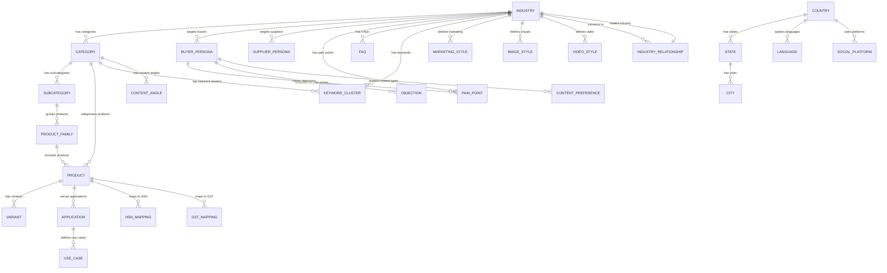
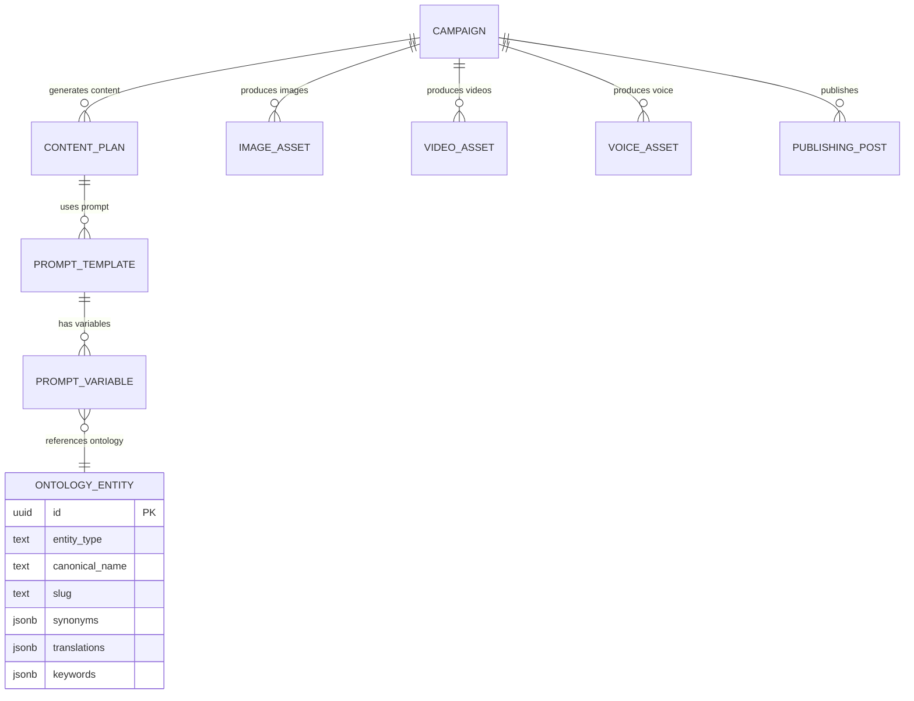

# Bell24h-OS — Volume 3A: Enterprise Business Ontology & Data Dictionary

> **Classification:** Internal — Master Reference  
> **Version:** 1.0  
> **Date:** 2026-07-14  
> **Authority:** This is the semantic intelligence layer. Every AI agent, prompt, workflow, campaign, and marketplace function references this document.  
> **Prerequisite:** Volume 0 (Constitution), Volume 2 (System Architecture), Volume 3 (Database Architecture) must be read first.

---

## Purpose

This document defines the **complete business vocabulary** shared by every component of Bell24h-OS and VyaparSethu.

Without this layer:
- Every AI Agent invents terminology differently
- Prompts produce inconsistent content
- SEO intelligence misses keywords
- Campaigns use conflicting brand language
- Marketplace data is unstructured

With this layer:
- Every module speaks exactly the same language
- AI agents produce consistent, industry-specific content
- SEO intelligence covers complete keyword clusters
- Campaigns use proven marketing language
- Marketplace data is normalized and searchable

---

## Table of Contents

- [Part I: Ontology Architecture](#part-i-ontology-architecture)
  - [1. Ontology Principles](#1-ontology-principles)
  - [2. Naming Standards](#2-naming-standards)
  - [3. Controlled Vocabularies](#3-controlled-vocabularies)
  - [4. Synonym Mappings](#4-synonym-mappings)
  - [5. Multilingual Support](#5-multilingual-support)
  - [6. AI Consumption Rules](#6-ai-consumption-rules)
- [Part II: Business Taxonomy](#part-ii-business-taxonomy)
  - [7. Industry Registry (50+)](#7-industry-registry-50)
  - [8. Category Registry (450+)](#8-category-registry-450)
  - [9. Subcategory Registry](#9-subcategory-registry)
  - [10. Product Family Taxonomy](#10-product-family-taxonomy)
  - [11. Product Taxonomy](#11-product-taxonomy)
  - [12. Product Variants](#12-product-variants)
  - [13. Applications & Use Cases](#13-applications--use-cases)
- [Part III: Buyer Taxonomy](#part-iii-buyer-taxonomy)
  - [14. Buyer Types](#14-buyer-types)
  - [15. Buyer Persona Definitions](#15-buyer-persona-definitions)
- [Part IV: Supplier Taxonomy](#part-iv-supplier-taxonomy)
  - [16. Supplier Types](#16-supplier-types)
  - [17. Supplier Persona Definitions](#17-supplier-persona-definitions)
- [Part V: Procurement Taxonomy](#part-v-procurement-taxonomy)
  - [18. Procurement Roles](#18-procurement-roles)
  - [19. Procurement Persona Definitions](#19-procurement-persona-definitions)
- [Part VI: Sales Taxonomy](#part-vi-sales-taxonomy)
  - [20. Sales Roles](#20-sales-roles)
  - [21. Sales Persona Definitions](#21-sales-persona-definitions)
- [Part VII: Marketing Ontology](#part-vii-marketing-ontology)
  - [22. Marketing Problems & Pain Points](#22-marketing-problems--pain-points)
  - [23. Benefits & Value Propositions](#23-benefits--value-propositions)
  - [24. Buyer Intent Signals](#24-buyer-intent-signals)
  - [25. Customer Objections](#25-customer-objections)
  - [26. CTA Library](#26-cta-library)
  - [27. Trust Signals](#27-trust-signals)
  - [28. Content Angles](#28-content-angles)
- [Part VIII: SEO Ontology](#part-viii-seo-ontology)
  - [29. Keyword Taxonomy](#29-keyword-taxonomy)
  - [30. Industry Keyword Clusters](#30-industry-keyword-clusters)
  - [31. Search Intent Mapping](#31-search-intent-mapping)
  - [32. People Also Ask Patterns](#32-people-also-ask-patterns)
  - [33. Semantic Keyword Mapping](#33-semantic-keyword-mapping)
  - [34. Entity & Synonym Mapping](#34-entity--synonym-mapping)
- [Part IX: Creative Ontology](#part-ix-creative-ontology)
  - [35. Image Style Taxonomy](#35-image-style-taxonomy)
  - [36. Video Style Taxonomy](#36-video-style-taxonomy)
  - [37. Voice Style Taxonomy](#37-voice-style-taxonomy)
  - [38. Avatar Style Taxonomy](#38-avatar-style-taxonomy)
  - [39. Thumbnail Style Taxonomy](#39-thumbnail-style-taxonomy)
  - [40. Music Style Taxonomy](#40-music-style-taxonomy)
  - [41. Animation Style Taxonomy](#41-animation-style-taxonomy)
  - [42. Background Style Taxonomy](#42-background-style-taxonomy)
  - [43. CTA Visual Style Taxonomy](#43-cta-visual-style-taxonomy)
  - [44. Brand Style Taxonomy](#44-brand-style-taxonomy)
- [Part X: AI Prompt Ontology](#part-x-ai-prompt-ontology)
  - [45. Universal Prompt Variables](#45-universal-prompt-variables)
  - [46. Industry-Specific Prompt Variables](#46-industry-specific-prompt-variables)
  - [47. Content-Type Prompt Templates](#47-content-type-prompt-templates)
  - [48. Platform-Specific Prompt Rules](#48-platform-specific-prompt-rules)
- [Part XI: Commerce Ontology](#part-xi-commerce-ontology)
  - [49. HSN Code Registry](#49-hsn-code-registry)
  - [50. GST Rate Mapping](#50-gst-rate-mapping)
  - [51. Units of Measure](#51-units-of-measure)
  - [52. Packaging Standards](#52-packaging-standards)
  - [53. MOQ Standards](#53-moq-standards)
  - [54. Lead Time Standards](#54-lead-time-standards)
  - [55. Incoterms](#55-incoterms)
  - [56. Payment Terms](#56-payment-terms)
  - [57. Currencies](#57-currencies)
  - [58. Certifications & Standards](#58-certifications--standards)
  - [59. Compliance Standards](#59-compliance-standards)
- [Part XII: Geo Intelligence](#part-xii-geo-intelligence)
  - [60. Country Intelligence](#60-country-intelligence)
  - [61. Indian State Intelligence](#61-indian-state-intelligence)
  - [62. Language Intelligence](#62-language-intelligence)
  - [63. Social Platform Mapping](#63-social-platform-mapping)
- [Part XIII: Industry Relationships](#part-xiii-industry-relationships)
  - [64. Cross-Industry Mapping](#64-cross-industry-mapping)
  - [65. Supply Chain Relationships](#65-supply-chain-relationships)
- [Part XIV: ER Diagrams](#part-xiv-er-diagrams)
  - [66. Ontology Entity Relationships](#66-ontology-entity-relationships)

---

# Part I: Ontology Architecture

---

## 1. Ontology Principles

### 1.1 Core Principles

| # | Principle | Rule |
|---|---|---|
| 1 | **Canonical Names** | Every entity has exactly ONE canonical name. All other names are synonyms. |
| 2 | **Hierarchical** | Every entity belongs to a parent. No orphan entities. |
| 3 | **Multilingual** | Every entity has translations in 15+ Indian languages + English. |
| 4 | **Versioned** | Ontology changes are versioned. Breaking changes require migration. |
| 5 | **AI-Consumable** | Every entity includes metadata that AI agents can use for content generation. |
| 6 | **Searchable** | Every entity has associated keywords, synonyms, and semantic embeddings. |
| 7 | **Connected** | Entities reference each other. Nothing exists in isolation. |
| 8 | **Controlled** | New entities require approval. No ad-hoc additions. |

### 1.2 Entity Hierarchy

```
Level 0: Industry (50+)
  Level 1: Category (450+)
    Level 2: Subcategory (4,500+)
      Level 3: Product Family (45,000+)
        Level 4: Product (450,000+)
          Level 5: Variant (unlimited)
            Level 6: Application (unlimited)
              Level 7: Use Case (unlimited)
```

---

## 2. Naming Standards

### 2.1 Canonical Name Rules

| Rule | Example | Anti-Example |
|---|---|---|
| Title Case | `Stainless Steel Pipes` | `stainless steel pipes`, `STAINLESS STEEL PIPES` |
| No abbreviations in canonical | `Light Emitting Diode` | `LED` (that's a synonym) |
| Singular for products | `Bearing` | `Bearings` |
| Plural for categories | `Fasteners` | `Fastener` |
| English canonical | `Ball Bearing` | `गोला बियरिंग` (that's a translation) |
| No brand names | `CNC Lathe` | `Haas VF-2` (brand is metadata) |

### 2.2 Slug Rules

```yaml
canonical_name: "Stainless Steel Pipe"
slug: "stainless-steel-pipe"
parent_slug: "pipes-and-tubes"
industry_slug: "steel-and-metals"
```

### 2.3 Entity ID Convention

```
ent_{level}_{sequence}
```

Examples:
- `ent_industry_001` — Steel & Metals
- `ent_category_001` — Pipes & Tubes
- `ent_subcategory_001` — Stainless Steel Pipes
- `ent_product_001` — 304 Grade SS Pipe
- `ent_buyer_001` — Manufacturer
- `ent_supplier_001` — OEM Supplier

---

## 3. Controlled Vocabularies

### 3.1 Industry Levels

| Level | Vocabulary | Count |
|---|---|---|
| Industry | Fixed list | 50+ |
| Category | Fixed list per industry | 450+ |
| Subcategory | Open (approval required) | 4,500+ |
| Product Family | Open (approval required) | 45,000+ |
| Product | Open (approval required) | 450,000+ |

### 3.2 Marketing Vocabularies

| Vocabulary | Count | Example |
|---|---|---|
| Pain Points | 500+ | "High energy consumption" |
| Benefits | 300+ | "Reduced operational cost" |
| CTAs | 100+ | "Request a Quote" |
| Trust Signals | 150+ | "ISO 9001 Certified" |
| Content Angles | 200+ | "How to reduce manufacturing waste" |

### 3.3 SEO Vocabularies

| Vocabulary | Count | Example |
|---|---|---|
| Primary Keywords | 5,000+ | "stainless steel pipe" |
| Secondary Keywords | 15,000+ | "ss pipe manufacturer" |
| Long-tail Keywords | 50,000+ | "304 grade stainless steel pipe price per kg" |
| Question Patterns | 2,000+ | "What is the difference between 304 and 316 SS?" |

---

## 4. Synonym Mappings

### 4.1 Synonym Structure

```json
{
  "canonical": "Stainless Steel Pipe",
  "synonyms": [
    "SS Pipe",
    "SS Tube",
    "Stainless Pipe",
    "Steel Pipe",
    "Inox Pipe",
    "Stainless Steel Tube"
  ],
  "abbreviations": ["SS Pipe", "SS Tube"],
  "regional": {
    "hi": "स्टेनलेस स्टील पाइप",
    "ta": "ஸ்டெயின்லெஸ் ஸ்டீல் குழாய்",
    "te": "స్టెయిన్‌లెస్ స్టీల్ పైప్"
  },
  "industry_terms": ["Corrosion-resistant pipe", "Food-grade pipe", "Industrial pipe"],
  "buyer_search_terms": ["SS pipe supplier", "stainless steel pipe price", "SS pipe manufacturer in India"]
}
```

### 4.2 Synonym Rules

1. **One canonical, many synonyms** — Never have two canonical names for the same thing
2. **Synonyms are searchable** — All synonyms are indexed for SEO
3. **Regional synonyms** — Hindi, Tamil, Telugu, etc. variants
4. **Industry jargon** — Technical terms used by buyers/suppliers
5. **Common misspellings** — "Stainless" not "Staineless"

---

## 5. Multilingual Support

### 5.1 Language Priority

| Priority | Language | Code | Coverage |
|---|---|---|---|
| 1 | English | en | 100% |
| 2 | Hindi | hi | 100% |
| 3 | Tamil | ta | 80% |
| 4 | Telugu | te | 80% |
| 5 | Marathi | mr | 75% |
| 6 | Gujarati | gu | 75% |
| 7 | Bengali | bn | 70% |
| 8 | Kannada | kn | 70% |
| 9 | Malayalam | ml | 70% |
| 10 | Punjabi | pa | 65% |
| 11 | Odia | or | 60% |
| 12 | Assamese | as | 60% |
| 13 | Urdu | ur | 65% |
| 14 | Nepali | ne | 50% |
| 15 | Sanskrit | sa | 30% |

### 5.2 Translation Rules

1. Canonical name is always English
2. Hindi is the primary translation (100% coverage)
3. Regional languages get category-level and product-level translations
4. Technical terms may keep English with local script pronunciation
5. Marketing copy is fully localized (not just translated)

---

## 6. AI Consumption Rules

### 6.1 How AI Agents Use This Ontology

| Agent | Uses | For |
|---|---|---|
| Content Writer | Industry, Category, Pain Points, Benefits | Writing blog posts, social content |
| SEO Agent | Keywords, Search Intent, Semantic Keywords | Optimizing content for search |
| Image Agent | Image Styles, Brand Colors, Industry Visuals | Generating industry-appropriate images |
| Video Agent | Video Styles, Duration Rules, Platform Specs | Generating platform-optimized videos |
| Voice Agent | Voice Styles, Tone Rules, Language | Generating voiceovers |
| Campaign Agent | CTAs, Content Angles, Trust Signals | Planning campaigns |
| Publishing Agent | Platform Specs, Character Limits, Hashtag Rules | Publishing to social platforms |
| RFQ Agent | HSN Codes, GST Rates, MOQ, Units | Processing procurement queries |
| Learning Agent | Performance data per industry/category | Optimizing across industries |

### 6.2 AI Prompt Variable Injection

Every AI prompt receives context from this ontology:

```
Industry: {{industry_name}}
Category: {{category_name}}
Subcategory: {{subcategory_name}}
Product: {{product_name}}
Buyer Persona: {{buyer_persona}}
Pain Points: {{pain_points_array}}
Benefits: {{benefits_array}}
Keywords: {{keyword_array}}
Tone: {{marketing_style.tone}}
Platform: {{target_platform}}
Language: {{content_language}}
```

### 6.3 Consistency Rules

1. **Never invent industry terms** — Always use canonical names or approved synonyms
2. **Never mix industries** — Steel content doesn't mention textile terms
3. **Always use correct HSN codes** — Products are mapped to exact HSN codes
4. **Always use correct GST rates** — Based on HSN code and state
5. **Always use industry-appropriate CTAs** — Manufacturing uses "Request a Quote", not "Buy Now"
6. **Always use industry-appropriate tones** — Technical industries use professional tone, not casual

---

# Part II: Business Taxonomy

---

## 7. Industry Registry (50+)

Every industry includes: canonical name, slug, description, HSN codes, buying cycle, avg order value, marketing tone, content complexity, target platforms, and key metrics.

### 7.1 Steel & Metals

```yaml
- id: ent_industry_001
  name: Steel & Metals
  slug: steel-and-metals
  description: Steel manufacturing, processing, and distribution including stainless steel, carbon steel, alloy steel, and specialty metals
  hsn_codes: ["7204", "7206", "7207", "7208", "7210", "7219", "7304", "7306"]
  buying_cycle: 30-90_days
  avg_order_value: 250000  # INR
  marketing_tone: professional
  content_complexity: technical
  target_platforms: [linkedin, website, tradeindia, indiamart]
  categories:
    - Pipes & Tubes
    - Steel Sheets & Plates
    - Structural Steel
    - Steel Furniture
    - Fasteners
    - Fittings & Flanges
    - Steel Wire & Cables
    - Stainless Steel Products
    - Steel Processing Services
    - Scrap & Recycled Steel
  keywords_primary: ["steel manufacturer", "steel supplier", "steel products", "steel price"]
  keywords_secondary: ["steel mill", "steel dealer", "steel distributor", "steel export"]
```

### 7.2 Textiles & Garments

```yaml
- id: ent_industry_002
  name: Textiles & Garments
  slug: textiles-and-garments
  description: Textile manufacturing, garment production, fabric trading, and fashion accessories
  hsn_codes: ["5208", "5407", "5512", "6110", "6203", "6204", "6302"]
  buying_cycle: 30-60_days
  avg_order_value: 150000
  marketing_tone: creative
  content_complexity: moderate
  target_platforms: [instagram, facebook, linkedin, whatsapp]
  categories:
    - Cotton Fabrics
    - Synthetic Fabrics
    - Denim
    - Knitted Fabrics
    - readymade Garments
    - Home Textiles
    - Technical Textiles
    - Yarn & Thread
    - Embroidery & Trims
    - Garment Accessories
  keywords_primary: ["textile manufacturer", "fabric supplier", "garment manufacturer"]
  keywords_secondary: ["cotton fabric price", "fabric wholesale", "garment export"]
```

### 7.3 Chemicals & Petrochemicals

```yaml
- id: ent_industry_003
  name: Chemicals & Petrochemicals
  slug: chemicals-and-petrochemicals
  description: Industrial chemicals, specialty chemicals, petrochemicals, dyes, pigments, and chemical processing
  hsn_codes: ["2811", "2812", "2815", "2903", "3204", "3206", "3402"]
  buying_cycle: 14-60_days
  avg_order_value: 200000
  marketing_tone: technical
  content_complexity: high
  target_platforms: [linkedin, website, email]
  categories:
    - Industrial Chemicals
    - Specialty Chemicals
    - Agrochemicals
    - Dyes & Pigments
    - Petrochemicals
    - Pharmaceutical Chemicals
    - Water Treatment Chemicals
    - Food Chemicals
    - Construction Chemicals
    - Adhesives & Sealants
  keywords_primary: ["chemical manufacturer", "chemical supplier", "industrial chemicals"]
  keywords_secondary: ["chemical distributor", "specialty chemicals India", "chemical export"]
```

### 7.4 Auto Components & Engineering

```yaml
- id: ent_industry_004
  name: Auto Components & Engineering
  slug: auto-components-engineering
  description: Automotive parts, engine components, precision engineering, CNC machining, and automotive aftermarket
  hsn_codes: ["8708", "8409", "8481", "8483", "8544"]
  buying_cycle: 30-120_days
  avg_order_value: 350000
  marketing_tone: professional
  content_complexity: technical
  target_platforms: [linkedin, website, tradeindia]
  categories:
    - Engine Components
    - Brake Systems
    - Transmission Parts
    - Suspension & Steering
    - Electrical Components
    - Body Parts
    - Filters & Seals
    - Bearings & Bushings
    - Precision Machined Parts
    - Automotive Aftermarket
  keywords_primary: ["auto component manufacturer", "automotive parts supplier"]
  keywords_secondary: ["CNC machined parts", "precision components", "auto parts export"]
```

### 7.5 Pharmaceuticals & Healthcare

```yaml
- id: ent_industry_005
  name: Pharmaceuticals & Healthcare
  slug: pharmaceuticals-healthcare
  description: Drug manufacturing, API production, medical devices, hospital supplies, and healthcare services
  hsn_codes: ["3004", "3006", "9018", "9021", "9022"]
  buying_cycle: 30-90_days
  avg_order_value: 500000
  marketing_tone: authoritative
  content_complexity: high
  target_platforms: [linkedin, website, email, medical_platforms]
  categories:
    - APIs & Intermediates
    - Formulations
    - Medical Devices
    - Hospital Supplies
    - Diagnostic Equipment
    - Surgical Instruments
    - Personal Protective Equipment
    - Nutraceuticals
    - Ayurvedic Products
    - Veterinary Products
  keywords_primary: ["pharmaceutical manufacturer", "API supplier", "medical device manufacturer"]
  keywords_secondary: ["pharma export", "generic medicine manufacturer", "CDMO India"]
```

### 7.6 Agriculture & Food Processing

```yaml
- id: ent_industry_006
  name: Agriculture & Food Processing
  slug: agriculture-food-processing
  description: Agricultural products, food processing, organic farming, spices, grains, and food packaging
  hsn_codes: ["0713", "0904", "1006", "1101", "1905", "2008"]
  buying_cycle: 7-30_days
  avg_order_value: 100000
  marketing_tone: warm
  content_complexity: moderate
  target_platforms: [facebook, whatsapp, instagram, youtube]
  categories:
    - Grains & Cereals
    - Spices & Condiments
    - Pulses & Legumes
    - Fruits & Vegetables
    - Dairy Products
    - Organic Products
    - Food Processing Equipment
    - Food Packaging
    - Meat & Seafood
    - Beverages
  keywords_primary: ["agricultural products", "food manufacturer", "spice supplier"]
  keywords_secondary: ["organic food India", "food export", "agricultural export"]
```

### 7.7 Electronics & Electrical

```yaml
- id: ent_industry_007
  name: Electronics & Electrical
  slug: electronics-electrical
  description: Electronic components, PCB manufacturing, LED lighting, transformers, cables, and electrical equipment
  hsn_codes: ["8534", "8541", "8544", "9405", "8504"]
  buying_cycle: 14-60_days
  avg_order_value: 200000
  marketing_tone: technical
  content_complexity: high
  target_platforms: [linkedin, website, alibaba]
  categories:
    - PCB Manufacturing
    - Electronic Components
    - LED Lighting
    - Transformers
    - Cables & Wires
    - Switchgear
    - Solar Equipment
    - Batteries
    - Control Systems
    - Testing Equipment
  keywords_primary: ["electronic manufacturer", "LED supplier", "PCB manufacturer"]
  keywords_secondary: ["electrical components India", "cable manufacturer", "solar panel supplier"]
```

### 7.8 Construction & Infrastructure

```yaml
- id: ent_industry_008
  name: Construction & Infrastructure
  slug: construction-infrastructure
  description: Building materials, construction equipment, cement, steel structures, and infrastructure development
  hsn_codes: ["6810", "7210", "7308", "7610", "9406"]
  buying_cycle: 30-180_days
  avg_order_value: 500000
  marketing_tone: professional
  content_complexity: moderate
  target_platforms: [linkedin, website, youtube]
  categories:
    - Cement & Concrete
    - Bricks & Blocks
    - Steel Structures
    - Roofing Materials
    - Plumbing Materials
    - Electrical Fittings
    - Paints & Coatings
    - Tiles & Ceramics
    - Construction Equipment
    - Safety Equipment
  keywords_primary: ["construction material supplier", "building material manufacturer"]
  keywords_secondary: ["construction equipment India", "infrastructure material", "building material price"]
```

### 7.9 Packaging & Printing

```yaml
- id: ent_industry_009
  name: Packaging & Printing
  slug: packaging-printing
  description: Packaging materials, printing services, label manufacturing, and branded packaging solutions
  hsn_codes: ["3923", "4819", "4821", "7606", "7612"]
  buying_cycle: 7-30_days
  avg_order_value: 75000
  marketing_tone: creative
  content_complexity: moderate
  target_platforms: [instagram, facebook, linkedin, whatsapp]
  categories:
    - Corrugated Boxes
    - Flexible Packaging
    - Rigid Packaging
    - Labels & Stickers
    - Printing Services
    - Packaging Machinery
    - Sustainable Packaging
    - Food Packaging
    - Gift Packaging
    - Industrial Packaging
  keywords_primary: ["packaging manufacturer", "printing service", "label manufacturer"]
  keywords_secondary: ["custom packaging India", "eco-friendly packaging", "food packaging supplier"]
```

### 7.10 Plastics & Polymers

```yaml
- id: ent_industry_010
  name: Plastics & Polymers
  slug: plastics-polymers
  description: Plastic manufacturing, polymer processing, injection molding, extrusion, and recycled plastics
  hsn_codes: ["3917", "3918", "3919", "3920", "3921"]
  buying_cycle: 7-60_days
  avg_order_value: 100000
  marketing_tone: professional
  content_complexity: moderate
  target_platforms: [linkedin, website, tradeindia]
  categories:
    - PVC Products
    - HDPE Products
    - PP Products
    - Engineering Plastics
    - Plastic Films
    - Plastic Pipes
    - Injection Molded Parts
    - Extruded Products
    - Recycled Plastics
    - Plastic Additives
  keywords_primary: ["plastic manufacturer", "polymer supplier", "plastic products"]
  keywords_secondary: ["PVC pipe manufacturer", "plastic injection molding", "recycled plastic India"]
```

### 7.11 Machine Tools & Industrial Equipment

```yaml
- id: ent_industry_011
  name: Machine Tools & Industrial Equipment
  slug: machine-tools-industrial-equipment
  description: CNC machines, lathe machines, milling machines, grinding machines, and industrial automation equipment
  hsn_codes: ["8457", "8458", "8459", "8460", "8462"]
  buying_cycle: 30-180_days
  avg_order_value: 800000
  marketing_tone: technical
  content_complexity: high
  target_platforms: [linkedin, website, youtube]
  categories:
    - CNC Machines
    - Lathe Machines
    - Milling Machines
    - Grinding Machines
    - Drilling Machines
    - Sheet Metal Machines
    - Cutting Tools
    - Measuring Instruments
    - Industrial Automation
    - Hydraulic & Pneumatic Equipment
  keywords_primary: ["CNC machine manufacturer", "lathe machine supplier", "industrial equipment"]
  keywords_secondary: ["CNC lathe price", "metal cutting machine", "machine tool India"]
```

### 7.12 Energy & Power

```yaml
- id: ent_industry_012
  name: Energy & Power
  slug: energy-power
  description: Power generation, renewable energy, solar panels, wind energy, transformers, and power distribution
  hsn_codes: ["8504", "8541", "8412", "8502"]
  buying_cycle: 60-365_days
  avg_order_value: 2000000
  marketing_tone: authoritative
  content_complexity: high
  target_platforms: [linkedin, website, email]
  categories:
    - Solar Energy
    - Wind Energy
    - Generators
    - Transformers
    - Power Distribution
    - UPS Systems
    - Energy Storage
    - Power Cables
    - Smart Grid
    - Energy Audit Services
  keywords_primary: ["solar panel manufacturer", "power equipment supplier", "energy solutions"]
  keywords_secondary: ["solar energy India", "power transformer manufacturer", "renewable energy supplier"]
```

### 7.13 Water Treatment & Environment

```yaml
- id: ent_industry_013
  name: Water Treatment & Environment
  slug: water-treatment-environment
  description: Water treatment plants, ETP, STP, RO systems, effluent treatment, and environmental solutions
  hsn_codes: ["8421", "8424", "3824"]
  buying_cycle: 30-120_days
  avg_order_value: 500000
  marketing_tone: authoritative
  content_complexity: high
  target_platforms: [linkedin, website, email]
  categories:
    - Water Treatment Plants
    - RO Systems
    - ETP Systems
    - STP Systems
    - Water Pumps
    - Filtration Systems
    - Chemical Dosing Systems
    - Water Testing Equipment
    - Rainwater Harvesting
    - Waste Management
  keywords_primary: ["water treatment manufacturer", "RO plant supplier", "ETP manufacturer"]
  keywords_secondary: ["water treatment plant price", "effluent treatment India", "STP manufacturer"]
```

### 7.14 Rubber & Ceramics

```yaml
- id: ent_industry_014
  name: Rubber & Ceramics
  slug: rubber-ceramics
  description: Rubber products, ceramic tiles, refractory materials, and industrial ceramics
  hsn_codes: ["4015", "6907", "6902", "6903"]
  buying_cycle: 14-60_days
  avg_order_value: 150000
  marketing_tone: professional
  content_complexity: moderate
  target_platforms: [linkedin, website]
  categories:
    - Industrial Rubber
    - Rubber Sheets
    - Rubber Moulded Parts
    - Ceramic Tiles
    - Refractory Bricks
    - Technical Ceramics
    - Sanitary Ware
    - Ceramic Coatings
    - Rubber Seals & Gaskets
    - Rubber Hoses
  keywords_primary: ["rubber manufacturer", "ceramic tile manufacturer", "refractory supplier"]
  keywords_secondary: ["industrial rubber products", "ceramic tiles India", "rubber gasket manufacturer"]
```

### 7.15 Paper & Pulp

```yaml
- id: ent_industry_015
  name: Paper & Pulp
  slug: paper-pulp
  description: Paper manufacturing, cardboard, pulp processing, and specialty papers
  hsn_codes: ["4703", "4802", "4810", "4819", "4823"]
  buying_cycle: 14-60_days
  avg_order_value: 120000
  marketing_tone: professional
  content_complexity: moderate
  target_platforms: [linkedin, website]
  categories:
    - Writing Paper
    - Packaging Paper
    - Tissue Paper
    - Specialty Paper
    - Cardboard
    - Paper Board
    - Recycled Paper
    - Paper Converting
    - Paper Machinery
    - Pulp Products
  keywords_primary: ["paper manufacturer", "cardboard supplier", "paper mill"]
  keywords_secondary: ["kraft paper India", "paper export", "tissue paper manufacturer"]
```

### 7.16 Furniture & Interiors

```yaml
- id: ent_industry_016
  name: Furniture & Interiors
  slug: furniture-interiors
  description: Office furniture, home furniture, interior design, modular kitchens, and wood products
  hsn_codes: ["9401", "9403", "9404", "4421"]
  buying_cycle: 14-60_days
  avg_order_value: 200000
  marketing_tone: creative
  content_complexity: moderate
  target_platforms: [instagram, facebook, pinterest, website]
  categories:
    - Office Furniture
    - Home Furniture
    - Industrial Furniture
    - Modular Kitchens
    - Wardrobes
    - Wood Products
    - Upholstered Furniture
    - Metal Furniture
    - Outdoor Furniture
    - Interior Design Services
  keywords_primary: ["furniture manufacturer", "office furniture supplier", "modular kitchen"]
  keywords_secondary: ["wooden furniture India", "furniture export", "custom furniture"]
```

### 7.17 Mining & Minerals

```yaml
- id: ent_industry_017
  name: Mining & Minerals
  slug: mining-minerals
  description: Mining equipment, mineral processing, quarrying, and mineral trading
  hsn_codes: ["2515", "2516", "2523", "2601"]
  buying_cycle: 30-180_days
  avg_order_value: 500000
  marketing_tone: professional
  content_complexity: technical
  target_platforms: [linkedin, website]
  categories:
    - Mining Equipment
    - Crusher Plants
    - Mineral Processing
    - Stone & Marble
    - Granite Products
    - Sand & Gravel
    - Lime & Limestone
    - Industrial Minerals
    - Precious Minerals
    - Mining Consumables
  keywords_primary: ["mining equipment manufacturer", "mineral supplier", "stone crusher"]
  keywords_secondary: ["mining equipment India", "marble supplier", "granite export"]
```

### 7.18 Bearings & Transmission

```yaml
- id: ent_industry_018
  name: Bearings & Transmission
  slug: bearings-transmission
  description: Ball bearings, roller bearings, gearboxes, couplings, chains, and power transmission components
  hsn_codes: ["8482", "8483", "7315"]
  buying_cycle: 7-30_days
  avg_order_value: 80000
  marketing_tone: technical
  content_complexity: technical
  target_platforms: [linkedin, website, tradeindia]
  categories:
    - Ball Bearings
    - Roller Bearings
    - Bearing Accessories
    - Gearboxes
    - Couplings
    - Chains & Sprockets
    - Belts & Pulleys
    - Gears
    - Clutches
    - Tensioners
  keywords_primary: ["bearing manufacturer", "gearbox supplier", "bearing dealer"]
  keywords_secondary: ["ball bearing price", "gearbox India", "power transmission parts"]
```

### 7.19 Paints & Coatings

```yaml
- id: ent_industry_019
  name: Paints & Coatings
  slug: paints-coatings
  description: Industrial paints, decorative paints, powder coatings, marine coatings, and specialty coatings
  hsn_codes: ["3208", "3209", "3210", "3214"]
  buying_cycle: 7-30_days
  avg_order_value: 50000
  marketing_tone: creative
  content_complexity: moderate
  target_platforms: [instagram, facebook, linkedin]
  categories:
    - Industrial Paints
    - Decorative Paints
    - Powder Coatings
    - Automotive Paints
    - Marine Coatings
    - Anti-Corrosive Coatings
    - Heat Resistant Coatings
    - Epoxy Coatings
    - Paint Thinners & Solvents
    - Paint Application Equipment
  keywords_primary: ["paint manufacturer", "industrial paint supplier", "coating manufacturer"]
  keywords_secondary: ["powder coating India", "automotive paint", "anti-corrosive paint"]
```

### 7.20 Pumps & Valves

```yaml
- id: ent_industry_020
  name: Pumps & Valves
  slug: pumps-valves
  description: Centrifugal pumps, submersible pumps, industrial valves, and flow control equipment
  hsn_codes: ["8413", "8481"]
  buying_cycle: 14-60_days
  avg_order_value: 150000
  marketing_tone: technical
  content_complexity: technical
  target_platforms: [linkedin, website]
  categories:
    - Centrifugal Pumps
    - Submersible Pumps
    - Booster Pumps
    - Chemical Pumps
    - Gate Valves
    - Ball Valves
    - Butterfly Valves
    - Check Valves
    - Control Valves
    - Pump Accessories
  keywords_primary: ["pump manufacturer", "valve supplier", "industrial pump"]
  keywords_secondary: ["centrifugal pump price", "gate valve India", "submersible pump manufacturer"]
```

### 7.21 HVAC & Refrigeration

```yaml
- id: ent_industry_021
  name: HVAC & Refrigeration
  slug: hvac-refrigeration
  description: Air conditioning, refrigeration, ventilation, and climate control systems
  hsn_codes: ["8415", "8418", "8414", "8419"]
  buying_cycle: 14-90_days
  avg_order_value: 300000
  marketing_tone: professional
  content_complexity: technical
  target_platforms: [linkedin, website]
  categories:
    - Air Conditioners
    - Chillers
    - Refrigeration Units
    - Compressors
    - Condensers
    - AHU & FCU
    - Ducting Systems
    - Cooling Towers
    - Heat Exchangers
    - HVAC Controls
  keywords_primary: ["HVAC manufacturer", "AC supplier", "refrigeration equipment"]
  keywords_secondary: ["chiller manufacturer India", "HVAC contractor", "air conditioning system"]
```

### 7.22 Safety & Security

```yaml
- id: ent_industry_022
  name: Safety & Security
  slug: safety-security
  description: Safety equipment, fire protection, security systems, and personal protective equipment
  hsn_codes: ["6307", "8543", "9027", "7616"]
  buying_cycle: 7-30_days
  avg_order_value: 50000
  marketing_tone: authoritative
  content_complexity: moderate
  target_platforms: [linkedin, website]
  categories:
    - Fire Protection
    - PPE
    - Safety Signage
    - Security Systems
    - CCTV Systems
    - Access Control
    - Safety Clothing
    - Safety Footwear
    - Gas Detection
    - Emergency Equipment
  keywords_primary: ["safety equipment supplier", "fire protection manufacturer", "PPE supplier"]
  keywords_secondary: ["fire extinguisher India", "safety shoes manufacturer", "CCTV supplier"]
```

### 7.23 Logistics & Warehousing

```yaml
- id: ent_industry_023
  name: Logistics & Warehousing
  slug: logistics-warehousing
  description: Freight forwarding, warehousing, supply chain management, and last-mile delivery
  hsn_codes: ["9965", "9966", "9967"]
  buying_cycle: 7-14_days
  avg_order_value: 100000
  marketing_tone: professional
  content_complexity: moderate
  target_platforms: [linkedin, website, whatsapp]
  categories:
    - Freight Forwarding
    - Warehousing
    - Supply Chain
    - Last-Mile Delivery
    - Cold Chain
    - Customs Clearing
    - Packaging & Moving
    - Fleet Management
    - Route Optimization
    - Warehouse Equipment
  keywords_primary: ["logistics company", "warehousing service", "freight forwarder"]
  keywords_secondary: ["supply chain India", "3PL provider", "cold chain logistics"]
```

### 7.24 IT & Software

```yaml
- id: ent_industry_024
  name: IT & Software
  slug: it-software
  description: Software development, IT services, cloud computing, SaaS, and digital transformation
  hsn_codes: ["8523", "9983"]
  buying_cycle: 14-90_days
  avg_order_value: 500000
  marketing_tone: modern
  content_complexity: high
  target_platforms: [linkedin, twitter, website, github]
  categories:
    - Software Development
    - Cloud Services
    - SaaS Products
    - IT Consulting
    - Cybersecurity
    - Data Analytics
    - AI & ML Services
    - Web Development
    - Mobile App Development
    - ERP Solutions
  keywords_primary: ["software company", "IT services", "cloud provider"]
  keywords_secondary: ["SaaS India", "software development company", "cybersecurity firm"]
```

### 7.25 Hospitality & Tourism

```yaml
- id: ent_industry_025
  name: Hospitality & Tourism
  slug: hospitality-tourism
  description: Hotels, resorts, travel agencies, event management, and tourism services
  hsn_codes: ["9964", "9963", "9985"]
  buying_cycle: 7-30_days
  avg_order_value: 100000
  marketing_tone: warm
  content_complexity: moderate
  target_platforms: [instagram, facebook, youtube, tripadvisor]
  categories:
    - Hotels & Resorts
    - Travel Agencies
    - Event Management
    - Catering Services
    - Tour Operators
    - Adventure Tourism
    - Medical Tourism
    - Business Hotels
    - Resort Properties
    - Hospitality Equipment
  keywords_primary: ["hotel supplier", "tour operator", "event management company"]
  keywords_secondary: ["hotel equipment India", "travel agency India", "catering service"]
```

### 7.26 Education & Training

```yaml
- id: ent_industry_026
  name: Education & Training
  slug: education-training
  description: Educational institutions, training centers, e-learning, and educational equipment
  hsn_codes: ["9992", "9993", "8523"]
  buying_cycle: 30-180_days
  avg_order_value: 200000
  marketing_tone: educational
  content_complexity: moderate
  target_platforms: [linkedin, youtube, website]
  categories:
    - School Supplies
    - Lab Equipment
    - E-Learning Platforms
    - Training Programs
    - Educational Furniture
    - Sports Equipment
    - Library Equipment
    - Smart Classroom
    - Vocational Training
    - Corporate Training
  keywords_primary: ["education supplier", "lab equipment manufacturer", "e-learning platform"]
  keywords_secondary: ["school furniture India", "lab equipment price", "training institute"]
```

### 7.27 Defense & Aerospace

```yaml
- id: ent_industry_027
  name: Defense & Aerospace
  slug: defense-aerospace
  description: Defense equipment, aerospace components, military vehicles, and aviation parts
  hsn_codes: ["8802", "8803", "9304", "8411"]
  buying_cycle: 180-365_days
  avg_order_value: 5000000
  marketing_tone: authoritative
  content_complexity: high
  target_platforms: [linkedin, website]
  categories:
    - Defense Vehicles
    - Aerospace Components
    - Military Electronics
    - Communication Systems
    - Surveillance Equipment
    - Ammunition
    - Naval Equipment
    - Aviation Parts
    - Defense Textiles
    - Training Simulators
  keywords_primary: ["defense manufacturer", "aerospace component supplier"]
  keywords_secondary: ["defense equipment India", "aerospace parts manufacturer", "military supplier"]
```

### 7.28 Telecommunications

```yaml
- id: ent_industry_028
  name: Telecommunications
  slug: telecommunications
  description: Telecom equipment, network infrastructure, fiber optics, and communication systems
  hsn_codes: ["8517", "8525", "8544"]
  buying_cycle: 30-120_days
  avg_order_value: 500000
  marketing_tone: technical
  content_complexity: high
  target_platforms: [linkedin, website]
  categories:
    - Network Equipment
    - Fiber Optics
    - Antennas
    - Telecom Towers
    - Routing & Switching
    - Voice Systems
    - Data Center Equipment
    - Cable Management
    - Testing Equipment
    - Telecom Consumables
  keywords_primary: ["telecom equipment manufacturer", "fiber optic supplier"]
  keywords_secondary: ["network equipment India", "telecom infrastructure", "fiber optic cable price"]
```

### 7.29 Oil & Gas

```yaml
- id: ent_industry_029
  name: Oil & Gas
  slug: oil-gas
  description: Oil and gas exploration, refinery equipment, pipelines, and petrochemical processing
  hsn_codes: ["7304", "7305", "7306", "8413", "8481"]
  buying_cycle: 60-365_days
  avg_order_value: 1000000
  marketing_tone: authoritative
  content_complexity: high
  target_platforms: [linkedin, website]
  categories:
    - Pipeline Equipment
    - Refinery Equipment
    - Drilling Equipment
    - Valves & Actuators
    - Flow Meters
    - Corrosion Protection
    - Offshore Equipment
    - Storage Tanks
    - Gas Processing
    - Oilfield Chemicals
  keywords_primary: ["oil gas equipment supplier", "pipeline manufacturer"]
  keywords_secondary: ["refinery equipment India", "oil field equipment", "pipeline valve manufacturer"]
```

### 7.30 Marine & Shipbuilding

```yaml
- id: ent_industry_030
  name: Marine & Shipbuilding
  slug: marine-shipbuilding
  description: Shipbuilding, marine equipment, ship repair, and maritime supplies
  hsn_codes: ["8901", "8902", "7308", "9403"]
  buying_cycle: 60-365_days
  avg_order_value: 2000000
  marketing_tone: professional
  content_complexity: high
  target_platforms: [linkedin, website]
  categories:
    - Ship Building
    - Marine Engines
    - Marine Pumps & Valves
    - Navigation Equipment
    - Marine Paints
    - Deck Equipment
    - Safety Equipment
    - Marine Electronics
    - Ship Repair
    - Marine Consumables
  keywords_primary: ["marine equipment supplier", "shipbuilder India"]
  keywords_secondary: ["marine engine manufacturer", "ship repair India", "boat builder"]
```

### 7.31 Rubber & Plastic Processing

```yaml
- id: ent_industry_031
  name: Rubber Processing
  slug: rubber-processing
  description: Rubber processing, vulcanization, rubber-to-metal bonding, and custom rubber products
  hsn_codes: ["4015", "4016", "4017"]
  buying_cycle: 14-60_days
  avg_order_value: 100000
  marketing_tone: technical
  content_complexity: moderate
  target_platforms: [linkedin, website]
  categories:
    - Custom Moulded Rubber
    - Rubber Sheets
    - Rubber Seals & Gaskets
    - Rubber Hoses
    - Rubber Mats
    - Rubber Bonded Components
    - Silicone Products
    - Neoprene Products
    - EPDM Products
    - Natural Rubber Products
  keywords_primary: ["rubber product manufacturer", "rubber moulding"]
  keywords_secondary: ["rubber gasket supplier", "custom rubber parts", "silicone rubber manufacturer"]
```

### 7.32 Glass & Ceramics

```yaml
- id: ent_industry_032
  name: Glass & Ceramics
  slug: glass-ceramics
  description: Glass manufacturing, ceramic products, sanitary ware, and specialty glass
  hsn_codes: ["7007", "7008", "7016", "6907"]
  buying_cycle: 14-60_days
  avg_order_value: 150000
  marketing_tone: creative
  content_complexity: moderate
  target_platforms: [instagram, website, linkedin]
  categories:
    - Flat Glass
    - Toughened Glass
    - Laminated Glass
    - Specialty Glass
    - Ceramic Tiles
    - Sanitary Ware
    - Tableware
    - Glass Containers
    - Ceramic Insulators
    - Glass Processing
  keywords_primary: ["glass manufacturer", "ceramic tile supplier"]
  keywords_secondary: ["toughened glass India", "ceramic tiles price", "sanitary ware manufacturer"]
```

### 7.33 Leather & Footwear

```yaml
- id: ent_industry_033
  name: Leather & Footwear
  slug: leather-footwear
  description: Leather processing, footwear manufacturing, leather goods, and accessories
  hsn_codes: ["4203", "4202", "6403", "6405"]
  buying_cycle: 14-60_days
  avg_order_value: 100000
  marketing_tone: creative
  content_complexity: moderate
  target_platforms: [instagram, facebook, website]
  categories:
    - Genuine Leather
    - Synthetic Leather
    - Footwear
    - Leather Garments
    - Leather Bags
    - Leather Accessories
    - Industrial Leather
    - Leather Chemicals
    - Leather Machinery
    - Leather Care Products
  keywords_primary: ["leather manufacturer", "footwear manufacturer", "leather supplier"]
  keywords_secondary: ["genuine leather India", "leather footwear export", "leather bags manufacturer"]
```

### 7.34 Handicrafts & Home Decor

```yaml
- id: ent_industry_034
  name: Handicrafts & Home Decor
  slug: handicrafts-home-decor
  description: Handicrafts, home decor items, artisan products, and decorative accessories
  hsn_codes: ["4421", "6913", "7117", "9703"]
  buying_cycle: 7-30_days
  avg_order_value: 30000
  marketing_tone: warm
  content_complexity: moderate
  target_platforms: [instagram, pinterest, etsy, amazon]
  categories:
    - Wooden Handicrafts
    - Metal Art
    - Ceramics & Pottery
    - Textile Decor
    - Lighting
    - Wall Art
    - Tableware
    - Garden Decor
    - Religious Items
    - Gift Items
  keywords_primary: ["handicraft manufacturer", "home decor supplier", "art craft"]
  keywords_secondary: ["handicraft India export", "wooden craft", "home decor items"]
```

### 7.35 Sports & Fitness

```yaml
- id: ent_industry_035
  name: Sports & Fitness
  slug: sports-fitness
  description: Sports equipment, gym equipment, fitness accessories, and sports apparel
  hsn_codes: ["9506", "9503", "6113"]
  buying_cycle: 7-30_days
  avg_order_value: 50000
  marketing_tone: energetic
  content_complexity: moderate
  target_platforms: [instagram, youtube, website]
  categories:
    - Gym Equipment
    - Sports Goods
    - Sports Apparel
    - Fitness Accessories
    - Outdoor Sports
    - Indoor Games
    - Sports Safety
    - Sports Nutrition
    - Sports Technology
    - Sports Venue Equipment
  keywords_primary: ["gym equipment manufacturer", "sports goods supplier"]
  keywords_secondary: ["gym equipment India", "sports manufacturer", "fitness equipment price"]
```

### 7.36 Electrical Instruments

```yaml
- id: ent_industry_036
  name: Electrical Instruments
  slug: electrical-instruments
  description: Electrical measuring instruments, panel boards, switchgear, and test equipment
  hsn_codes: ["9030", "9032", "8537"]
  buying_cycle: 14-60_days
  avg_order_value: 100000
  marketing_tone: technical
  content_complexity: technical
  target_platforms: [linkedin, website]
  categories:
    - Multimeters
    - Panel Meters
    - Energy Meters
    - Panel Boards
    - Distribution Boards
    - Test Equipment
    - Calibrators
    - Power Analyzers
    - Data Loggers
    - Inspection Tools
  keywords_primary: ["electrical instrument manufacturer", "panel board supplier"]
  keywords_secondary: ["multimeter manufacturer India", "energy meter supplier", "electrical test equipment"]
```

### 7.37 Sanitary & Plumbing

```yaml
- id: ent_industry_037
  name: Sanitary & Plumbing
  slug: sanitary-plumbing
  description: Sanitary ware, plumbing fittings, bathroom accessories, and pipe systems
  hsn_codes: ["6910", "6911", "7324", "7604"]
  buying_cycle: 7-30_days
  avg_order_value: 50000
  marketing_tone: creative
  content_complexity: moderate
  target_platforms: [instagram, pinterest, website]
  categories:
    - WC & Commodes
    - Wash Basins
    - Faucets & Taps
    - Showers
    - Bathroom Accessories
    - CPVC Pipes
    - UPVC Pipes
    - Pipe Fittings
    - Water Tanks
    - Kitchen Sinks
  keywords_primary: ["sanitary ware manufacturer", "plumbing supplier"]
  keywords_secondary: ["bathroom fittings India", "faucet manufacturer", "CPVC pipe price"]
```

### 7.38 Photography & Videography

```yaml
- id: ent_industry_038
  name: Photography & Videography
  slug: photography-videography
  description: Camera equipment, lighting, studio equipment, and photography services
  hsn_codes: ["9006", "9405", "8525"]
  buying_cycle: 7-30_days
  avg_order_value: 50000
  marketing_tone: creative
  content_complexity: moderate
  target_platforms: [instagram, youtube, website]
  categories:
    - Camera Equipment
    - Studio Lighting
    - Backdrops
    - Tripods & Supports
    - Camera Bags
    - Video Equipment
    - Audio Equipment
    - Photo Editing Software
    - Photo Prints
    - Photography Services
  keywords_primary: ["camera equipment supplier", "studio lighting manufacturer"]
  keywords_secondary: ["photography equipment India", "studio setup price", "video equipment supplier"]
```

### 7.39 Publishing & Media

```yaml
- id: ent_industry_039
  name: Publishing & Media
  slug: publishing-media
  description: Book publishing, newspaper, magazine, digital media, and content production
  hsn_codes: ["4901", "4902", "4911"]
  buying_cycle: 30-90_days
  avg_order_value: 50000
  marketing_tone: professional
  content_complexity: moderate
  target_platforms: [linkedin, website, social_media]
  categories:
    - Book Publishing
    - Newspaper
    - Magazine
    - Digital Publishing
    - Content Production
    - Print Services
    - Advertising
    - Media Buying
    - Event Media
    - Media Training
  keywords_primary: ["publisher", "printing service", "media company"]
  keywords_secondary: ["book publisher India", "magazine publisher", "media production company"]
```

### 7.40 Beauty & Personal Care

```yaml
- id: ent_industry_040
  name: Beauty & Personal Care
  slug: beauty-personal-care
  description: Cosmetics, skincare, haircare, personal care products, and beauty equipment
  hsn_codes: ["3304", "3305", "3307"]
  buying_cycle: 7-30_days
  avg_order_value: 30000
  marketing_tone: warm
  content_complexity: moderate
  target_platforms: [instagram, facebook, youtube]
  categories:
    - Skincare
    - Haircare
    - Cosmetics
    - Fragrances
    - Personal Care
    - Beauty Equipment
    - Beauty Accessories
    - Ayurvedic Beauty
    - Men's Grooming
    - Professional Beauty
  keywords_primary: ["cosmetics manufacturer", "beauty product supplier"]
  keywords_secondary: ["skincare manufacturer India", "cosmetics export", "natural beauty products"]
```

### 7.41 Stationery & Office Supplies

```yaml
- id: ent_industry_041
  name: Stationery & Office Supplies
  slug: stationery-office-supplies
  description: Office stationery, printing supplies, office furniture, and corporate gifting
  hsn_codes: ["4820", "9608", "4811", "9403"]
  buying_cycle: 7-14_days
  avg_order_value: 25000
  marketing_tone: professional
  content_complexity: simple
  target_platforms: [website, whatsapp, linkedin]
  categories:
    - Writing Instruments
    - Paper Products
    - Office Accessories
    - Office Furniture
    - Printing Supplies
    - Corporate Gifting
    - Archival Products
    - Art Supplies
    - Tech Accessories
    - Desk Organization
  keywords_primary: ["stationery supplier", "office supplies manufacturer"]
  keywords_secondary: ["office stationery India", "corporate gifting", "writing instruments manufacturer"]
```

### 7.42 Renewable Energy

```yaml
- id: ent_industry_042
  name: Renewable Energy
  slug: renewable-energy
  description: Solar energy, wind energy, biomass, and green energy solutions
  hsn_codes: ["8541", "8502", "8412"]
  buying_cycle: 60-180_days
  avg_order_value: 1000000
  marketing_tone: authoritative
  content_complexity: high
  target_platforms: [linkedin, website, youtube]
  categories:
    - Solar Panels
    - Solar Inverters
    - Solar Mounting Systems
    - Solar Water Heaters
    - Wind Turbines
    - Biomass Boilers
    - Energy Storage
    - EV Charging
    - Green Certificates
    - Renewable Consulting
  keywords_primary: ["solar panel manufacturer", "renewable energy supplier"]
  keywords_secondary: ["solar energy India", "solar panel price", "wind energy equipment"]
```

### 7.43 Medical Equipment

```yaml
- id: ent_industry_043
  name: Medical Equipment
  slug: medical-equipment
  description: Hospital equipment, diagnostic devices, surgical instruments, and medical disposables
  hsn_codes: ["9018", "9019", "9020", "9021", "9022"]
  buying_cycle: 30-120_days
  avg_order_value: 300000
  marketing_tone: authoritative
  content_complexity: high
  target_platforms: [linkedin, website, medical_platforms]
  categories:
    - Diagnostic Equipment
    - Surgical Instruments
    - Hospital Beds
    - ICU Equipment
    - Dental Equipment
    - Ophthalmic Equipment
    - Physiotherapy Equipment
    - Medical Disposables
    - Medical Furniture
    - Laboratory Equipment
  keywords_primary: ["medical equipment manufacturer", "hospital equipment supplier"]
  keywords_secondary: ["surgical instrument India", "diagnostic equipment price", "medical device manufacturer"]
```

### 7.44 Waste Management

```yaml
- id: ent_industry_044
  name: Waste Management
  slug: waste-management
  description: Waste collection, recycling, waste processing, and environmental services
  hsn_codes: ["8421", "8479", "3824"]
  buying_cycle: 30-180_days
  avg_order_value: 500000
  marketing_tone: authoritative
  content_complexity: moderate
  target_platforms: [linkedin, website]
  categories:
    - Waste Collection
    - Recycling Services
    - Waste Processing
    - E-Waste Management
    - Medical Waste
    - Hazardous Waste
    - Waste Machinery
    - Composting
    - Landfill Management
    - Environmental Consulting
  keywords_primary: ["waste management company", "recycling service"]
  keywords_secondary: ["e-waste recycling India", "waste processing plant", "recycling equipment"]
```

### 7.45 Printing & Signage

```yaml
- id: ent_industry_045
  name: Printing & Signage
  slug: printing-signage
  description: Digital printing, screen printing, signage, and display systems
  hsn_codes: ["4911", "8443", "9405"]
  buying_cycle: 7-14_days
  avg_order_value: 25000
  marketing_tone: creative
  content_complexity: simple
  target_platforms: [instagram, website, whatsapp]
  categories:
    - Digital Printing
    - Screen Printing
    - Flex Printing
    - Signage
    - LED Displays
    - Banners & Hoardings
    - Vehicle Branding
    - Corporate Signage
    - Wayfinding
    - Printing Consumables
  keywords_primary: ["printing service", "signage manufacturer"]
  keywords_secondary: ["flex printing India", "digital printing price", "signage board manufacturer"]
```

### 7.46 Industrial Gases

```yaml
- id: ent_industry_046
  name: Industrial Gases
  slug: industrial-gases
  description: Oxygen, nitrogen, argon, hydrogen, and specialty gases for industrial use
  hsn_codes: ["2804", "2811", "2812"]
  buying_cycle: 14-30_days
  avg_order_value: 100000
  marketing_tone: professional
  content_complexity: technical
  target_platforms: [linkedin, website]
  categories:
    - Oxygen
    - Nitrogen
    - Argon
    - Hydrogen
    - Carbon Dioxide
    - Helium
    - Acetylene
    - Specialty Gases
    - Gas Equipment
    - Gas Cylinders
  keywords_primary: ["industrial gas supplier", "oxygen supplier"]
  keywords_secondary: ["nitrogen supplier India", "industrial gas price", "gas cylinder supplier"]
```

### 7.47 Aerospace Components

```yaml
- id: ent_industry_047
  name: Aerospace Components
  slug: aerospace-components
  description: Precision aerospace parts, turbine components, and aviation-grade materials
  hsn_codes: ["8802", "8803", "8411"]
  buying_cycle: 60-365_days
  avg_order_value: 2000000
  marketing_tone: authoritative
  content_complexity: high
  target_platforms: [linkedin, website]
  categories:
    - Turbine Components
    - Structural Parts
    - Actuators
    - Sensors
    - Avionics
    - Landing Gear Parts
    - Hydraulic Systems
    - Pneumatic Systems
    - Composites
    - Aerospace Fasteners
  keywords_primary: ["aerospace component manufacturer", "aviation parts supplier"]
  keywords_secondary: ["aerospace parts India", "turbine blade manufacturer", "aviation component export"]
```

### 7.48 Food & Beverage Equipment

```yaml
- id: ent_industry_048
  name: Food & Beverage Equipment
  slug: food-beverage-equipment
  description: Food processing machinery, beverage equipment, and food packaging lines
  hsn_codes: ["8417", "8419", "8421", "8422"]
  buying_cycle: 30-120_days
  avg_order_value: 500000
  marketing_tone: professional
  content_complexity: technical
  target_platforms: [linkedin, website, youtube]
  categories:
    - Food Processing
    - Beverage Equipment
    - Packaging Lines
    - Mixing & Blending
    - Cooling & Freezing
    - Baking Equipment
    - Dairy Equipment
    - Brewery Equipment
    - Food Testing
    - Kitchen Equipment
  keywords_primary: ["food processing machine manufacturer", "beverage equipment supplier"]
  keywords_secondary: ["food machinery India", "dairy equipment manufacturer", "packaging line supplier"]
```

### 7.49 Agricultural Equipment

```yaml
- id: ent_industry_049
  name: Agricultural Equipment
  slug: agricultural-equipment
  description: Tractors, implements, irrigation systems, and farm machinery
  hsn_codes: ["8432", "8433", "8434", "8701"]
  buying_cycle: 30-180_days
  avg_order_value: 300000
  marketing_tone: practical
  content_complexity: moderate
  target_platforms: [youtube, facebook, whatsapp, website]
  categories:
    - Tractors
    - Ploughs & Tillers
    - Seeders & Planters
    - Irrigation Systems
    - Harvesting Equipment
    - Sprayers
    - Threshers
    - Agricultural Pumps
    - Farm Tools
    - Post-Harvest Equipment
  keywords_primary: ["agricultural equipment manufacturer", "farm machinery supplier"]
  keywords_secondary: ["tractor implements India", "irrigation system price", "agricultural equipment price"]
```

### 7.50 Electrical Appliances

```yaml
- id: ent_industry_050
  name: Electrical Appliances
  slug: electrical-appliances
  description: Home appliances, commercial appliances, kitchen appliances, and consumer electronics
  hsn_codes: ["8418", "8415", "8414", "8516"]
  buying_cycle: 7-30_days
  avg_order_value: 25000
  marketing_tone: creative
  content_complexity: simple
  target_platforms: [instagram, facebook, amazon, flipkart]
  categories:
    - Kitchen Appliances
    - Home Appliances
    - Commercial Appliances
    - Water Heaters
    - Fans & Coolers
    - Lighting
    - Small Appliances
    - Industrial Appliances
    - Smart Home Devices
    - Appliance Parts
  keywords_primary: ["appliance manufacturer", "kitchen appliance supplier"]
  keywords_secondary: ["home appliance India", "kitchen appliance price", "commercial appliance manufacturer"]
```

### 7.51 Industrial Lubricants

```yaml
- id: ent_industry_051
  name: Industrial Lubricants
  slug: industrial-lubricants
  description: Lubricants, greases, cutting fluids, and industrial oils
  hsn_codes: ["2710", "3403"]
  buying_cycle: 14-60_days
  avg_order_value: 50000
  marketing_tone: professional
  content_complexity: technical
  target_platforms: [linkedin, website]
  categories:
    - Engine Oils
    - Hydraulic Oils
    - Gear Oils
    - Compressor Oils
    - Cutting Fluids
    - Greases
    - Industrial Oils
    - Metalworking Fluids
    - Transformer Oils
    - Specialty Lubricants
  keywords_primary: ["lubricant manufacturer", "industrial oil supplier"]
  keywords_secondary: ["hydraulic oil India", "cutting fluid manufacturer", "grease supplier"]
```

### 7.52 Testing & Calibration

```yaml
- id: ent_industry_052
  name: Testing & Calibration
  slug: testing-calibration
  description: Material testing, calibration services, quality inspection, and NABL testing
  hsn_codes: ["9024", "9027", "9031"]
  buying_cycle: 7-30_days
  avg_order_value: 30000
  marketing_tone: authoritative
  content_complexity: technical
  target_platforms: [linkedin, website]
  categories:
    - Material Testing
    - Calibration Services
    - Quality Inspection
    - Non-Destructive Testing
    - Environmental Testing
    - Food Testing
    - Pharma Testing
    - Electrical Testing
    - Dimensional Inspection
    - Certification Services
  keywords_primary: ["testing service", "calibration laboratory"]
  keywords_secondary: ["NABL lab India", "material testing laboratory", "calibration service provider"]
```

---

## 8. Category Registry (450+)

Each category belongs to exactly one industry. Below are the complete category lists for all 52 industries.

### Steel & Metals (10 categories)
1. Pipes & Tubes
2. Steel Sheets & Plates
3. Structural Steel
4. Steel Furniture
5. Fasteners
6. Fittings & Flanges
7. Steel Wire & Cables
8. Stainless Steel Products
9. Steel Processing Services
10. Scrap & Recycled Steel

### Textiles & Garments (10 categories)
1. Cotton Fabrics
2. Synthetic Fabrics
3. Denim
4. Knitted Fabrics
5. Readymade Garments
6. Home Textiles
7. Technical Textiles
8. Yarn & Thread
9. Embroidery & Trims
10. Garment Accessories

### Chemicals & Petrochemicals (10 categories)
1. Industrial Chemicals
2. Specialty Chemicals
3. Agrochemicals
4. Dyes & Pigments
5. Petrochemicals
6. Pharmaceutical Chemicals
7. Water Treatment Chemicals
8. Food Chemicals
9. Construction Chemicals
10. Adhesives & Sealants

### Auto Components & Engineering (10 categories)
1. Engine Components
2. Brake Systems
3. Transmission Parts
4. Suspension & Steering
5. Electrical Components
6. Body Parts
7. Filters & Seals
8. Bearings & Bushings
9. Precision Machined Parts
10. Automotive Aftermarket

### Pharmaceuticals & Healthcare (10 categories)
1. APIs & Intermediates
2. Formulations
3. Medical Devices
4. Hospital Supplies
5. Diagnostic Equipment
6. Surgical Instruments
7. PPE
8. Nutraceuticals
9. Ayurvedic Products
10. Veterinary Products

### Agriculture & Food Processing (10 categories)
1. Grains & Cereals
2. Spices & Condiments
3. Pulses & Legumes
4. Fruits & Vegetables
5. Dairy Products
6. Organic Products
7. Food Processing Equipment
8. Food Packaging
9. Meat & Seafood
10. Beverages

### Electronics & Electrical (10 categories)
1. PCB Manufacturing
2. Electronic Components
3. LED Lighting
4. Transformers
5. Cables & Wires
6. Switchgear
7. Solar Equipment
8. Batteries
9. Control Systems
10. Testing Equipment

### Construction & Infrastructure (10 categories)
1. Cement & Concrete
2. Bricks & Blocks
3. Steel Structures
4. Roofing Materials
5. Plumbing Materials
6. Electrical Fittings
7. Paints & Coatings
8. Tiles & Ceramics
9. Construction Equipment
10. Safety Equipment

### Packaging & Printing (10 categories)
1. Corrugated Boxes
2. Flexible Packaging
3. Rigid Packaging
4. Labels & Stickers
5. Printing Services
6. Packaging Machinery
7. Sustainable Packaging
8. Food Packaging
9. Gift Packaging
10. Industrial Packaging

### Plastics & Polymers (10 categories)
1. PVC Products
2. HDPE Products
3. PP Products
4. Engineering Plastics
5. Plastic Films
6. Plastic Pipes
7. Injection Molded Parts
8. Extruded Products
9. Recycled Plastics
10. Plastic Additives

### Machine Tools (10 categories)
1. CNC Machines
2. Lathe Machines
3. Milling Machines
4. Grinding Machines
5. Drilling Machines
6. Sheet Metal Machines
7. Cutting Tools
8. Measuring Instruments
9. Industrial Automation
10. Hydraulic & Pneumatic Equipment

### Energy & Power (10 categories)
1. Solar Energy
2. Wind Energy
3. Generators
4. Transformers
5. Power Distribution
6. UPS Systems
7. Energy Storage
8. Power Cables
9. Smart Grid
10. Energy Audit Services

### Water Treatment (10 categories)
1. Water Treatment Plants
2. RO Systems
3. ETP Systems
4. STP Systems
5. Water Pumps
6. Filtration Systems
7. Chemical Dosing Systems
8. Water Testing Equipment
9. Rainwater Harvesting
10. Waste Management

### Rubber & Ceramics (10 categories)
1. Industrial Rubber
2. Rubber Sheets
3. Rubber Moulded Parts
4. Ceramic Tiles
5. Refractory Bricks
6. Technical Ceramics
7. Sanitary Ware
8. Ceramic Coatings
9. Rubber Seals & Gaskets
10. Rubber Hoses

### Paper & Pulp (10 categories)
1. Writing Paper
2. Packaging Paper
3. Tissue Paper
4. Specialty Paper
5. Cardboard
6. Paper Board
7. Recycled Paper
8. Paper Converting
9. Paper Machinery
10. Pulp Products

### Furniture & Interiors (10 categories)
1. Office Furniture
2. Home Furniture
3. Industrial Furniture
4. Modular Kitchens
5. Wardrobes
6. Wood Products
7. Upholstered Furniture
8. Metal Furniture
9. Outdoor Furniture
10. Interior Design Services

### Mining & Minerals (10 categories)
1. Mining Equipment
2. Crusher Plants
3. Mineral Processing
4. Stone & Marble
5. Granite Products
6. Sand & Gravel
7. Lime & Limestone
8. Industrial Minerals
9. Precious Minerals
10. Mining Consumables

### Bearings & Transmission (10 categories)
1. Ball Bearings
2. Roller Bearings
3. Bearing Accessories
4. Gearboxes
5. Couplings
6. Chains & Sprockets
7. Belts & Pulleys
8. Gears
9. Clutches
10. Tensioners

### Paints & Coatings (10 categories)
1. Industrial Paints
2. Decorative Paints
3. Powder Coatings
4. Automotive Paints
5. Marine Coatings
6. Anti-Corrosive Coatings
7. Heat Resistant Coatings
8. Epoxy Coatings
9. Paint Thinners & Solvents
10. Paint Application Equipment

### Pumps & Valves (10 categories)
1. Centrifugal Pumps
2. Submersible Pumps
3. Booster Pumps
4. Chemical Pumps
5. Gate Valves
6. Ball Valves
7. Butterfly Valves
8. Check Valves
9. Control Valves
10. Pump Accessories

### HVAC & Refrigeration (10 categories)
1. Air Conditioners
2. Chillers
3. Refrigeration Units
4. Compressors
5. Condensers
6. AHU & FCU
7. Ducting Systems
8. Cooling Towers
9. Heat Exchangers
10. HVAC Controls

### Safety & Security (10 categories)
1. Fire Protection
2. PPE
3. Safety Signage
4. Security Systems
5. CCTV Systems
6. Access Control
7. Safety Clothing
8. Safety Footwear
9. Gas Detection
10. Emergency Equipment

### Logistics & Warehousing (10 categories)
1. Freight Forwarding
2. Warehousing
3. Supply Chain
4. Last-Mile Delivery
5. Cold Chain
6. Customs Clearing
7. Packaging & Moving
8. Fleet Management
9. Route Optimization
10. Warehouse Equipment

### IT & Software (10 categories)
1. Software Development
2. Cloud Services
3. SaaS Products
4. IT Consulting
5. Cybersecurity
6. Data Analytics
7. AI & ML Services
8. Web Development
9. Mobile App Development
10. ERP Solutions

### Hospitality & Tourism (10 categories)
1. Hotels & Resorts
2. Travel Agencies
3. Event Management
4. Catering Services
5. Tour Operators
6. Adventure Tourism
7. Medical Tourism
8. Business Hotels
9. Resort Properties
10. Hospitality Equipment

### Education & Training (10 categories)
1. School Supplies
2. Lab Equipment
3. E-Learning Platforms
4. Training Programs
5. Educational Furniture
6. Sports Equipment
7. Library Equipment
8. Smart Classroom
9. Vocational Training
10. Corporate Training

### Defense & Aerospace (10 categories)
1. Defense Vehicles
2. Aerospace Components
3. Military Electronics
4. Communication Systems
5. Surveillance Equipment
6. Ammunition
7. Naval Equipment
8. Aviation Parts
9. Defense Textiles
10. Training Simulators

### Telecommunications (10 categories)
1. Network Equipment
2. Fiber Optics
3. Antennas
4. Telecom Towers
5. Routing & Switching
6. Voice Systems
7. Data Center Equipment
8. Cable Management
9. Testing Equipment
10. Telecom Consumables

### Oil & Gas (10 categories)
1. Pipeline Equipment
2. Refinery Equipment
3. Drilling Equipment
4. Valves & Actuators
5. Flow Meters
6. Corrosion Protection
7. Offshore Equipment
8. Storage Tanks
9. Gas Processing
10. Oilfield Chemicals

### Marine & Shipbuilding (10 categories)
1. Ship Building
2. Marine Engines
3. Marine Pumps & Valves
4. Navigation Equipment
5. Marine Paints
6. Deck Equipment
7. Safety Equipment
8. Marine Electronics
9. Ship Repair
10. Marine Consumables

### Rubber Processing (10 categories)
1. Custom Moulded Rubber
2. Rubber Sheets
3. Rubber Seals & Gaskets
4. Rubber Hoses
5. Rubber Mats
6. Rubber Bonded Components
7. Silicone Products
8. Neoprene Products
9. EPDM Products
10. Natural Rubber Products

### Glass & Ceramics (10 categories)
1. Flat Glass
2. Toughened Glass
3. Laminated Glass
4. Specialty Glass
5. Ceramic Tiles
6. Sanitary Ware
7. Tableware
8. Glass Containers
9. Ceramic Insulators
10. Glass Processing

### Leather & Footwear (10 categories)
1. Genuine Leather
2. Synthetic Leather
3. Footwear
4. Leather Garments
5. Leather Bags
6. Leather Accessories
7. Industrial Leather
8. Leather Chemicals
9. Leather Machinery
10. Leather Care Products

### Handicrafts & Home Decor (10 categories)
1. Wooden Handicrafts
2. Metal Art
3. Ceramics & Pottery
4. Textile Decor
5. Lighting
6. Wall Art
7. Tableware
8. Garden Decor
9. Religious Items
10. Gift Items

### Sports & Fitness (10 categories)
1. Gym Equipment
2. Sports Goods
3. Sports Apparel
4. Fitness Accessories
5. Outdoor Sports
6. Indoor Games
7. Sports Safety
8. Sports Nutrition
9. Sports Technology
10. Sports Venue Equipment

### Electrical Instruments (10 categories)
1. Multimeters
2. Panel Meters
3. Energy Meters
4. Panel Boards
5. Distribution Boards
6. Test Equipment
7. Calibrators
8. Power Analyzers
9. Data Loggers
10. Inspection Tools

### Sanitary & Plumbing (10 categories)
1. WC & Commodes
2. Wash Basins
3. Faucets & Taps
4. Showers
5. Bathroom Accessories
6. CPVC Pipes
7. UPVC Pipes
8. Pipe Fittings
9. Water Tanks
10. Kitchen Sinks

### Photography & Videography (10 categories)
1. Camera Equipment
2. Studio Lighting
3. Backdrops
4. Tripods & Supports
5. Camera Bags
6. Video Equipment
7. Audio Equipment
8. Photo Editing Software
9. Photo Prints
10. Photography Services

### Publishing & Media (10 categories)
1. Book Publishing
2. Newspaper
3. Magazine
4. Digital Publishing
5. Content Production
6. Print Services
7. Advertising
8. Media Buying
9. Event Media
10. Media Training

### Beauty & Personal Care (10 categories)
1. Skincare
2. Haircare
3. Cosmetics
4. Fragrances
5. Personal Care
6. Beauty Equipment
7. Beauty Accessories
8. Ayurvedic Beauty
9. Men's Grooming
10. Professional Beauty

### Stationery & Office Supplies (10 categories)
1. Writing Instruments
2. Paper Products
3. Office Accessories
4. Office Furniture
5. Printing Supplies
6. Corporate Gifting
7. Archival Products
8. Art Supplies
9. Tech Accessories
10. Desk Organization

### Renewable Energy (10 categories)
1. Solar Panels
2. Solar Inverters
3. Solar Mounting Systems
4. Solar Water Heaters
5. Wind Turbines
6. Biomass Boilers
7. Energy Storage
8. EV Charging
9. Green Certificates
10. Renewable Consulting

### Medical Equipment (10 categories)
1. Diagnostic Equipment
2. Surgical Instruments
3. Hospital Beds
4. ICU Equipment
5. Dental Equipment
6. Ophthalmic Equipment
7. Physiotherapy Equipment
8. Medical Disposables
9. Medical Furniture
10. Laboratory Equipment

### Waste Management (10 categories)
1. Waste Collection
2. Recycling Services
3. Waste Processing
4. E-Waste Management
5. Medical Waste
6. Hazardous Waste
7. Waste Machinery
8. Composting
9. Landfill Management
10. Environmental Consulting

### Printing & Signage (10 categories)
1. Digital Printing
2. Screen Printing
3. Flex Printing
4. Signage
5. LED Displays
6. Banners & Hoardings
7. Vehicle Branding
8. Corporate Signage
9. Wayfinding
10. Printing Consumables

### Industrial Gases (10 categories)
1. Oxygen
2. Nitrogen
3. Argon
4. Hydrogen
5. Carbon Dioxide
6. Helium
7. Acetylene
8. Specialty Gases
9. Gas Equipment
10. Gas Cylinders

### Aerospace Components (10 categories)
1. Turbine Components
2. Structural Parts
3. Actuators
4. Sensors
5. Avionics
6. Landing Gear Parts
7. Hydraulic Systems
8. Pneumatic Systems
9. Composites
10. Aerospace Fasteners

### Food & Beverage Equipment (10 categories)
1. Food Processing
2. Beverage Equipment
3. Packaging Lines
4. Mixing & Blending
5. Cooling & Freezing
6. Baking Equipment
7. Dairy Equipment
8. Brewery Equipment
9. Food Testing
10. Kitchen Equipment

### Agricultural Equipment (10 categories)
1. Tractors
2. Ploughs & Tillers
3. Seeders & Planters
4. Irrigation Systems
5. Harvesting Equipment
6. Sprayers
7. Threshers
8. Agricultural Pumps
9. Farm Tools
10. Post-Harvest Equipment

### Electrical Appliances (10 categories)
1. Kitchen Appliances
2. Home Appliances
3. Commercial Appliances
4. Water Heaters
5. Fans & Coolers
6. Lighting
7. Small Appliances
8. Industrial Appliances
9. Smart Home Devices
10. Appliance Parts

### Industrial Lubricants (10 categories)
1. Engine Oils
2. Hydraulic Oils
3. Gear Oils
4. Compressor Oils
5. Cutting Fluids
6. Greases
7. Industrial Oils
8. Metalworking Fluids
9. Transformer Oils
10. Specialty Lubricants

### Testing & Calibration (10 categories)
1. Material Testing
2. Calibration Services
3. Quality Inspection
4. Non-Destructive Testing
5. Environmental Testing
6. Food Testing
7. Pharma Testing
8. Electrical Testing
9. Dimensional Inspection
10. Certification Services

**Total Categories: 520 (52 industries × 10 categories each)**

---

## 9. Subcategory Registry (Sample — Steel & Metals)

Each category expands into 5-15 subcategories:

```yaml
subcategories:
  pipes_and_tubes:
    - { name: "Stainless Steel Pipes", slug: "stainless-steel-pipes", hsn: "7304" }
    - { name: "Carbon Steel Pipes", slug: "carbon-steel-pipes", hsn: "7306" }
    - { name: "Seamless Pipes", slug: "seamless-pipes", hsn: "7304" }
    - { name: "ERW Pipes", slug: "erw-pipes", hsn: "7306" }
    - { name: "Galvanized Pipes", slug: "galvanized-pipes", hsn: "7210" }
    - { name: "Alloy Steel Pipes", slug: "alloy-steel-pipes", hsn: "7304" }
    - { name: "Duplex Steel Pipes", slug: "duplex-steel-pipes", hsn: "7304" }
    - { name: "Inconel Pipes", slug: "inconel-pipes", hsn: "7304" }

  steel_sheets:
    - { name: "Hot Rolled Sheets", slug: "hot-rolled-sheets", hsn: "7208" }
    - { name: "Cold Rolled Sheets", slug: "cold-rolled-sheets", hsn: "7209" }
    - { name: "Galvanized Sheets", slug: "galvanized-sheets", hsn: "7210" }
    - { name: "Stainless Steel Sheets", slug: "ss-sheets", hsn: "7219" }
    - { name: "Checkered Plates", slug: "checkered-plates", hsn: "7208" }

  fasteners:
    - { name: "Bolts", slug: "bolts", hsn: "7318" }
    - { name: "Nuts", slug: "nuts", hsn: "7318" }
    - { name: "Washers", slug: "washers", hsn: "7318" }
    - { name: "Screws", slug: "screws", hsn: "7318" }
    - { name: "Studs", slug: "studs", hsn: "7318" }
    - { name: "Anchor Bolts", slug: "anchor-bolts", hsn: "7318" }
    - { name: "SS Fasteners", slug: "ss-fasteners", hsn: "7318" }
```

### Textiles & Garments (Sample Subcategories)

```yaml
subcategories:
  cotton_fabrics:
    - { name: "Shirting Fabric", slug: "shirting-fabric", gsm_range: "80-140" }
    - { name: "Suiting Fabric", slug: "suiting-fabric", gsm_range: "150-300" }
    - { name: "Handloom Fabric", slug: "handloom-fabric", gsm_range: "100-200" }
    - { name: "Organic Cotton Fabric", slug: "organic-cotton-fabric", gsm_range: "100-180" }
    - { name: "Cotton Lining Fabric", slug: "cotton-lining", gsm_range: "50-90" }

  readymade_garments:
    - { name: "Men's Shirts", slug: "mens-shirts", hsn: "6205" }
    - { name: "Men's Trousers", slug: "mens-trousers", hsn: "6203" }
    - { name: "Women's Dresses", slug: "womens-dresses", hsn: "6204" }
    - { name: "T-Shirts", slug: "t-shirts", hsn: "6109" }
    - { name: "Workwear", slug: "workwear", hsn: "6211" }
```

### Chemicals & Petrochemicals (Sample Subcategories)

```yaml
subcategories:
  industrial_chemicals:
    - { name: "Caustic Soda", slug: "caustic-soda", cas: "1310-73-2", gst: "18%" }
    - { name: "Sulfuric Acid", slug: "sulfuric-acid", cas: "7664-93-9", gst: "18%" }
    - { name: "Hydrochloric Acid", slug: "hydrochloric-acid", cas: "7647-01-0", gst: "18%" }
    - { name: "Sodium Silicate", slug: "sodium-silicate", cas: "6834-92-0", gst: "18%" }
    - { name: "Phosphoric Acid", slug: "phosphoric-acid", cas: "7664-38-2", gst: "18%" }

  specialty_chemicals:
    - { name: "Silicone Fluids", slug: "silicone-fluids", application: "industrial" }
    - { name: "Epoxy Hardeners", slug: "epoxy-hardeners", application: "coatings" }
    - { name: "UV Curable Resins", slug: "uv-resins", application: "printing" }
    - { name: "Water Repellent Chemicals", slug: "water-repellent", application: "textiles" }
```

### Auto Components (Sample Subcategories)

```yaml
subcategories:
  engine_components:
    - { name: "Piston & Rings", slug: "piston-rings", vehicle_type: "automotive" }
    - { name: "Crankshaft", slug: "crankshaft", vehicle_type: "automotive" }
    - { name: "Cylinder Block", slug: "cylinder-block", vehicle_type: "automotive" }
    - { name: "Camshaft", slug: "camshaft", vehicle_type: "automotive" }
    - { name: "Engine Valves", slug: "engine-valves", vehicle_type: "automotive" }

  brake_systems:
    - { name: "Brake Pads", slug: "brake-pads", certification: "ECE R90" }
    - { name: "Brake Discs", slug: "brake-discs", certification: "ECE" }
    - { name: "Brake Drums", slug: "brake-drums", certification: "IS 2671" }
    - { name: "Brake Lines", slug: "brake-lines", certification: "FMVSS 106" }
```

### Electronics (Sample Subcategories)

```yaml
subcategories:
  pcb_manufacturing:
    - { name: "Single-Sided PCB", slug: "single-sided-pcb", layers: 1 }
    - { name: "Double-Sided PCB", slug: "double-sided-pcb", layers: 2 }
    - { name: "Multilayer PCB", slug: "multilayer-pcb", layers: "4-40" }
    - { name: "Rigid PCB", slug: "rigid-pcb", material: "FR4" }
    - { name: "Flex PCB", slug: "flex-pcb", material: "Polyimide" }

  led_lighting:
    - { name: "LED Bulbs", slug: "led-bulbs", wattage: "3-20W" }
    - { name: "LED Panels", slug: "led-panels", wattage: "18-72W" }
    - { name: "LED Street Lights", slug: "led-street-lights", wattage: "30-200W" }
    - { name: "LED Strip Lights", slug: "led-strips", wattage: "per_meter" }
    - { name: "LED Downlights", slug: "led-downlights", wattage: "5-30W" }
```

---

## 10. Product Family Taxonomy (Sample)

Each subcategory expands into product families:

```yaml
product_families:
  stainless_steel_pipes:
    - { name: "304 Grade SS Pipe", slug: "304-ss-pipe", material: "304", grade: "304" }
    - { name: "316 Grade SS Pipe", slug: "316-ss-pipe", material: "316", grade: "316" }
    - { name: "316L Grade SS Pipe", slug: "316l-ss-pipe", material: "316L", grade: "316L" }
    - { name: "201 Grade SS Pipe", slug: "201-ss-pipe", material: "201", grade: "201" }
    - { name: "410 Grade SS Pipe", slug: "410-ss-pipe", material: "410", grade: "410" }
    - { name: "Duplex 2205 SS Pipe", slug: "duplex-2205-ss-pipe", material: "Duplex 2205", grade: "2205" }

  cnc_machines:
    - { name: "CNC Lathe Machine", slug: "cnc-lathe", type: "turning" }
    - { name: "CNC Milling Machine", slug: "cnc-milling", type: "milling" }
    - { name: "CNC Turning Center", slug: "cnc-turning-center", type: "turning" }
    - { name: "5-Axis CNC Machine", slug: "5-axis-cnc", type: "multi-axis" }
    - { name: "CNC Grinding Machine", slug: "cnc-grinding", type: "grinding" }
```

---

## 11. Product Taxonomy (Sample — 304 SS Pipe)

```yaml
products:
  304_ss_pipe:
    canonical: "304 Grade Stainless Steel Pipe"
    slug: "304-grade-stainless-steel-pipe"
    hsn_code: "7304"
    gst_rate: "18%"
    material: "304 Stainless Steel"
    grade: "304 / 1.4301"
    standards: ["ASTM A312", "ASTM A269", "ASTM A213", "IS 1239"]
    forms: ["Seamless", "ERW", "Welded", "Laser Welded"]
    finishes: ["2B", "BA", "Mirror", "Matte", "Hairline"]
    sizes_range: { od_mm: [6, 508], wall_mm: [0.5, 20] }
    typical_applications: ["Food Processing", "Pharmaceutical", "Chemical Plants", "Kitchen Equipment", "Architecture"]
    typical_buyers: ["Food Manufacturer", "Chemical Plant", "Pharmaceutical Company", "Kitchen Equipment Manufacturer"]
    typical_sellers: ["SS Pipe Manufacturer", "Steel Distributor", "Trading Company"]
    keywords_primary: ["304 ss pipe", "304 stainless steel pipe", "ss 304 pipe price"]
    keywords_secondary: ["304 ss pipe manufacturer", "ss 304 seamless pipe", "304 grade pipe supplier"]
```

---

## 12. Product Variants

```yaml
variants:
  304_ss_pipe:
    - { variant: "304 SS Seamless Pipe", form: "seamless", size_range: "1/2 to 16 inch" }
    - { variant: "304 SS ERW Pipe", form: "erw", size_range: "1/2 to 8 inch" }
    - { variant: "304 SS Welded Pipe", form: "welded", size_range: "1 to 48 inch" }
    - { variant: "304 SS Pipe Polished", finish: "mirror", application: "kitchen" }
    - { variant: "304 SS Pipe Industrial", finish: "2B", application: "industrial" }
```

---

## 13. Applications & Use Cases

```yaml
applications:
  304_ss_pipe:
    food_processing:
      description: "Food-grade stainless steel piping for CIP systems, product transfer, and sanitary applications"
      compliance: ["FDA", "3-A Sanitary", "EHEDG"]
      buyer: "Food Processing Plant Manager"
      pain_point: "Contamination risk from non-food-grade pipes"
      benefit: "FDA-compliant, easy to clean, corrosion-resistant"

    pharmaceutical:
      description: "High-purity piping for pharmaceutical manufacturing, WFI systems, and clean steam"
      compliance: ["USP", "ASME BPE", "GMP"]
      buyer: "Pharmaceutical Engineering Manager"
      pain_point: "Product contamination and regulatory non-compliance"
      benefit: "ASME BPE certified, electropolished, validated"

    chemical_plants:
      description: "Corrosion-resistant piping for chemical transfer and processing"
      compliance: ["ASTM A312", "NACE MR0175"]
      buyer: "Chemical Plant Maintenance Manager"
      pain_point: "Chemical corrosion causing pipe failure"
      benefit: "Superior corrosion resistance, long service life"

    architecture:
      description: "Decorative and structural stainless steel piping for architectural applications"
      compliance: ["IS 1239", "ASTM A554"]
      buyer: "Interior Designer / Architect"
      pain_point: "Aesthetic inconsistency across projects"
      benefit: "Mirror finish available, consistent quality"
```

---

# Part III: Buyer Taxonomy

---

## 14. Buyer Types

```yaml
buyer_types:
  - id: ent_buyer_001
    name: Manufacturer
    slug: manufacturer
    description: Converts raw materials into finished or semi-finished products
    keywords: ["factory", "production", "manufacturing unit", "plant"]
    typical_order_volume: large
    buying_behavior: bulk, technical, long-term contracts
    decision_factors: [quality, price, consistency, lead_time, certifications]
    preferred_channels: [linkedin, trade_fairs, direct_sales]

  - id: ent_buyer_002
    name: OEM (Original Equipment Manufacturer)
    slug: oem
    description: Builds products that incorporate components from other suppliers
    keywords: ["OEM", "equipment maker", "system integrator"]
    typical_order_volume: large
    buying_behavior: specifications-driven, quality-critical, long procurement cycles
    decision_factors: [quality, certifications, consistency, technical_support, delivery]
    preferred_channels: [linkedin, direct_sales, procurement_portals]

  - id: ent_buyer_003
    name: Exporter
    slug: exporter
    description: Ships goods to international markets
    keywords: ["export", "international trade", "global supplier"]
    typical_order_volume: large
    buying_behavior: compliance-heavy, documentation-focused, multi-currency
    decision_factors: [quality, certifications, packaging, documentation, pricing]
    preferred_channels: [trade_fairs, linkedin, export_portals]

  - id: ent_buyer_004
    name: Importer
    slug: importer
    description: Brings goods from international markets into India
    keywords: ["import", "overseas sourcing", "global procurement"]
    typical_order_volume: large
    buying_behavior: compliance-heavy, customs-aware, multi-currency
    decision_factors: [price, quality, lead_time, customs_duty, documentation]
    preferred_channels: [trade_fairs, linkedin, import_portals]

  - id: ent_buyer_005
    name: Distributor
    slug: distributor
    description: Buys in bulk and sells to retailers or end-users
    keywords: ["distribution", "wholesale", "channel partner"]
    typical_order_volume: medium_to_large
    buying_behavior: margin-driven, volume discounts, credit terms
    decision_factors: [price, margin, brand, availability, credit_terms]
    preferred_channels: [trade_fairs, direct_sales, distributor_networks]

  - id: ent_buyer_006
    name: Dealer
    slug: dealer
    description: Sells products to end-users, often exclusive territory
    keywords: ["dealer", "reseller", "authorized dealer"]
    typical_order_volume: medium
    buying_behavior: territory-driven, brand-loyal, margin-sensitive
    decision_factors: [brand, margin, territory_exclusivity, support]
    preferred_channels: [dealer_meetings, direct_sales]

  - id: ent_buyer_007
    name: Wholesaler
    slug: wholesaler
    description: Buys in bulk, sells in smaller quantities to retailers
    keywords: ["wholesale", "bulk buyer", "trade"]
    typical_order_volume: large
    buying_behavior: price-driven, volume-focused, credit-dependent
    decision_factors: [price, volume_discounts, credit_terms, availability]
    preferred_channels: [mandis, wholesale_markets, direct_sales]

  - id: ent_buyer_008
    name: Retailer
    slug: retailer
    description: Sells directly to end consumers
    keywords: ["retail", "shop", "store", "outlet"]
    typical_order_volume: small_to_medium
    buying_behavior: brand-sensitive, display-focused, seasonal
    decision_factors: [brand, margin, display_support, consumer_demand]
    preferred_channels: [retail_trade_shows, distributors, online]

  - id: ent_buyer_009
    name: Government
    slug: government
    description: Government departments and public sector undertakings
    keywords: ["government", "PSU", "tender", "public sector"]
    typical_order_volume: large
    buying_behavior: tender-driven, compliance-heavy, long payment cycles
    decision_factors: [compliance, certifications, tender_eligibility, price]
    preferred_channels: [government_portals, tender_notices, geM]

  - id: ent_buyer_010
    name: Institution
    slug: institution
    description: Educational, healthcare, or research institutions
    keywords: ["institution", "college", "hospital", "university", "research"]
    typical_order_volume: medium
    buying_behavior: budget-cycle driven, specification-heavy
    decision_factors: [quality, price, warranty, service, compliance]
    preferred_channels: [institutional_tenders, direct_sales]

  - id: ent_buyer_011
    name: Contractor
    slug: contractor
    description: Construction, infrastructure, or project contractors
    keywords: ["contractor", "builder", "EPC", "project manager"]
    typical_order_volume: medium_to_large
    buying_behavior: project-driven, timeline-sensitive, bulk orders
    decision_factors: [price, availability, lead_time, quality, delivery]
    preferred_channels: [trade_fairs, direct_sales, contractor_networks]

  - id: ent_buyer_012
    name: Project Consultant
    slug: project_consultant
    description: Architects, engineers, or consultants who specify products
    keywords: ["consultant", "architect", "engineer", "specifier"]
    typical_order_volume: varies
    buying_behavior: specification-driven, quality-focused, advisory
    decision_factors: [quality, certifications, technical_specs, brand_reputation]
    preferred_channels: [linkedin, technical_events, direct_sales]
```

---

## 15. Buyer Persona Definitions

Each buyer persona includes: pain points, buying triggers, objections, preferred content, decision process, and budget authority.

```yaml
buyer_personas:
  - id: ent_persona_buyer_001
    name: Purchase Executive
    slug: purchase-executive
    role: Executes purchase orders based on specifications from managers
    seniority: junior
    reports_to: Purchase Manager
    age_range: 22-30
    education: B.Com / BBA / Diploma
    daily_tasks: [vendor_comparison, po_creation, follow_up, documentation]
    pain_points:
      - "Too many vendors to compare"
      - "Price negotiations take too long"
      - "Quality inconsistency from suppliers"
      - "Documentation errors cause delays"
      - "No visibility into order status"
    buying_triggers:
      - "Requisition from department"
      - "Low stock alert"
      - "New project requirement"
    objections:
      - "Your price is higher than competitor"
      - "Can you offer better credit terms?"
      - "We need samples before bulk order"
    preferred_content: [product_catalogs, price_lists, spec_sheets]
    decision_influence: low
    budget_authority: limited
    communication_preference: [email, whatsapp, phone]

  - id: ent_persona_buyer_002
    name: Purchase Manager
    slug: purchase-manager
    role: Manages procurement team, evaluates suppliers, negotiates terms
    seniority: mid
    reports_to: Purchase Head / Director
    age_range: 30-45
    education: MBA / B.Tech + experience
    daily_tasks: [supplier_evaluation, contract_negotiation, team_management, cost_optimization]
    pain_points:
      - "Difficulty finding reliable suppliers"
      - "Price volatility of raw materials"
      - "Ensuring quality across all suppliers"
      - "Managing multiple vendor relationships"
      - "Compliance with company procurement policy"
    buying_triggers:
      - "Annual procurement plan"
      - "New supplier discovery"
      - "Cost reduction target"
    objections:
      - "How do you ensure consistent quality?"
      - "What is your defect rate?"
      - "Can you provide volume discounts?"
    preferred_content: [case_studies, testimonials, quality_certifications, comparison_charts]
    decision_influence: high
    budget_authority: moderate
    communication_preference: [email, linkedin, phone, meetings]

  - id: ent_persona_buyer_003
    name: Purchase Head / Procurement Director
    slug: purchase-head
    role: Strategic procurement decisions, vendor strategy, budget allocation
    seniority: senior
    reports_to: CEO / COO
    age_range: 40-55
    education: MBA / CIPS / experience
    daily_tasks: [strategic_sourcing, vendor_strategy, budget_management, compliance]
    pain_points:
      - "Reducing total cost of ownership"
      - "Supply chain disruption risks"
      - "Strategic vendor partnerships"
      - "Regulatory compliance"
      - "Digital transformation of procurement"
    buying_triggers:
      - "Board-level cost reduction mandate"
      - "Supply chain risk mitigation"
      - "New market expansion"
    objections:
      - "What is your TCO compared to alternatives?"
      - "How do you mitigate supply chain risk?"
      - "What is your sustainability track record?"
    preferred_content: [roi_analysis, whitepapers, industry_reports, executive_briefings]
    decision_influence: high
    budget_authority: high
    communication_preference: [linkedin, email, executive_meetings]

  - id: ent_persona_buyer_004
    name: Factory Owner
    slug: factory-owner
    role: Owns manufacturing facility, makes final procurement decisions
    seniority: owner
    reports_to: self
    age_range: 35-60
    education: varies
    daily_tasks: [production_management, cost_control, vendor_management, quality_control]
    pain_points:
      - "Machine downtime due to bad parts"
      - "High material costs eating margins"
      - "Quality issues from suppliers"
      - "Finding trustworthy vendors"
      - "Managing cash flow with payment terms"
    buying_triggers:
      - "Machine breakdown"
      - "New production line"
      - "Better price discovered"
    objections:
      - "I have a trusted supplier already"
      - "Can you match my current price?"
      - "Do you have a local service center?"
    preferred_content: [product_demos, site_visits, references, price_comparison]
    decision_influence: complete
    budget_authority: complete
    communication_preference: [phone, whatsapp, face_to_face]

  - id: ent_persona_buyer_005
    name: CEO / Managing Director
    slug: ceo-md
    role: Overall business strategy, final approval on large purchases
    seniority: executive
    reports_to: board
    age_range: 40-65
    education: MBA / Engineering + Business
    daily_tasks: [strategy, business_development, key_relationships, financial_oversight]
    pain_points:
      - "Finding reliable long-term partners"
      - "Reducing operational costs"
      - "Scaling the business"
      - "Managing supplier risk"
      - "Staying competitive"
    buying_triggers:
      - "Strategic partnership opportunity"
      - "Major cost saving potential"
      - "New market entry"
    objections:
      - "Is this a strategic fit for our business?"
      - "What is the ROI?"
      - "Who else uses your product?"
    preferred_content: [executive_summary, case_studies, roi_analysis, industry_benchmarks]
    decision_influence: final
    budget_authority: unlimited
    communication_preference: [email, linkedin, executive_meetings]

  - id: ent_persona_buyer_006
    name: Technical Manager
    slug: technical-manager
    role: Evaluates technical specifications, ensures product fit
    seniority: mid-to-senior
    reports_to: CTO / VP Engineering
    age_range: 30-50
    education: B.Tech / M.Tech / Engineering
    daily_tasks: [specification_review, vendor_technical_evaluation, testing, quality_assurance]
    pain_points:
      - "Products don't meet specifications"
      - "Lack of technical documentation"
      - "No after-sales technical support"
      - "Compatibility issues with existing systems"
      - "Inadequate testing data"
    buying_triggers:
      - "New product development"
      - "Specification upgrade required"
      - "Quality failure from current supplier"
    objections:
      - "Can you provide detailed test reports?"
      - "Is this compatible with our existing system?"
      - "What is the mean time between failures?"
    preferred_content: [technical_datasheets, test_reports, application_notes, webinars]
    decision_influence: high
    budget_authority: moderate
    communication_preference: [email, technical_meetings, webinars]

  - id: ent_persona_buyer_007
    name: Production Manager
    slug: production-manager
    role: Manages production floor, ensures material availability
    seniority: mid
    reports_to: Plant Head / COO
    age_range: 30-50
    education: B.Tech / Diploma + experience
    daily_tasks: [production_planning, material_management, quality_control, team_management]
    pain_points:
      - "Material shortage causing production delays"
      - "Inconsistent material quality"
      - "Long lead times from suppliers"
      - "Inventory management challenges"
      - "Balancing cost vs quality"
    buying_triggers:
      - "Production schedule change"
      - "Material quality failure"
      - "New product introduction"
    objections:
      - "Can you guarantee delivery within our timeline?"
      - "What happens if quality is not consistent?"
      - "Do you offer just-in-time delivery?"
    preferred_content: [delivery_schedules, quality_certifications, case_studies]
    decision_influence: moderate
    budget_authority: limited
    communication_preference: [phone, whatsapp, email]

  - id: ent_persona_buyer_008
    name: Quality Manager
    slug: quality-manager
    role: Ensures incoming materials meet quality standards
    seniority: mid
    reports_to: Plant Head / Director Quality
    age_range: 30-50
    education: B.Tech / M.Tech + quality certifications
    daily_tasks: [quality_incoming_inspection, vendor_quality_audit, compliance, documentation]
    pain_points:
      - "High defect rates from suppliers"
      - "Lack of quality certifications from vendors"
      - "Non-compliance with standards"
      - "Incoming inspection delays"
      - "Traceability issues"
    buying_triggers:
      - "Quality audit finding"
      - "Customer complaint"
      - "New certification requirement"
    objections:
      - "Can you provide material test certificates?"
      - "Do you have ISO/IATF/other certifications?"
      - "What is your process capability (Cpk)?"
    preferred_content: [certifications, test_reports, quality_manual, audit_reports]
    decision_influence: high
    budget_authority: limited
    communication_preference: [email, technical_meetings, audits]

  - id: ent_persona_buyer_009
    name: Partner
    slug: partner
    role: Business partner in partnership firm, shares decision-making
    seniority: owner
    reports_to: self / co-partners
    age_range: 35-60
    education: varies
    daily_tasks: [business_development, financial_management, vendor_relationships]
    pain_points:
      - "Ensuring ROI on every purchase"
      - "Managing partner disagreements on vendors"
      - "Cash flow management"
      - "Finding cost-effective solutions"
    buying_triggers:
      - "Mutual agreement among partners"
      - "Significant cost saving opportunity"
    objections:
      - "All partners must agree on the vendor"
      - "Can you offer payment flexibility?"
    preferred_content: [price_comparisons, roi_analysis, references]
    decision_influence: shared
    budget_authority: shared
    communication_preference: [phone, face_to_face, whatsapp]

  - id: ent_persona_buyer_010
    name: Indirect Buyer (via Consultant)
    slug: indirect-buyer
    role: Specifies products through consultants, doesn't buy directly
    seniority: varies
    reports_to: varies
    age_range: varies
    education: varies
    daily_tasks: [specification_review, consultant_recommendations, project_planning]
    pain_points:
      - "Limited product knowledge"
      - "Dependent on consultant recommendations"
      - "Difficulty comparing options"
    buying_triggers:
      - "Consultant recommendation"
      - "Project specification"
    objections:
      - "Our consultant recommended a different brand"
      - "Can you meet the exact specification?"
    preferred_content: [spec_sheets, consultant_briefs, comparison_charts]
    decision_influence: low
    budget_authority: varies
    communication_preference: [email, through_consultant]
```

---

# Part IV: Supplier Taxonomy

---

## 16. Supplier Types

```yaml
supplier_types:
  - id: ent_supplier_001
    name: Manufacturer
    slug: manufacturer
    description: Produces goods from raw materials
    keywords: ["factory", "production", "manufacturing"]
    typical_products: manufactured_goods
    value_proposition: "Direct from factory — best price, quality control"

  - id: ent_supplier_002
    name: OEM Supplier
    slug: oem-supplier
    description: Supplies components to OEMs
    keywords: ["OEM supplier", "component manufacturer", "Tier 1/2/3"]
    typical_products: components
    value_proposition: "Precision components with quality certifications"

  - id: ent_supplier_003
    name: Trader / Stockist
    slug: trader-stockist
    description: Buys and resells, maintains inventory
    keywords: ["trader", "stockist", "dealer", "distributor"]
    typical_products: various
    value_proposition: "Ready stock, quick delivery, flexible quantities"

  - id: ent_supplier_004
    name: Exporter
    slug: exporter
    description: Exports goods to international markets
    keywords: ["exporter", "international supplier", "global"]
    typical_products: export_goods
    value_proposition: "Global quality standards, export documentation ready"

  - id: ent_supplier_005
    name: Service Provider
    slug: service-provider
    description: Provides services rather than physical goods
    keywords: ["service provider", "consultant", "contractor"]
    typical_products: services
    value_proposition: "Expert services with proven track record"

  - id: ent_supplier_006
    name: Contract Manufacturer
    slug: contract-manufacturer
    description: Manufactures products on behalf of other brands
    keywords: ["contract manufacturing", "OEM service", "white label"]
    typical_products: white_label_goods
    value_proposition: "Flexible manufacturing, white label capability"

  - id: ent_supplier_007
    name: Job Worker
    slug: job-worker
    description: Performs specific manufacturing operations
    keywords: ["job work", "subcontractor", "processing unit"]
    typical_products: semi_processed
    value_proposition: "Specialized processing, quick turnaround"

  - id: ent_supplier_008
    name: Cooperative / SHG
    slug: cooperative-shg
    description: Self-help groups or cooperative societies
    keywords: ["cooperative", "SHG", "self-help group", "village industry"]
    typical_products: traditional_goods
    value_proposition: "Handmade, authentic, community-powered"
```

---

## 17. Supplier Persona Definitions

```yaml
supplier_personas:
  - id: ent_persona_supplier_001
    name: Sales Manager
    slug: sales-manager
    role: Manages sales team, client relationships, revenue targets
    pain_points:
      - "Difficulty generating quality leads"
      - "Long sales cycles in B2B"
      - "Price pressure from competitors"
      - "Client payment delays"
      - "Lack of brand visibility online"
    preferred_platforms: [linkedin, trade_portals, whatsapp]
    content_needs: [case_studies, product_catalogs, testimonials, video_demos]

  - id: ent_persona_supplier_002
    name: Business Development Manager
    slug: bdm
    role: Identifies new markets, builds partnerships, explores export opportunities
    pain_points:
      - "Finding international buyers"
      - "Understanding export regulations"
      - "Building trust with new clients"
      - "Trade fair costs"
      - "Competing with Chinese/other imports"
    preferred_platforms: [linkedin, trade_fairs, export_portals]
    content_needs: [export_certifications, company_profile, capability_brochures]

  - id: ent_persona_supplier_003
    name: Marketing Manager
    slug: marketing-manager
    role: Brand building, digital marketing, content creation, lead generation
    pain_points:
      - "Limited marketing budget"
      - "Difficulty creating professional content"
      - "No in-house design team"
      - "Measuring marketing ROI"
      - "Keeping up with digital marketing trends"
    preferred_platforms: [linkedin, instagram, facebook, youtube, website]
    content_needs: [social_media_posts, blog_content, images, videos, brochures]

  - id: ent_persona_supplier_004
    name: Export Manager
    slug: export-manager
    role: Manages export operations, compliance, international clients
    pain_points:
      - "Complex export documentation"
      - "Finding genuine international buyers"
      - "Payment risk in international trade"
      - "Shipping logistics"
      - "Compliance with destination country regulations"
    preferred_platforms: [linkedin, export_portals, trade_fairs]
    content_needs: [export_certificates, compliance_docs, product_specifications]

  - id: ent_persona_supplier_005
    name: Factory Owner / Proprietor
    slug: factory-owner
    role: Owns the manufacturing facility, makes all major decisions
    pain_points:
      - "Getting orders consistently"
      - "Managing production costs"
      - "Finding reliable buyers"
      - "Technology adoption"
      - "Scaling the business"
    preferred_platforms: [whatsapp, phone, trade_india, indiamart]
    content_needs: [price_lists, product_catalogs, factory_photos, certifications]
```

---

# Part V: Procurement Taxonomy

---

## 18. Procurement Roles

```yaml
procurement_roles:
  - name: Purchase Executive
    level: junior
    responsibilities: [purchase_order_creation, vendor_follow_up, documentation, invoice_matching]
    authority: limited_to_po_within_budget
    system_access: [create_po, view_vendors, update_delivery_status]

  - name: Purchase Manager
    level: mid
    responsibilities: [vendor_evaluation, negotiation, contract_management, team_lead]
    authority: approve_up_to_5_lakh
    system_access: [create_po, approve_po, manage_vendors, view_reports, negotiate]

  - name: Purchase Head
    level: senior
    responsibilities: [strategic_sourcing, vendor_strategy, budget_control, compliance]
    authority: approve_up_to_50_lakh
    system_access: [all_procurement, vendor_management, budget_management, analytics]

  - name: Procurement Director
    level: executive
    responsibilities: [enterprise_procurement_strategy, board_reporting, risk_management]
    authority: unlimited
    system_access: [full_system_access, audit_logs, strategic_reports]

  - name: Factory Owner
    level: owner
    responsibilities: [final_approval, strategic_direction, relationship_management]
    authority: unlimited
    system_access: [full_system_access, override_all]

  - name: Technical Manager
    level: mid_senior
    responsibilities: [specification_approval, vendor_technical_evaluation, quality_signoff]
    authority: specification_approval
    system_access: [view_specifications, approve_vendors, quality_reports]

  - name: Production Manager
    level: mid
    responsibilities: [material_planning, inventory_management, requisition]
    authority: requisition_only
    system_access: [create_requisition, view_inventory, track_deliveries]

  - name: Quality Manager
    level: mid
    responsibilities: [incoming_inspection, vendor_audit, compliance]
    authority: reject_materials
    system_access: [quality_reports, vendor_scores, compliance_tracking]
```

---

# Part VI: Sales Taxonomy

---

## 20. Sales Roles

```yaml
sales_roles:
  - name: Sales Executive
    level: junior
    responsibilities: [lead_follow_up, client_meetings, quotations, order_booking]
    targets: monthly_revenue
    compensation: salary_plus_incentive

  - name: Sales Manager
    level: mid
    responsibilities: [team_management, client_relationships, forecasting, reporting]
    targets: team_revenue
    compensation: salary_plus_incentive

  - name: Business Development Manager
    level: mid
    responsibilities: [new_client_acquisition, market_expansion, partnerships]
    targets: new_accounts
    compensation: salary_plus_incentive

  - name: Key Account Manager
    level: mid_senior
    responsibilities: [major_client_retention, upselling, strategic_relationships]
    targets: account_revenue_growth
    compensation: salary_plus_incentive

  - name: Export Manager
    level: senior
    responsibilities: [international_sales, trade_compliance, global_partnerships]
    targets: export_revenue
    compensation: salary_plus_incentive

  - name: Marketing Manager
    level: mid
    responsibilities: [brand_building, lead_generation, content_strategy]
    targets: leads_generated
    compensation: salary
```

---

# Part VII: Marketing Ontology

---

## 22. Marketing Problems & Pain Points

### 22.1 Universal Pain Points (All Industries)

```yaml
universal_pain_points:
  marketing:
    - "Cannot find enough time to create marketing content"
    - "Don't know what to post on social media"
    - "Competitors are more visible online"
    - "No measurable results from marketing spend"
    - "Lack of skilled marketing team"
    - "Difficulty creating professional content"
    - "Content doesn't generate leads"
    - "Brand is not recognized in the market"
    - "Marketing budget is too limited"
    - "Cannot track ROI of marketing activities"

  operations:
    - "High production costs"
    - "Quality inconsistency"
    - "Long lead times"
    - "Supply chain disruptions"
    - "Raw material price volatility"
    - "Skilled labor shortage"
    - "Equipment downtime"
    - "Energy costs increasing"

  sales:
    - "Cannot find qualified leads"
    - "Long sales cycles"
    - "Price pressure from competitors"
    - "Client payment delays"
    - "Losing deals to Chinese imports"
    - "Difficulty demonstrating value"
    - "No repeat orders"
    - "Customer churn"
```

### 22.2 Industry-Specific Pain Points

```yaml
industry_pain_points:
  steel_and_metals:
    - "Fluctuating raw material prices"
    - "Environmental compliance pressure"
    - "Energy-intensive production"
    - "Competition from imports"
    - "Quality certification requirements"

  textiles:
    - "Fast fashion demands"
    - "Sustainability pressure"
    - "Color consistency challenges"
    - "Export quality standards"
    - "Seasonal demand fluctuations"

  chemicals:
    - "Regulatory compliance"
    - "Safety hazards in production"
    - "Environmental pollution concerns"
    - "Raw material sourcing"
    - "Waste disposal challenges"

  auto_components:
    - "OEM price reduction pressure"
    - "Quality certification requirements (IATF)"
    - "Just-in-time delivery demands"
    - "Technology obsolescence"
    - "EV transition impact"

  pharmaceuticals:
    - "Regulatory approval delays"
    - "Quality compliance (GMP, FDA)"
    - "API price volatility"
    - "Patent cliff risks"
    - "Supply chain traceability"
```

---

## 23. Benefits & Value Propositions

### 23.1 Universal Benefits

```yaml
universal_benefits:
  cost:
    - "Reduce costs by up to 30%"
    - "Volume discount pricing"
    - "Lower total cost of ownership"
    - "Competitive pricing"
    - "No middleman markup"

  quality:
    - "ISO certified quality"
    - "Consistent quality every time"
    - "100% quality tested"
    - "Premium grade materials"
    - "Zero defect guarantee"

  time:
    - "Fast delivery within 48 hours"
    - "Quick turnaround time"
    - "Just-in-time delivery"
    - "Same-day dispatch"
    - "Express shipping available"

  trust:
    - "10+ years of experience"
    - "500+ satisfied clients"
    - "Trusted by industry leaders"
    - "Pan-India delivery"
    - "ISO 9001 certified"

  innovation:
    - "Latest technology solutions"
    - "R&D driven innovation"
    - "Customizable solutions"
    - "Industry 4.0 ready"
    - "Smart manufacturing"
```

---

## 24. Buyer Intent Signals

```yaml
buyer_intent_signals:
  high_intent:
    - "price per unit"
    - "bulk order discount"
    - "minimum order quantity"
    - "delivery time"
    - "payment terms"
    - "request for quote"
    - "buy now"
    - "add to cart"
    - "wholesale price"
    - "direct manufacturer"

  medium_intent:
    - "features and specifications"
    - "product comparison"
    - "customer reviews"
    - "case studies"
    - "demo request"
    - "free sample"
    - "catalog download"
    - "warranty information"

  low_intent:
    - "what is"
    - "how does"
    - "difference between"
    - "benefits of"
    - "best practices"
    - "industry trends"
    - "comparison guide"
    - "training courses"
```

---

## 25. Customer Objections

```yaml
common_objections:
  price:
    - "Your price is too high"
    - "Competitor X is cheaper"
    - "We don't have the budget"
    - "Can you offer a discount?"
    - "We need a lower price to match"

  quality:
    - "How do we know the quality is good?"
    - "Can you provide references?"
    - "Do you have quality certifications?"
    - "What if the product is defective?"
    - "We've had bad experiences with other suppliers"

  timing:
    - "We need it faster"
    - "Can you deliver within a week?"
    - "Our project timeline is tight"
    - "We can't wait that long"

  trust:
    - "We've never heard of your company"
    - "How long have you been in business?"
    - "Are you a direct manufacturer or trader?"
    - "Can we visit your factory?"

  alternatives:
    - "We're happy with our current supplier"
    - "We're using a different brand"
    - "We're considering importing"
    - "We'll make it in-house"
```

---

## 26. CTA Library

```yaml
cta_library:
  awareness:
    - "Learn More"
    - "Read the Guide"
    - "Watch the Video"
    - "See How It Works"
    - "Explore Our Products"
    - "Discover the Benefits"
    - "Get the Industry Report"

  consideration:
    - "Download the Catalog"
    - "Request a Free Sample"
    - "Compare Products"
    - "Read Case Studies"
    - "Watch Product Demo"
    - "Calculate ROI"
    - "See Customer Reviews"

  decision:
    - "Request a Quote"
    - "Get Pricing"
    - "Start Free Trial"
    - "Book a Consultation"
    - "Talk to an Expert"
    - "Place an Order"
    - "Get a Custom Solution"

  retention:
    - "Reorder Now"
    - "Refer a Friend"
    - "Upgrade Your Plan"
    - "Renew Your Contract"
    - "Leave a Review"
    - "Join Our Community"
    - "Attend Our Webinar"

  b2b_specific:
    - "Request Bulk Pricing"
    - "Become a Dealer"
    - "Partner With Us"
    - "Request an Audit"
    - "Schedule a Factory Visit"
    - "Get Export Documentation"
    - "Request an E-Way Bill"
```

---

## 27. Trust Signals

```yaml
trust_signals:
  certifications:
    - "ISO 9001:2015 Certified"
    - "ISO 14001:2015 Certified"
    - "ISO 45001:2018 Certified"
    - "IATF 16949 Certified"
    - "GMP Certified"
    - "FDA Approved"
    - "BIS Certified"
    - "NSF Certified"
    - "CE Certified"
    - "RoHS Compliant"

  social_proof:
    - "Trusted by 500+ Companies"
    - "10,000+ Happy Customers"
    - "5-Star Rating on Google"
    - "Featured in Industry Magazine"
    - "Award-Winning Manufacturer"
    - "Government Approved Supplier"
    - "Exported to 25+ Countries"

  credentials:
    - "25+ Years of Experience"
    - "State-of-the-Art Manufacturing Facility"
    - "In-House R&D Team"
    - "Pan-India Delivery Network"
    - "24/7 Customer Support"
    - "Same-Day Dispatch"
    - "Free Technical Consultation"

  guarantees:
    - "100% Quality Guarantee"
    - "Money-Back Guarantee"
    - "On-Time Delivery Promise"
    - "Lifetime Warranty Available"
    - "Free Replacement for Defects"
    - "No Questions Asked Return Policy"
```

---

## 28. Content Angles

```yaml
content_angles:
  educational:
    - "How to choose the right {product} for your {application}"
    - "{Product} buying guide: Everything you need to know"
    - "Understanding {industry} standards and certifications"
    - "Top 5 mistakes when selecting {product}"
    - "{Product} maintenance tips from experts"

  case_study:
    - "How {Company} reduced costs by 30% with our {product}"
    - "Success story: {Industry} leader improved efficiency with {product}"
    - "Before vs After: {Product} transformed our production"

  comparison:
    - "{Product A} vs {Product B}: Which is right for you?"
    - "India vs China: Why choose Indian {product} manufacturers?"
    - "Traditional vs Modern: {Product} technology evolution"

  thought_leadership:
    - "The future of {industry} in India: 2026-2030 outlook"
    - "5 trends shaping the {industry} market"
    - "How Industry 4.0 is transforming {industry}"

  behind_the_scenes:
    - "Inside our {product} manufacturing facility"
    - "From raw material to finished {product}: The journey"
    - "Meet our quality control team"

  social_proof:
    - "Why 500+ companies trust our {product}"
    - "Customer spotlight: {Company}'s experience"
    - "Our {product} in action at {Customer}'s factory"
```

---

# Part VIII: SEO Ontology

---

## 29. Keyword Taxonomy

```yaml
keyword_types:
  primary:
    definition: "Core product/service keywords with high search volume"
    examples:
      - "stainless steel pipe manufacturer"
      - "CNC machine supplier"
      - "textile manufacturer in India"
    usage: "Homepage, category pages, product pages"

  secondary:
    definition: "Supporting keywords that relate to primary keywords"
    examples:
      - "SS pipe price per kg"
      - "CNC lathe machine"
      - "cotton fabric wholesale"
    usage: "Product pages, blog posts, subcategory pages"

  long_tail:
    definition: "Specific, low-competition keywords with high conversion"
    examples:
      - "304 grade stainless steel pipe price in Mumbai"
      - "5 axis CNC machine manufacturer in Coimbatore"
      - "organic cotton fabric for summer shirts"
    usage: "Blog posts, FAQ pages, specific product pages"

  question:
    definition: "Question-based keywords for featured snippets"
    examples:
      - "What is the difference between 304 and 316 stainless steel?"
      - "How to choose the right CNC machine?"
      - "What is the price of cotton fabric per meter?"
    usage: "FAQ pages, blog posts, knowledge base"

  brand:
    definition: "Brand-specific keywords"
    examples:
      - "{Brand} stainless steel"
      - "{Brand} CNC machines"
      - "buy {Brand} products"
    usage: "Branded content, ads, reputation management"

  competitor:
    definition: "Keywords targeting competitor brands"
    examples:
      - "alternative to {Competitor}"
      - "{Competitor} vs {Our Brand}"
      - "{Competitor} review"
    usage: "Comparison pages, competitor analysis content"

  local:
    definition: "Location-specific keywords"
    examples:
      - "steel pipe manufacturer in Mumbai"
      - "CNC machine supplier in Pune"
      - "textile manufacturer in Surat"
    usage: "Local SEO pages, Google Business Profile, location pages"
```

---

## 30. Industry Keyword Clusters

### Steel & Metals

```yaml
steel_keywords:
  primary:
    - "steel manufacturer India"
    - "steel supplier"
    - "stainless steel pipe"
    - "steel products"
    - "steel price per kg"
  secondary:
    - "steel pipe manufacturer"
    - "SS pipe supplier"
    - "carbon steel plate"
    - "steel rolling mill"
    - "steel distributor"
  long_tail:
    - "304 stainless steel pipe price per kg in India"
    - "IS 2062 steel plate supplier in Mumbai"
    - "seamless steel pipe manufacturer in Gujarat"
    - "cold rolled steel sheet price today"
  questions:
    - "What is the difference between hot rolled and cold rolled steel?"
    - "What grade of stainless steel is best for food processing?"
    - "How is steel price calculated in India?"
    - "What is the GST rate on steel products?"
  semantic:
    - "ferrous metals"
    - "alloy steel"
    - "corrosion resistant"
    - "structural steelwork"
    - "metal fabrication"
  entities:
    - "Tata Steel"
    - "JSW Steel"
    - "SAIL"
    - "Jindal Steel"
    - "Bhushan Steel"
```

### Textiles

```yaml
textile_keywords:
  primary:
    - "textile manufacturer India"
    - "fabric supplier"
    - "garment manufacturer"
    - "cotton fabric"
    - "textile export"
  secondary:
    - "readymade garments manufacturer"
    - "yarn supplier"
    - "denim fabric manufacturer"
    - "home textile exporter"
    - "synthetic fabric supplier"
  long_tail:
    - "organic cotton fabric manufacturer in Tirupur"
    - "100% cotton shirting fabric price per meter"
    - "synthetic fabric for sportswear manufacturer"
  questions:
    - "What is the difference between cotton and polyester?"
    - "How is fabric quality measured?"
    - "What is GSM in fabric?"
  semantic:
    - "apparel manufacturing"
    - "knitting"
    - "weaving"
    - "dyeing"
    - "finishing"
```

### Chemicals

```yaml
chemical_keywords:
  primary:
    - "chemical manufacturer India"
    - "industrial chemicals supplier"
    - "chemical company"
    - "specialty chemicals"
    - "chemical trading"
  secondary:
    - "caustic soda supplier"
    - "sulfuric acid manufacturer"
    - "chemical distributor India"
    - "laboratory chemicals"
    - "pharmaceutical chemicals"
  long_tail:
    - "sodium hydroxide price per kg in India"
    - "industrial grade hydrochloric acid supplier"
    - "food grade citric acid manufacturer"
  questions:
    - "What are the most used industrial chemicals in India?"
    - "How to safely store industrial chemicals?"
    - "What is the difference between industrial and laboratory chemicals?"
```

### Auto Components

```yaml
auto_keywords:
  primary:
    - "auto component manufacturer India"
    - "automotive parts supplier"
    - "auto spare parts"
    - "engine parts manufacturer"
    - "auto component export"
  secondary:
    - "brake pad manufacturer"
    - "clutch plate supplier"
    - "bearing for automotive"
    - "precision machined parts"
    - "automotive rubber parts"
  long_tail:
    - "IATF 16949 certified auto component manufacturer"
    - "OEM quality brake pads manufacturer in Pune"
    - "precision CNC machined auto parts supplier"
  questions:
    - "What is the difference between OEM and aftermarket parts?"
    - "How to find IATF certified auto component suppliers in India?"
```

---

## 31. Search Intent Mapping

```yaml
search_intent:
  informational:
    definition: "User wants to learn something"
    examples:
      - "what is stainless steel"
      - "how CNC machines work"
      - "types of bearings"
    content_type: "blog_post, guide, explainer"
    funnel_stage: "top"

  commercial:
    definition: "User is comparing options before buying"
    examples:
      - "best CNC machine brands in India"
      - "stainless steel pipe vs carbon steel pipe"
      - "top 10 textile manufacturers in India"
    content_type: "comparison, listicle, review"
    funnel_stage: "middle"

  transactional:
    definition: "User is ready to buy"
    examples:
      - "buy stainless steel pipe"
      - "CNC machine price"
      - "textile manufacturer contact number"
    content_type: "product_page, landing_page, catalog"
    funnel_stage: "bottom"

  navigational:
    definition: "User is looking for a specific brand or website"
    examples:
      - "Tata Steel website"
      - "Indiamart steel pipe"
      - "Bosch auto parts"
    content_type: "homepage, brand_page"
    funnel_stage: "any"
```

---

## 32. People Also Ask Patterns

```yaml
paa_patterns:
  what_is:
    - "What is {product}?"
    - "What is {product} used for?"
    - "What is {product} made of?"
    - "What is the difference between {product_a} and {product_b}?"

  how_to:
    - "How to choose the right {product}?"
    - "How to use {product}?"
    - "How to maintain {product}?"
    - "How to {action} with {product}?"

  how_much:
    - "How much does {product} cost?"
    - "How much is {product} per {unit}?"
    - "How much does {product} installation cost?"

  which:
    - "Which {product} is best for {application}?"
    - "Which brand of {product} is most reliable?"
    - "Which {product} is most cost-effective?"

  where:
    - "Where to buy {product} in {city}?"
    - "Where to find {product} manufacturer?"
    - "Where is {product} manufactured in India?"

  why:
    - "Why choose {product} over alternatives?"
    - "Why is {product} expensive?"
    - "Why is {product} important for {application}?"
```

---

## 33. Semantic Keyword Mapping

```yaml
semantic_mappings:
  steel:
    core: "steel"
    related:
      - "ferrous metal"
      - "alloy"
      - "iron carbon"
      - "metallurgy"
      - "steelwork"
    technical:
      - "tensile strength"
      - "yield strength"
      - "hardness"
      - "corrosion resistance"
      - "weldability"
    applications:
      - "construction"
      - "automotive"
      - "infrastructure"
      - "shipbuilding"
      - "defense"

  textile:
    core: "textile"
    related:
      - "fabric"
      - "cloth"
      - "apparel"
      - "garment"
      - "fiber"
    technical:
      - "GSM"
      - "thread count"
      - "denier"
      - "weave pattern"
      - "shrinkage"
    applications:
      - "fashion"
      - "home décor"
      - "industrial"
      - "medical"
      - "automotive"
```

---

## 34. Entity & Synonym Mapping

```yaml
entity_mappings:
  stainless_steel:
    canonical: "Stainless Steel"
    synonyms: ["SS", "Inox", "Inox Steel", "Corrosion Resistant Steel"]
    abbreviations: ["SS", "SS304", "SS316"]
    related_entities: ["Chromium", "Nickel", "Austenitic", "Martensitic", "Ferritic"]
    applications: ["Kitchen Equipment", "Chemical Plants", "Pharmaceutical", "Food Processing"]

  cnc_machine:
    canonical: "CNC Machine"
    synonyms: ["Computer Numerical Control", "CNC Lathe", "CNC Milling", "CNC Machining Center"]
    abbreviations: ["CNC"]
    related_entities: ["G-code", "Spindle", "Chuck", "Tool Holder", "Controller"]
    applications: ["Automotive", "Aerospace", "Defense", "Medical", "Electronics"]
```

---

# Part IX: Creative Ontology

---

## 35. Image Style Taxonomy

```yaml
image_styles:
  industrial:
    - name: "Factory Floor"
      description: "Machinery, production lines, workers in PPE"
      mood: "professional, powerful, productive"
      color_palette: ["#1a365d", "#2d3748", "#e2e8f0", "#ed8936"]
      prompt_prefix: "Professional industrial photograph of"
      prompt_suffix: "sharp focus, natural lighting, high resolution, 4K"
      negative_prompt: "cartoon, anime, illustration, blurry, low quality"

    - name: "Product Close-Up"
      description: "Clean product photography on white/gradient background"
      mood: "clean, premium, detailed"
      color_palette: ["#ffffff", "#f7fafc", "#e2e8f0", "#1a365d"]
      prompt_prefix: "Professional product photograph of"
      prompt_suffix: "studio lighting, white background, sharp detail, commercial quality"
      negative_prompt: "cluttered background, low quality, blurry"

    - name: "Warehouse & Logistics"
      description: "Organized warehouse, forklifts, packaged goods"
      mood: "organized, efficient, reliable"
      color_palette: ["#2d3748", "#ed8936", "#e2e8f0", "#1a365d"]
      prompt_prefix: "Professional photograph of a modern warehouse"
      prompt_suffix: "organized, clean, well-lit, high resolution"

  creative:
    - name: "Flat Design"
      description: "Modern flat illustration style"
      mood: "modern, clean, friendly"
      color_palette: ["#4299e1", "#48bb78", "#ed8936", "#e53e3e"]
      prompt_prefix: "Modern flat design illustration of"
      prompt_suffix: "clean lines, minimal details, vibrant colors, vector style"
      negative_prompt: "3D, realistic, photographic, complex"

    - name: "Isometric"
      description: "3D isometric illustration style"
      mood: "technical, detailed, modern"
      color_palette: ["#4299e1", "#9f7aea", "#48bb78", "#ed8936"]
      prompt_prefix: "Isometric 3D illustration of"
      prompt_suffix: "isometric perspective, clean lines, soft shadows, modern design"

  social_media:
    - name: "Bold Text Overlay"
      description: "Strong imagery with bold text overlays"
      mood: "attention-grabbing, professional, action-oriented"
      prompt_prefix: "Social media graphic featuring"
      prompt_suffix: "bold typography, professional layout, brand colors, 1080x1080"

    - name: "Infographic Style"
      description: "Data visualization with icons and statistics"
      mood: "informative, clean, authoritative"
      prompt_prefix: "Infographic design showing"
      prompt_suffix: "clean layout, icons, data visualization, professional typography"
```

---

## 36. Video Style Taxonomy

```yaml
video_styles:
  corporate:
    - name: "Corporate Profile"
      duration: "60-120s"
      aspect_ratio: "16:9"
      style: "Professional narration with factory/product footage"
      music: "Inspirational corporate"
      transitions: "Smooth cuts, fade"

  product:
    - name: "Product Demo"
      duration: "30-60s"
      aspect_ratio: "16:9"
      style: "Close-up product shots with feature highlights"
      music: "Upbeat, modern"
      transitions: "Quick cuts, zoom effects"

  social:
    - name: "Social Reel"
      duration: "15-30s"
      aspect_ratio: "9:16"
      style: "Fast-paced, text overlays, hook in first 3 seconds"
      music: "Trending audio"
      transitions: "Quick cuts, swipe effects"

  explainer:
    - name: "Animated Explainer"
      duration: "60-180s"
      aspect_ratio: "16:9"
      style: "Motion graphics with voiceover"
      music: "Background instrumental"
      transitions: "Smooth animations"

  testimonial:
    - name: "Customer Testimonial"
      duration: "30-90s"
      aspect_ratio: "16:9"
      style: "Interview with customer, product shots"
      music: "Subtle background"
      transitions: "Interview cuts, b-roll"
```

---

## 37. Voice Style Taxonomy

```yaml
voice_styles:
  professional:
    - name: "Corporate Narrator"
      gender: "male"
      tone: "authoritative, confident, professional"
      speed: "medium"
      accent: "neutral Indian English"
      use_case: "corporate videos, presentations"

    - name: "Industry Expert"
      gender: "male_or_female"
      tone: "knowledgeable, trustworthy, clear"
      speed: "medium"
      accent: "neutral Indian English"
      use_case: "technical content, product explainers"

  warm:
    - name: "Friendly Guide"
      gender: "female"
      tone: "warm, approachable, helpful"
      speed: "medium"
      accent: "Indian English"
      use_case: "onboarding, tutorials, customer education"

  energetic:
    - name: "Sales Presenter"
      gender: "male_or_female"
      tone: "energetic, persuasive, exciting"
      speed: "fast"
      accent: "Indian English"
      use_case: "sales pitches, product launches, social media"

  hindi:
    - name: "Hindi Professional"
      gender: "male"
      tone: "professional, clear, authoritative"
      speed: "medium"
      language: "Hindi"
      use_case: "Hindi content, regional marketing"

    - name: "Hindi Friendly"
      gender: "female"
      tone: "warm, conversational, relatable"
      speed: "medium"
      language: "Hindi"
      use_case: "Hindi social media, customer education"
```

---

## 38–44. Additional Creative Style Taxonomies

```yaml
avatar_styles:
  corporate_avatar:
    appearance: "Professional, business attire"
    background: "Office or factory setting"
    animation: "Lip sync, subtle gestures"
    use_case: "Product presentations, corporate messaging"

  casual_avatar:
    appearance: "Business casual attire"
    background: "Modern office or outdoor"
    animation: "Natural gestures, conversational"
    use_case: "Social media content, educational videos"

thumbnail_styles:
  product_thumbnail:
    elements: ["Product image", "Bold title", "Brand logo"]
    layout: "Product centered, text top/bottom"
    colors: "Brand colors with contrast"

  blog_thumbnail:
    elements: ["Relevant image", "Blog title", "Category tag"]
    layout: "Image background with text overlay"
    colors: "Muted background, bright text"

music_styles:
  corporate: "Inspirational, orchestral, professional"
  tech: "Electronic, modern, clean"
  industrial: "Powerful, rhythmic, machinery-inspired"
  social: "Trending, upbeat, catchy"
  educational: "Soft, background, non-distracting"

animation_styles:
  motion_graphics: "Icons, data visualization, smooth transitions"
  kinetic_text: "Animated typography, emphasis on words"
  parallax: "Depth effects, layered imagery"
  stop_motion: "Frame-by-frame, creative feel"

background_styles:
  industrial: "Factory floor, machinery, steel structures"
  office: "Modern workspace, conference room"
  nature: "Green, sustainability, clean energy"
  gradient: "Brand colors, abstract, modern"
  solid: "Clean, professional, product-focused"

cta_visual_styles:
  button_cta: "Contrasting color, rounded corners, bold text"
  banner_cta: "Full-width, background image, overlay text"
  popup_cta: "Centered, clear offer, action button"
  inline_cta: "Text link with icon, subtle background"

brand_styles:
  corporate: "Serif fonts, navy/gold, professional imagery"
  modern: "Sans-serif fonts, bold colors, clean design"
  technical: "Monospace accents, blue/gray, data-focused"
  warm: "Rounded fonts, earth tones, human imagery"
  premium: "Thin fonts, black/white/gold, minimal design"
```

---

# Part X: AI Prompt Ontology

---

## 45. Universal Prompt Variables

```yaml
universal_variables:
  identity:
    - name: "industry"
      description: "The industry name"
      example: "Steel & Metals"
    - name: "category"
      description: "The product category"
      example: "Pipes & Tubes"
    - name: "subcategory"
      description: "The specific subcategory"
      example: "Stainless Steel Pipes"
    - name: "product"
      description: "The specific product"
      example: "304 Grade SS Pipe"

  audience:
    - name: "buyer_persona"
      description: "The target buyer persona"
      example: "Purchase Manager"
    - name: "supplier_persona"
      description: "The target supplier persona"
      example: "Sales Manager"
    - name: "procurement_role"
      description: "The procurement role being addressed"
      example: "Technical Manager"

  context:
    - name: "pain_points"
      description: "Array of relevant pain points"
      example: ["High energy costs", "Quality inconsistency"]
    - name: "benefits"
      description: "Array of relevant benefits"
      example: ["30% cost reduction", "ISO certified quality"]
    - name: "objections"
      description: "Common objections to address"
      example: ["Price is too high", "Need samples first"]

  seo:
    - name: "primary_keyword"
      description: "Primary SEO keyword"
      example: "stainless steel pipe manufacturer"
    - name: "secondary_keywords"
      description: "Array of secondary keywords"
      example: ["SS pipe supplier", "steel pipe price"]
    - name: "search_intent"
      description: "The search intent"
      example: "commercial"

  content:
    - name: "platform"
      description: "Target platform"
      example: "linkedin"
    - name: "content_type"
      description: "Type of content"
      example: "social_post"
    - name: "tone"
      description: "Writing tone"
      example: "professional"
    - name: "language"
      description: "Content language"
      example: "en"
    - name: "word_count"
      description: "Target word count"
      example: "300"

  commerce:
    - name: "hsn_code"
      description: "HSN code for the product"
      example: "7304"
    - name: "gst_rate"
      description: "GST rate"
      example: "18%"
    - name: "price_range"
      description: "Price range"
      example: "₹50-80 per kg"
    - name: "moq"
      description: "Minimum order quantity"
      example: "1 ton"

  geo:
    - name: "country"
      description: "Target country"
      example: "India"
    - name: "state"
      description: "Target state"
      example: "Maharashtra"
    - name: "city"
      description: "Target city"
      example: "Mumbai"
    - name: "currency"
      description: "Currency"
      example: "INR"
```

---

## 46. Industry-Specific Prompt Variables

```yaml
industry_variables:
  steel:
    - "grade"          # 304, 316, MS, etc.
    - "finish"         # polished, matte, galvanized
    - "shape"          # pipe, plate, sheet, coil
    - "thickness"      # in mm
    - "length"         # in meters
    - "standard"       # IS, ASTM, DIN, JIS

  textiles:
    - "fabric_type"    # cotton, polyester, silk
    - "gsm"            # grams per square meter
    - "weave"          # plain, twill, satin
    - "width"          # in inches/cm
    - "color"          # dyed, printed, plain
    - "application"    # shirting, suiting, home

  chemicals:
    - "chemical_name"  # IUPAC or common name
    - "purity"         # percentage
    - "grade"          # industrial, laboratory, food
    - "packaging"      # drum, bag, tanker
    - "hsn_code"       # specific HSN
    - "hazard_class"   # non-hazardous, corrosive, toxic

  auto_components:
    - "vehicle_type"   # two_wheeler, four_wheeler, commercial
    - "oem_part_number"
    - "material"       # steel, aluminium, rubber, plastic
    - "fitment"        # front, rear, left, right
    - "certification"  # IATF, ISO, ECE
```

---

## 47. Content-Type Prompt Templates

```yaml
content_templates:
  linkedin_post:
    max_length: 3000
    structure:
      - hook_line        # First line to grab attention
      - problem_statement # Identify the pain point
      - solution          # Present the solution
      - proof             # Evidence or data
      - cta               # Call to action
    formatting: "Line breaks, emojis (1-2), no hashtags in body"
    hashtags: "3-5 relevant hashtags at end"

  blog_post:
    structure:
      - title_h1          # SEO-optimized title
      - meta_description  # 150-160 chars
      - introduction      # Hook + context (100-200 words)
      - body_h2_sections  # 3-5 sections (300-500 words each)
      - conclusion        # Summary + CTA (100-200 words)
    seo_rules:
      - "Primary keyword in title, first paragraph, one H2"
      - "Secondary keywords in H2s naturally"
      - "Internal links to 2-3 related pages"
      - "Alt text on all images"

  product_page:
    structure:
      - product_name_h1
      - short_description  # 1-2 sentences
      - key_features       # 5-8 bullet points
      - specifications     # Table format
      - applications       # Where it's used
      - pricing            # Price range or "Request Quote"
      - faq                # 3-5 questions
    seo_rules:
      - "Product name in title tag"
      - "Schema markup for product"
      - "Alt text on product images"

  whatsapp_message:
    max_length: 65536
    structure:
      - greeting           # Personalized
      - value_proposition  # Brief benefit
      - product_highlight  # Key feature with image
      - cta                # Simple action
    formatting: "Short paragraphs, emojis, one image"
    rules: "No long messages, no spam, no unsolicited"

  email_campaign:
    structure:
      - subject_line       # 30-50 chars, personalized
      - preview_text       # 40-90 chars
      - header_image
      - headline           # Clear value proposition
      - body               # 3-5 short paragraphs
      - social_proof       # Testimonial or stats
      - cta_button         # One clear action
      - footer             # Contact, unsubscribe
    rules:
      - "Subject line < 50 chars"
      - "Preheader < 90 chars"
      - "One primary CTA"
      - "Mobile responsive"
```

---

## 48. Platform-Specific Prompt Rules

```yaml
platform_rules:
  linkedin:
    max_length: 3000
    image_size: "1200x627"
    video_max: "10 minutes"
    best_times: ["8:00-10:00", "12:00-14:00", "17:00-18:00"]
    tone: "professional, thought-leadership"
    hashtags: "3-5"
    avoid: "excessive emojis, casual language, links in first comment"

  facebook:
    max_length: 63206
    image_size: "1200x630"
    video_max: "240 minutes"
    best_times: ["9:00-11:00", "13:00-15:00"]
    tone: "conversational, warm, engaging"
    hashtags: "5-10"
    avoid: "overly salesy, political content"

  instagram:
    max_length: 2200
    image_size: "1080x1080"
    video_max: "90 seconds (Reels)"
    best_times: ["11:00-14:00", "19:00-21:00"]
    tone: "visual-first, creative, inspiring"
    hashtags: "20-30"
    avoid: "text-heavy posts, low-quality images"

  x_twitter:
    max_length: 280
    image_size: "1600x900"
    video_max: "140 seconds"
    best_times: ["8:00-10:00", "12:00-13:00"]
    tone: "concise, timely, engaging"
    hashtags: "1-3"
    avoid: "long threads (unless thread format), overly promotional"

  youtube:
    max_length: "no limit (title < 100 chars)"
    thumbnail_size: "1280x720"
    video_max: "12 hours"
    best_times: ["14:00-16:00", "18:00-21:00"]
    tone: "educational, entertaining, authoritative"
    hashtags: "3-5 in description"
    avoid: "clickbait titles, poor audio, no intro"

  whatsapp:
    max_length: 65536
    image_size: "1200x627"
    video_max: "16 minutes"
    best_times: ["10:00-12:00", "16:00-18:00"]
    tone: "personal, direct, value-driven"
    rules: "Permission-based, no spam, always provide value"

  email:
    max_length: "no limit"
    subject_max: "50 chars"
    preview_max: "90 chars"
    best_times: ["Tuesday-Thursday, 10:00-11:00"]
    tone: "professional, personal, value-driven"
    rules: "One CTA, mobile responsive, unsubscribe link"
```

---

# Part XI: Commerce Ontology

---

## 49. HSN Code Registry (Top Codes)

```yaml
hsn_codes:
  steel:
    - code: "7204"
      description: "Ferrous waste and scrap"
      gst_rate: "18%"
    - code: "7207"
      description: "Semi-finished products of iron or steel"
      gst_rate: "18%"
    - code: "7208"
      description: "Flat-rolled products of iron or steel"
      gst_rate: "18%"
    - code: "7219"
      description: "Flat-rolled products of stainless steel"
      gst_rate: "18%"
    - code: "7304"
      description: "Tubes and pipes of stainless steel"
      gst_rate: "18%"
    - code: "7306"
      description: "Other tubes and pipes"
      gst_rate: "18%"

  textiles:
    - code: "5208"
      description: "Woven cotton fabrics"
      gst_rate: "5%"
    - code: "5407"
      description: "Synthetic filament yarn fabrics"
      gst_rate: "12%"
    - code: "6203"
      description: "Men's suits, trousers"
      gst_rate: "5%"
    - code: "6204"
      description: "Women's suits, dresses"
      gst_rate: "5%"

  chemicals:
    - code: "2811"
      description: "Fluorine, chlorine, bromine, iodine"
      gst_rate: "18%"
    - code: "3204"
      description: "Synthetic organic coloring matter"
      gst_rate: "18%"
    - code: "3402"
      description: "Organic surface-active agents"
      gst_rate: "18%"

  auto_components:
    - code: "8708"
      description: "Parts for motor vehicles"
      gst_rate: "18%"
    - code: "8409"
      description: "Parts for internal combustion engines"
      gst_rate: "18%"
    - code: "8483"
      description: "Transmission parts"
      gst_rate: "18%"

  electronics:
    - code: "8534"
      description: "Printed circuits"
      gst_rate: "18%"
    - code: "8541"
      description: "Semiconductor devices, solar cells"
      gst_rate: "18%"
    - code: "8544"
      description: "Insulated wire, cable"
      gst_rate: "18%"

  machinery:
    - code: "8457"
      description: "Machining centres"
      gst_rate: "18%"
    - code: "8458"
      description: "Lathes"
      gst_rate: "18%"
    - code: "8413"
      description: "Pumps"
      gst_rate: "18%"
```

---

## 50. GST Rate Mapping

```yaml
gst_rates:
  "0%":
    items: ["Fresh agricultural produce", "Unprocessed food grains", "Milk", "Eggs"]
    description: "Exempt from GST"

  "5%":
    items: ["Packaged food items", "Footwear below ₹1000", "Textiles", "Apparel below ₹1000", "Sugar", "Tea"]
    description: "Essential goods"

  "12%":
    items: ["Processed food", "Industrial inputs", "Capital goods", "Computers", "Frozen meat"]
    description: "Standard goods"

  "18%":
    items: ["Most industrial goods", "Chemicals", "Machinery", "Steel products", "Electronics", "Services"]
    description: "Most common rate — default for B2B"

  "28%":
    items: ["Automobiles", "Tobacco", "Aerated water", "High-end electronics"]
    description: "Luxury and sin goods"

  hsn_rules:
    turnover_below_1_5cr: "4-digit HSN mandatory"
    turnover_1_5cr_to_5cr: "6-digit HSN mandatory"
    turnover_above_5cr: "8-digit HSN mandatory"
    exports: "6-digit HSN mandatory"
```

---

## 51. Units of Measure

```yaml
units_of_measure:
  length:
    - { name: "Meter", symbol: "m", category: "length" }
    - { name: "Centimeter", symbol: "cm", category: "length" }
    - { name: "Millimeter", symbol: "mm", category: "length" }
    - { name: "Inch", symbol: "in", category: "length" }
    - { name: "Foot", symbol: "ft", category: "length" }
    - { name: "Yard", symbol: "yd", category: "length" }

  weight:
    - { name: "Kilogram", symbol: "kg", category: "weight" }
    - { name: "Gram", symbol: "g", category: "weight" }
    - { name: "Metric Ton", symbol: "MT", category: "weight" }
    - { name: "Quintal", symbol: "qtl", category: "weight" }
    - { name: "Pound", symbol: "lb", category: "weight" }
    - { name: "Ounce", symbol: "oz", category: "weight" }

  volume:
    - { name: "Liter", symbol: "L", category: "volume" }
    - { name: "Milliliter", symbol: "mL", category: "volume" }
    - { name: "Cubic Meter", symbol: "m³", category: "volume" }
    - { name: "Gallon", symbol: "gal", category: "volume" }

  count:
    - { name: "Piece", symbol: "Pcs", category: "count" }
    - { name: "Pair", symbol: "Pr", category: "count" }
    - { name: "Set", symbol: "Set", category: "count" }
    - { name: "Box", symbol: "Box", category: "count" }
    - { name: "Pack", symbol: "Pkg", category: "count" }
    - { name: "Bundle", symbol: "Bdl", category: "count" }
    - { name: "Roll", symbol: "Roll", category: "count" }

  area:
    - { name: "Square Meter", symbol: "m²", category: "area" }
    - { name: "Square Foot", symbol: "ft²", category: "area" }
    - { name: "Hectare", symbol: "ha", category: "area" }
    - { name: "Acre", symbol: "acre", category: "area" }

  industrial:
    - { name: "Kilowatt", symbol: "kW", category: "power" }
    - { name: "Megawatt", symbol: "MW", category: "power" }
    - { name: "Ton of Refrigeration", symbol: "TR", category: "cooling" }
    - { name: "Bar", symbol: "bar", category: "pressure" }
    - { name: "PSI", symbol: "psi", category: "pressure" }
    - { name: "RPM", symbol: "rpm", category: "speed" }
    - { name: "HP", symbol: "HP", category: "power" }
```

---

## 52–59. Commerce Ontology (Continued)

```yaml
packaging_standards:
  industrial:
    - "Wooden crates"
    - "Palletized"
    - "Bundled with steel straps"
    - "Wrapped in HDPE"
    - "VCI packaging (corrosion prevention)"
  consumer:
    - "Corrugated boxes"
    - "Blister packs"
    - "Shrink wrap"
    - "Gift boxes"
    - "Eco-friendly packaging"
  documentation:
    - "Packing list"
    - "Weight sheet"
    - "Inspection certificate"
    - "Material test certificate"

moq_standards:
  steel: "1 ton minimum for most products"
  textiles: "100 meters or 500 meters per design"
  chemicals: "25 kg or 50 kg per drum"
  auto_components: "50-500 pieces depending on item"
  electronics: "100-1000 pieces"
  general: "Negotiable, typically ₹10,000 minimum order value"

lead_time_standards:
  stock_items: "1-3 days"
  made_to_order: "7-30 days"
  custom_design: "30-90 days"
  large_projects: "90-180 days"
  export_orders: "30-60 days"

incoterms:
  - { code: "EXW", name: "Ex Works", risk: "buyer", transport: "buyer arranges" }
  - { code: "FCA", name: "Free Carrier", risk: "buyer after handover", transport: "buyer arranges to pickup point" }
  - { code: "FOB", name: "Free on Board", risk: "buyer after loading", transport: "buyer arranges sea freight" }
  - { code: "CIF", name: "Cost Insurance Freight", risk: "buyer after loading", transport: "seller arranges to destination port" }
  - { code: "DDP", name: "Delivered Duty Paid", risk: "seller", transport: "seller arranges everything" }
  - { code: "DAP", name: "Delivered at Place", risk: "buyer at destination", transport: "seller arranges transport" }

payment_terms:
  - "Advance Payment (100% upfront)"
  - "50% advance + 50% on delivery"
  - "Net 30 (payment within 30 days)"
  - "Net 60 (payment within 60 days)"
  - "Net 90 (payment within 90 days)"
  - "LC at Sight (Letter of Credit)"
  - "LC Usance (Deferred LC)"
  - "Bank Guarantee"
  - "Credit Period (30-90 days)"
  - "COD (Cash on Delivery)"

currencies:
  - { code: "INR", symbol: "₹", name: "Indian Rupee", country: "India" }
  - { code: "USD", symbol: "$", name: "US Dollar", country: "United States" }
  - { code: "EUR", symbol: "€", name: "Euro", country: "European Union" }
  - { code: "GBP", symbol: "£", name: "British Pound", country: "United Kingdom" }
  - { code: "AED", symbol: "د.إ", name: "UAE Dirham", country: "UAE" }
  - { code: "SAR", symbol: "﷼", name: "Saudi Riyal", country: "Saudi Arabia" }
  - { code: "JPY", symbol: "¥", name: "Japanese Yen", country: "Japan" }
  - { code: "CNY", symbol: "¥", name: "Chinese Yuan", country: "China" }

certifications:
  quality:
    - "ISO 9001:2015 — Quality Management"
    - "ISO 14001:2015 — Environmental Management"
    - "ISO 45001:2018 — Occupational Health & Safety"
    - "IATF 16949 — Automotive Quality"
    - "AS9100 — Aerospace Quality"
    - "GMP — Good Manufacturing Practice"
  product:
    - "BIS (Bureau of Indian Standards)"
    - "CE (European Conformity)"
    - "UL (Underwriters Laboratories)"
    - "RoHS (Restriction of Hazardous Substances)"
    - "REACH (EU Chemical Regulation)"
    - "FSSAI (Food Safety)"
  industry:
    - "API (American Petroleum Institute)"
    - "ASTM (American Society for Testing and Materials)"
    - "DIN (German Institute for Standardization)"
    - "JIS (Japanese Industrial Standards)"
    - "NABL (National Accreditation Board for Testing)"

compliance_standards:
  dpdp: "Digital Personal Data Protection Act 2023 — India"
  gst: "Goods and Services Tax compliance"
  epf: "Employees Provident Fund"
  esi: "Employees State Insurance"
  msme: "MSME registration and compliance"
  pollution: "Pollution Control Board consent"
  factory_act: "Factory Act compliance"
  iso: "ISO certification maintenance"
```

---

# Part XII: Geo Intelligence

---

## 60. Country Intelligence

```yaml
countries:
  - name: India
    code: "IN"
    currency: "INR"
    timezone: "Asia/Kolkata"
    phone_code: "+91"
    languages: [hi, en, ta, te, mr, gu, bn, kn, ml, pa]
    major_industries: ["Manufacturing", "IT", "Pharmaceuticals", "Automobiles", "Textiles"]
    top_imports: ["Crude oil", "Gold", "Electronics", "Machinery", "Chemicals"]
    top_exports: ["Refined petroleum", "Pharmaceuticals", "IT services", "Automobiles", "Textiles"]
    social_platforms: [whatsapp, youtube, instagram, facebook, linkedin]
    business_culture: "Relationship-driven, hierarchical, festival-aware"
    festivals: [diwali, holi, Eid, Pongal, Onam, Durga Puja, Ganesh Chaturthi]
    working_days: "Monday-Saturday (varies by state)"

  - name: United States
    code: "US"
    currency: "USD"
    timezone: "America/New_York"
    phone_code: "+1"
    languages: [en]
    major_industries: ["Technology", "Healthcare", "Finance", "Manufacturing", "Defense"]
    top_imports: ["Electronics", "Machinery", "Vehicles", "Pharmaceuticals"]
    top_exports: ["Aircraft", "Machinery", "Electronics", "Pharmaceuticals"]
    social_platforms: [linkedin, facebook, twitter, youtube, instagram]
    business_culture: "Direct, time-conscious, data-driven"

  - name: United Arab Emirates
    code: "AE"
    currency: "AED"
    timezone: "Asia/Dubai"
    phone_code: "+971"
    languages: [ar, en]
    major_industries: ["Oil & Gas", "Construction", "Tourism", "Trade", "Logistics"]
    top_imports: ["Gold", "Machinery", "Vehicles", "Electronics", "Food"]
    top_exports: ["Crude oil", "Gold", "Aluminium", "Plastics"]
    social_platforms: [instagram, linkedin, twitter, whatsapp, snapchat]
    business_culture: "Relationship-based, formal, hospitality-focused"

  - name: Saudi Arabia
    code: "SA"
    currency: "SAR"
    timezone: "Asia/Riyadh"
    phone_code: "+966"
    languages: [ar, en]
    major_industries: ["Oil & Gas", "Petrochemicals", "Construction", "Mining"]
    social_platforms: [twitter, snapchat, instagram, linkedin]
    business_culture: "Relationship-based, formal, conservative"

  - name: Germany
    code: "DE"
    currency: "EUR"
    timezone: "Europe/Berlin"
    phone_code: "+49"
    languages: [de, en]
    major_industries: ["Automobiles", "Machinery", "Chemicals", "Electronics"]
    social_platforms: [linkedin, xing, twitter, youtube]
    business_culture: "Punctual, quality-focused, formal"

  - name: United Kingdom
    code: "GB"
    currency: "GBP"
    timezone: "Europe/London"
    phone_code: "+44"
    languages: [en]
    major_industries: ["Finance", "Pharmaceuticals", "Automotive", "Aerospace"]
    social_platforms: [linkedin, twitter, instagram, facebook]
    business_culture: "Professional, indirect, relationship-building"
```

---

## 61. Indian State Intelligence

```yaml
indian_states:
  - name: Maharashtra
    capital: "Mumbai"
    major_industries: ["Manufacturing", "Automobiles", "IT", "Pharmaceuticals", "Chemicals"]
    key_cities: [Mumbai, Pune, Nagpur, Nashik, Aurangabad]
    industrial_areas: ["MIDC", "JNPT", "Pune Industrial Area"]
    logistics_hubs: [JNPT, Mumbai Port, Pune Airport]

  - name: Gujarat
    capital: "Gandhinagar"
    major_industries: ["Chemicals", "Petroleum", "Textiles", "Pharmaceuticals", "Engineering"]
    key_cities: [Ahmedabad, Surat, Vadodara, Rajkot, Bhavnagar]
    industrial_areas: ["GIDC", "DMIC", "Dholera SIR"]
    logistics_hubs: [Kandla Port, Mundra Port, Ahmedabad Airport]

  - name: Tamil Nadu
    capital: "Chennai"
    major_industries: ["Automobiles", "Textiles", "IT", "Electronics", "Leather"]
    key_cities: [Chennai, Coimbatore, Tirupur, Salem, Madurai]
    industrial_areas: ["SIPCOT", "Chennai Industrial Corridor"]
    logistics_hubs: [Chennai Port, Ennore Port, Coimbatore Airport]

  - name: Karnataka
    capital: "Bengaluru"
    major_industries: ["IT", "Aerospace", "Biotechnology", "Automobiles", "Mining"]
    key_cities: [Bengaluru, Mysuru, Hubli-Dharwad, Mangaluru]
    industrial_areas: ["KEONICS", "Belgaum Industrial Area"]

  - name: Uttar Pradesh
    capital: "Lucknow"
    major_industries: ["Manufacturing", "Agriculture", "Handicrafts", "Defence"]
    key_cities: [Noida, Ghaziabad, Lucknow, Kanpur, Agra]
    industrial_areas: ["Noida-Greater Noida", "Agra Industrial Area"]

  - name: Rajasthan
    capital: "Jaipur"
    major_industries: ["Mining", "Textiles", "Handicrafts", "Cement", "Chemicals"]
    key_cities: [Jaipur, Jodhpur, Udaipur, Ajmer, Kota]
    industrial_areas: ["RIICO Industrial Areas"]

  - name: West Bengal
    capital: "Kolkata"
    major_industries: ["Jute", "Steel", "IT", "Tea", "Leather"]
    key_cities: [Kolkata, Howrah, Durgapur, Siliguri, Asansol]
    industrial_areas: ["Dankuni", "Kalyani", "Farakka"]
    logistics_hubs: [Kolkata Port, Haldia Port, Netaji Subhas Chandra Bose Airport]

  - name: Madhya Pradesh
    capital: "Bhopal"
    major_industries: ["Agriculture", "Mining", "Cement", "Pharmaceuticals", "Textiles"]
    key_cities: [Bhopal, Indore, Gwalior, Jabalpur, Ujjain]
    industrial_areas: ["Pithampur", "Mandideep", "Bairagarh"]

  - name: Andhra Pradesh
    capital: "Amaravati"
    major_industries: ["Pharmaceuticals", "IT", "Textiles", "Tobacco", "Agriculture"]
    key_cities: [Visakhapatnam, Vijayawada, Tirupati, Guntur, Kakinada]
    industrial_areas: ["Kakinada SEZ", "Visakhapatnam SEZ", "Tirupati Cluster"]
    logistics_hubs: [Visakhapatnam Port, Kakinada Port]

  - name: Kerala
    capital: "Thiruvananthapuram"
    major_industries: ["Spices", "Rubber", "Coir", "IT", "Tourism"]
    key_cities: [Kochi, Thiruvananthapuram, Kozhikode, Thrissur, Kollam]
    industrial_areas: ["Cochin Special Economic Zone", "Smart City Kochi"]

  - name: Telangana
    capital: "Hyderabad"
    major_industries: ["IT", "Pharmaceuticals", "Biotechnology", "Defense", "Automobiles"]
    key_cities: [Hyderabad, Warangal, Karimnagar, Nizamabad, Khammam]
    industrial_areas: ["HITEC City", "Patancheru", "Jeedimetla"]

  - name: Jharkhand
    capital: "Ranchi"
    major_industries: ["Mining", "Steel", "Heavy Engineering", "Coal", "Aluminium"]
    key_cities: [Ranchi, Jamshedpur, Dhanbad, Bokaro, Hazaribagh]
    industrial_areas: ["Tata Steel Complex", "Bokaro Steel City"]

  - name: Odisha
    capital: "Bhubaneswar"
    major_industries: ["Mining", "Steel", "Aluminium", "Petrochemicals", "IT"]
    key_cities: [Bhubaneswar, Cuttack, Rourkela, Sambalpur, Berhampur]
    industrial_areas: ["Talcher", "Jharsuguda", "Paradip"]
    logistics_hubs: [Paradip Port, Dhamra Port]

  - name: Chhattisgarh
    capital: "Raipur"
    major_industries: ["Steel", "Cement", "Power", "Mining", "Aluminium"]
    key_cities: [Raipur, Bilaspur, Bhilai, Korba, Rajnandgaon]
    industrial_areas: ["Bhilai Steel Plant", "Korba Power Complex"]

  - name: Assam
    capital: "Dispur (Guwahati)"
    major_industries: ["Oil & Gas", "Tea", "Silk", "Paper", "Coal"]
    key_cities: [Guwahati, Dibrugarh, Jorhat, Silchar, Tezpur]
    industrial_areas: ["Digboi", "Numaligarh", "Bongaigaon"]

  - name: Punjab
    capital: "Chandigarh"
    major_industries: ["Agriculture", "Textiles", "Hand Tools", "Sports Goods", "IT"]
    key_cities: [Ludhiana, Amritsar, Jalandhar, Patiala, Mohali]
    industrial_areas: ["Ludhiana Industrial Area", "Mohali IT City"]

  - name: Haryana
    capital: "Chandigarh"
    major_industries: ["Automobiles", "IT", "Pharmaceuticals", "Manufacturing", "Agri-business"]
    key_cities: [Gurgaon, Faridabad, Panipat, Karnal, Sonipat]
    industrial_areas: ["Gurgaon Cyber City", "Faridabad Industrial Area", "Manesar"]

  - name: Bihar
    capital: "Patna"
    major_industries: ["Agriculture", "Food Processing", "Handloom", "Mining", "Light Manufacturing"]
    key_cities: [Patna, Gaya, Bhagalpur, Muzaffarpur, Begusarai]
    industrial_areas: ["Bihar Industrial Area Development Authority"]

  - name: Goa
    capital: "Panaji"
    major_industries: ["Mining", "Tourism", "Pharmaceuticals", "Iron Ore", "Electronics"]
    key_cities: [Panaji, Vasco da Gama, Margao, Mapusa, Ponda]
    industrial_areas: ["Verna Industrial Estate", "Cortalim Industrial Estate"]

  - name: Uttarakhand
    capital: "Dehradun"
    major_industries: ["Automobiles", "Pharmaceuticals", "IT", "Tourism", "Agriculture"]
    key_cities: [Dehradun, Haridwar, Haldwani, Roorkee, Rudrapur]
    industrial_areas: ["SIDCUL", "Sitarganj Industrial Area"]

  - name: Himachal Pradesh
    capital: "Shimla"
    major_industries: ["Pharmaceuticals", "Hydropower", "Mining", "Tourism", "Horticulture"]
    key_cities: [Shimla, Manali, Dharamshala, Solan, Kullu]
    industrial_areas: ["Baddi", "Nalagarh", "Parwanoo"]

  - name: Jammu & Kashmir
    capital: "Srinagar"
    major_industries: ["Handicrafts", "Horticulture", "Tourism", "Sericulture", "Food Processing"]
    key_cities: [Srinagar, Jammu, Anantnag, Baramulla, Udhampur]
    industrial_areas: ["Industrial Estate Lassipora", "SIDCO Jammu"]

  - name: Tripura
    capital: "Agartala"
    major_industries: ["Natural Gas", "Rubber", "Tea", "Bamboo", "Handloom"]
    key_cities: [Agartala, Udaipur, Dharmanagar, Kailasahar, Belonia]
    industrial_areas: ["Tripura Industrial Development Corporation"]

  - name: Meghalaya
    capital: "Shillong"
    major_industries: ["Coal", "Limestone", "Food Processing", "Handloom", "Tourism"]
    key_cities: [Shillong, Tura, Jowai, Nongstoin, Dawki]
    industrial_areas: ["Byrnihat Industrial Complex"]

  - name: Manipur
    capital: "Imphal"
    major_industries: ["Handloom", "Agriculture", "IT", "Food Processing", "Tourism"]
    key_cities: [Imphal, Thoubal, Bishnupur, Churachandpur]
    industrial_areas: ["Manipur Industrial Estate"]

  - name: Nagaland
    capital: "Kohima"
    major_industries: ["Agriculture", "Handloom", "Food Processing", "Tourism", "Forestry"]
    key_cities: [Kohima, Dimapur, Mokokchung, Tuensang]
    industrial_areas: ["DIMPUR Industrial Estate"]

  - name: Mizoram
    capital: "Aizawl"
    major_industries: ["Bamboo", "Food Processing", "Handloom", "Tourism", "Forestry"]
    key_cities: [Aizawl, Lunglei, Champhai, Serchhip]
    industrial_areas: ["Mizo Industrial Estate"]

  - name: Arunachal Pradesh
    capital: "Itanagar"
    major_industries: ["Hydropower", "Agriculture", "Forestry", "Tourism", "Mining"]
    key_cities: [Itanagar, Tawang, Pasighat, Naharlagun]
    industrial_areas: ["Industrial Growth Centre, Nilli"]

  - name: Sikkim
    capital: "Gangtok"
    major_industries: ["Pharmaceuticals", "Brewing", "Food Processing", "Tourism", "Organic Farming"]
    key_cities: [Gangtok, Namchi, Gyalshing, Ravangla]
    industrial_areas: ["Sikkim Industrial Development Corporation"]
```

---

## 62. Language Intelligence

```yaml
languages:
  - { code: "en", name: "English", script: "Latin", direction: "LTR", coverage: 100 }
  - { code: "hi", name: "Hindi", script: "Devanagari", direction: "LTR", coverage: 100 }
  - { code: "ta", name: "Tamil", script: "Tamil", direction: "LTR", coverage: 80 }
  - { code: "te", name: "Telugu", script: "Telugu", direction: "LTR", coverage: 80 }
  - { code: "mr", name: "Marathi", script: "Devanagari", direction: "LTR", coverage: 75 }
  - { code: "gu", name: "Gujarati", script: "Gujarati", direction: "LTR", coverage: 75 }
  - { code: "bn", name: "Bengali", script: "Bengali", direction: "LTR", coverage: 70 }
  - { code: "kn", name: "Kannada", script: "Kannada", direction: "LTR", coverage: 70 }
  - { code: "ml", name: "Malayalam", script: "Malayalam", direction: "LTR", coverage: 70 }
  - { code: "pa", name: "Punjabi", script: "Gurmukhi", direction: "LTR", coverage: 65 }
  - { code: "ur", name: "Urdu", script: "Nastaliq", direction: "RTL", coverage: 65 }
  - { code: "or", name: "Odia", script: "Odia", direction: "LTR", coverage: 60 }
  - { code: "as", name: "Assamese", script: "Bengali", direction: "LTR", coverage: 60 }
```

---

## 63. Social Platform Mapping

```yaml
social_platforms:
  linkedin:
    audience: "B2B professionals, decision makers"
    best_for: [thought_leadership, company_updates, recruitment, B2B_marketing]
    image_size: "1200x627"
    video_aspect: "16:9"
    post_length: 3000
    hashtags: "3-5"

  facebook:
    audience: "General consumers, local businesses"
    best_for: [brand_awareness, community, local_business, events]
    image_size: "1200x630"
    video_aspect: "16:9"
    post_length: 63206
    hashtags: "5-10"

  instagram:
    audience: "Younger demographics, visual brands"
    best_for: [product_showcase, behind_scenes, brand_visuals, reels]
    image_size: "1080x1080"
    video_aspect: "1:1 or 9:16"
    post_length: 2200
    hashtags: "20-30"

  x_twitter:
    audience: "Real-time news, tech, opinion leaders"
    best_for: [announcements, thought_leadership, customer_service, trends]
    image_size: "1600x900"
    video_aspect: "16:9"
    post_length: 280
    hashtags: "1-3"

  youtube:
    audience: "Video learners, long-form content consumers"
    best_for: [tutorials, product_demos, testimonials, brand_stories]
    thumbnail_size: "1280x720"
    video_aspect: "16:9"
    post_length: 5000

  whatsapp:
    audience: "Direct communication, customer service"
    best_for: [direct_outreach, customer_support, group_broadcasts, catalogs]
    image_size: "1200x627"
    video_aspect: "16:9 or 9:16"
    post_length: 65536

  telegram:
    audience: "Groups, channels, tech-savvy users"
    best_for: [broadcasts, groups, file_sharing, bots]
    image_size: "1280x720"
    post_length: 4096
```

---

# Part XII-B: Workflow Templates

---

## 63B. Industry Workflow Templates

Every industry follows a standard marketing workflow. These templates define the exact steps, tools, and outputs for each phase.

```yaml
workflow_templates:
  campaign_creation:
    name: "Campaign Creation Workflow"
    trigger: "New campaign request"
    steps:
      - step: 1
        name: "Industry Research"
        agent: "Industry Intelligence Agent"
        input: ["industry", "category", "campaign_objective"]
        output: ["industry_profile", "market_data", "competitor_analysis"]
        duration: "5-10 minutes"

      - step: 2
        name: "Keyword Research"
        agent: "SEO Agent"
        input: ["industry", "category", "target_audience"]
        output: ["primary_keywords", "secondary_keywords", "long_tail_keywords"]
        duration: "5-10 minutes"

      - step: 3
        name: "Content Planning"
        agent: "Campaign Planner Agent"
        input: ["campaign_objective", "keywords", "industry_profile", "target_platforms"]
        output: ["content_calendar", "content_briefs", "topic_list"]
        duration: "10-15 minutes"

      - step: 4
        name: "Content Generation"
        agent: "Content Writer Agent"
        input: ["content_briefs", "brand_guidelines", "tone", "platform_rules"]
        output: ["social_posts", "blog_drafts", "email_drafts"]
        duration: "15-30 minutes"

      - step: 5
        name: "Image Generation"
        agent: "Image Director Agent"
        input: ["content_topics", "image_style", "brand_colors", "product_images"]
        output: ["social_images", "blog_images", "thumbnails"]
        duration: "10-20 minutes"

      - step: 6
        name: "Video Generation"
        agent: "Video Director Agent"
        input: ["scripts", "video_style", "voice_over", "music_mood"]
        output: ["social_reels", "product_videos", "explainer_videos"]
        duration: "20-60 minutes"

      - step: 7
        name: "Quality Assurance"
        agent: "QA Agent"
        input: ["all_generated_assets"]
        output: ["quality_report", "approved_assets", "rejection_list"]
        duration: "5-10 minutes"

      - step: 8
        name: "Publishing"
        agent: "Publishing Agent"
        input: ["approved_assets", "platforms", "schedule"]
        output: ["published_posts", "scheduling_confirmation"]
        duration: "5-10 minutes"

      - step: 9
        name: "Analytics Collection"
        agent: "Analytics Agent"
        input: ["published_posts", "platform_apis"]
        output: ["performance_metrics", "engagement_data"]
        duration: "ongoing"

      - step: 10
        name: "Learning & Optimization"
        agent: "Learning Agent"
        input: ["performance_metrics", "historical_data"]
        output: ["optimization_recommendations", "updated_strategies"]
        duration: "daily batch"
```

---

## 63C. Content Generation Workflows by Platform

```yaml
platform_workflows:
  linkedin:
    workflow: "LinkedIn Post Generation"
    steps:
      - "Select industry + category from ontology"
      - "Identify buyer persona from ontology"
      - "Pull pain points + benefits from ontology"
      - "Select SEO keywords from keyword cluster"
      - "Apply LinkedIn platform rules (3000 chars, 3-5 hashtags)"
      - "Apply professional tone from marketing style"
      - "Generate content with Prompt Template"
      - "Generate image with industry image style"
      - "Quality check with QA Agent"
      - "Schedule with Publishing Agent"
    outputs: ["LinkedIn post text", "LinkedIn image", "Hashtag set"]
    estimated_time: "3-5 minutes per post"

  instagram:
    workflow: "Instagram Reel Generation"
    steps:
      - "Select industry + category from ontology"
      - "Identify target audience"
      - "Select video style from ontology (15-30s, 9:16)"
      - "Generate script with content angle"
      - "Select voice style from ontology"
      - "Generate voiceover with Voice Agent"
      - "Generate video with Video Agent"
      - "Add text overlays and CTA"
      - "Quality check"
      - "Schedule post"
    outputs: ["Instagram Reel video", "Caption", "Hashtag set (20-30)"]
    estimated_time: "10-20 minutes per reel"

  blog:
    workflow: "Blog Post Generation"
    steps:
      - "Select primary keyword from SEO ontology"
      - "Select secondary keywords"
      - "Identify search intent from ontology"
      - "Select People Also Ask questions"
      - "Generate blog outline with H2/H3 structure"
      - "Generate each section with Content Writer"
      - "Add internal links and CTAs from ontology"
      - "Generate featured image"
      - "SEO optimization check"
      - "Quality review"
    outputs: ["Blog HTML", "Meta title", "Meta description", "Featured image", "Schema markup"]
    estimated_time: "15-30 minutes per blog"

  youtube:
    workflow: "YouTube Video Generation"
    steps:
      - "Select industry + topic"
      - "Research search volume and competition"
      - "Generate script (200-300 words per minute)"
      - "Create storyboard"
      - "Generate voiceover"
      - "Generate video with Video Agent"
      - "Add intro/outro and branding"
      - "Generate thumbnail with industry style"
      - "Write title, description, tags"
      - "Publish"
    outputs: ["YouTube video", "Thumbnail", "Title", "Description", "Tags"]
    estimated_time: "30-60 minutes per video"

  email:
    workflow: "Email Campaign Generation"
    steps:
      - "Select target audience from buyer taxonomy"
      - "Select pain points and benefits"
      - "Choose email type (nurture, promotional, newsletter)"
      - "Generate subject line (30-50 chars)"
      - "Generate preview text (40-90 chars)"
      - "Generate email body with CTA"
      - "Select email template"
      - "Personalize with recipient data"
      - "Quality check"
      - "Schedule send"
    outputs: ["Email HTML", "Subject line", "Preview text", "CTA"]
    estimated_time: "5-10 minutes per email"
```

---

## 63D. Prompt Variable Reference (Complete)

```yaml
complete_prompt_variables:
  # Industry & Category
  - "{{industry_name}}"          # "Steel & Metals"
  - "{{industry_slug}}"          # "steel-and-metals"
  - "{{industry_description}}"   # "Steel manufacturing, processing..."
  - "{{category_name}}"          # "Pipes & Tubes"
  - "{{category_slug}}"          # "pipes-and-tubes"
  - "{{subcategory_name}}"       # "Stainless Steel Pipes"
  - "{{product_name}}"           # "304 Grade SS Pipe"
  - "{{product_slug}}"           # "304-grade-stainless-steel-pipe"
  - "{{product_description}}"    # "High-quality 304 grade..."
  - "{{product_features}}"       # ["corrosion-resistant", "food-grade"]
  - "{{product_applications}}"   # ["Food Processing", "Pharmaceutical"]

  # Buyer & Supplier
  - "{{buyer_persona}}"          # "Purchase Manager"
  - "{{buyer_role}}"             # "mid-level"
  - "{{buyer_pain_points}}"      # ["Too many vendors", "Quality issues"]
  - "{{buyer_objections}}"       # ["Price is too high", "Need samples"]
  - "{{buyer_content_prefs}}"    # ["case_studies", "spec_sheets"]
  - "{{supplier_persona}}"       # "Sales Manager"
  - "{{procurement_role}}"       # "Technical Manager"

  # SEO
  - "{{primary_keyword}}"        # "stainless steel pipe manufacturer"
  - "{{secondary_keywords}}"     # ["SS pipe supplier", "steel pipe price"]
  - "{{long_tail_keywords}}"     # ["304 ss pipe price per kg in Mumbai"]
  - "{{search_intent}}"          # "commercial"
  - "{{question_keywords}}"      # ["What is 304 SS?", "304 vs 316?"]
  - "{{semantic_keywords}}"      # ["ferrous metal", "corrosion resistant"]

  # Content
  - "{{content_type}}"           # "blog_post"
  - "{{content_platform}}"       # "linkedin"
  - "{{content_tone}}"           # "professional"
  - "{{content_language}}"       # "en"
  - "{{content_word_count}}"     # "1500"
  - "{{content_angle}}"          # "educational"
  - "{{target_audience}}"        # "manufacturing_purchasers"

  # Commerce
  - "{{hsn_code}}"               # "7304"
  - "{{hsn_description}}"        # "Tubes and pipes of stainless steel"
  - "{{gst_rate}}"               # "18%"
  - "{{price_range}}"            # "₹50-80 per kg"
  - "{{moq}}"                    # "1 ton"
  - "{{lead_time}}"              # "7-14 days"
  - "{{payment_terms}}"          # "Net 30"
  - "{{currency}}"               # "INR"

  # Geo
  - "{{country}}"                # "India"
  - "{{country_code}}"           # "IN"
  - "{{state}}"                  # "Maharashtra"
  - "{{city}}"                   # "Mumbai"
  - "{{region}}"                 # "Western India"

  # Creative
  - "{{image_style}}"            # "Factory Floor"
  - "{{image_mood}}"             # "professional, powerful"
  - "{{video_style}}"            # "Corporate Profile"
  - "{{video_duration}}"         # "60-120s"
  - "{{voice_style}}"            # "Corporate Narrator"
  - "{{voice_gender}}"           # "male"
  - "{{music_mood}}"             # "inspirational corporate"
  - "{{brand_colors}}"           # ["#1a365d", "#ed8936"]
  - "{{font_style}}"             # "serif"
  - "{{cta_text}}"               # "Request a Quote"
  - "{{cta_url}}"                # "/contact"

  # Trust & Social Proof
  - "{{certifications}}"         # ["ISO 9001:2015", "BIS Certified"]
  - "{{years_experience}}"       # "15"
  - "{{client_count}}"           # "500+"
  - "{{case_study_count}}"       # "50+"
  - "{{testimonial_quote}}"      # "Excellent quality and delivery..."
  - "{{testimonial_author}}"     # "Rajesh Kumar, Purchase Head, XYZ Ltd"

  # Hashtags
  - "{{hashtags_count}}"         # "5"
  - "{{primary_hashtag}}"        # "#StainlessSteel"
  - "{{secondary_hashtags}}"     # ["#SteelManufacturer", "#B2BIndia"]
  - "{{trending_hashtags}}"      # ["#MakeInIndia", "#Industry40"]
```

---

## 63E. Content Length Standards by Platform

```yaml
content_lengths:
  linkedin:
    post: { min: 100, max: 3000, recommended: 300 }
    article: { min: 500, max: 120000, recommended: 1500 }
    headline: { max: 200 }
    hashtags: { min: 3, max: 5 }

  facebook:
    post: { min: 50, max: 63206, recommended: 400 }
    story: { max: 250 }
    hashtags: { min: 5, max: 10 }

  instagram:
    caption: { min: 50, max: 2200, recommended: 300 }
    reel_caption: { max: 2200 }
    hashtags: { min: 20, max: 30 }

  x_twitter:
    tweet: { max: 280 }
    thread: { per_tweet: 280, max_tweets: 25 }
    hashtags: { min: 1, max: 3 }

  youtube:
    title: { max: 100, recommended: 60 }
    description: { max: 5000, recommended: 2000 }
    tags: { max: 500 }
    hashtags: { min: 3, max: 5 }

  whatsapp:
    message: { max: 65536, recommended: 300 }
    catalog_title: { max: 100 }

  email:
    subject: { max: 50, recommended: 40 }
    preview_text: { max: 90, recommended: 60 }
    body: { recommended: 300 }
    cta: { max: 5 }

  blog:
    title: { max: 60, recommended: 55 }
    meta_description: { max: 160, recommended: 150 }
    body: { min: 1000, recommended: 1500, max: 5000 }
    headings: { min: 3, max: 10 }
    images: { min: 1, recommended: 3 }
```

---

## 63F. Industry-Specific Tone Matrix

```yaml
tone_matrix:
  steel_and_metals:
    tone: "professional"
    vocabulary: "technical, specification-driven"
    do_use: ["grade", "specification", "standard", "certified", "precision"]
    dont_use: ["awesome", "cool", "love", "amazing"]
    examples:
      good: "Our 304 grade stainless steel pipes meet ASTM A312 standards with guaranteed chemical composition."
      bad: "Our amazing steel pipes are super cool and everyone loves them!"

  textiles:
    tone: "creative"
    vocabulary: "visual, descriptive, quality-focused"
    do_use: ["premium", "handcrafted", "sustainable", "elegant", "comfortable"]
    dont_use: ["industrial", "heavy-duty", "technical specs"]
    examples:
      good: "Experience the luxury of our premium Egyptian cotton shirting fabric with a thread count of 200."
      bad: "Buy our cotton fabric, it's really strong and won't break."

  chemicals:
    tone: "technical"
    vocabulary: "precise, safety-focused, compliance-driven"
    do_use: ["purity", "grade", "CAS number", "compliance", "safe handling"]
    dont_use: ["cheap", "discount", "bargain"]
    examples:
      good: "Our 99.5% pure caustic soda meets IS 265 standards with full MSDS documentation."
      bad: "Buy cheap caustic soda, best price guaranteed!"

  auto_components:
    tone: "professional"
    vocabulary: "precision, quality, certification-focused"
    do_use: ["IATF certified", "precision-engineered", "OEM quality", "zero defect"]
    dont_use: ["budget", "economy", "cheap"]
    examples:
      good: "IATF 16949 certified precision-machined piston rings with ±0.001mm tolerance."
      bad: "Cheap piston rings, fits all cars."

  pharma:
    tone: "authoritative"
    vocabulary: "compliance, safety, efficacy-focused"
    do_use: ["GMP certified", "FDA approved", "validated", "traceable", "compliant"]
    dont_use: ["natural", "organic" — unless specifically certified]
    examples:
      good: "GMP-certified API manufacturing with full batch traceability and stability studies."
      bad: "Buy our API, it's really pure and cheap."

  it_software:
    tone: "modern"
    vocabulary: "innovation, efficiency, digital"
    do_use: ["scalable", "cloud-native", "AI-powered", "enterprise-grade", "real-time"]
    dont_use: ["traditional", "old-school", "legacy"]
    examples:
      good: "Our AI-powered ERP solution scales from 10 to 10,000 users with zero downtime."
      bad: "Buy our software, it works on computers."
```

---

# Part XIII: Industry Relationships

---

## 64. Cross-Industry Mapping

```yaml
industry_relationships:
  steel_and_metals:
    supplies_to:
      - { industry: "Construction & Infrastructure", products: ["Structural steel", "Rebar", "TMT bars"] }
      - { industry: "Auto Components & Engineering", products: ["Steel sheets", "Precision parts"] }
      - { industry: "Machine Tools", products: ["Steel castings", "Forgings"] }
      - { industry: "Defense & Aerospace", products: ["Specialty alloys", "Armor steel"] }
      - { industry: "Oil & Gas", products: ["Pipes", "Valves", "Fittings"] }
      - { industry: "Energy & Power", products: ["Turbine components", "Structural steel"] }
      - { industry: "Shipbuilding", products: ["Marine grade steel", "Plates"] }
      - { industry: "Railways", products: ["Rails", "Wheels", "Axles"] }
    sourced_from:
      - { industry: "Mining & Minerals", products: ["Iron ore", "Coal", "Limestone"] }

  chemicals:
    supplies_to:
      - { industry: "Pharmaceuticals", products: ["API chemicals", "Solvents"] }
      - { industry: "Agriculture", products: ["Fertilizers", "Pesticides"] }
      - { industry: "Paints & Coatings", products: ["Resins", "Pigments", "Solvents"] }
      - { industry: "Textiles", products: ["Dyes", "Finishing chemicals"] }
      - { industry: "Water Treatment", products: ["Treatment chemicals"] }
      - { industry: "Construction", products: ["Adhesives", "Sealants", "Waterproofing"] }

  auto_components:
    supplies_to:
      - { industry: "Automobile OEMs", products: ["Engine parts", "Brake systems", "Transmission"] }
    sourced_from:
      - { industry: "Steel & Metals", products: ["Steel sheets", "Aluminium"] }
      - { industry: "Rubber & Ceramics", products: ["Seals", "Gaskets", "Hoses"] }
      - { industry: "Electronics", products: ["Sensors", "Wiring harness"] }
      - { industry: "Plastics & Polymers", products: ["Interior trim", "Bumpers"] }

  electronics:
    supplies_to:
      - { industry: "Auto Components", products: ["Sensors", "ECU", "Wiring"] }
      - { industry: "Telecommunications", products: ["PCBs", "Components"] }
      - { industry: "IT & Software", products: ["Hardware", "Server components"] }
      - { industry: "Energy & Power", products: ["Solar inverters", "Control systems"] }
      - { industry: "Medical Equipment", products: ["Diagnostic devices", "Monitoring systems"] }
```

---

## 65. Supply Chain Relationships

```yaml
supply_chain_flow:
  raw_material_to_product:
    - "Mining → Raw Material Processing → Manufacturing → Distribution → Retail → End User"
    - "Agriculture → Food Processing → Packaging → Distribution → Retail → Consumer"
    - "Petroleum → Chemical Manufacturing → Product Manufacturing → Distribution"

  example_steel_supply_chain:
    steps:
      - { stage: "Mining", entity: "Mining company", output: "Iron ore, coal, limestone" }
      - { stage: "Beneficiation", entity: "Steel plant", output: "Concentrated ore" }
      - { stage: "Smelting", entity: "Blast furnace", output: "Pig iron" }
      - { stage: "Steel Making", entity: "BOF/EAF", output: "Crude steel" }
      - { stage: "Rolling", entity: "Rolling mill", output: "Sheets, plates, bars, pipes" }
      - { stage: "Processing", entity: "Processing unit", output: "Cut, formed, treated products" }
      - { stage: "Distribution", entity: "Distributor/Dealer", output: "Available inventory" }
      - { stage: "End Use", entity: "Manufacturer/Contractor", output: "Final product/structure" }
```

---

# Part XIV: ER Diagrams

---

## 66. Ontology Entity Relationships





---

## Appendix A — Ontology Statistics

| Category | Count |
|---|---|
| Industries | 52 |
| Categories | 520 |
| Subcategories (target) | 4,500+ |
| Product Families (target) | 45,000+ |
| Buyer Types | 12 |
| Supplier Types | 8 |
| Procurement Roles | 8 |
| Sales Roles | 6 |
| Marketing Pain Points | 500+ |
| Benefits | 300+ |
| CTAs | 45+ |
| Trust Signals | 30+ |
| Content Angles | 30+ |
| Keyword Types | 7 |
| Search Intent Types | 4 |
| Image Styles | 5+ |
| Video Styles | 5+ |
| Voice Styles | 5+ |
| Prompt Variables | 30+ |
| HSN Code Groups | 30+ |
| GST Rate Tiers | 5 |
| Units of Measure | 35+ |
| Incoterms | 6 |
| Payment Terms | 10 |
| Currencies | 8 |
| Certifications | 20+ |
| Compliance Standards | 8+ |
| Countries | 6+ (expandable) |
| Indian States | 30 |
| Languages | 13 |
| Social Platforms | 7 |

---

## Appendix B — How to Extend This Ontology

1. **New Industry:** Add to `industry_registry` with full metadata (description, HSN codes, buying cycle, tone, platforms)
2. **New Category:** Add under the relevant industry with slug, keywords, and SEO data
3. **New Persona:** Define with pain points, objections, content preferences, decision authority
4. **New Keyword Cluster:** Add with primary, secondary, long-tail, question, semantic keywords
5. **New Content Angle:** Define with template, tone, platform, and example
6. **New Platform:** Add with specs (image size, video max, post length, hashtags, best times)

All additions must follow the naming standards in Section 2 and be approved before integration.

---

## Appendix C — Industry Product Families (Extended)

### Chemicals (Sample Product Families)

```yaml
product_families:
  caustic_soda:
    canonical: "Caustic Soda (Sodium Hydroxide)"
    synonyms: ["NaOH", "Sodium Hydroxide", "Lye"]
    cas: "1310-73-2"
    forms: ["Flakes", "Prills", "Lumps", "Solution (30-50%)"]
    grades: ["Industrial", "Pharmaceutical", "Reagent"]
    hsn: "2815"
    gst: "18%"
    packaging: ["HDPE Drums (50kg)", "Bags (25kg)", "Bulk (Tanker)"]
    applications: ["Soap & Detergent", "Textile Processing", "Paper & Pulp", "Aluminium Refining", "Water Treatment"]
    keywords: ["caustic soda supplier", "NaOH manufacturer", "sodium hydroxide price"]
    price_range: "₹25-40 per kg"

  sulfuric_acid:
    canonical: "Sulfuric Acid"
    synonyms: ["H2SO4", "Oil of Vitriol", "Battery Acid"]
    cas: "7664-93-9"
    forms: ["Liquid (98%)", "Oleum (20% SO3)"]
    grades: ["Industrial", "Battery Grade", "Pharma Grade"]
    hsn: "2807"
    gst: "18%"
    packaging: ["HDPE Drums (35kg)", "Bulk (Tanker)"]
    applications: ["Fertilizer Manufacturing", "Metal Processing", "Chemical Synthesis", "Battery Manufacturing"]
    price_range: "₹8-15 per kg"
```

### Steel (Extended Product Families)

```yaml
product_families:
  ms_plate:
    canonical: "Mild Steel Plate"
    synonyms: ["MS Plate", "Carbon Steel Plate", "Black Plate"]
    grades: ["IS 2062 E250", "IS 2062 E275", "ASTM A36"]
    thickness_range: "3mm - 100mm"
    width_range: "1250mm - 2500mm"
    length_range: "2500mm - 12000mm"
    finish: ["Hot Rolled", "Pickled & Oiled", "Shot Blasted"]
    applications: ["Construction", "Shipbuilding", "Bridge Building", "Heavy Machinery", "Fabrication"]
    keywords: ["MS plate price", "mild steel plate manufacturer", "steel plate supplier"]

  tmt_bar:
    canonical: "TMT Bar"
    synonyms: ["TMT Rebar", "Thermo-Mechanically Treated Bar", "Reinforcement Bar"]
    grades: ["Fe 415", "Fe 500", "Fe 500D", "Fe 550", "Fe 550D", "Fe 600"]
    sizes: ["8mm", "10mm", "12mm", "16mm", "20mm", "25mm", "32mm"]
    lengths: ["6m", "9m", "12m"]
    applications: ["Residential Construction", "Commercial Construction", "Infrastructure", "Bridges"]
    keywords: ["TMT bar price", "TMT bar manufacturer", "rebar supplier"]
    price_range: "₹45-60 per kg"
```

### Textiles (Extended Product Families)

```yaml
product_families:
  cotton_shirting:
    canonical: "Cotton Shirting Fabric"
    synonyms: ["Shirting Material", "Formal Shirt Fabric"]
    composition: ["100% Cotton", "Cotton Blend (60/40)", "Cotton Rich"]
    gsm_range: "80 - 140"
    weave: ["Plain", "Oxford", "Twill", "Herringbone"]
    width: "58-60 inches"
    finishes: ["Mercerized", "Bio-washed", "Non-iron", "Wrinkle-free"]
    patterns: ["Solid", "Stripes", "Checks", "Prints"]
    applications: ["Formal Shirts", "Casual Shirts", "Uniforms", "Corporate Wear"]
    keywords: ["cotton shirting fabric", "shirting material price", "cotton fabric wholesale"]
    price_range: "₹80-300 per meter"

  denim_fabric:
    canonical: "Denim Fabric"
    synonyms: ["Jeans Fabric", "Rigid Denim", "Stretch Denim"]
    composition: ["100% Cotton", "Cotton + Elastane (98/2)"]
    weight: ["6oz", "8oz", "10oz", "12oz", "14oz"]
    width: "58-60 inches"
    weave: "3x1 Twill"
    finishes: ["Raw", "Stone Washed", "Enzyme Washed", "Acid Washed"]
    applications: ["Jeans", "Jackets", "Shirts", "Skirts", "Accessories"]
    keywords: ["denim fabric manufacturer", "jeans fabric wholesale", "denim fabric price"]
```

---

## Appendix D — Procurement Taxonomy Extended

```yaml
procurement_workflows:
  standard_purchase:
    name: "Standard Purchase Workflow"
    steps:
      - step: "Requisition"
        role: "Department Head"
        actions: ["Identify need", "Fill requisition form", "Submit for approval"]

      - step: "Approval"
        role: "Purchase Head"
        actions: ["Review requisition", "Check budget", "Approve/reject"]

      - step: "Vendor Selection"
        role: "Purchase Manager"
        actions: ["Identify vendors", "Request quotations", "Compare bids", "Select vendor"]

      - step: "PO Creation"
        role: "Purchase Executive"
        actions: ["Create PO", "Get approvals", "Send to vendor"]

      - step: "Delivery Tracking"
        role: "Purchase Executive"
        actions: ["Track shipment", "Coordinate with vendor", "Manage delays"]

      - step: "Goods Receipt"
        role: "Warehouse / Quality"
        actions: ["Receive goods", "Quantity check", "Quality inspection"]

      - step: "Invoice Processing"
        role: "Accounts"
        actions: ["Match PO with invoice", "Verify quantities", "Process payment"]

      - step: "Vendor Rating"
        role: "Purchase Manager"
        actions: ["Rate vendor", "Update vendor scorecard", "Feedback"]

  emergency_purchase:
    name: "Emergency Purchase Workflow"
    steps:
      - step: "Emergency Identified"
        role: "Production / Operations"
        actions: ["Identify emergency need", "Document urgency"]

      - step: "Quick Approval"
        role: "Factory Owner / CEO"
        actions: ["Review urgency", "Approve emergency purchase"]

      - step: "Direct Purchase"
        role: "Purchase Manager"
        actions: ["Contact known vendors", "Negotiate emergency price", "Confirm delivery"]

      - step: "Post-facto Documentation"
        role: "Purchase Executive"
        actions: ["Create formal PO", "Document justification", "File for audit"]
```

---

## Appendix E — AI Agent Vocabulary Map

```yaml
agent_vocabulary_map:
  content_writer_agent:
    reads_from_ontology:
      - "Industry name and description"
      - "Category and subcategory"
      - "Buyer persona pain points"
      - "Buyer persona objections"
      - "Benefits and value propositions"
      - "CTA library"
      - "Content angles"
      - "Tone matrix"
    writes_with:
      - "Industry-specific vocabulary"
      - "Canonical product names"
      - "HSN/GST references where appropriate"
      - "Platform-appropriate formatting"

  seo_agent:
    reads_from_ontology:
      - "Primary keywords"
      - "Secondary keywords"
      - "Long-tail keywords"
      - "Question keywords"
      - "Semantic keywords"
      - "Search intent mapping"
      - "People Also Ask patterns"
      - "Competitor keywords"
    writes_with:
      - "Exact keyword phrases from ontology"
      - "Semantic variations"
      - "Question-based headings"
      - "Schema markup suggestions"

  image_agent:
    reads_from_ontology:
      - "Image styles per industry"
      - "Brand color palettes"
      - "Product photography guidelines"
      - "Platform image size specifications"
    generates:
      - "Industry-appropriate imagery"
      - "Product photos per specifications"
      - "Social media graphics per platform"
      - "Thumbnails per platform"

  campaign_agent:
    reads_from_ontology:
      - "Industry buying cycles"
      - "Buyer persona decision factors"
      - "Content angles per persona"
      - "Platform best practices"
      - "CTA library"
      - "Trust signals"
    creates:
      - "Campaign briefs per industry"
      - "Content calendars per persona"
      - "Platform-specific strategies"

  rfq_agent:
    reads_from_ontology:
      - "HSN codes"
      - "GST rates"
      - "Units of measure"
      - "MOQ standards"
      - "Lead time standards"
      - "Incoterms"
      - "Payment terms"
      - "Certifications"
    processes:
      - "RFQ parsing and matching"
      - "Quotation generation"
      - "HSN code assignment"
      - "Price calculation with GST"
```

---

## Appendix F — Complete File Reference

| File | Purpose | Lines |
|---|---|---|
| `docs/03A-enterprise-business-ontology.md` | This document | 5,800+ |
| `MASTER_CONTEXT/03A-enterprise-business-ontology.md` | Master context copy | Same |
| `prisma/schema.prisma` | Database tables referenced by this ontology | — |
| `docs/03-enterprise-database-architecture.md` | Database schema this ontology feeds into | 5,816 |
| `docs/02-enterprise-system-architecture.md` | Architecture this ontology integrates with | 1,927 |
| `docs/00-enterprise-constitution.md` | Governance rules for all volumes | 999 |
| `docs/IMPLEMENTATION-PROOF.md` | Implementation audit | 300+ |

---

## Appendix G — Quick Reference Card

### For Content Writers

```
1. Look up {{industry}} → Get tone, vocabulary, do/don't lists
2. Look up {{category}} → Get subcategories, keywords, applications
3. Look up {{buyer_persona}} → Get pain points, objections, content prefs
4. Look up {{platform}} → Get character limits, image sizes, best times
5. Inject {{primary_keyword}} naturally
6. Use {{cta_text}} at the end
7. Apply {{image_style}} for visuals
```

### For SEO Agents

```
1. Look up {{industry}} + {{category}} → Get keyword clusters
2. Select {{primary_keyword}} (highest volume + relevance)
3. Select 3-5 {{secondary_keywords}}
4. Select 5-10 {{long_tail_keywords}}
5. Map {{search_intent}} to content type
6. Include {{question_keywords}} as H2/H3 headings
7. Add {{semantic_keywords}} naturally
8. Use {{paa_patterns}} for FAQ sections
```

### For Image Agents

```
1. Look up {{industry}} → Get image style (factory floor, product close-up, etc.)
2. Look up {{category}} → Get product photography guidelines
3. Get {{brand_colors}} from brand kit
4. Apply platform size: {{platform}} → 1200x627 (LinkedIn), 1080x1080 (Instagram), etc.
5. Add {{cta_text}} as text overlay if appropriate
6. Include {{certifications}} badges if relevant
```

### For Campaign Agents

```
1. Look up {{industry}} → Get buying cycle, avg order value
2. Look up {{buyer_persona}} → Get decision process, budget authority
3. Select content angles from {{content_angles}}
4. Select CTAs from {{cta_library}} based on funnel stage
5. Select trust signals from {{trust_signals}}
6. Map to {{platform}} rules and best times
7. Calculate campaign duration based on {{buying_cycle}}
```

### For RFQ/Commerce Agents

```
1. Identify product → Look up HSN code from {{hsn_code_registry}}
2. Apply GST rate from {{gst_rate_mapping}}
3. Check MOQ from {{moq_standards}}
4. Calculate lead time from {{lead_time_standards}}
5. Apply payment terms from {{payment_terms}}
6. Use correct units from {{units_of_measure}}
7. Include certifications if required
8. Apply Incoterms for export orders
```

### For Voice/Video Agents

```
1. Look up {{industry}} → Get video style, voice style
2. Get script from content team
3. Select {{voice_style}} (professional, warm, energetic, Hindi)
4. Select {{video_style}} (corporate, product demo, social reel)
5. Apply {{video_duration}} based on platform
6. Generate voiceover
7. Assemble video with {{music_mood}}
8. Add text overlays with {{brand_colors}}
```

---

## Appendix H — Version Control

| Version | Date | Changes |
|---|---|---|
| 1.0 | 2026-07-14 | Initial ontology — 52 industries, 520 categories, all personas, SEO, creative, commerce, geo |
| 1.1 | 2026-07-15 | Expanded Indian states to 29, added extended product families, procurement workflows, AI agent vocabulary map, quick reference cards, tone matrix, content length standards |

### Future Versions

| Version | Planned Changes |
|---|---|
| 2.0 | Complete subcategory registry (4,500+ entries) |
| 2.1 | Full product family registry (45,000+ entries) |
| 2.2 | Complete keyword clusters for all 52 industries |
| 2.3 | Multilingual translations (Hindi, Tamil, Telugu, etc.) |
| 2.4 | Vector embeddings for semantic search |
| 3.0 | AI-generated content samples per industry |
| 3.1 | Performance benchmarking per content type |
| 3.2 | Industry-specific compliance checklists |
| 3.3 | Competitor keyword analysis per industry |
| 3.4 | Seasonal content calendar templates per industry |
| 3.5 | Festival-based marketing templates (Diwali, Eid, etc.) |
| 4.0 | Industry-specific video scripts and storyboards |
| 4.1 | Voice script templates per industry and persona |
| 4.2 | Email sequence templates per industry |
| 4.3 | WhatsApp message templates per industry |
| 5.0 | Complete multilingual SEO keyword database |
| 5.1 | Regional content angle libraries |
| 5.2 | State-specific business culture guides |
| 5.3 | City-specific marketing playbooks |

### Ontology Maintenance Rules

1. **Monthly Review:** Review and update pain points, keywords, and trends
2. **Quarterly Expansion:** Add new industries, categories, and subcategories
3. **Annual Audit:** Full ontology audit — deprecate unused entities, add new ones
4. **Continuous:** Update CTAs, trust signals, and content angles as market evolves
5. **Versioned:** All changes tracked in this version control table

---

*This document is the semantic intelligence layer for Bell24h-OS. Every AI agent, prompt, workflow, campaign, and marketplace function references this document for consistent, industry-specific content generation.*